# Lab 11 - Develop an IT  HR help desk triage agent with the Voice Live API and Microsoft Teams hand-off

**Objective:**

In this lab, you will work with an AI help line that employees call for routine IT and HR questions. It works out whether a request belongs to IT or HR, answers only from approved articles, checks who is calling before it shares anything personal or files a ticket, raises tickets with the right priority, and routes the call to the right team in Microsoft Teams — with sensitive HR matters kept private from start to finish. By the end of the lab, you will be able to:

- Find your way around the project and name the file behind each behaviour of the help line.

- Explain the logic that classifies a request, protects sensitive HR matters, verifies a phone caller with a one-time code, answers from approved articles, prioritises tickets and builds the context for a transfer.

- Rehearse every scenario in the browser before any Azure service is involved.

- Prepare Azure Communication Services and the Azure AI Voice Live API with keyless access.

- Call the help line from your own phone, verify yourself, raise a ticket and be transferred to the right team in Teams.

- Remove the lab resources when you are done.

**Description:**

Contoso runs one internal phone line for IT and HR. Most calls are routine: a VPN that keeps dropping, a question about leave, a flickering laptop screen. Some are urgent, such as a click on a phishing link, and some are sensitive, such as a complaint about a manager. In this lab you work with the automated assistant that answers that line.

The assistant says it is automated, listens to the request and classifies it against a fixed list of IT and HR topics; when it is unsure, it asks one clarifying question. General questions are answered from approved knowledge articles that are still within their review date. Anything personal — a leave balance, a ticket — needs to know who is calling: a Teams caller is already signed in, but a phone caller must read back a one-time code. Tickets are read back and filed only after a yes, with a priority from a fixed matrix; a security incident becomes P1 and goes straight to IT on-call. A sensitive HR matter is never recorded or summarised, and goes to a confidential HR line with nothing but the label “Confidential HR”.

The assistant runs on a Node.js server on your machine. Azure Communication Services (ACS) provides the phone number and call control, the Azure AI Voice Live API (gpt-realtime) listens and speaks, and the server makes every decision. The complete code is in the lab files; you study the important parts, rehearse in the browser, then connect Azure, a phone number and Teams and test with real calls.

**Prerequisites:** Windows with PowerShell 7, Node.js 22 or later, Visual Studio Code, the Azure CLI, the Dev Tunnels CLI and the MicrosoftTeams PowerShell module; an Azure subscription in the lab tenant where you can create resources and assign roles; a Teams user with a Teams Phone licence to answer the transferred calls; and a phone that can call a US number.

**Note:** The lab files include two small changes made for this lab: src\voice\acs.mjs cleans the call-context headers so transfers to Teams work on an ACS phone number, and src\server.mjs prints a phone caller’s one-time code in the server window, because the code is not sent to Teams chat or SMS in this sample. You will read both in Exercise 2.

## Exercise 1: Tour the help line project

**Overview:**

In this exercise, you open the help line project, install its packages, confirm that the automated tests pass, and find out where its topics, routing rules, people and knowledge articles are kept.

1. Open a PowerShell window and run the below commands to go to the project, switch to PowerShell 7, install the packages and open VS Code.

   ```powershell
   cd "C:\LabFiles\voice-ai-template-gallery\docs\templates\it-hr-help-desk-triage\code"
   pwsh
   npm install --ignore-scripts
   code .
   ```

   Run the four commands in order. `npm install --ignore-scripts` takes about 30 seconds and reports how many packages were added (123 in the screenshot). The notice about 4 vulnerabilities (1 moderate, 3 high) is expected for this lab project — you do not need to fix anything.

   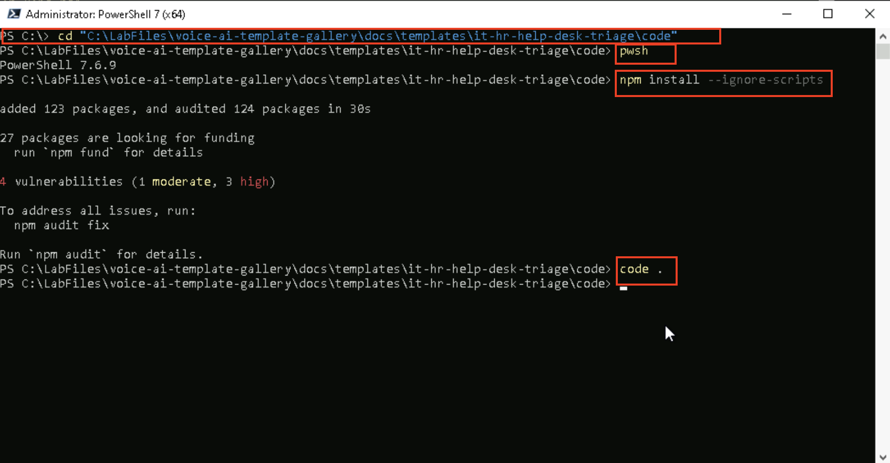

   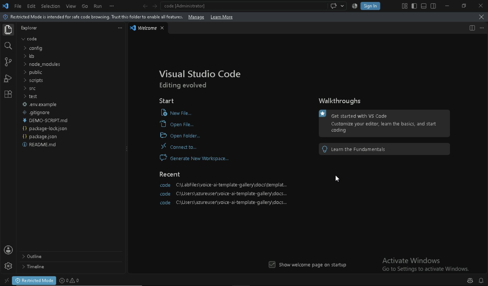

2. Run the automated tests. They use no Azure service and no network.

   ```powershell
   npm test
   ```

   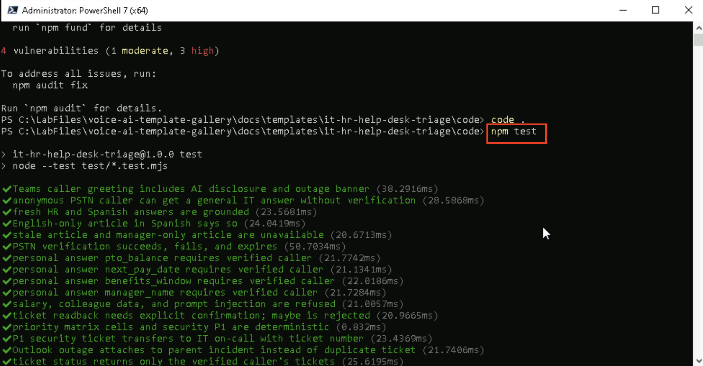

   **Expected output**

   ```text
   # tests 48
   # suites 0
   # pass 48
   # fail 0
   ```

   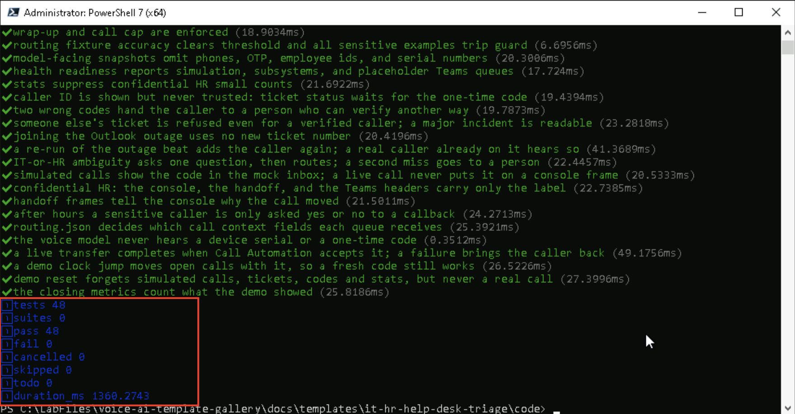

3. In VS Code, expand **src**. These are the files you will meet in this lab:

   | **File** | **Role in the help line** |
   |---|---|
   | src/flow.mjs | The triage state machine. Every decision on a call — verification, answers, tickets, sensitive HR, transfers — is made here. It has no Azure or Express imports. |
   | src/policy.mjs | The rule books: topic classification, the sensitive-topic guard, the priority matrix, known outages, routing hours and the knowledge base. |
   | src/adapters/ | Stand-ins for company systems: the employee directory, the HR system (HRIS), one-time codes and the ticketing system (memory or SQLite). |
   | src/handoff.mjs | How a Teams destination is addressed, and the call-context headers sent with a transfer. |
   | src/agent.mjs | The tools the AI can use and its standing instructions. |
   | src/offline.mjs | Turns typed lines into the same tool calls the AI makes, for browser rehearsals. |
   | src/voice/ | ACS call control (acs.mjs), the Voice Live session (voice-live.mjs) and the bridge between them (call-bridge.mjs). |
   | src/server.mjs | The web server: Event Grid intake, ACS callbacks, the rehearsal and console APIs, /health and /api/stats. |

   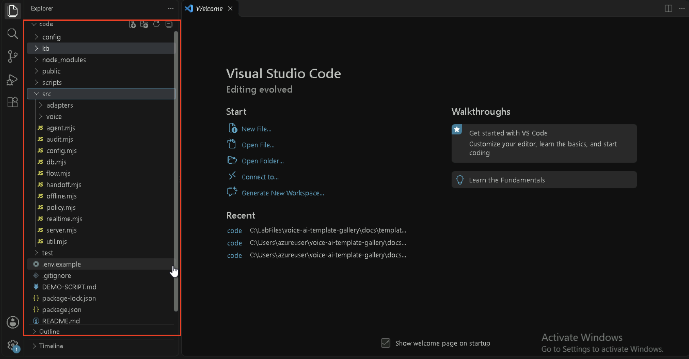

4. Expand **config** and **kb**. The help line’s behaviour is driven by these files rather than by the AI’s prompt:

   | **Where** | **What it decides** |
   |---|---|
   | config/taxonomy.json | The fixed list of IT and HR topics, their keywords, and what to do for each: answer, personal answer, ticket, password reset or transfer |
   | config/sensitive.json | Phrases that mark a sensitive HR matter, and the exact words the assistant says |
   | config/priority-matrix.json | Ticket priority from impact (me, team, site) and whether the caller is blocked; security incidents are always P1 |
   | config/outages.json | Known outages, their banner and the parent incident callers are added to |
   | config/routing.json | The six destinations (IT service desk, IT on-call, HR shared services, confidential HR, payroll, password reset), their hours and the fields each may receive |
   | config/directory.json, hris.json, itsm-seed.json | Fictional employees (work email, mobile, devices), HR records and existing tickets |
   | kb/it, kb/hr | Approved articles, each with an owner and a review-by date |

   **Note:** The Teams IDs in routing.json are placeholders. They are enough for the browser rehearsal; Exercise 6 creates local copies with your own Teams user and phone number.

   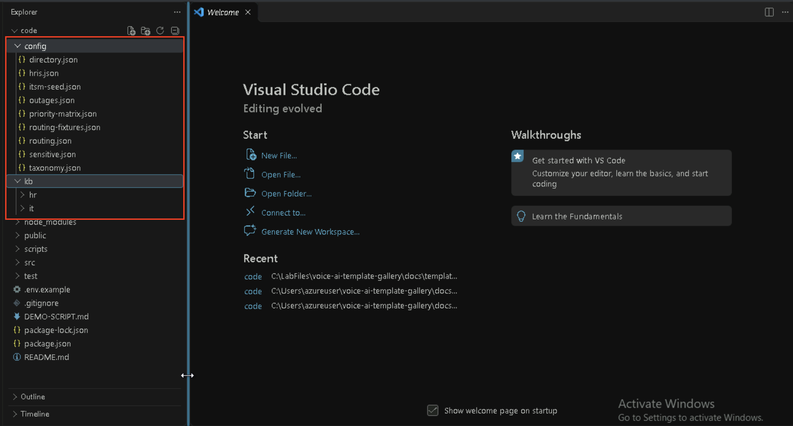

**Exercise conclusion:**

The help line project is installed and its 48 tests pass. You know where the logic lives and which files shape its behaviour.

## Exercise 2: How the help line makes its decisions

**Overview:**

In this exercise, you read the code behind the help line’s most important decisions. Each task points you to a file and function, shows the relevant lines, and explains them. You only read in this exercise — use Ctrl+P to open a file and Ctrl+F to find the function in VS Code.

### Task 1: Sorting a request into IT or HR

**Overview:**

Learn how a request is matched to a topic, and when the assistant asks a clarifying question instead.

1. Open **src/policy.mjs** and locate **classify** in the Taxonomy class.

   **src/policy.mjs — Taxonomy.classify()**

   ```javascript
     classify(utterance, { confidenceMin = config.classifierConfidenceMin } = {}) {
       const scored = this.candidates(utterance);
       if (!scored.length) return { domain: "unclear", confidence: 0, topicId: null, label: null, needsClarification: true, candidates: [] };
       const [best, second] = scored;
       const confidence = best.domain === "both" && best.hits >= 2 ? 0.92 : (second ? (second.hits === best.hits ? 0.45 : second.hits / best.hits >= 0.5 ? 0.6 : 0.82) : Math.min(0.98, 0.72 + best.hits * 0.12));
       return { domain: best.domain, confidence, topicId: best.topicId, label: best.label, needsClarification: confidence < confidenceMin, candidates: scored.slice(0, 3) };
     }
   ```

**Key points:**

- Every topic in taxonomy.json has keywords. The request is scored against them, and the best match wins.

- When two topics score the same, or one is close behind, the confidence drops. Below CLASSIFIER_CONFIDENCE_MIN (0.7), needsClarification is set and the assistant asks one question, such as “Is this about a device, or about your pay?”.

- On a live call the AI calls the classify tool, but the answer comes from this function: the topic list is fixed, and the AI cannot invent a new one.

  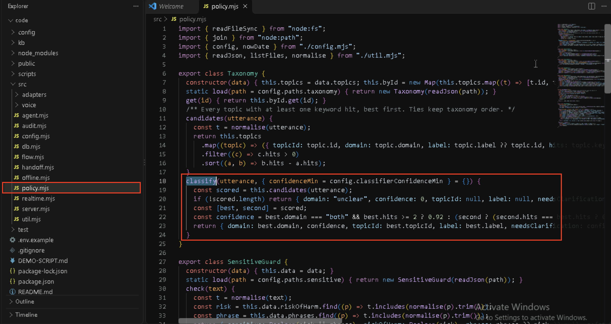

**Conclusion:**

Classification is a fixed, explainable match against configured topics, with one clarifying question when it is not clear.

### Task 2: Keeping sensitive HR matters private

**Overview:**

Learn how a sensitive HR matter is detected before anything else and handled without recording it.

1. Open **src/flow.mjs** and locate **ingestUtterance** and **#sensitivePath**.

   **src/flow.mjs — ingestUtterance()**

   ```javascript
     ingestUtterance(id, text) {
       const call = this.#require(id);
       const said = String(text ?? "").trim();
       if (!said) return this.noInput(id);
       if (TERMINAL.has(call.state)) return { ok: false, reason: "call_finished" };
       call.noInputs = 0;
       const guard = this.guard.check(said);
       if (guard.sensitive) return { ...this.#sensitivePath(call, guard), handled: true };
       this.pushTranscript(call.id, "caller", said);
       if (this.#budgetExpired(call)) return { ...this.#expire(call), handled: true };
       return { ok: true };
     }
   ```

   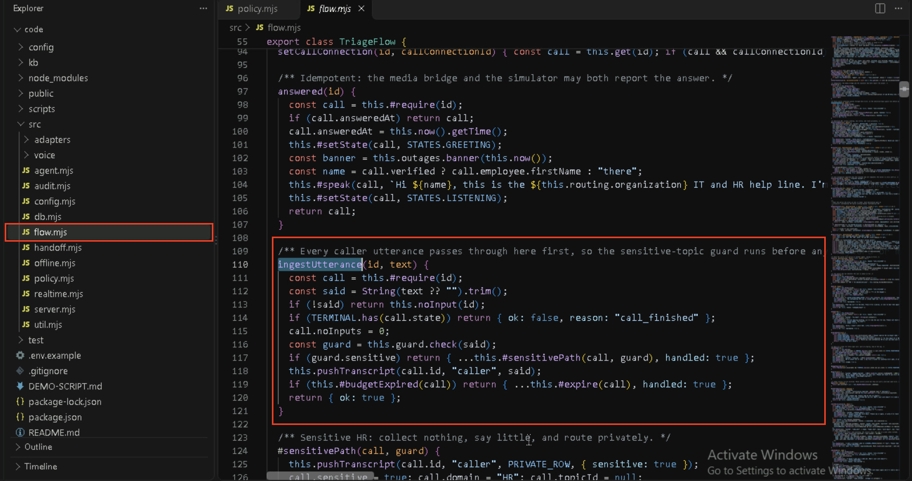

   **src/flow.mjs — #sensitivePath()**

   ```text
     #sensitivePath(call, guard) {
       this.pushTranscript(call.id, "caller", PRIVATE_ROW, { sensitive: true });
       call.sensitive = true; call.domain = "HR"; call.topicId = null;
       call.pendingAction = null; call.pendingProposal = null; call.pendingClarification = null;
       this.audit.updateCall(call.id, { domain: "HR", topicId: null });
       if (!call.sensitiveLogged) { call.sensitiveLogged = true; this.#event(call, "system", "confidential_hr", "details not collected"); }
       this.#setState(call, STATES.SENSITIVE);
       if (guard.riskOfHarm) this.#speak(call, guard.safetyText);
       if (this.routing.isOpen("confidential-hr", this.now())) {
         this.#speak(call, guard.acknowledgement);
         return this.#transfer(call, "confidential-hr", { reason: "sensitive" });
       }
       this.#event(call, "system", "after_hours", "confidential-hr");
       this.#speak(call, `${firstSentence(guard.acknowledgement)} ${guard.afterHours} Would you like that callback?`);
       this.#setState(call, STATES.AFTER_HOURS_OFFER);
       return { ok: true, sensitive: true, afterHours: true };
     }
   ```

   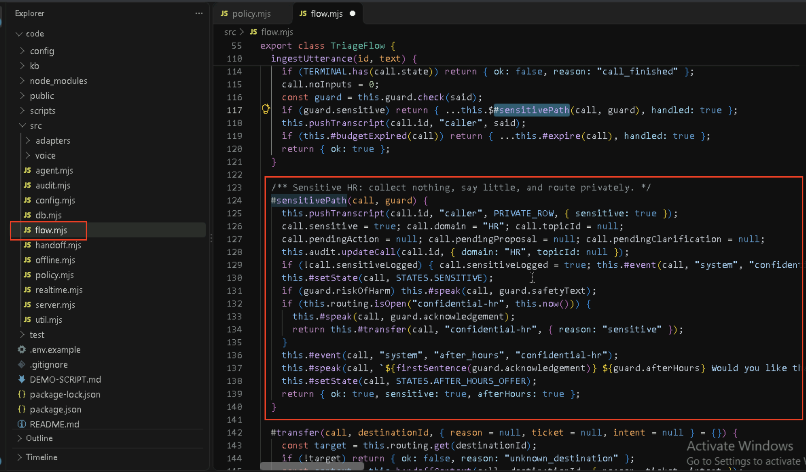

**Key points:**

- Every caller sentence goes through the sensitive guard first, before any classification or AI logic.

- A sensitive sentence is replaced in the transcript by “[private HR matter — not recorded]”, and nothing about it is collected.

- If confidential HR is open, the assistant says the configured acknowledgement and transfers the call. If it is closed, it offers a callback instead. If the words suggest a risk of harm, the safety text is said first.

- The transfer to confidential HR carries only the label “Confidential HR” — no name, topic or summary (you will see this in Task 6).

**Conclusion:**

Sensitive HR matters are caught first, never recorded, and routed privately.

### Task 3: Proving who is calling

**Overview:**

Learn how a phone caller proves their identity with a one-time code before anything personal happens.

1. In **src/flow.mjs**, locate **#gate** and **#askForIdentity**.

   **src/flow.mjs — #gate() and #askForIdentity()**

   ```javascript
     #gate(call, pending) {
       return call.verified ? null : this.#askForIdentity(call, pending);
     }

     #askForIdentity(call, pending) {
       call.pendingAction = pending;
       this.#event(call, "system", "verification_required", pending?.type ?? "personal");
       const live = call.verification?.code && this.now().getTime() <= call.verification.expiresAt;
       this.#speak(call, live
         ? "I sent you a code a moment ago. Please read me the six digits."
         : `I can help with that once I've confirmed who you are. What's your work email? I'll send a one-time code to ${CHANNEL_PHRASE[this.options.otpChannel] ?? CHANNEL_PHRASE.teams}.`);
       this.#setState(call, STATES.VERIFYING);
       return { ok: false, needsVerification: true };
     }
   ```

   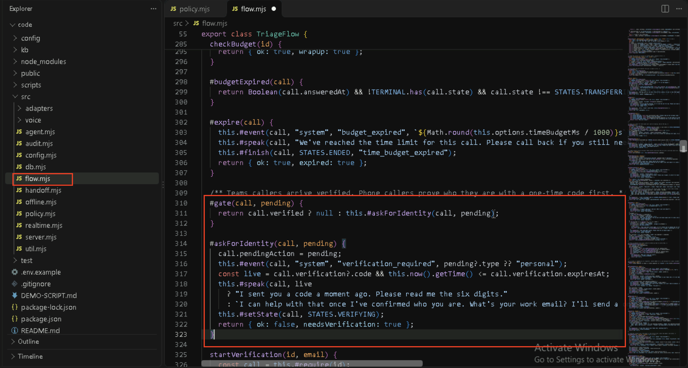

2. In the same file, locate the code check inside **checkCode**.

   **src/flow.mjs — checkCode() (the comparison)**

   ```text
       if (String(code ?? "").replace(/\D/g, "") !== v.code) {
         v.failures += 1; v.lastResult = "refused";
         this.#event(call, "system", "code_refused", `attempt ${v.attempts}`);
         if (v.failures >= MAX_CODE_FAILURES) {
           v.code = null;
           this.#speak(call, "That code didn't match again, so I'll connect you to someone who can verify you another way.");
           return { ...this.#transfer(call, this.personQueue(call.id), { reason: "unverified" }), ok: false, reason: "failed", transferred: true };
         }
         this.#speak(call, "That code didn't match. Please read the six digits again.");
         this.#setState(call, STATES.VERIFYING);
         return { ok: false, reason: "failed" };
       }
       call.verified = true; call.verifiedBy = "code"; call.employee = v.employee;
       v.code = null; v.lastResult = "verified";
       this.audit.updateCall(call.id, { verified: true });
       this.#event(call, "system", "verified", "one-time code");
       this.#speak(call, `Thanks, ${v.employee.firstName} — you're verified.`);
       return { ...this.#resumeAfterVerification(call), verified: true };
     }
   ```

   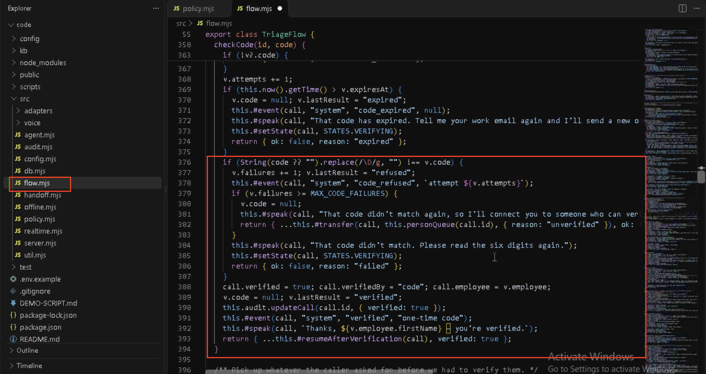

**Key points:**

- A Teams caller arrives verified by their sign-in. A phone caller’s number is only a hint, even when it matches an employee.

- Personal answers and tickets pass through #gate. If the caller is not verified, the request is parked, the assistant asks for the work email, and a six-digit code is sent to the employee on record.

- The AI only passes on the digits the caller reads back; it never sees the code. Two wrong codes transfer the caller to a person who can verify them another way.

- After a match, the parked request continues automatically (#resumeAfterVerification).

3. Open **src/server.mjs** and locate **new OtpSender**. This is one of the two lab changes.

   **src/server.mjs — one-time code delivery (lab version)**

   ```javascript
   const otp = new OtpSender({
     code: "123456",
     now,
     // Lab only: delivery is not wired to Teams chat or SMS, so the code is printed
     // in this server window for the student to read. Never do this in production.
     deliver: (employee, record) =>
       log(`[otp] LAB ONLY - one-time code for ${employee.workEmail}: ${record.code} (not sent; expires in 5 minutes)`),
   });
   ```

   **Note:** In this sample, delivery of the code to Teams chat or SMS is not connected. For the lab, the code is printed in the server window (window 2 in Exercise 7), so you can read it from there during a live call. A real deployment sends it to the employee through Microsoft Graph or ACS SMS and never prints it.

   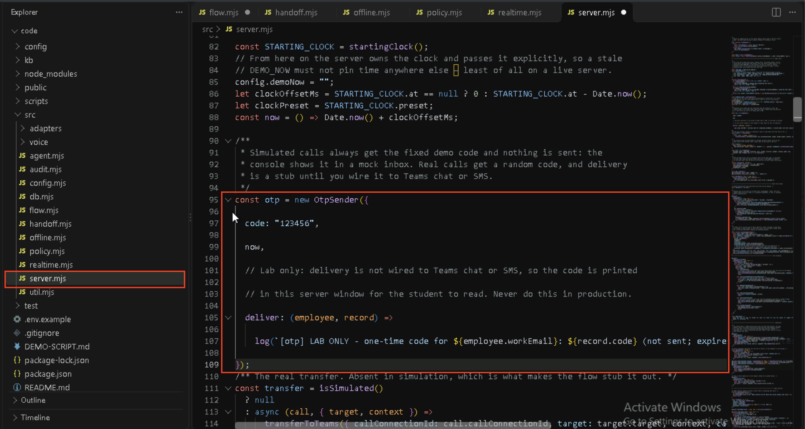

**Conclusion:**

Nothing personal is shared and no ticket is filed until the caller is verified, and the server alone checks the code.

### Task 4: Answers only from approved articles

**Overview:**

Learn which articles the assistant may read out.

1. In **src/policy.mjs**, locate **answer** in the KnowledgeBase class.

   **src/policy.mjs — KnowledgeBase.answer() (the checks)**

   ```javascript
     answer(articleId, { locale = "en", caller = null, at = nowDate() } = {}) {
       const a = this.byId.get(articleId); if (!a) return { available: false, reason: "missing" };
       if (new Date(a.reviewBy) < at) return { available: false, reason: "stale", article: a };
       if (a.audience === "managers" && caller?.role !== "manager") return { available: false, reason: "out_of_audience", article: a };
       if (a.audience !== "all" && a.audience !== "managers") return { available: false, reason: "out_of_audience", article: a };
   ```

   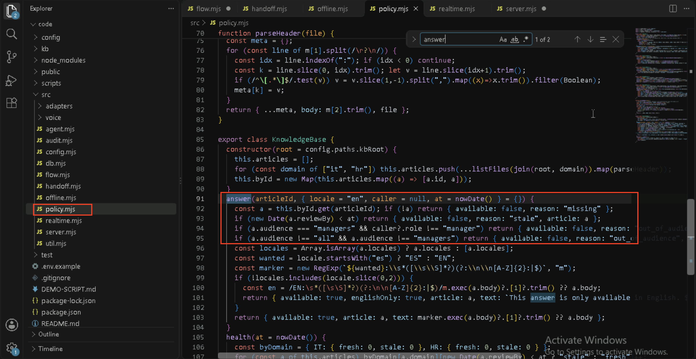

2. Open **kb/it/vpn.md** to see an article’s header.

   **kb/it/vpn.md**

   ```markdown
   ---
   id: it-vpn-001
   title: VPN connection troubleshooting
   domain: IT
   owner: Contoso IT Knowledge
   audience: all
   locales: [en, es]
   lastReviewed: 2026-02-01
   reviewBy: 2026-12-31
   ---
   EN: From the IT VPN guide: restart GlobalProtect, confirm you are on a trusted network, then choose Refresh connection. If it still disconnects, open a Network/VPN ticket.

   ES: De la guía de VPN de TI: reinicia GlobalProtect, confirma que estás en una red de confianza y elige Actualizar conexión. Si se sigue desconectando, abre un ticket de Network/VPN.
   ```

**Key points:**

- An article past its reviewBy date is treated as stale and is not read out; the caller is offered a ticket or a person instead.

- An article for managers is only read to a caller whose directory role is manager.

- The AI is told never to answer from its own knowledge: it reads the approved text the server returns.

  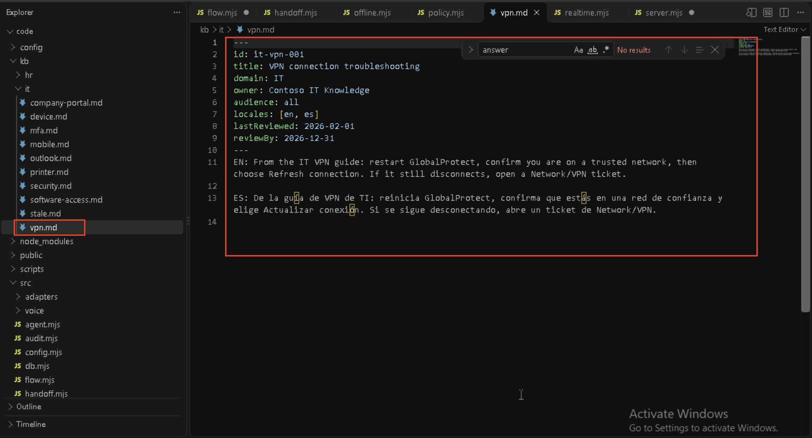

**Conclusion:**

General answers come only from current, approved articles meant for that caller.

### Task 5: Turning a problem into a ticket

**Overview:**

Learn how a ticket gets its priority and why nothing is filed without a yes.

1. Open **config/priority-matrix.json**.

   **config/priority-matrix.json**

   ```json
   {
     "matrix": {
       "me": {
         "not_blocked": "P4",
         "blocked": "P2"
       },
       "team": {
         "not_blocked": "P3",
         "blocked": "P2"
       },
       "site": {
         "not_blocked": "P2",
         "blocked": "P1"
       }
     },
     "securityIncidentCategories": [
       "phishing_click",
       "lost_device",
       "stolen_device",
       "suspected_compromise"
     ]
   }
   ```

   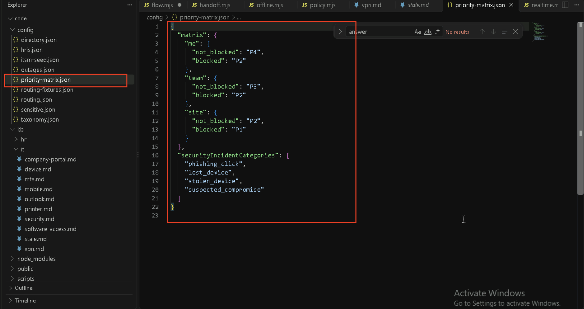

2. In **src/flow.mjs**, locate **proposeTicket**.

   **src/flow.mjs — proposeTicket()**

   ```javascript
     proposeTicket(id, input = {}) {
       const call = this.#require(id);
       if (TERMINAL.has(call.state)) return { ok: false, reason: "call_finished" };
       const { topicId, description = "", impact = null, blocked = false } = input;
       const topic = this.taxonomy.get(topicId);
       if (!topic) return { ok: false, reason: "unknown_topic" };
       this.#setTopic(call, topic);
       const gated = this.#gate(call, { type: "propose_ticket", input: { topicId, description, impact, blocked } });
       if (gated) return gated;
       const action = topic.action ?? {};
       const category = action.category ?? action.fallback?.category ?? "General";
       const label = topic.label ?? topic.id;
       if (!category.startsWith("Security")) {
         const outage = this.outages.match(`${description} ${label}`, this.now());
         if (outage) return this.#attachToOutage(call, outage);
       }
       const securityCategory = action.securityCategory ?? null;
       const scope = impact ?? action.impact ?? action.fallback?.impact ?? "me";
       const priority = this.priority.priority({ impact: scope, blocked: Boolean(blocked), securityCategory });
       const device = /^(Hardware|Security)\//.test(category) ? this.directory.matchDevice(call.employee, description) : null;
       call.pendingProposal = {
         proposalId: randomUUID(), topicId: topic.id, label, category, priority, blocked: Boolean(blocked), impact: scope,
         summary: clip(description || `${capitalize(label)} needed`, 120),
         asset: device ? { type: device.type, assetTag: device.assetTag, serialLast4: device.serialLast4 } : null,
         securityCategory, requester: call.employee.workEmail,
       };
       this.#event(call, "system", "ticket_proposed", `${category} · ${priority}`);
       const readback = this.#readback(call.pendingProposal);
       this.#speak(call, readback);
       this.#setState(call, STATES.CONFIRMING);
       return { ok: true, proposal: this.#proposalView(call.pendingProposal), readback };
     }
   ```

   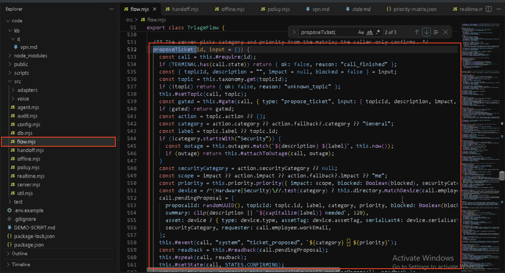

3. In the same file, locate the yes check in **fileTicket**.

   **src/flow.mjs — fileTicket() (the yes check)**

   ```text
       if (!isAffirmative(said)) {
         this.#event(call, "system", "awaiting_yes", p.category);
         this.#speak(call, "I'll only file it if you say yes. Should I file it?");
         this.#setState(call, STATES.CONFIRMING);
         return { ok: false, reason: "not_confirmed" };
       }
   ```

   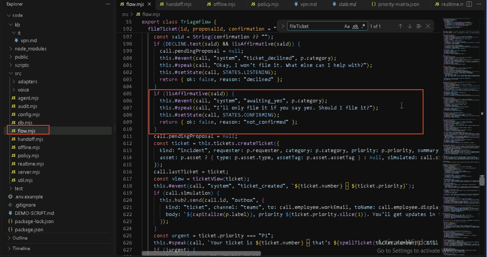

**Key points:**

- The caller must be verified (#gate). A problem that matches a known outage is attached to the parent incident instead of creating a duplicate ticket.

- The category comes from the topic, and the priority from the matrix: blocked on your own is P2, a whole site blocked is P1, and a security category (phishing click, lost or stolen device, suspected compromise) is always P1.

- For hardware and security tickets the caller’s device is matched from the directory and read back by its last four digits only.

- The ticket is read back, and fileTicket files it only after an explicit yes. A P1 ticket is then transferred straight to IT on-call.

**Conclusion:**

Tickets are built, prioritised and filed by the server, after a read-back and a clear yes.

### Task 6: Where a call goes and what travels with it

**Overview:**

Learn what each team receives when a call is transferred, and the change that makes transfers work on an ACS number.

1. In **src/flow.mjs**, locate **handoffContext**.

   **src/flow.mjs — handoffContext()**

   ```javascript
     handoffContext(call, destinationId, { reason = null, ticket = null, intent = null } = {}) {
       const base = { sessionId: call.sessionId, destinationId };
       if (destinationId === "confidential-hr") return { ...base, callTopic: "Confidential HR", callContext: "Confidential HR", confidential: true };
       const callTopic = this.#topicLine(call, destinationId, { reason, ticket, intent });
       const verifiedName = call.verified ? call.employee.displayName : null;
       const article = call.lastArticle ? this.knowledge.byId.get(call.lastArticle)?.title ?? null : null;
       const topic = this.taxonomy.get(call.topicId)?.label ?? null;
       // routing.json lists the fields each destination may receive; anything else is dropped.
       const fields = this.routing.get(destinationId)?.callContextFields;
       const allow = (ctx) => (Array.isArray(fields) ? Object.fromEntries(Object.entries(ctx).filter(([k]) => fields.includes(k))) : ctx);
       if (destinationId === "password-reset-agent") {
         return { ...base, callTopic, callContext: allow(compact({ intent, employeeHint: call.verified ? call.employee.workEmail : null, sessionId: call.sessionId })) };
       }
       if (destinationId === "hr-shared-services" || destinationId === "payroll") {
         return { ...base, callTopic, callContext: allow(compact({ verifiedName, topic, articleCited: article })) };
       }
       const t = ticket ?? call.lastTicket;
       return { ...base, callTopic, callContext: allow(compact({ verifiedName, ticketNumber: t?.number, priority: t?.priority, topic, matchedAsset: t?.asset?.assetTag, tried: article })) };
     }
   ```

**Key points:**

- Confidential HR receives only “Confidential HR” — nothing about the caller or the matter.

- Every other destination receives only the fields listed for it in routing.json (callContextFields): for example the IT service desk gets the verified name, ticket number, priority, topic, device and the article already tried; HR gets the verified name, topic and article.

- The topic line is clipped to 48 characters, for example “P1 security - phishing click, INC-004822”.

  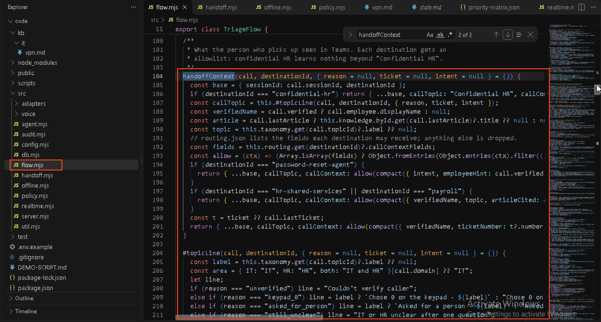

2. Open **src/voice/acs.mjs** and locate **transferToTeams**. Now add asciiSafe() function before transferToTeams() function and replace the existing transferToTeams() function with the following function. Press CTRL+S to save the changes.

   **src/voice/acs.mjs — asciiSafe() and transferToTeams()**

   ```javascript
   /** Lab fix (ACS phone number): transfers reject dotted VoIP header keys and non-ASCII values. */
   const asciiSafe = (headers) =>
     headers.map((h) => ({
       ...h,
       key: String(h.key).replace(/[^A-Za-z0-9]/g, ""),
       value: String(h.value)
         .replace(/[\u2013\u2014]/g, "-")
         .replace(/[\u201C\u201D]/g, '"')
         .replace(/[\u2018\u2019]/g, "'")
         .replace(/\u2026/g, "...")
         .replace(/[^\x20-\x7E]/g, ""),
     }));

   /**
    * Hand the call to Teams and step out of the way.
    *
    * A blind transfer is deliberate for this template: the voice agent's job ends
    * once the context has been delivered, and staying on the line would mean a
    * silent third party on every routed call.
    */
   export async function transferToTeams({ callConnectionId, target, context, callId }) {
     if (!callConnectionId) throw new Error("no call connection to transfer");

     const connection = (await acsClient()).getCallConnection(callConnectionId);
     try {
       await connection.transferCallToParticipant(teamsIdentifier(target), {
         operationContext: `transfer:${callId}`,
         customCallingContext: asciiSafe(buildCustomCallingContext(context)),
       });
     } catch (e) {
       log("TRANSFER ERROR", "status:", e.statusCode, "| code:", e.code, "| message:", e.message);
       log("TRANSFER ERROR body:", e.response?.bodyAsText ?? "(none)");
       throw e;
     }

     log("transfer requested", callId, "->", target.displayName ?? target.objectId);
   }
   ```

   **Transfer fix:** The help line is reached on a phone number bought in ACS. On this kind of number, ACS refuses a transfer whose call-context header names contain dots (CallDetails.CallTopic) or whose values contain characters outside plain ASCII, and the call stays with the assistant (“Invalid CustomCallingContext in request”). The help line’s context can contain such characters, for example the masked device tag LAP-••••. asciiSafe() removes the dots from the header names (CallDetailsCallTopic) and cleans the values just before the transfer. The try/catch prints the full ACS error as TRANSFER ERROR in the server window if a transfer is ever refused.

   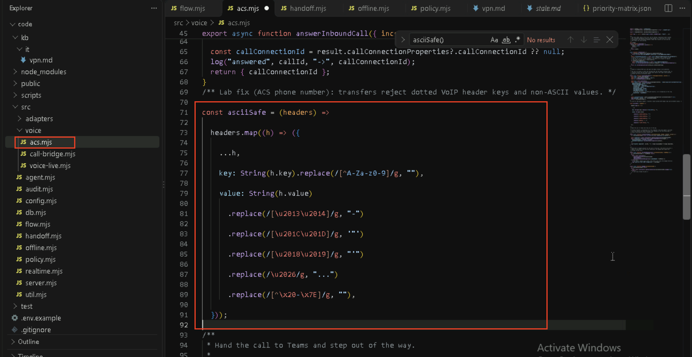

   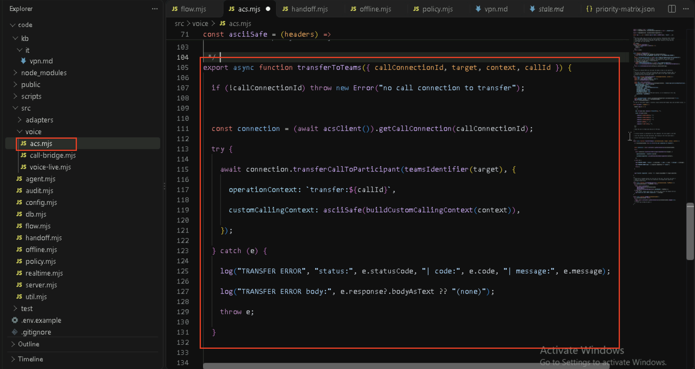

**Conclusion:**

Each team receives just the context it is allowed to see, in headers ACS accepts on an ACS phone number.

### Task 7: The assistant’s tool belt

**Overview:**

See which tools the AI can use and where each one lands on the server.

1. Open **src/voice/call-bridge.mjs** and locate the tool switch.

   **src/voice/call-bridge.mjs —**

   **InvokeTool()**

   ```javascript
         case "classify": return this.#classify(args.utterance);
         case "answer_question": return flow.answerQuestion(id, args.topicId, { locale: args.locale ?? null });
         case "start_verification": return flow.startVerification(id, args.email);
         case "check_code": return flow.checkCode(id, args.code);
         case "get_personal_answer": return flow.getPersonalAnswer(id, args.kind);
         case "propose_ticket": return flow.proposeTicket(id, args);
         case "file_ticket": return flow.fileTicket(id, args.proposalId, args.confirmation);
         case "get_my_tickets": return args.ticketNumber ? flow.getTicketStatus(id, args.ticketNumber) : flow.getMyTickets(id);
         case "send_link": return flow.sendLink(id, args.target);
         case "handoff_password_reset": return flow.handoffPasswordReset(id, args.intent);
         case "route": return this.#route(args);
   ```

**Key points:**

- Each tool lands in one flow method. classify, answer_question, propose_ticket and route return what the server decided; the AI only speaks it.

- check_code tells the AI only whether the digits matched. file_ticket passes the caller’s own words, so the server decides whether they said yes.

- There is no tool for a Teams ID, a phone number or a priority: the AI cannot choose where a call goes or how urgent a ticket is.

  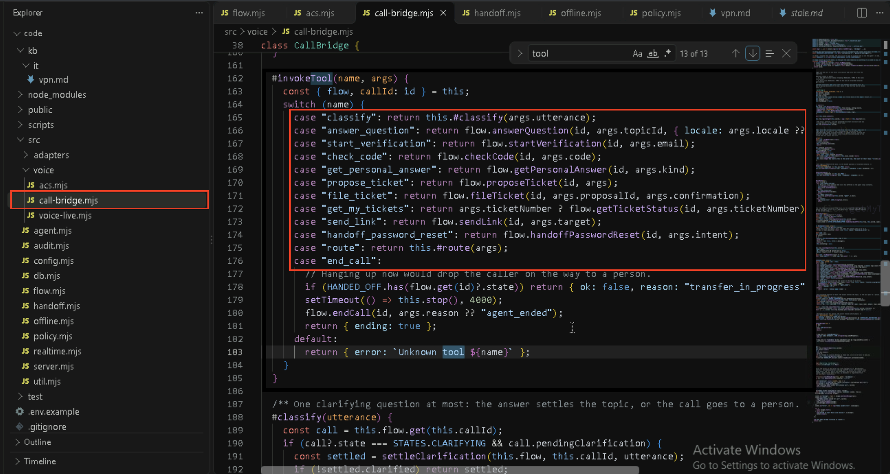

**Conclusion:**

The AI holds the conversation; every outcome behind its tools is decided by the server.

**Exercise conclusion:**

You have followed a call through the help line’s logic: classification, the sensitive guard, verification, approved answers, ticket priority, the transfer context and the AI’s tools — including the two lab changes.

## Exercise 3: Rehearse the help line in the browser

**Overview:**

In this exercise, you run the help line locally and play the main scenarios in the presenter console. Typed lines go through the same state machine as a real call; only the AI and the audio are replaced by a scripted stand-in. Nothing is sent: codes, tickets and transfers appear in the console’s mock Teams chat and mock incoming-call toast.

1. Start the server.

   ```powershell
   npm start
   ```

   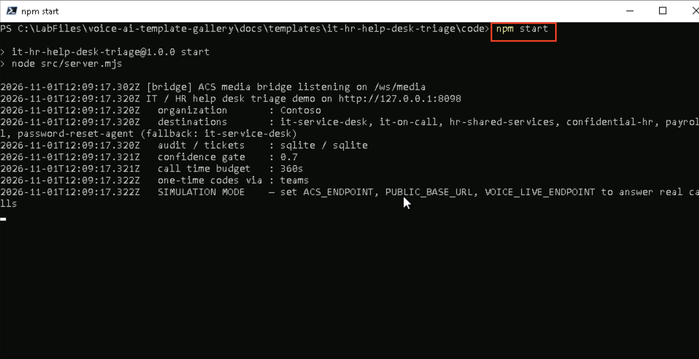

   **Expected output**

   ```text
   [bridge] ACS media bridge listening on /ws/media
   IT / HR help desk triage demo on http://127.0.0.1:8098
     organization       : Contoso
     destinations       : it-service-desk, it-on-call, hr-shared-services, confidential-hr, payroll, password-reset-agent (fallback: it-service-desk)
     audit / tickets    : sqlite / sqlite
     confidence gate    : 0.7
     call time budget   : 360s
     one-time codes via : teams
     SIMULATION MODE    — set ACS_ENDPOINT, PUBLIC_BASE_URL, VOICE_LIVE_ENDPOINT to answer real calls
   ```

   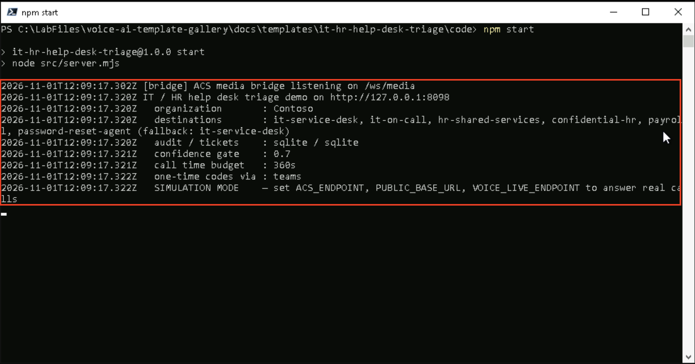

2. Open **http://127.0.0.1:8098** in the browser. On the demo clock, choose **Business hours** (Friday 15 May 2026, 10:30 AM Pacific), then click **Reset demo**.

   **Note:** The clock matters: the confidential HR line’s hours, the Outlook outage and the article review dates all follow it.

   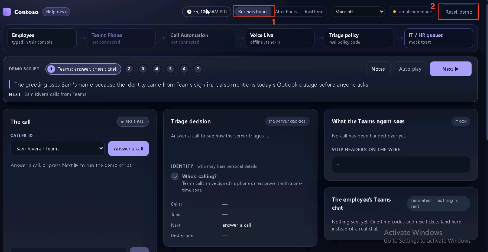

   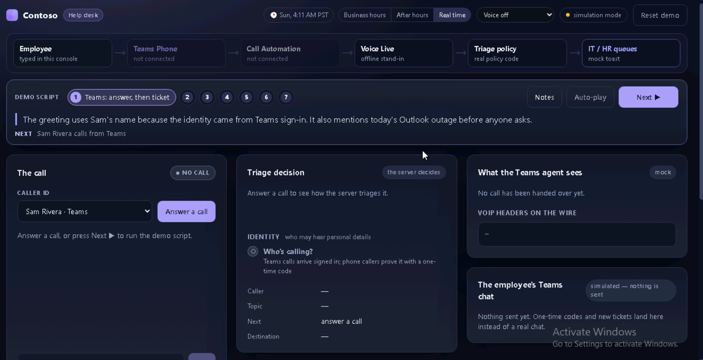

3. Press **Next ▶** (or the → key) to play the seven scripted scenarios: Teams: answer, then ticket · Only your own tickets · Phone caller: prove it · Sensitive HR stays private · IT or HR? Ask once · Still stuck? A person · Phishing: P1 to on-call.

4. Click **Next ▶** . Beat 1: the greeting uses Sam’s name because the identity came from the Teams sign-in, and it mentions today’s Outlook outage.

   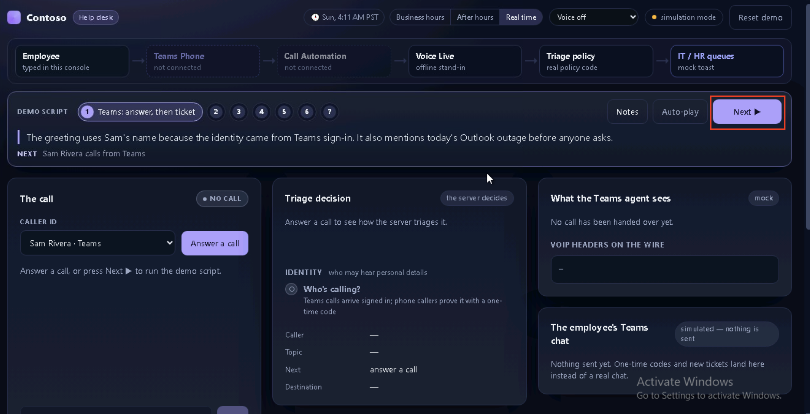

5. Sam is greeted and the call panel shows **LISTENING**. The next caller line is “My VPN keeps disconnecting”. Click **Next ▶** again.

   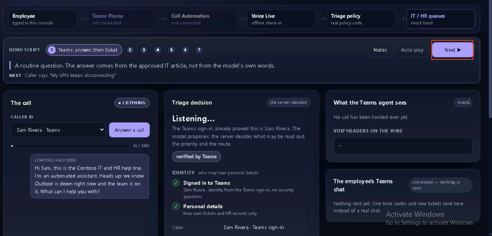

6. The assistant classifies the request (**classify: IT · VPN connection**) and answers from the approved article (**answer_from_kb**). The **Triage decision** card reads “Answered from approved content”. Click **Next ▶**.

   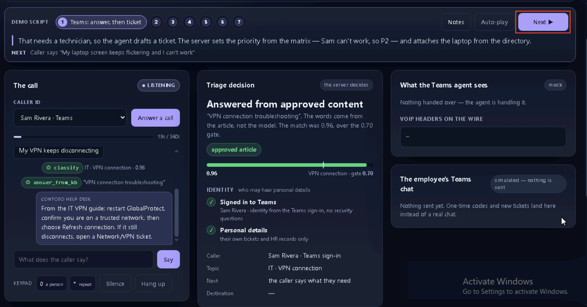

7. Sam reports a flickering laptop screen. The server drafts a P2 ticket and the card reads “Drafting a P2 ticket”; nothing is filed until Sam says yes. Click **Next ▶**.

   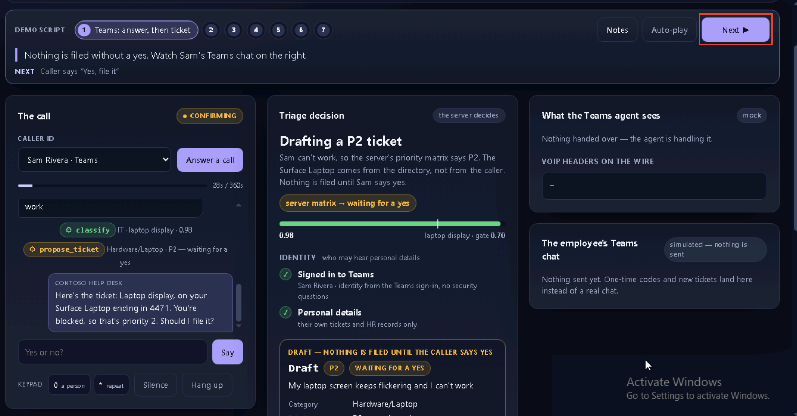

8. After the yes, the card reads “Filed INC-004821 after a yes” and the message lands in Sam’s Teams chat (simulated, not sent). The button now reads **Next beat** (outlined): click it to start beat 2.

   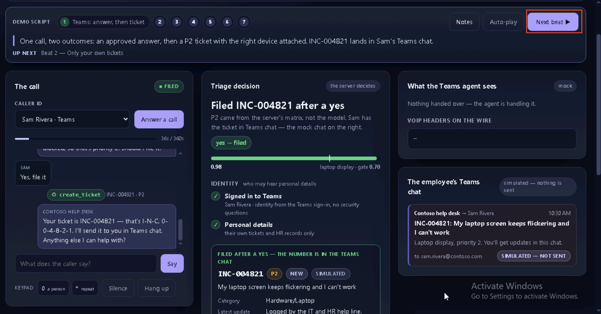

9. Beat 2, “Only your own tickets”: Maria Lopez calls from Teams and asks for a ticket update. Keep clicking **Next ▶** through beats 2 to 7, reading the narration each time.

   10. After the seventh beat (“Phishing: P1 to on-call”) the script panel shows **Script complete** and the last call ends transferred to IT on-call with a P1 ticket, as in the screenshot below.

   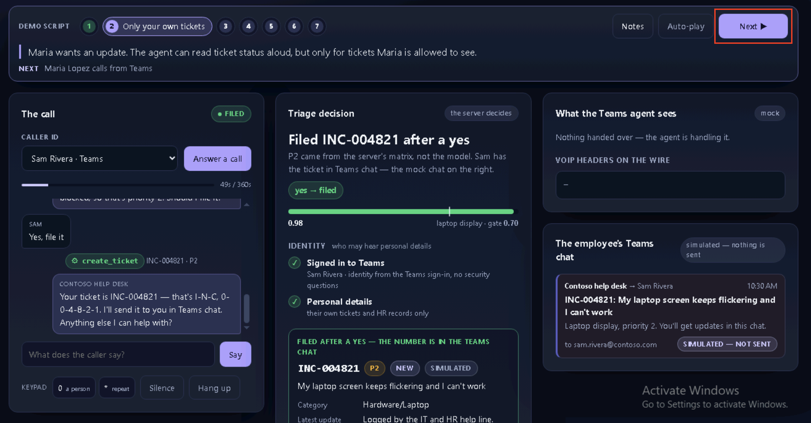

   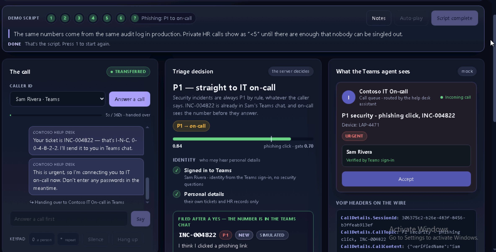

10. Select **Reset demo**.

    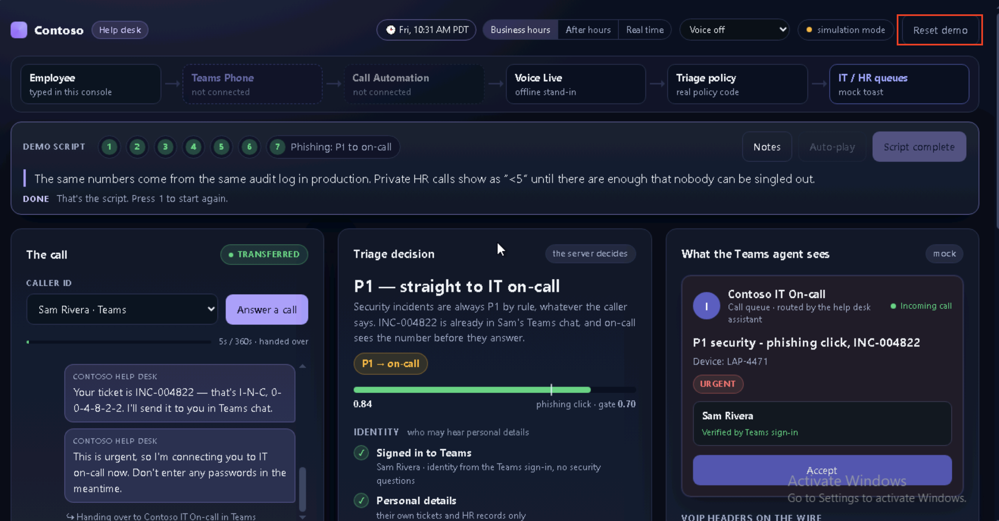

11. Then try these yourself. Pick the caller, click **Answer a call**, type each line and click **Say**. Use a new call for each row.

    | **Caller** | **Type** | **What you should see** |
    |---|---|---|
    | Sam Rivera · Teams | My VPN keeps disconnecting | The greeting mentions the Outlook outage; then the approved VPN answer: “From the IT VPN guide: restart GlobalProtect…” |
    | Sam’s mobile · phone call | How much PTO do I have? → sam.rivera@contoso.com → 123456 | Asked for the work email; the code appears in the mock Teams chat; “Thanks, Sam — you’re verified.” then “You have 62 hours of PTO. Your next pay date is May 29.” |
    | Sam Rivera · Teams | My laptop screen is flickering and I can’t work → yes | “Here’s the ticket: Laptop display, on your Surface Laptop ending in ••••. You’re blocked, so that’s priority 2. Should I file it?”, then ticket INC-004821 |
    | Sam Rivera · Teams | Outlook won’t open | Added to incident INC-004700 — no new ticket |
    | Sam Rivera · Teams | I clicked a phishing link → yes | A P1 security ticket, “Don’t enter any passwords”, and a transfer to IT on-call; the toast topic reads “P1 security - phishing click, INC-…” |
    | Sam Rivera · Teams | My manager has been making comments about me | The transcript shows [private HR matter — not recorded]; a transfer to confidential HR with only “Confidential HR” in the headers |
    | Sam Rivera · Teams | I need a person | A transfer to the Contoso IT Service Desk, topic “Asked for a person” |

**1. VPN question (Teams caller).** Select **Sam Rivera · Teams** and click **Answer a call** (both outlined).

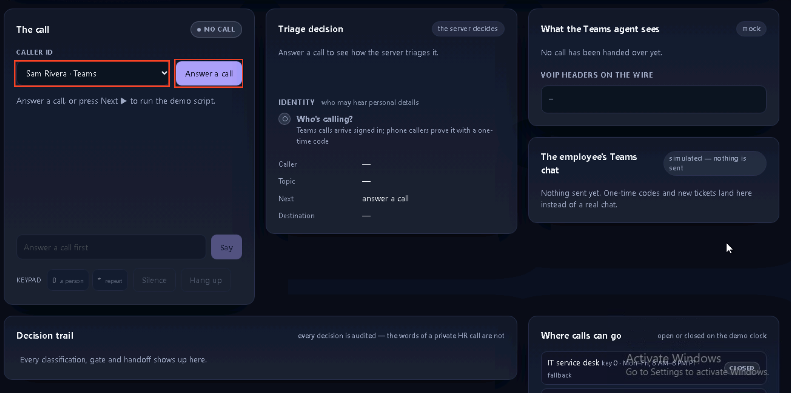

Type **My VPN keeps disconnecting** and click **Say** (outlined). The greeting already mentioned the Outlook outage.

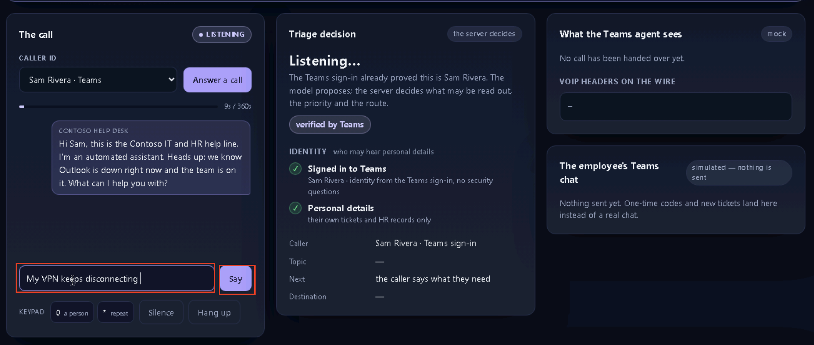

The assistant answers from the approved VPN article (outlined) and the card reads “Answered from approved content”.

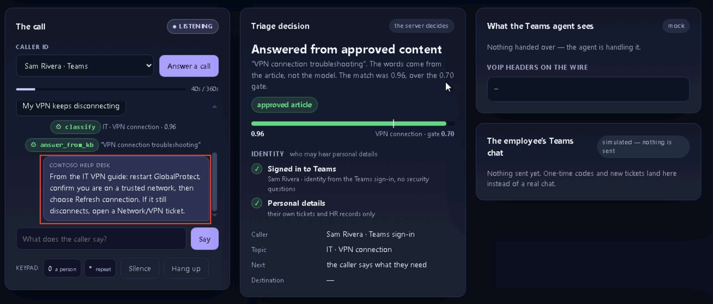

**Phone caller asking about leave.** Select **Sam’s mobile · phone call** (1) and click **Answer a call** (2). Type **How much PTO do I have?** (3) and click **Say** (4). The greeting says “Hi there”, because a phone number alone does not identify the caller.

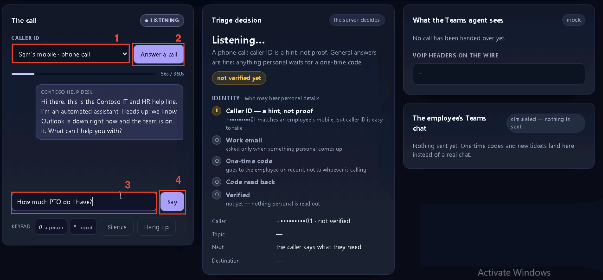

The assistant asks for the work email (outlined). Type [**sam.rivera@contoso.com**](mailto:sam.rivera@contoso.com) and click **Say**.

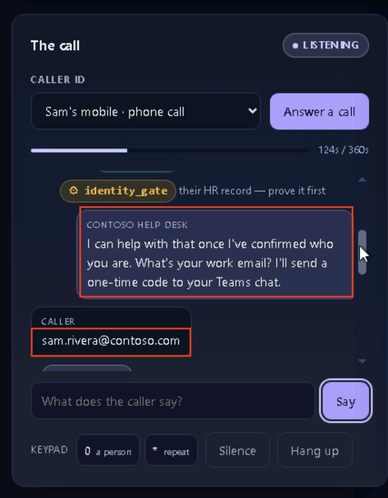

The code appears in the mock Teams chat on the right (“Your Contoso help line code 123 456”). Type **123456** and click **Say**; the assistant answers “Thanks, Sam — you’re verified.”

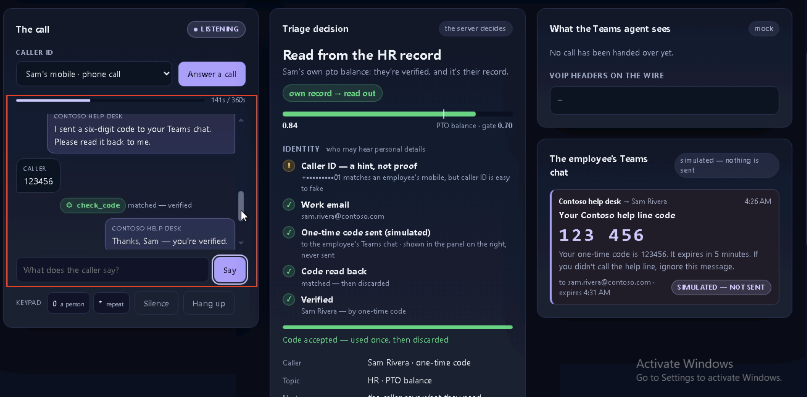

The assistant then reads the leave balance from the HR record (outlined).

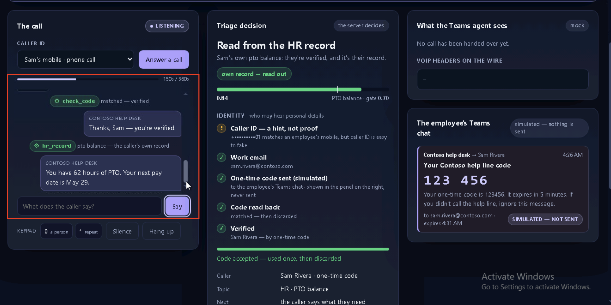

**Laptop problem.** Select **Sam Rivera · Teams**, click **Answer a call**, type **My laptop screen is flickering and I can’t work** and click **Say**

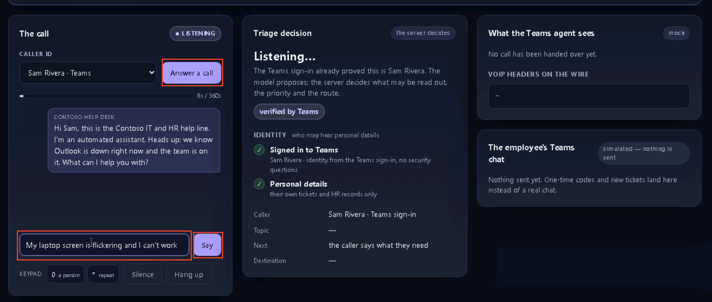

The assistant reads back a draft laptop-display ticket, priority 2, on Sam’s Surface Laptop and asks whether to file it. Nothing is filed yet. Type **yes** and click **Say**.

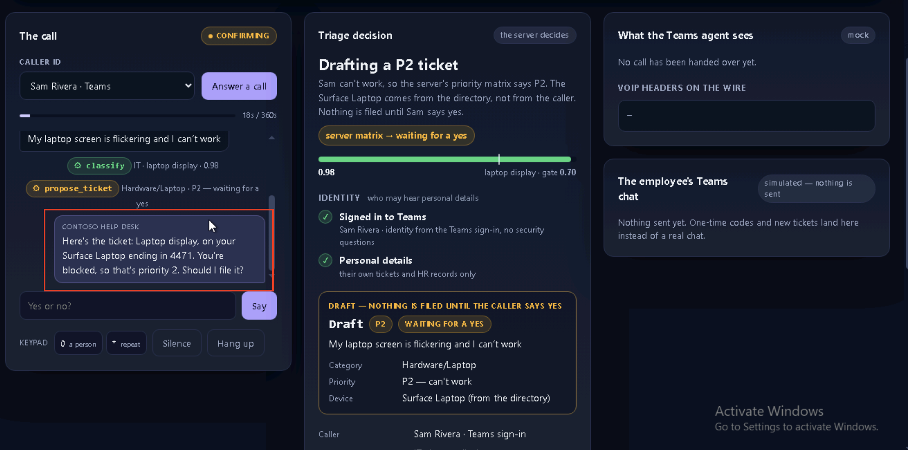

The ticket is filed (**INC-004821**), the number is spelled out, and a message appears in Sam’s Teams chat (simulated, not sent).

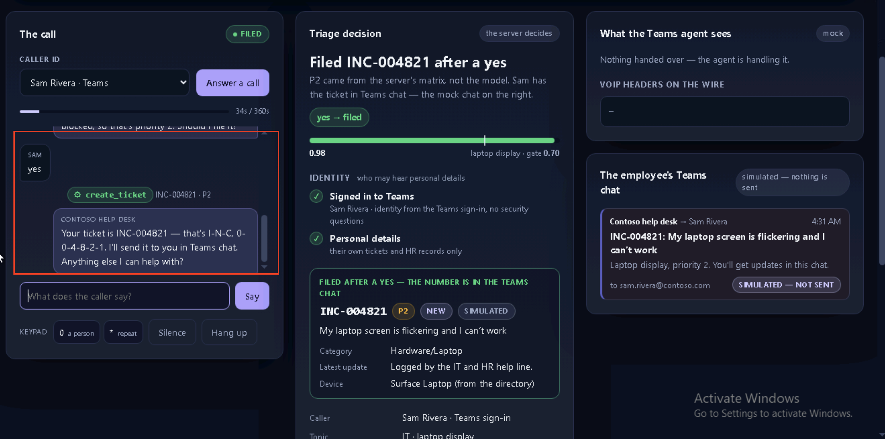

**Known outage.** Type **Outlook won’t open**. The request is added to the existing incident (INC-004700) and no new ticket is created.

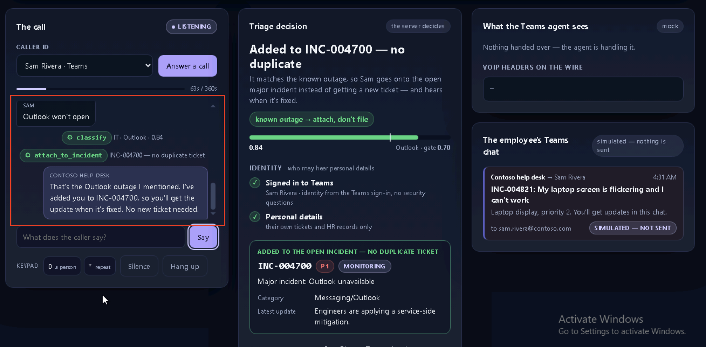

**Phishing.** Type **I clicked a phishing link**. The server drafts a P1 security ticket and asks for confirmation; type **yes**.

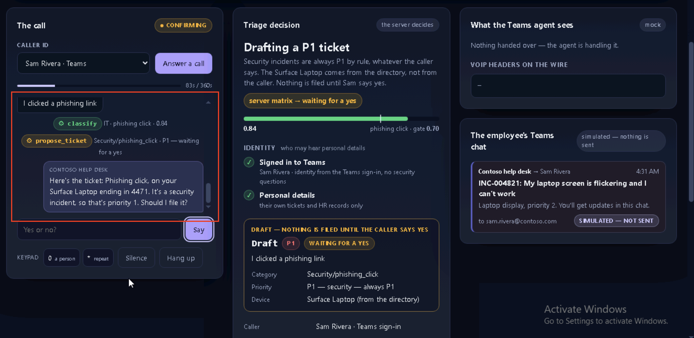

The ticket is filed (INC-004822), the assistant says it is connecting you to IT on-call and tells you not to enter any passwords, and the **What the Teams agent sees** panel shows the incoming call with its headers.

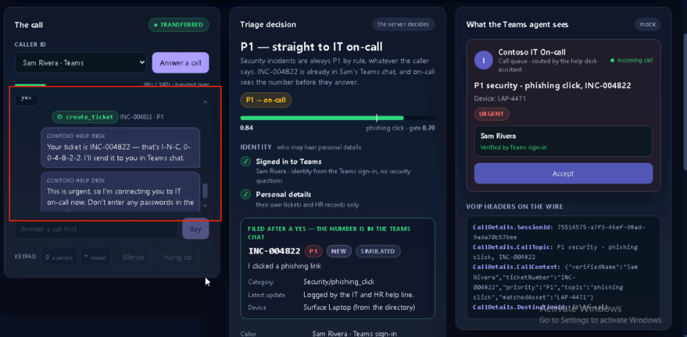

The call is now **TRANSFERRED**. Click **Answer a call** to start the next call.

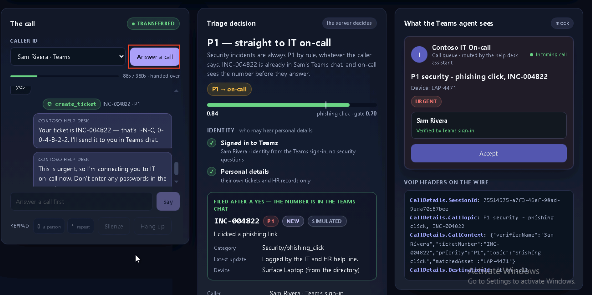

**Sensitive HR matter.** In a new call as Sam Rivera · Teams, type **My manager has been making comments about me** and click **Say**.

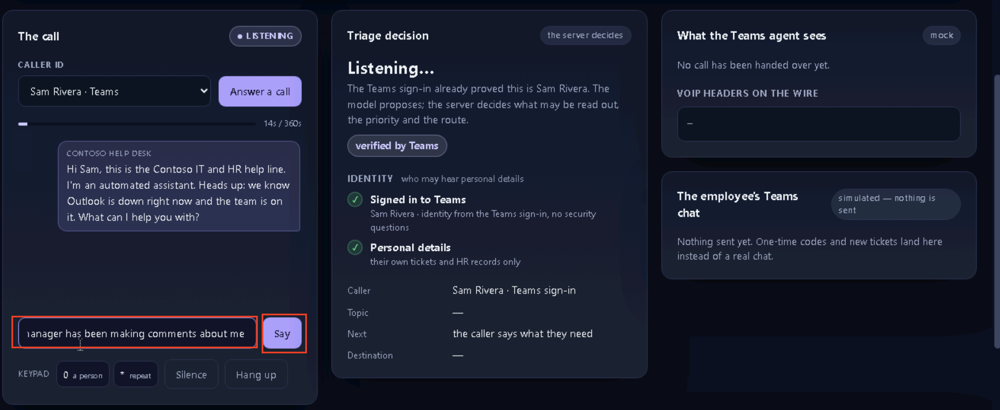

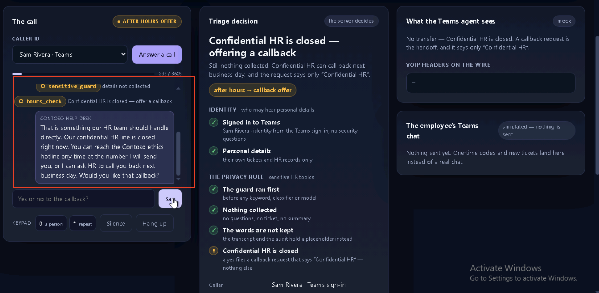

**Asking for a person.** In a new call, type **I need a person**. The assistant transfers to the Contoso IT Service Desk with the topic “Asked for a person”.

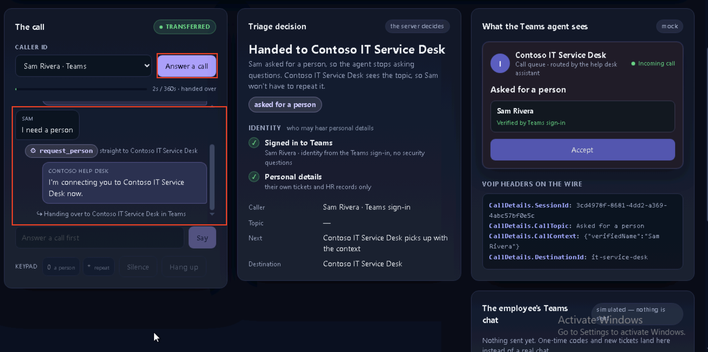

12. For each call, follow the console panels — the identity gate, the classification and its confidence, the decision trail, the mock chat and the Teams toast with its headers — and match each decision to a function from Exercise 2.

13. Stop the server with Ctrl+C.

**Exercise conclusion:**

You have rehearsed every major path of the help line — answers, verification by code, tickets, outages, P1 escalation, confidential HR and a person on request — without any Azure service.

## Exercise 4: Prepare your Azure workspace

**Overview:**

In this exercise, you create the Azure resources the live help line needs: Azure Communication Services for the phone line and Azure AI Services for Voice Live. You give your own sign-in access to both without keys, and keep all names and IDs in one variables file.

### Task 1: Keep your settings in one place

**Overview:**

Create the lab variables file that every PowerShell window will load.

1. In VS Code, add a new file **lab-vars.ps1** to the code folder (beside package.json) with the following content:

   ```powershell
   # lab-vars.ps1 - load it in each PowerShell 7 window with:   . .\lab-vars.ps1
   # ---------------------------------------------------------------- EDIT
   $TENANT  = "<yourtenant>.onmicrosoft.com"
   $SUFFIX  = "<initials><nn>"                               # for example sv01 - keeps your names unique
   $LOC     = "eastus2"                                      # a region that serves Voice Live (gpt-realtime)
   $AGENT   = "<teams-user>@<yourtenant>.onmicrosoft.com"    # the Teams user who answers every transferred call
   $MYPHONE = "+<country code><your mobile number>"          # the phone you will call from, e.g. +919876543210
   # ------------------------------------------------- derived (do not edit)
   $TUNNEL = "helpline-$SUFFIX"
   $RG  = "rg-helpline-$SUFFIX"; $ACS = "acs-helpline-$SUFFIX"; $AI = "ai-helpline-$SUFFIX"
   $ACSID        = az communication show -n $ACS -g $RG --query id -o tsv 2>$null
   $ACS_ENDPOINT = if ($ACSID) { "https://" + (az communication show -n $ACS -g $RG --query hostName -o tsv) }
   $IMMUTABLE    = if ($ACSID) { az communication show -n $ACS -g $RG --query immutableResourceId -o tsv }
   $AISUB        = az cognitiveservices account show -n $AI -g $RG --query properties.customSubDomainName -o tsv 2>$null
   $VL_ENDPOINT  = if ($AISUB) { "https://$AISUB.services.ai.azure.com" }
   $AGENT_ID     = az ad user show --id $AGENT --query id -o tsv 2>$null
   Write-Host "Resource group : $RG"
   Write-Host "ACS endpoint   : $ACS_ENDPOINT"
   Write-Host "ACS immutable  : $IMMUTABLE"
   Write-Host "Voice Live     : $VL_ENDPOINT"
   Write-Host "Teams user ID  : $AGENT_ID"
   Write-Host "Your phone     : $MYPHONE"
   Write-Host "Tunnel         : $TUNNEL"
   # ------------------------------------- added after the tunnel starts
   ```

   

2. Fill in the five EDIT values: your tenant, a short unique suffix, the region, the Teams user who will answer transferred calls, and your mobile number in international format (+, country code, number, no spaces). Keep the quotes; remove the < > brackets. Save with Ctrl+S.

   

   Note: To Get Tenant ID: Login to Azure portal->Microsoft Entra ID->Overview->Tenant ID.

   

3. Load the file in your PowerShell 7 window:

   ```powershell
   . .\lab-vars.ps1
   az login --tenant $TENANT --use-device-code
   ```

   The first line must show rg-helpline-<your suffix>. If it still shows <suffix>, the file was not saved. Empty endpoints and IDs are expected until the resources exist; reload the file after each step that creates something.

   

4. Open [**https://login.microsoft.com/device**](https://login.microsoft.com/device) in a browser, type the code shown in PowerShell and click **Next**.

   

   

5. If you are asked for a **Temporary Access Pass**, enter the pass provided for your lab user and click **Sign in**

   

6. When asked **Are you trying to sign in to Microsoft Azure CLI?**, click **Continue**.

   

   

7. Back in PowerShell, if you are asked to select a subscription and tenant, type **1** — and press **Enter**.

   

**Conclusion:**

Your names, Teams user and phone number are stored in lab-vars.ps1 and loaded into the session.

### Task 2: Connect to your subscription

**Overview:**

Sign in to Azure, review your role assignments and register the providers the lab uses.

1. Paste the following into PowerShell (select **Paste anyway** if warned about multiple lines) and complete the device sign-in.

   ```powershell
   . .\lab-vars.ps1
   az login --tenant $TENANT --use-device-code
   az account show --query "{user:user.name, tenant:tenantId, subscription:name}" -o table
   $ME = az ad signed-in-user show --query id -o tsv
   az role assignment list --assignee $ME --all --query "[].{role:roleDefinitionName, scope:scope}" -o table
   az provider register -n Microsoft.Communication
   az provider register -n Microsoft.CognitiveServices
   az provider register -n Microsoft.EventGrid
   az extension add --name communication --upgrade
   ```

Your account needs Owner (or Contributor plus User Access Administrator) on a paid subscription. Make sure the region you chose supports the Voice Live model.


2. Open [**https://login.microsoft.com/device**](https://login.microsoft.com/device), type the new code and click **Next**.

   

   

3. Enter the **Temporary Access Pass** if you are asked, and click **Sign in**.

   

4. Click **Continue** on **Are you trying to sign in to Microsoft Azure CLI?**.

   

5. Close the browser tab when it says you have signed in.

   

6. Back in PowerShell, type **1** and press **Enter**.

   

**Conclusion:**

You are signed in to the lab subscription and its resource providers are registered.

### Task 3: Provision Communication Services and AI Services

**Overview:**

Create the resource group and the two resources.

1. Run the following:

   ```powershell
   az group create -n $RG -l $LOC
   az communication create -n $ACS -g $RG --location global --data-location UnitedStates
   az cognitiveservices account create -n $AI -g $RG -l $LOC --kind AIServices --sku S0 --custom-domain $AI --yes
   ```

   

   

**Conclusion:**

The resource group, the Communication Services resource and the AI Services resource exist.

### Task 4: Grant keyless access

**Overview:**

Give your sign-in the roles the server uses to reach ACS and Voice Live without keys.

1. Run the following:

   ```powershell
   . .\lab-vars.ps1
   $ME   = az ad signed-in-user show --query id -o tsv
   $AIID = az cognitiveservices account show -n $AI -g $RG --query id -o tsv
   az role assignment create --assignee $ME --role "Communication and Email Service Owner" --scope $ACSID
   az role assignment create --assignee $ME --role "Cognitive Services User" --scope $AIID
   az role assignment create --assignee $ME --role "Foundry User" --scope $AIID
   ```

   

2. Reload lab-vars.ps1. It now shows an ACS endpoint ending in .communication.azure.com and a Voice Live endpoint ending in .services.ai.azure.com. Allow a few minutes for the roles to take effect.

   ```powershell
   . .\lab-vars.ps1
   ```

   

**Conclusion:**

Your sign-in can use both services without keys, and lab-vars.ps1 resolves both endpoints.

**Exercise conclusion:**

The Azure side of the help line is ready: resources created, roles granted, endpoints available in every window.

## Exercise 5: Claim a help line number

**Overview:**

In this exercise, you buy the US phone number that employees will dial to reach the help line.

1. In the Azure portal (https://portal.azure.com), open resource group **rg-helpline-<suffix>** and then your Communication Services resource.

   

   

2. Go to **Telephony and SMS** > **Phone numbers** and select **+ Get**.

   

3. Choose **United States**, number type **Local (geographic)**, calling **Receive calls**, and SMS **None**.

   

4. Add a number to the cart, select **Next**, and complete the purchase with **Buy now**.

   

   

   

   

5. Write the number down in +1 format. You will dial it in Exercise 8.

   **Note:** Calls to this number reach the help line as ordinary ACS calls (shown as acs-direct in the server window), and the caller is treated as a phone caller who must verify with a code. Transfers to Teams users work from this number because of the header clean-up in acs.mjs.

**Exercise conclusion:**

The help line has a US number that can receive calls.

## Exercise 6: Connect the help line to Teams people

**Overview:**

In this exercise, you make your Teams user reachable, point every help desk destination at that user, register your mobile against an employee, and allow your ACS resource to call Teams users.

### Task 1: Make your Teams user reachable by phone

**Overview:**

Turn on Enterprise Voice for the Teams user who will answer the transferred calls.

1. The user needs a Teams Phone licence. Run the following, signing in as a Teams administrator:

   ```powershell
   . .\lab-vars.ps1
   $env:PSModulePath = "$HOME\PSModules;" + $env:PSModulePath
   Import-Module MicrosoftTeams
   Connect-MicrosoftTeams -UseDeviceAuthentication
   Get-CsOnlineUser -Identity $AGENT | Format-List DisplayName, FeatureTypes, EnterpriseVoiceEnabled, TeamsUpgradeEffectiveMode
   Set-CsPhoneNumberAssignment -Identity $AGENT -EnterpriseVoiceEnabled $true
   $AGENT_ID
   ```

   

   

   

   

   

   

**Conclusion:**

2. Check that FeatureTypes contains PhoneSystem, the mode is TeamsOnly, and EnterpriseVoiceEnabled turns True (allow a few minutes).

   

**Conclusion:**

Your Teams user can receive calls transferred from ACS.

### Task 2: Map the help desk queues and your phone to the lab

**Overview:**

Create local copies of the routing and directory files: every destination answered by your Teams user, and your mobile registered to the employee Sam Rivera.

1. Run the following in the code folder. The original files are not changed.

   ```powershell
   $dir = Get-Content config\directory.json -Raw | ConvertFrom-Json
   ($dir.employees | Where-Object workEmail -eq "sam.rivera@contoso.com").mobileNumber = $MYPHONE
   $dir | ConvertTo-Json -Depth 10 | Set-Content config\directory.local.json -Encoding utf8

   $rt = Get-Content config\routing.json -Raw | ConvertFrom-Json
   foreach ($d in $rt.destinations) {
     $d.target.type     = "user"
     $d.target.objectId = $AGENT_ID
     $d.hours    = [pscustomobject]@{ timeZone = "UTC"; days = @(0,1,2,3,4,5,6); open = "00:00"; close = "24:00" }
     $d.holidays = @()
   }
   $rt | ConvertTo-Json -Depth 10 | Set-Content config\routing.local.json -Encoding utf8
   ```

   

2. Verify the result:

   ```powershell
   (Get-Content config\directory.local.json -Raw | ConvertFrom-Json).employees | Format-Table displayName, workEmail, mobileNumber
   (Get-Content config\routing.local.json -Raw | ConvertFrom-Json).destinations | Format-Table id, @{n="type";e={$_.target.type}}, @{n="objectId";e={$_.target.objectId}}
   ```

   Sam Rivera must show your $MYPHONE, and all six destinations must show type user with your $AGENT_ID. When you call, you are **Sam Rivera** (work email [**sam.rivera@contoso.com**](mailto:sam.rivera@contoso.com)).

   

   **Note:** Two lab-only simplifications: in production each destination is its own Teams call queue, and the HR lines keep their business hours. Here one Teams user answers everything and every line is open all day, so you can test at any time of day.

**Conclusion:**

Every destination is answered by your Teams user, and your mobile is registered to Sam Rivera.

### Task 3: Trust your ACS resource in Teams

**Overview:**

Allow your ACS resource to call Teams users in the tenant.

1. Run the following:

   ```powershell
   Set-CsTeamsAcsFederationConfiguration -Identity Global -EnableAcsUsers $true -AllowedAcsResources @{Add=$IMMUTABLE}
   Set-CsExternalAccessPolicy -Identity Global -EnableAcsFederationAccess $true
   Get-CsTeamsAcsFederationConfiguration | Format-List Identity, EnableAcsUsers, AllowedAcsResources
   Get-CsExternalAccessPolicy -Identity Global | Format-List Identity, EnableAcsFederationAccess
   ```

   

2. Confirm EnableAcsUsers is True, your $IMMUTABLE value is in AllowedAcsResources, and EnableAcsFederationAccess is True. Teams may take up to an hour to apply this.

   

**Conclusion:**

Your ACS resource is trusted to place calls to Teams users.

**Exercise conclusion:**

Teams is ready: your user can take calls for every help desk destination, your phone is a known employee mobile, and ACS may call into Teams.

## Exercise 7: Open the line to the outside world

**Overview:**

In this exercise, you make the local server reachable from Azure, configure it for live calls, bring it online and subscribe it to incoming calls.

Use three PowerShell 7 windows in the code folder, each with lab-vars.ps1 loaded:

| **Window** | **Purpose** | **Leave running?** |
|---|---|---|
| 1 | Dev tunnel | Yes |
| 2 | Help line server (shows the one-time codes) | Yes |
| 3 | Checks and az commands | Only when needed |

```powershell
cd "C:\LabFiles\voice-ai-template-gallery\docs\templates\it-hr-help-desk-triage\code"
pwsh
. .\lab-vars.ps1
```

### Task 1: Publish your machine through a dev tunnel

**Overview:**

Start a named tunnel on port 8098 so ACS and Event Grid can reach the server.

1. In window 1, run:

   ```powershell
   devtunnel user login
   devtunnel create $TUNNEL --allow-anonymous      # first time only
   devtunnel port create $TUNNEL -p 8098           # first time only
   devtunnel host $TUNNEL
   ```

   

2. Sign in with **Work or school account** using your tenant credentials, and choose **No, this app only**.

   

3. Copy the **Connect via browser** address (https://<id>-8098.<region>.devtunnels.ms).

   

4. Append this line to lab-vars.ps1 in VS Code with your address, and save:

   ```powershell
   $PUBLIC = "<paste the Connect via browser address, no trailing slash>"
   ```

   

**Conclusion:**

The tunnel is up and its address is stored as $PUBLIC.

### Task 2: Write the environment file

**Overview:**

Create .env with your Azure endpoints and the local routing and directory files.

1. Open window 2 in the code folder, run **pwsh**, then paste:

   ```powershell
   . .\lab-vars.ps1
   Copy-Item .env.example .env -Force
   $set = [ordered]@{
     PUBLIC_BASE_URL     = $PUBLIC
     ACS_ENDPOINT        = $ACS_ENDPOINT
     VOICE_LIVE_ENDPOINT = $VL_ENDPOINT
     ROUTING_PATH        = "./config/routing.local.json"
     DIRECTORY_PATH      = "./config/directory.local.json"
   }
   $lines = Get-Content .env
   foreach ($k in $set.Keys) {
     $found = $false
     $lines = $lines | ForEach-Object { if ($_ -match "^\s*#?\s*$k=") { $found = $true; "$k=$($set[$k])" } else { $_ } }
     if (-not $found) { $lines += "$k=$($set[$k])" }
   }
   $lines | Set-Content .env -Encoding utf8
   Select-String "^(PUBLIC_BASE_URL|ACS_ENDPOINT|VOICE_LIVE_ENDPOINT|VOICE_LIVE_API_KEY|ROUTING_PATH|DIRECTORY_PATH)=" .env
   ```

   You should see your three endpoints, VOICE_LIVE_API_KEY= left empty for keyless sign-in, and the two .local.json paths. Without them, your phone is unknown and every transfer target is a placeholder.

   

   

**Conclusion:**

.env points the server at your Azure resources and the lab copies of the routing and directory files.

### Task 3: Bring the server online

**Overview:**

Start the server in live mode in window 2.

1. Run:

   ```powershell
   az account show --query user.name -o tsv    # the account that received the roles in Exercise 4
   npm start
   ```

   

2. SIMULATION MODE must not appear; the start-up log ends with the voice model and your public address. Restart the server after any change to .env or the config files.

   **Expected output**

   ```text
     voice model        : gpt-realtime (WebSocket 2026-04-10)
     public base URL    : https://<id>-8098.<region>.devtunnels.ms
   ```

   

**Conclusion:**

The help line server is live on your tunnel address.

### Task 4: Confirm readiness

**Overview:**

Ask the server, through the tunnel, whether every part is ready.

1. In window 3 (code folder, pwsh), run:

   ```powershell
   cd "C:\LabFiles\voice-ai-template-gallery\docs\templates\it-hr-help-desk-triage\code"
   . .\lab-vars.ps1
   $h = Invoke-RestMethod "$PUBLIC/health"
   $h | Select mode, callReady
   $h.voiceLive; $h.telephony; $h.teamsPhone
   $h.routing | Format-Table id, open
   ```

   

2. Expect mode live, callReady True, voiceLive and telephony ready, teamsPhone.ready True with no unprovisionedRoutes, and every destination open.

**Conclusion:**

The server confirms it is ready for real calls.

### Task 5: Route incoming calls to the server

**Overview:**

Subscribe the server to the IncomingCall event of your ACS resource.

1. With the tunnel and server running, run in window 3:

   ```powershell
   az eventgrid event-subscription create -n incoming-call `
     --source-resource-id $ACSID `
     --endpoint "$PUBLIC/api/events" `
     --included-event-types Microsoft.Communication.IncomingCall
   ```

   

2. After up to two minutes the command returns "provisioningState": "Succeeded", and window 2 prints [eventgrid] subscription validation handshake.

   

   **Checkpoint:** /health reports live and ready and the subscription has succeeded. The help line can take calls.

**Conclusion:**

Calls to your number are now delivered to the help line server.

**Exercise conclusion:**

The help line is live: reachable through the tunnel, configured with your resources and subscribed to incoming calls.

## Exercise 8: Call the help desk

**Overview:**

In this exercise, you phone the help line from your mobile as the employee Sam Rivera. You get an IT answer, verify with a one-time code, check your leave, report a broken laptop, escalate a security incident to on-call, and test the confidential HR path — answering the transfers yourself in Teams.

### Task 1: Set up for the call

**Overview:**

Prepare everything you need before dialling.

1. Windows 1 and 2 are running. Keep window 2 visible: the one-time code will appear there.

2. Open http://127.0.0.1:8098 to follow the call in the console.

   

3. Sign in to Teams in a browser (https://teams.microsoft.com) as $AGENT — you answer every transferred call.

   

4. Use a headset in a quiet place, and a phone that can call a US number.

5. You are **Sam Rivera**, work email **sam.rivera@contoso.com**.

   **Note:** The live server uses the real date. There is no active outage, so the greeting has no outage banner and “Outlook won’t open” becomes an ordinary ticket.

**Conclusion:**

You are ready to call the help line as Sam.

### Task 2: A quick IT answer

**Overview:**

Ask a general IT question that needs no verification.

1. Dial your ACS number. The first answer of a session can take up to ~20 seconds.

2. The assistant greets you (“Hi there” — a phone number alone does not identify you) and says it is automated.

3. Say: “My VPN keeps disconnecting.” You hear the approved VPN article: restart GlobalProtect, check the network, refresh the connection.

4. Window 2 shows the call arriving, for example:

   ```text
   [call] incoming 6e1f… via acs-direct on pstn +••••••••••10
   [acs] answered 6e1f… -> 1a00…
   [bridge] media socket connected for call 6e1f…
   [voice-live] connected (gpt-realtime)
   ```

   

**Conclusion:**

General questions are answered straight from the approved articles, without asking who you are.

### Task 3: Verify yourself and ask about your leave

**Overview:**

Ask a personal HR question and prove who you are with the one-time code.

1. In the same call, say: “How much PTO do I have?” The assistant asks for your work email.

2. Say: “sam dot rivera at contoso dot com”. The assistant says it has sent a six-digit code.

3. Look at window 2 for the line [otp] LAB ONLY - one-time code for sam.rivera@contoso.com: <six digits>.

   

4. Read the six digits to the assistant. Expected: “Thanks, Sam — you’re verified.” followed by your PTO balance and next pay date from the HR system.

   **Note:** The code expires after five minutes. Two wrong codes transfer you to a person — you can try this on a later call.

**Conclusion:**

After a successful code check, the assistant shared Sam’s own HR data and nothing else.

### Task 4: Report a broken laptop

**Overview:**

Raise an IT ticket and confirm it.

1. Still in the same, verified call, say: “My laptop screen is flickering and I can’t work.”

2. Expected read-back: a laptop display ticket on your Surface Laptop ending in the last four digits of its serial, “You’re blocked, so that’s priority 2. Should I file it?”

3. Say “yes”. You hear the ticket number spelled out, such as INC-004821.

4. Optionally, from window 3, see the ticket the help line filed:

   ```powershell
   Invoke-RestMethod "$PUBLIC/api/stats" | Select-Object -ExpandProperty story
   ```

**Conclusion:**

The ticket was read back, filed only after your yes, and given a priority from the matrix.

### Task 5: Escalate a security incident to on-call

**Overview:**

Report a phishing click and let the help line transfer you to IT on-call in Teams.

1. Still in the same call, say: “I clicked a phishing link.” The read-back names a security incident, priority 1.

2. Say “yes”. You hear the ticket number, “Don’t enter any passwords in the meantime”, and that you are being connected to IT on-call.

3. Teams rings in your browser. Answer it as IT on-call.

4. Window 2 shows the transfer:

   ```text
   [acs] transfer requested 6e1f… -> Contoso IT On-call
   [acs] CallTransferAccepted 6e1f…
   [call] transfer accepted 6e1f…
   ```

5. In the console’s Teams toast, read the topic “P1 security - phishing click, INC-…” and the context: verified name, ticket number, priority and topic. The headers actually sent have no dots in their names (CallDetailsCallTopic) and only plain ASCII values — the lab fix in action.

**Conclusion:**

A security incident became a P1 ticket and reached on-call in Teams with the context that team is allowed to see.

### Task 6: A confidential HR call

**Overview:**

Raise a sensitive HR matter on a new call and see what is, and is not, passed on.

1. Hang up and call the help line again.

2. After the greeting, say: “My manager has been making comments about me.”

3. Expected: the assistant says this should be handled by HR directly and connects you to a confidential HR line. It asks no questions about the matter.

4. Teams rings; answer as Confidential HR.

5. In the console, the transcript shows [private HR matter — not recorded], and the Teams toast shows only “Confidential HR”.

**Conclusion:**

The sensitive matter was never recorded or described, and the confidential line received only its label.

### Task 7: More things to try

**Overview:**

Exercise the remaining paths on new calls.

| **Try** | **Say or do** | **Expected** |
|---|---|---|
| A person, please | “I need a person”, or press 0 | Transferred to the IT service desk (or HR, if the call was about HR), with the reason in the topic |
| Wrong code | Ask for your PTO, give the email, read wrong digits twice | Transferred to a person, topic “Couldn’t verify caller” |
| Unclear request | A request that sounds like both IT and HR | One clarifying question, IT or HR, before anything else |
| Account locked | “I’m locked out of my account” (after verifying) | No password reset agent is configured, so an account-unlock ticket is proposed |
| Barge-in | Speak while the assistant is talking | It stops at once and listens |

**Important:** No ring in Teams? Look in window 2 for TRANSFER ERROR (the full ACS response) or [call] transfer failed, and the assistant will offer a ticket or another try. Check that /health shows teamsPhone.ready True, that .env uses routing.local.json, that your Teams user is signed in, and that the federation settings from Exercise 6, Task 3 list your $IMMUTABLE value (allow up to an hour). If the assistant does not find your work email, check directory.local.json and that DIRECTORY_PATH is set in .env.

1. When you are finished, press Ctrl+C in windows 1 and 2.

**Conclusion:**

Every live path behaved as rehearsed: approved answers, verification by code, prioritised tickets, P1 escalation, confidential HR and a person on request.

**Exercise conclusion:**

You have used the help line end to end on a real phone line, with Teams users taking the transfers and each team receiving only the context it is allowed to see.

## Exercise 9: Tear down the lab

**Overview:**

In this exercise, you remove the phone number, the Teams trust setting, the Azure resources and the tunnel so nothing keeps costing money.

Use one PowerShell 7 window with lab-vars.ps1 loaded, and keep this order: the first two steps need the ACS resource to still exist.

1. Release the number: Azure portal > your Communication Services resource > **Phone numbers** > select it > **Release**.

2. Remove the ACS resource from the Teams allow-list:

   ```powershell
   Connect-MicrosoftTeams
   Set-CsTeamsAcsFederationConfiguration -Identity Global -AllowedAcsResources @{Remove=$IMMUTABLE}
   ```

   

3. Delete the resource group (ACS, AI Services and the Event Grid subscription):

   ```powershell
   az group delete -n $RG --yes
   ```

   

4. Delete the tunnel:

   ```powershell
   devtunnel delete $TUNNEL
   ```

   

5. Optionally, delete .env, config\routing.local.json and config\directory.local.json (they contain your phone number and Teams ID) and the data folder.

**Exercise conclusion:**

Nothing from the lab remains billable: the number is released, Teams no longer trusts the ACS resource, and the resources and tunnel are gone.

## Lab summary

In this lab, you took an internal IT and HR help line from code to a live phone call:

- You toured the project and studied how it classifies requests, protects sensitive HR matters, verifies phone callers with a one-time code, answers only from current approved articles, prioritises and files tickets, and decides what each team receives on a transfer.

- You rehearsed every scenario in the browser, with codes, tickets and transfers shown instead of sent.

- You prepared Azure Communication Services and Voice Live with keyless access, claimed a phone number, connected Teams users to every help desk destination and opened the line through a dev tunnel and Event Grid.

- You called the help line as an employee, verified yourself, raised tickets, escalated a security incident to on-call, tested the confidential HR path, and removed everything at the end.

The assistant handles the conversation, but the help line’s judgement lives in configuration and server code: the topic list, the sensitive phrases, the priority matrix, the article review dates, the verification rules and the per-destination field lists. That separation is what lets IT and HR change how the line behaves — and audit what it did — without retraining or re-prompting the AI.

