# Lab 2 - Build an after-hours sales lead capture voice agent with Azure Communication Services, Voice Live API and Microsoft Teams

**Objective:**

In this lab, you will run and explore a working AI phone assistant that answers a sales line when the sales team has gone home. It qualifies the caller, confirms their callback number, saves a scored lead with an owner and a callback deadline, and pages the on-call sales rep in Microsoft Teams when a lead cannot wait. By the end of the lab, you will be able to:

- Explain how the project is organised and which file owns which decision.

- Read the most important parts of the code: the sales-hours check, lead scoring, the callback read-back rule, owner and deadline assignment, the paging policy, the AI tools and the Teams handoff.

- Run and test the complete agent locally in simulation mode.

- Create and configure Azure Communication Services and the Azure AI Voice Live API with keyless access.

- Connect a phone number, take the agent live through a dev tunnel and Event Grid, and transfer calls to Teams with the lead details attached.

- Test the agent with real phone calls and clean up the resources afterwards.

**Description:**

Contoso Industrial Supply, a fictional distributor of fasteners, fittings and packaging, loses buyers who call after 6 PM and reach voicemail. In this lab you work with its after-hours sales assistant. During sales hours it stays out of the way and sends callers straight to the sales team in Teams. After hours it says up front that it is automated, asks the questions a sales rep would ask, reads the callback number back, and saves a lead with a score (hot, warm or cold), an owner and a callback deadline. When a hot lead is urgent — “our packaging line is down” — and someone is on call, it asks the caller to hold and transfers them to the on-call rep in Teams, with the lead details attached.

The agent runs on a Node.js server on your machine. Azure Communication Services (ACS) provides the phone number and call control, the Azure AI Voice Live API (gpt-realtime) listens and speaks, and the server owns every business decision: whether the assistant answers at all, how the lead scores, whether the callback number can be saved, who owns the lead and by when, and whether the on-call rep is paged. The AI holds the conversation and calls four narrow tools; it never sets a score, picks a rep or reaches Teams by itself.

The complete code is already in the lab files. This is based on the templates available here - [Voice AI Agent Template Gallery](https://anujb-msft.github.io/voice-ai-template-gallery/). You explore the key parts, run the agent in simulation mode without Azure, then create the Azure resources, buy a phone number, prepare Teams for transfers, take the agent live and test it with real calls.

## Exercise 1: Explore the project

In this exercise, you open the project, install its packages, run the automated tests, and look at the configuration files that hold the whole sales policy.

1. Open a PowerShell window and execute the below commands to navigate to the project, install the packages and open VS Code.

   ```powershell
   cd "C:\LabFiles\voice-ai-template-gallery\docs\templates\after-hours-sales-lead-capture\code"
   pwsh
   ```

   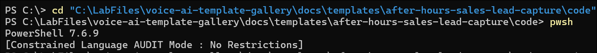

   ```powershell
   npm install --ignore-script
   code .
   ```

   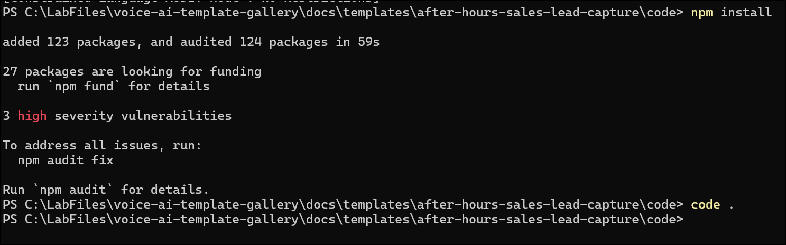

2. Execute the automated tests. They need no Azure and no network.

   ```powershell
   npm test
   ```

   **Expected output**

   ```text
   # tests 67
   # suites 0
   # pass 67
   # fail 0
   ```

   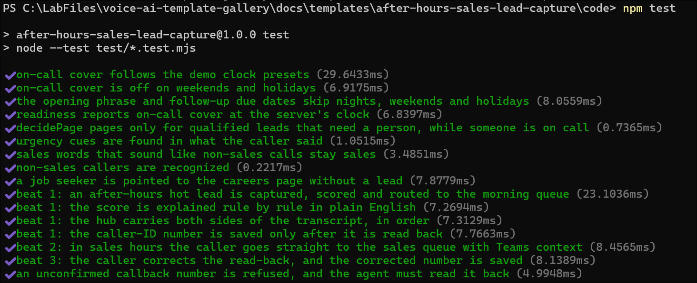

   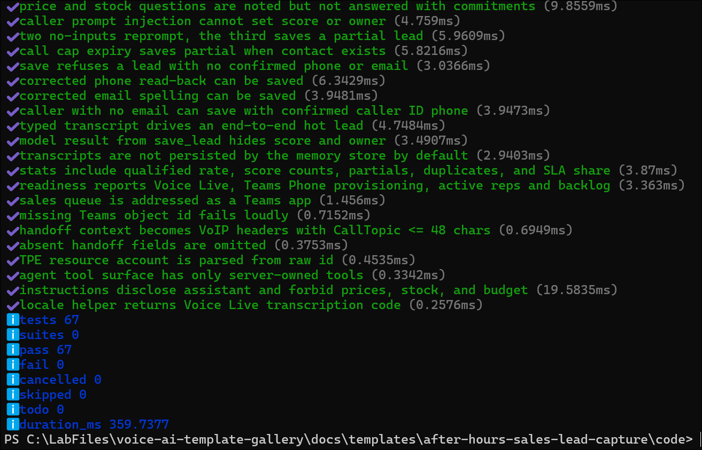

3. Look at the project layout in VS Code. Each file owns one job.

   | **File** | **What it does** |
   |---|---|
   | src/flow.mjs | The call state machine. Owns every decision on a call. Imports nothing from Azure, Express or SQLite, so it runs the same in tests, in simulation and on real calls. |
   | src/policy.mjs | Sales hours, holidays, on-call cover, the paging decision, the product catalog and lead scoring. |
   | src/db.mjs, src/db-sqlite.mjs | The lead store: repeat-caller merging, owner rotation, callback deadlines, the follow-up message outbox and the numbers on the console. SQLite keeps leads in data\after-hours-sales.db. |
   | src/handoff.mjs | How a Teams destination is addressed, and the VoIP headers that carry the lead to Teams. |
   | src/agent.mjs | The four tools the AI may call and its standing instructions. |
   | src/offline.mjs | A scripted stand-in for the AI, used only in simulation mode. |
   | src/voice/acs.mjs | ACS Call Automation: answer, transfer to Teams, keypad, hang up. |
   | src/voice/voice-live.mjs | The Voice Live (gpt-realtime) session over WebSocket. |
   | src/voice/call-bridge.mjs | Joins one phone call’s audio to one Voice Live session and passes the AI’s tool calls to the flow. |
   | src/server.mjs | Event Grid intake, ACS callbacks, the simulation and console APIs, /health and the WebSockets. |
   | public/ | The browser console you use in simulation and to watch live calls. |

4. Open the four files in **config/**. Together they are the whole **sales policy**; changing them is a configuration change, not a code change:

   | **File** | **Holds** | **Example** |
   |---|---|---|
   | hours.json | Organisation, time zone, weekly sales hours, holidays, the support line, the on-call cover and the Teams sales queue | Mon–Fri 8 AM–6 PM Pacific; Ben Ortiz on call until 9 PM |
   | reps.json | The sales reps who own leads, whether each is active, their Teams user IDs, and the sales manager | Ava Chen, Ben Ortiz, Dana Brooks active; Chloe Singh inactive |
   | qualification.json | Points for product, quantity, timeline and decision role, and the hot and warm thresholds | Hot is 6 of 8 or more; warm is 3 or more |
   | catalog.json | Product lines, the words that identify them, minimum orders and lead times | Fasteners: minimum order 5,000 |

   **Note:** The Teams IDs in hours.json and reps.json are placeholders (all zeros). That is fine for simulation. In Exercise 6 you create local copies that point at your own Teams user.

The project is open, its packages are installed and all 67 tests pass. You know which file owns which job and where the sales policy lives.

## Exercise 2: Understand the key code

In this exercise, you read the most important parts of the code. Each task shows a short excerpt and explains it. You do not need to change anything: open the file in VS Code (Ctrl+P, then type the file name) and find the code with Ctrl+F to see it in context.

### Task 1: The clock decides, not the AI

See how the server decides, before the assistant says a word, whether to answer the call at all.

1. Open **src/flow.mjs** and find **planRoute**.

   **src/flow.mjs — planRoute()**

   ```javascript
     planRoute(id) {
       const call = this.#require(id);
       if (call.routeDecision) return call.routeDecision;
       const now = this.now();
       const open = this.hours.isSalesOpen(now);
       const holiday = this.hours.isHoliday(now);
       const opening = this.hours.openingPhrase(now);
       let action = "capture";
       let reason;
       if (open && !call.overflow) {
         action = "transfer";
         reason = "Sales is open, so the caller goes straight to the sales queue";
       } else if (open) {
         reason = "The sales queue is full, so the assistant takes the details";
       } else if (!opening) {
         reason = "Sales is closed, so the assistant takes the details";
       } else if (holiday) {
         reason = `Sales is closed for the holiday until ${opening}, so the assistant takes the details`;
       } else {
         reason = `Sales is closed until ${opening}, so the assistant takes the details`;
       }
       call.routeDecision = { open, holiday, overflow: call.overflow, action, reason, opening, at: now.toISOString() };
       this.#event(call, "system", "route_decision", reason);
       return call.routeDecision;
     }
   ```

**How it works:**

- `this.hours.isSalesOpen(now)` checks the weekly hours and holidays from hours.json, in the sales time zone (Pacific), not the server’s time zone.

- In sales hours the action is **transfer**: the caller goes straight to the sales team. After hours (or when the sales queue overflowed) the action is **capture**.

- Every decision is stored with a plain-English **reason**, which the console’s decision trail shows. You will see the same pattern in every policy in this project.

2. Open **src/server.mjs** and find **onIncomingCall**, where a real call arrives from Event Grid.

   **src/server.mjs — onIncomingCall()**

   ```javascript
     const route = flow.planRoute(call.id);
     log("[call] incoming", call.id, "from", call.maskedPhone ?? "a withheld number", "→", route.action, `(${route.reason})`);
   
     if (route.action === "transfer") {
       // In sales hours the call is answered only so it can be handed to the Teams
       // sales queue: no media stream and no voice agent. The transfer starts
       // once ACS reports the call connected.
       const { callConnectionId } = await answerInboundCall({
         incomingCallContext: data.incomingCallContext,
         callId: call.id,
         startMedia: false,
       });
       flow.setCallConnection(call.id, callConnectionId);
       return;
     }
   
     // The call is ready for the agent before it is answered, because the media
     // socket can connect before answerCall returns.
     flow.routeIncoming(call.id, { answer: false });
     const { callConnectionId } = await answerInboundCall({ incomingCallContext: data.incomingCallContext, callId: call.id });
     flow.setCallConnection(call.id, callConnectionId);
   }
   ```

**How it works:**

- In sales hours the call is answered with `startMedia: false`: no audio stream and no AI. When ACS reports CallConnected, the call is transferred to the sales queue in Teams.

- After hours the call is answered with media, so the audio flows to Voice Live and the assistant greets the caller.

The server, using **hours.json**, decides whether the AI is involved at all. The AI is never asked whether sales is open.

### Task 2: Scoring a lead in plain English

See how the server scores a lead from four facts, using the rules in qualification.json.

1. Open **config/qualification.json**.

   **config/qualification.json**

   ```json
   {
     "timeline": { "within30Days": 3, "within90Days": 2, "later": 0, "unknown": 0 },
     "quantity": { "atOrAboveMoq": 2, "belowMoq": 0, "unknown": 1 },
     "productInterest": { "catalogLine": 1, "other": 0 },
     "role": { "decisionMaker": 2, "influencer": 1, "unknown": 0 },
     "thresholds": { "hot": 6, "warm": 3 }
   }
   ```

2. Open **src/policy.mjs** and find **score(fields)** in the QualificationPolicy class.

   **src/policy.mjs — QualificationPolicy.score()**

   ```javascript
     score(fields) {
       const breakdown = [];
       let points = 0;
       const add = (rule, reason, value) => {
         points += value;
         breakdown.push({ rule, reason, points: value });
       };
       const product = this.catalog.findLine(fields.productInterest ?? "");
       add("productInterest", product ? product.id : "other", product ? this.rules.productInterest.catalogLine : this.rules.productInterest.other);
       const quantity = Number(fields.quantity ?? 0);
       const moq = product?.minimumOrderQuantity ?? null;
       const quantityClass = moq == null || !quantity ? "unknown" : quantity >= moq ? "atOrAboveMoq" : "belowMoq";
       add("quantity", quantityClass, this.rules.quantity[quantityClass]);
       const timeline = classifyTimeline(fields.timeline);
       add("timeline", timeline, this.rules.timeline[timeline] ?? 0);
       const role = classifyRole(fields.role);
       add("role", role, this.rules.role[role] ?? 0);
       const score = points >= this.rules.thresholds.hot ? "hot" : points >= this.rules.thresholds.warm ? "warm" : "cold";
       return { score, points, breakdown, productLine: product?.id ?? null };
     }
   ```

**How it works:**

- **Four rules** add up to at most 8 points: a catalog product line (1 point), quantity at or above the line’s minimum order from catalog.json (2 points), a timeline within 30 days (3 points) and a decision maker (2 points).

- Hot is 6 or more, warm 3 or more, otherwise cold. The breakdown keeps a reason for each rule, which the console shows, for example “12,000 meets the 5,000 minimum order”.

- The AI only collects the facts. It never sees or sets the score, and it is told never to tell the caller a priority.

Lead scoring is a small, readable function driven by configuration, and every point has a reason.

### Task 3: Nothing is saved until the number is confirmed

See the rule that refuses to save a lead with a callback number the caller has not confirmed.

1. Open **src/flow.mjs** and find **saveLead**. Look at the first check.

   **src/flow.mjs — saveLead() (start)**

   ```javascript
       const email = normaliseEmail(draft.email);
       const hasContact = Boolean(draft.callbackPhone || email);
       const confirmed = Boolean((draft.callbackPhone && draft.phoneConfirmed) || (email && draft.emailConfirmed));
       if (!partial && hasContact && !confirmed) {
         this.#event(call, "system", "save_refused", "contact_unconfirmed");
         this.#setState(call, STATES.CONFIRMING);
         return { ok: false, reason: "contact_unconfirmed", readBack: phoneGroups(draft.callbackPhone) ?? email };
       }
   ```

**How it works:**

- The AI calls the **save_lead** tool with what it collected and **phoneConfirmed**: true only after reading the number back. If the number is not confirmed, the server refuses with **contact_unconfirmed** and returns the number to read back.

- This is enforced by the server, so even if the AI tries to save too early, nothing is stored. A corrected number is read back as well, and only the confirmed one is saved.

- A **partial** save (the caller went silent, or the time budget ran out) is allowed without confirmation, but the lead is marked “Callback number was not read back.”

The **read-back rule** lives in the server, so a lead always has a callback number someone actually confirmed.

### Task 4: An owner, a deadline and repeat callers

See how the lead store merges repeat calls, picks an owner and sets the callback deadline.

1. Open **src/db.mjs** and find **#findDuplicate** and **#nextRep**.

   **src/db.mjs — #findDuplicate()**

   ```javascript
     #findDuplicate(phone, email, now, simulated) {
       const cutoff = now.getTime() - this.dedupeWindowDays * 86400000;
       return [...this.leads.values()].find((l) =>
         Boolean(l.simulated) === simulated
         && new Date(l.createdAt).getTime() >= cutoff
         && ((phone && l.normalizedPhone === phone) || (email && l.normalizedEmail === email))) ?? null;
     }
   ```

   **src/db.mjs — #nextRep()**

   ```javascript
     #nextRep(simulated) {
       const active = this.reps.activeReps();
       if (!active.length) throw new Error("no active reps");
       const key = simulated ? "simulatedPointer" : "pointer";
       const rep = active[this[key] % active.length];
       this[key] = (this[key] + 1) % active.length;
       return rep;
     }
   ```

2. Open **src/policy.mjs** and find **followUpDue**.

   **src/policy.mjs — HoursPolicy.followUpDue()**

   ```text
     followUpDue(score, now = new Date()) {
       if (score === "hot") return this.addBusinessMinutes(now, 60);
       return this.closeOfBusinessDay(now, score === "warm" ? 1 : 2);
     }
   ```

**How it works:**

- A **second call** from the same phone number or email within DEDUPE_WINDOW_DAYS (30) updates the earlier lead instead of creating a new one. Simulated and real leads never merge.

- **New leads** go to the active reps in rotation (round-robin); an inactive rep, such as Chloe Singh, is skipped.

- The **deadline** is **counted** in **business time**: a hot lead within the first hour of selling time, warm by close of the next business day, cold by close of the second. The AI only receives the phrase to say, such as “within an hour of opening”.

- Each saved lead also puts a follow-up message for the owner in the outbox (GET /api/outbox), with the sales manager @-mentioned on hot leads.

Ownership, deadlines and repeat-caller handling are server rules on the lead store, not things the AI decides.

### Task 5: Whether to page the on-call rep

See the whole paging policy: when a caller is worth interrupting someone’s evening for.

1. Open **src/policy.mjs** and find **decidePage**.

   **src/policy.mjs — decidePage()**

   ```javascript
   export function decidePage({ score, urgent = false, askedForPerson = false, coverage = null, repName = "the on-call rep" } = {}) {
     const hot = score === "hot";
     const facts = {
       hot,
       urgent: Boolean(urgent),
       askedForPerson: Boolean(askedForPerson),
       covered: Boolean(coverage?.covered),
       coverageReason: coverage?.reason ?? null,
       repName,
       untilLabel: coverage?.untilLabel ?? null,
     };
     const page = (code, reason) => ({ page: true, code, reason, ...facts });
     const queue = (code, reason) => ({ page: false, code, reason, ...facts });
     if (!coverage || coverage.salesOpen) return queue("sales_open", "Sales is open, so the lead owner follows up during business hours");
     if (!urgent && !askedForPerson) {
       return queue("not_needed", hot
         ? "Hot, but nothing needs a person tonight, so it goes to the morning queue"
         : "Nothing needs a person tonight, so it goes to the morning queue");
     }
     if (!coverage.covered) return queue("no_cover", `${coverage.reason}, so it goes to the morning queue`);
     const onCall = `${repName} is on call until ${coverage.untilLabel}`;
     if (hot && urgent) return page("hot_urgent", `Hot and urgent, and ${onCall}`);
     if (askedForPerson && (hot || score === "warm")) return page("asked_for_person", `Caller asked for a person, and ${onCall}`);
     if (score === "warm") return queue("warm_waits", "Warm, and on-call is paged only for hot leads that can't wait, so it goes to the morning queue");
     return queue("not_qualified", "On-call is kept for qualified leads, so it goes to the morning queue");
   }
   ```

**How it works:**

- **No page** while **sales** is **open**, and no page when nothing is urgent and no one asked for a person.

- **No page outside on-call** cover (hours.json, onCall: the rep, the days, and the time cover ends).

- A page for a **hot lead that is urgent**, or for a **hot or warm caller who asks for a person**. Urgency comes from cues in the caller’s own words, such as “line is down” or “by tomorrow morning” (classifyUrgency).

- Every answer carries a reason that is saved on the lead, for example “On-call cover ends at 9 PM, so it goes to the morning queue”.

- When a page is decided, saveLead returns stayOnLine: the AI asks the caller to hold, and after PAGE_WINDOW_MS (6 seconds) the call is transferred to the on-call rep in Teams.

**decidePage** is the whole paging policy in one function, and every page or non-page is explained.

### Task 6: What the AI is allowed to do

See the four tools the AI can call and how each one is handed to the server.

1. Open **src/agent.mjs**. The AI has exactly four tools: **lookup_catalog**, **save_lead**, **classify_non_sales** and **end_call**. None of them can set a priority, pick a rep or reach Teams. One line of the standing instructions keeps the AI away from prices:

   **src/agent.mjs — buildInstructions() (one line)**

   ```text
   Never ask for budget. Never quote prices, stock, availability, or delivery dates. If asked, say: "I can't quote that, but I'll note it so your rep can give you an exact answer." Then add the question to notes.
   ```

2. Open **src/voice/call-bridge.mjs** and find **#onToolCall**. This is where every tool call from Voice Live arrives.

   **src/voice/call-bridge.mjs — #onToolCall()**

   ```javascript
     async #onToolCall(name, args = {}) {
       try {
         switch (name) {
           case "lookup_catalog":
             return this.flow.lookupCatalog(this.callId, args.query ?? "");
           case "save_lead":
             // The reply carries only the lead id and the follow-up promise, or
             // `contact_unconfirmed` with the number to read back.
             return this.flow.saveLead(this.callId, args.fields ?? {});
           case "classify_non_sales":
             return this.flow.classifyNonSales(this.callId, args.kind, args.note ?? "");
           case "end_call":
             if (args.reason) this.flow.logEvent(this.callId, "agent", "end_call", args.reason);
             // Refused while the on-call rep is being paged; the flow says so.
             return this.flow.endCall(this.callId, "agent_ended");
           default:
             return { error: `Unknown tool ${name}` };
         }
       } catch (e) {
         log("tool failed", name, e.message);
         return { error: e.message };
       }
     }
   ```

**How it works:**

- Each **tool maps** to one **flow** method and nothing else; the bridge makes no decisions of its own.

- **save_lead** returns only the lead id and the follow-up promise (or contact_unconfirmed with the number to read back, or stayOnLine during a page).

- **classify_non_sales** closes calls that are not new sales — an existing order, a job seeker, spam or an emergency — with the right pointer, and creates no lead, so the sales pipeline stays clean.

- **end_call** is refused while the on-call rep is being paged, so the caller is never dropped on the way to a person.

The AI holds the conversation through four narrow tools; every tool result comes from the server.

### Task 7: The Teams handoff and the transfer fix

See how a transfer addresses Teams and carries the lead details, and the fix that makes transfers work on an ACS phone number.

1. Open **src/handoff.mjs**.

   **src/handoff.mjs**

   ```javascript
   // Teams Phone handoff helpers: who the call goes to, and the context the person
   // who answers in Teams sees. Context travels as VoIP headers on the transfer.
   import { config } from "./config.mjs";
   
   const VOIP_VALUE_LIMIT = 1024;
   const CALL_TOPIC_LIMIT = 48;
   
   /**
    * The ACS identifier for a Teams target: a call queue or auto attendant is a
    * Teams app (its resource account's object id); an on-call rep is a Teams user.
    */
   export function teamsIdentifier(target) {
     if (!target?.objectId) throw new Error("sales queue target has no objectId");
     return target.type === "user"
       ? { microsoftTeamsUserId: target.objectId }
       : { teamsAppId: target.objectId, cloud: config.acs.teamsCloud };
   }
   
   /** The Teams Phone resource account the call was placed to, from its raw id ("28:orgid:<guid>"). */
   export function resourceAccountFrom(to) {
     const match = /^28:(?:orgid:)?([0-9a-f-]{36})$/i.exec(to?.rawId ?? "");
     return match ? match[1] : null;
   }
   
   /** The handoff context as VoIP headers. Empty fields are left out; AfterHours is sent only when true. */
   export function buildCustomCallingContext(context) {
     const headers = [
       ["CallDetails.SessionId", context.sessionId],
       ["CallDetails.CallTopic", context.callTopic],
       ["CallDetails.CallContext", context.callContext],
       ["CallDetails.RouteId", context.routeId],
       ["CallDetails.AfterHours", context.afterHours ? "true" : null],
     ];
     return headers
       .filter(([, value]) => value != null && value !== "")
       .map(([key, value]) => ({
         kind: "voip",
         key,
         value: String(value).slice(0, key === "CallDetails.CallTopic" ? CALL_TOPIC_LIMIT : VOIP_VALUE_LIMIT),
       }));
   }
   ```

**How it works:**

- **teamsIdentifier()** addresses a Teams user as { microsoftTeamsUserId } and a call queue (a resource account) as { teamsAppId }. In this lab both the sales queue and the on-call rep point at your Teams user.

- **buildCustomCallingContext()** turns the lead into VoIP headers: session id, topic (48 characters at most), context, route (sales or on-call) and an after-hours flag. The on-call context reads, for example: HOT lead (8 of 8). Sam Rivera, operations director, Tailwind Traders. Cartons, 2,000 units, needed by tomorrow morning…

2. Open **src/voice/acs.mjs** and find **transferToTeams**.

   **src/voice/acs.mjs — asciiSafe() and transferToTeams()**

   ```javascript
   /** Lab fix (ACS phone number): transfers reject dotted VoIP header keys and non-ASCII values. */
   const asciiSafe = (headers) =>
     headers.map((h) => ({
       ...h,
       key: String(h.key).replace(/[^A-Za-z0-9]/g, ""),
       value: String(h.value)
         .replace(/[\u2013\u2014]/g, "-")
         .replace(/[\u201C\u201D]/g, '"')
         .replace(/[\u2018\u2019]/g, "'")
         .replace(/\u2026/g, "...")
         .replace(/[^\x20-\x7E]/g, ""),
     }));
   
   /**
    * Hands the call to Teams: the sales queue in business hours, or the on-call
    * rep's Teams user after a page. The captured lead travels as VoIP headers, so
    * the person who answers sees it on the incoming-call toast.
    */
   export async function transferToTeams({ callConnectionId, target, context, callId }) {
     if (!callConnectionId) throw new Error("no call connection to transfer");
   
     const connection = (await acsClient()).getCallConnection(callConnectionId);
     try {
       await connection.transferCallToParticipant(teamsIdentifier(target), {
         operationContext: `transfer:${callId}`,
         customCallingContext: asciiSafe(buildCustomCallingContext(context)),
       });
     } catch (e) {
       log("TRANSFER ERROR", "status:", e.statusCode, "| code:", e.code, "| message:", e.message);
       log("TRANSFER ERROR body:", e.response?.bodyAsText ?? "(none)");
       throw e;
     }
   
     log("transfer requested", callId, "->", target.displayName ?? target.objectId);
   }
   ```

   **Transfer fix:** Callers reach this agent on a phone number bought in ACS. On this kind of number, ACS rejects a transfer whose VoIP header names contain dots (CallDetails.CallTopic) or whose values contain non-ASCII characters — and the on-call topic uses one: “Cartons — Tailwind Traders”. The transfer then fails with “Invalid CustomCallingContext in request”. asciiSafe() removes the dots from the header names (CallDetailsCallTopic) and replaces or removes non-ASCII characters in the values just before the transfer. The try/catch writes the full ACS error to the server log (TRANSFER ERROR) if a transfer is ever refused.

Transfers carry the lead to Teams as VoIP headers, cleaned so that ACS accepts them on an ACS phone number.

You have read the code behind every important decision: the sales-hours check, scoring, the read-back rule, owner and deadline, paging, the AI’s four tools and the Teams handoff.

## Exercise 3: Test the agent in simulation

In this exercise, you run the complete agent in the browser console before connecting any Azure services. A typed call drives the same state machine a real call does — the same sales hours, scoring, read-back, owner rotation, paging policy and handoff. Only the AI and the audio are replaced by a scripted stand-in.

1. Start the server.

   ```powershell
   npm start
   ```

   **Expected output**

   ```text
   [bridge] ACS media bridge listening on /ws/media
   After-hours sales lead capture demo on http://127.0.0.1:8093
     organization       : Contoso Industrial Supply
     sales hours        : Mon–Fri, 8 AM to 6 PM (America/Los_Angeles)
     on-call cover      : Ben Ortiz until 9 PM
     lead store         : sqlite
     call time budget   : 360s
     page window        : 6s
     SIMULATION MODE    — set ACS_ENDPOINT, PUBLIC_BASE_URL, VOICE_LIVE_ENDPOINT to answer real calls
   ```

   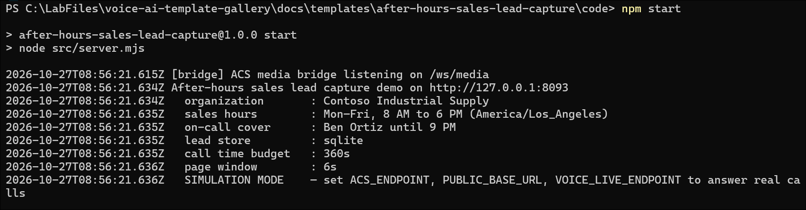

2. Open **http://127.0.0.1:8093** in the browser and click **Reset demo**.

3. Play the scripted demo: press **Next ▶** (or the → key) to run each of the six beats. Each beat sets the demo clock, picks the caller and types the caller’s lines. Compare with the expected result:

   | **#** | **Beat** | **Expected result** |
   |---|---|---|
   | 1 | After hours: capture (Dana Morgan, 7:30 PM) | The assistant says it is automated; one sentence fills in most of the lead; the number is read back; a **hot** lead, **8 of 8**, is saved for Ava Chen, with a callback within an hour of opening (8 AM). Nobody is paged: hot is not the same as urgent. |
   | 2 | Business hours: straight to sales (Pat Kim, 10:30 AM) | No questions: the call goes straight to the sales queue. The handoff shows routeId sales and “Sales inquiry during business hours”. |
   | 3 | Read back, corrected (Casey Quinn) | 200 fittings is below the 250 minimum; an influencer, not the decision maker. The caller corrects the number to 425-555-0147, which is read back too. A **warm** lead, **4 of 8**, saved with the mobile number, callback by the next business day. |
   | 4 | Not a sales call (Lee Park) | An existing order: the support number and hours are given, and **no lead** is created. |
   | 5 | Hot and urgent: page on call (Sam Rivera) | “Packaging line is down”, 2,000 cartons by tomorrow morning, asks for a person: **hot, 8 of 8**. After the read-back the server pages Ben Ortiz and the caller holds; the call is transferred to the on-call rep with the lead in the VoIP headers. Reason: “Hot and urgent, and Ben Ortiz is on call until 9 PM”. |
   | 6 | After cover ends: morning queue (Robin Diaz, 10:30 PM) | Urgent and asking for a person, but cover ended at 9 PM: “There’s no one on call right now”. A **hot** lead saved for the morning with the reason “On-call cover ends at 9 PM, so it goes to the morning queue”. The numbers strip shows the totals. |

   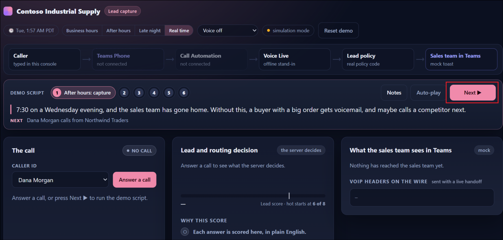

   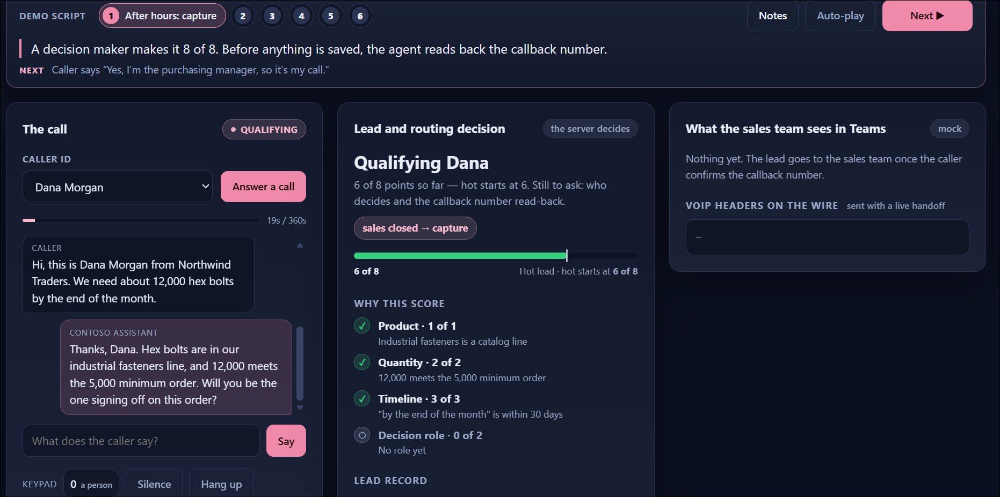

4. Now drive calls yourself. **Reset demo**. Click **After hours** in the header, pick a **Caller ID**, click **Answer a call**, type each line and click **Say** (or use the keypad and **Silence** buttons).

   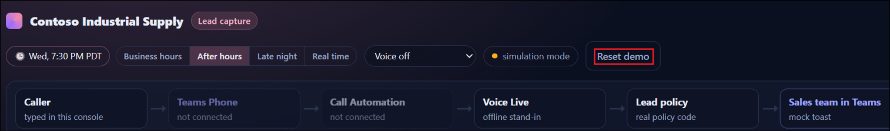

   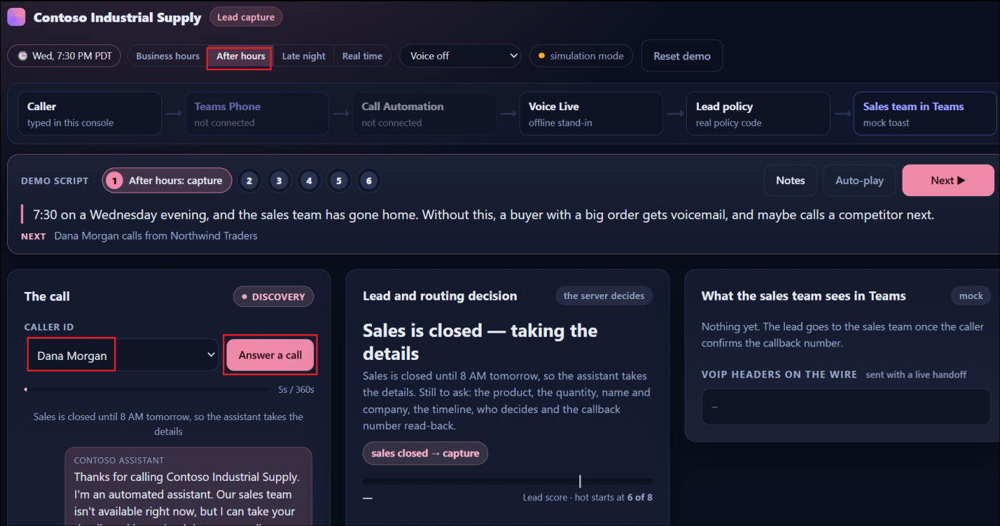

   | **Type or press** | **Expected result** |
   |---|---|
   | How much do 5,000 hex bolts cost? | “I can’t quote that, but I’ll note it so your rep can give you an exact answer.” No price; qualifying carries on. |
   | Hi, are you hiring? I’d like to apply for a job. | A pointer to the careers page, and no lead. |
   | 0 on the keypad | Taken as asking for a person: a few details first, then the paging policy decides. |
   | Silence three times | Two prompts, a goodbye, and a **partial cold** lead from the caller ID, marked as not read back. |

   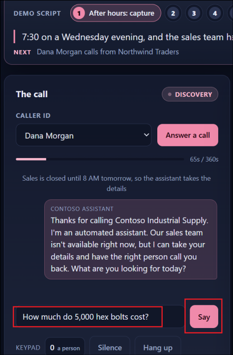

   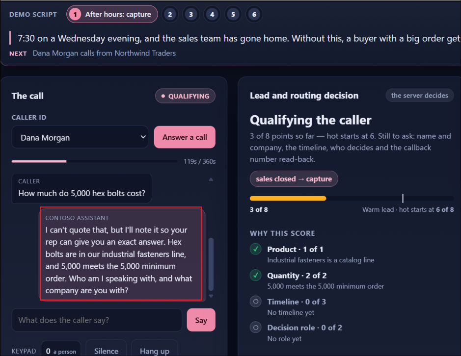

   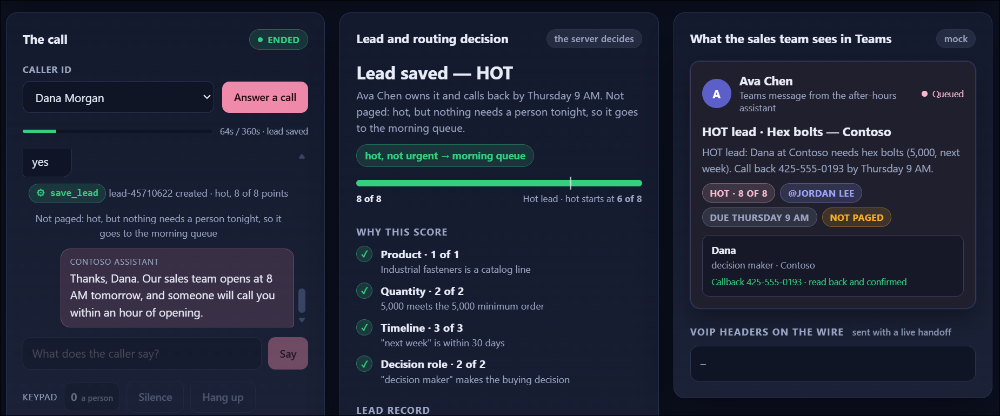

**Note:** Screenshots are added for few conversations only. You can try all of them from that table above.

5. For each call, read the **lead** panel (each score point with its reason), the **decision trail**, and the **Teams** panel with the **VoIP headers**.

6. Press Ctrl+C in the PowerShell window to stop the server.

You have seen every rule fire in simulation — the sales-hours check, scoring, the read-back and correction, non-sales calls, paging inside and outside on-call cover, and partial leads — and traced each one to the code.

## Exercise 4: Create the Azure resources

In this exercise, you create the Azure resources the live agent needs — an Azure Communication Services resource and an Azure AI Services resource for Voice Live — and give your sign-in the roles for keyless access. A small variables file keeps every name, endpoint and ID consistent across PowerShell windows.

### Task 1: Create the lab variables file

**Overview:**

Create lab-vars.ps1, a small file that holds your names and fetches every endpoint and ID from Azure, and load it into your PowerShell session.

1. In **VS Code**, create a new file named **lab-vars.ps1** in the code folder (next to package.json) and paste the below content.

   ```powershell
   # lab-vars.ps1 - load it in every PowerShell 7 window with:   . .\lab-vars.ps1
   # ---------------------------------------------------------------- EDIT
   $TENANT = "<yourtenant>.onmicrosoft.com"
   $SUFFIX = "<initials><nn>"                                # for example sv01 - keeps your names unique
   $LOC    = "eastus2"                                       # a region that serves Voice Live (gpt-realtime)
   $AGENT  = "<teams-user>@<yourtenant>.onmicrosoft.com"     # the Teams user who answers transferred calls
   # ------------------------------------------------- derived (do not edit)
   $TUNNEL = "afterhours-$SUFFIX"
   $RG  = "rg-afterhours-$SUFFIX"; $ACS = "acs-afterhours-$SUFFIX"; $AI = "ai-afterhours-$SUFFIX"
   $ACSID        = az communication show -n $ACS -g $RG --query id -o tsv 2>$null
   $ACS_ENDPOINT = if ($ACSID) { "https://" + (az communication show -n $ACS -g $RG --query hostName -o tsv) }
   $IMMUTABLE    = if ($ACSID) { az communication show -n $ACS -g $RG --query immutableResourceId -o tsv }
   $AISUB        = az cognitiveservices account show -n $AI -g $RG --query properties.customSubDomainName -o tsv 2>$null
   $VL_ENDPOINT  = if ($AISUB) { "https://$AISUB.services.ai.azure.com" }
   $AGENT_ID     = az ad user show --id $AGENT --query id -o tsv 2>$null
   Write-Host "Resource group : $RG"
   Write-Host "ACS endpoint   : $ACS_ENDPOINT"
   Write-Host "ACS immutable  : $IMMUTABLE"
   Write-Host "Voice Live     : $VL_ENDPOINT"
   Write-Host "Teams user ID  : $AGENT_ID"
   Write-Host "Tunnel         : $TUNNEL"
   # ------------------------------------- added after the tunnel starts
   ```

2. Replace the four values in the EDIT section with your own: your tenant, a short suffix (for example your initials and a number), the region, and the sign-in name of the Teams user who will answer the transferred calls. Keep the quotes and remove the < > brackets.

   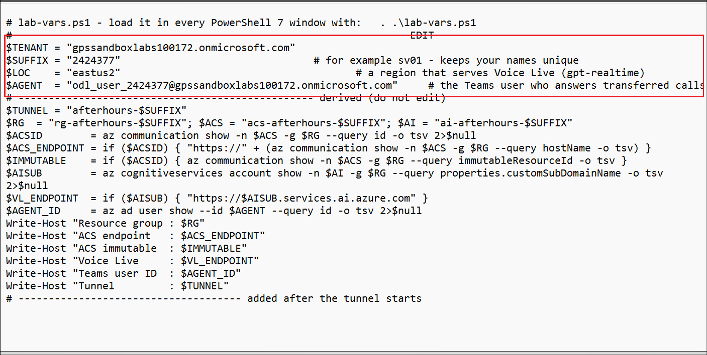

3. Save the file (Ctrl+S).

4. In the PowerShell 7 window, execute the below command to load the variables.

   ```powershell
   az login --tenant $TENANT --use-device-code
   . .\lab-vars.ps1
   ```

   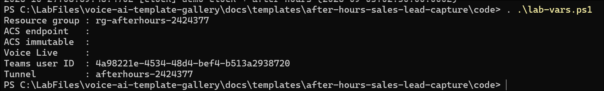

   Resource group must show rg-afterhours-<your suffix>, not the text <suffix>. If it still shows <suffix>, the EDIT section was not saved.

   **Note:** Blank endpoint and ID values after the first load are normal — the resources do not exist yet. Reload the file after each step that creates something.

lab-vars.ps1 holds your names and loads into the session.

### Task 2: Sign in and check permissions

Sign in to Azure, check your permissions and register the services the lab uses.

1. Copy the below code and paste it in the PowerShell to sign in and check the available permissions.

   ```powershell
   . .\lab-vars.ps1
   az login --tenant $TENANT --use-device-code
   az account show --query "{user:user.name, tenant:tenantId, subscription:name}" -o table
   $ME = az ad signed-in-user show --query id -o tsv
   az role assignment list --assignee $ME --all --query "[].{role:roleDefinitionName, scope:scope}" -o table
   az provider register -n Microsoft.Communication
   az provider register -n Microsoft.CognitiveServices
   az provider register -n Microsoft.EventGrid
   az extension add --name communication --upgrade
   ```

2. Select **Paste anyway** when you get a warning about multiple lines of code.

3. Follow the prompts to sign in.

   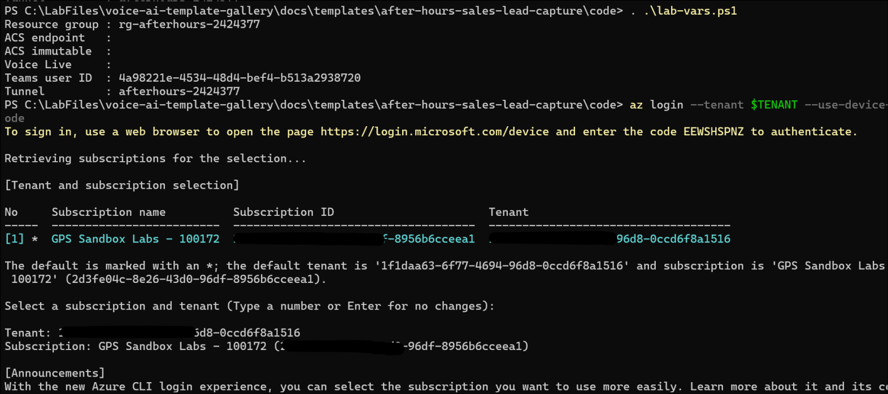

   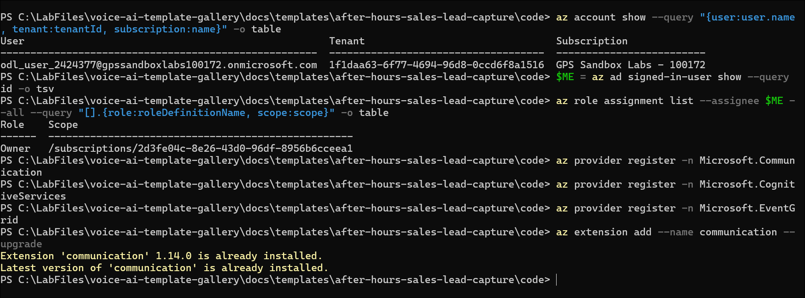

You are signed in to the lab tenant with the required permissions, and the resource providers are registered.

### Task 3: Create the resources

Create the resource group, the Azure Communication Services resource and the Azure AI Services resource.

1. Copy and paste the below block of code in the PowerShell to create the resources in Azure.

   ```powershell
   az group create -n $RG -l $LOC
   az communication create -n $ACS -g $RG --location global --data-location UnitedStates
   az cognitiveservices account create -n $AI -g $RG -l $LOC --kind AIServices --sku S0 --custom-domain $AI --yes
   ```

   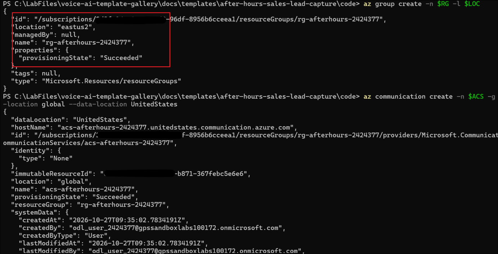

   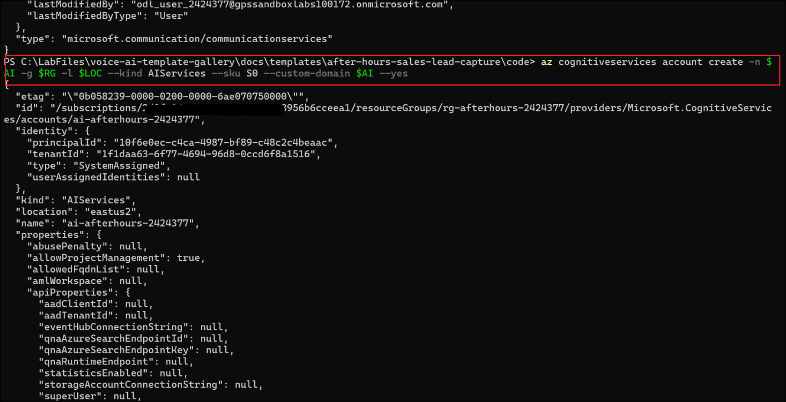

   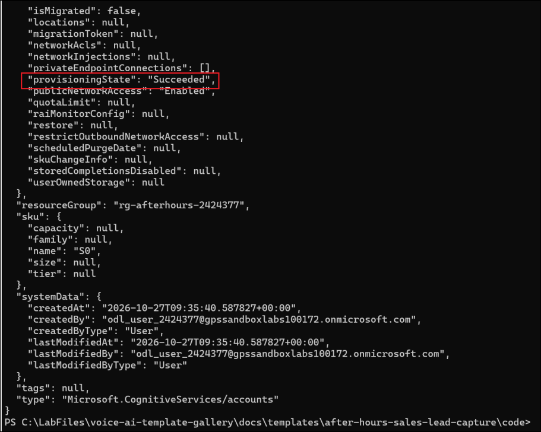

The resource group, ACS resource and AI Services resource are created.

### Task 4: Assign roles to your sign-in

Give your sign-in the roles it needs to use ACS and Voice Live without keys, and confirm the endpoints.

1. Copy and paste the below block of code in the PowerShell.

   ```powershell
   . .\lab-vars.ps1                 # reload: now fetches the new IDs
   $ME   = az ad signed-in-user show --query id -o tsv
   $AIID = az cognitiveservices account show -n $AI -g $RG --query id -o tsv
   az role assignment create --assignee $ME --role "Communication and Email Service Owner" --scope $ACSID
   az role assignment create --assignee $ME --role "Cognitive Services User" --scope $AIID
   az role assignment create --assignee $ME --role "Foundry User" --scope $AIID
   ```

2. The **. .\lab-vars.ps1** now prints an ACS endpoint ending in .communication.azure.com and a Voice Live endpoint ending in .services.ai.azure.com (never /models).

3. Role assignments can take a few minutes to apply.

   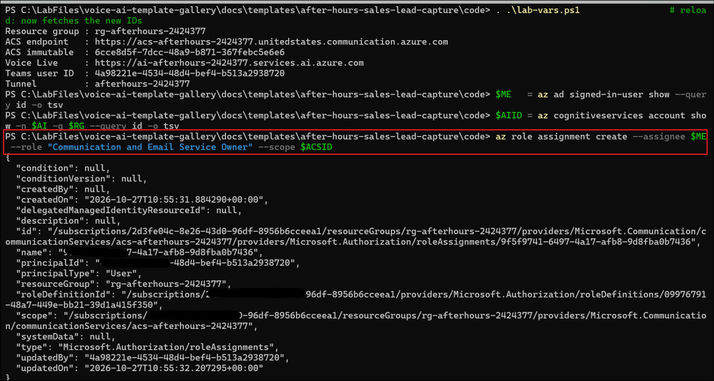

   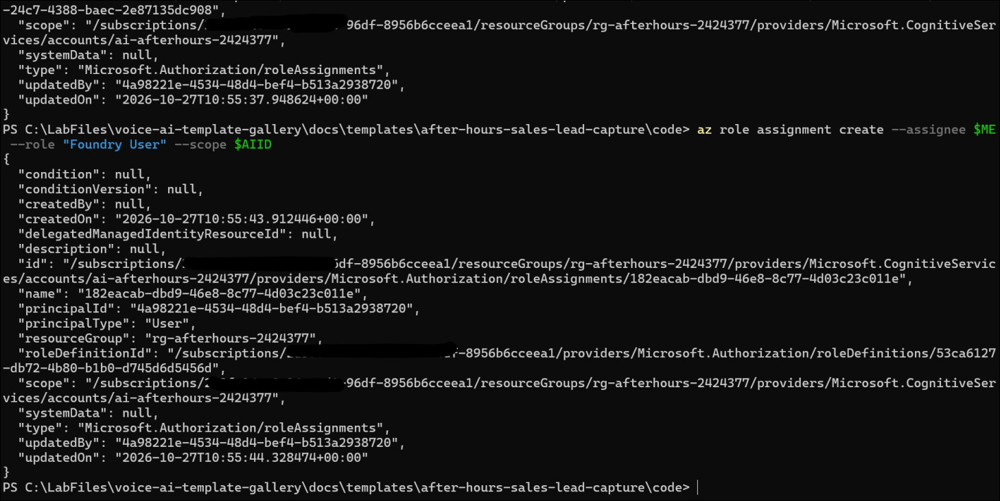

The roles are assigned and lab-vars.ps1 now returns both endpoints.

Your Azure resources exist, the roles are assigned, and lab-vars.ps1 fetches the ACS and Voice Live endpoints automatically.

## Exercise 5: Get a US phone number in ACS

In this exercise, you buy a US local phone number in your Azure Communication Services resource. This is the sales line callers dial to reach the agent.

1. Open the Azure portal at https://portal.azure.com and sign in with your lab tenant.

2. Open the resource group **rg-afterhours-<suffix>** and select your Communication Service from there.

   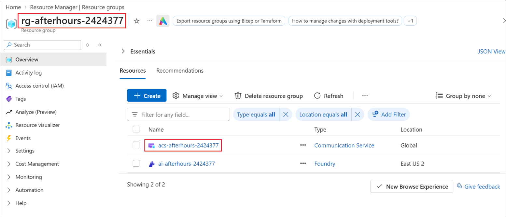

3. Select **Phone numbers** under **Telephony and SMS** and then select **+ Get**.

   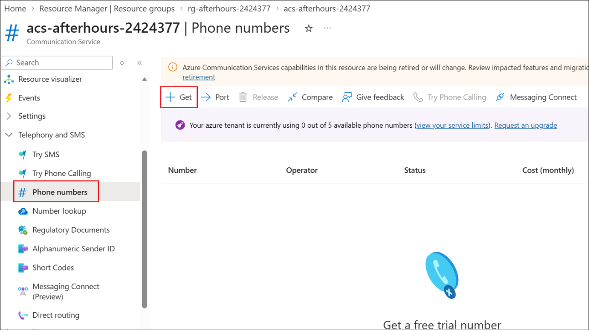

4. Select the below values.

- Country/region: United States.

- Number type: Local (geographic).

- Calling: Receive calls selected. SMS: None.

  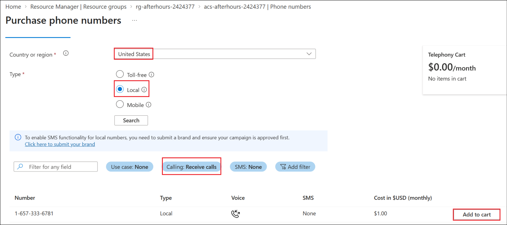

5. Add a number to the cart and then select **Next**.

   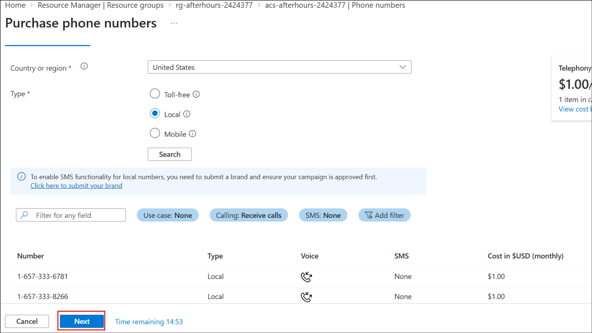

6. Complete the purchase: select **Buy now**. Make a note of this number in +1 format (for example, +1 XXX XXX XXXX). You will dial it later.

   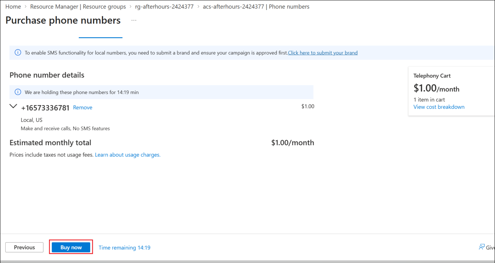

You have a phone number that can receive calls. It reaches the agent once the server is live and the Event Grid subscription is in place (Exercise 7).

## Exercise 6: Set up transfers to Teams

In this exercise, you prepare Microsoft Teams so the agent can hand callers to a person: you enable your Teams user for calling, point the sales queue and every rep at that user, and allow your ACS resource to call Teams users.

Lead capture works without this exercise. It is needed for the two kinds of transfer: in sales hours, straight to the sales queue; after hours, a page to the on-call rep.

**Note:** In production the sales queue is a Teams call queue and each rep has their own Teams user. In this lab the sales queue and every rep point at one Teams user — you — so you can answer every transfer yourself.

### Task 1: Sign in to Teams and enable the Teams user

**Overview:**

**Sign in** to **Teams PowerShell** and enable the Teams user who answers transferred calls for Teams calling.

1. Copy and paste the below code in the PowerShell window.

   ```powershell
   . .\lab-vars.ps1
   $env:PSModulePath = "$HOME\PSModules;" + $env:PSModulePath
   Import-Module MicrosoftTeams
   Connect-MicrosoftTeams -UseDeviceAuthentication     # sign in as the tenant's Teams admin
   Get-CsOnlineUser -Identity $AGENT | Format-List DisplayName, FeatureTypes, EnterpriseVoiceEnabled, TeamsUpgradeEffectiveMode
   Set-CsPhoneNumberAssignment -Identity $AGENT -EnterpriseVoiceEnabled $true
   $AGENT_ID                                            # the object ID used next
   ```

2. Ensure that **FeatureTypes** includes **PhoneSystem**, the mode is **TeamsOnly**, and **EnterpriseVoiceEnabled** becomes **True** (this can take a few minutes).

   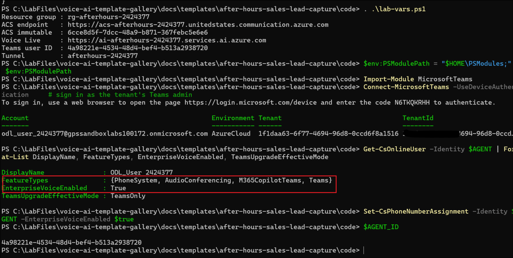

The Teams user has Teams Phone, is in Teams-only mode, and has Enterprise Voice enabled.

### Task 2: Point the sales queue, the reps and on-call cover at the Teams user

Create local copies of hours.json and reps.json that send every transfer to your Teams user, with on-call cover all day for testing.

1. Copy the below commands and execute them from the PowerShell window. They create **config\hours.local.json** and **config\reps.local.json**; the original files stay unchanged, and in the next exercise .env points at the local copies.

   ```powershell
   $h = Get-Content config\hours.json -Raw | ConvertFrom-Json
   $h.salesQueue.type     = "user"
   $h.salesQueue.objectId = $AGENT_ID
   $h.onCall | Add-Member -NotePropertyName from -NotePropertyValue "00:00" -Force
   $h.onCall.days  = @(0,1,2,3,4,5,6)
   $h.onCall.until = "24:00"
   $h | ConvertTo-Json -Depth 10 | Set-Content config\hours.local.json -Encoding utf8
   
   $r = Get-Content config\reps.json -Raw | ConvertFrom-Json
   foreach ($p in $r.reps) { $p.teamsUserId = $AGENT_ID }
   $r.manager.teamsUserId = $AGENT_ID
   $r | ConvertTo-Json -Depth 10 | Set-Content config\reps.local.json -Encoding utf8
   ```

   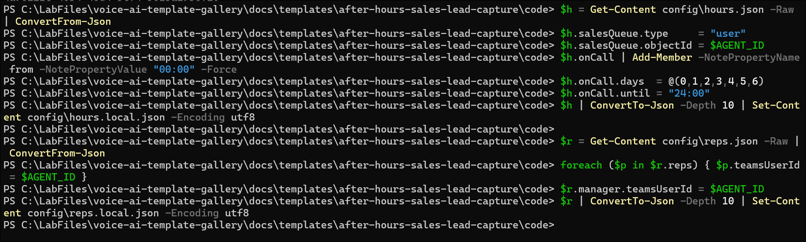

2. Check the result of the below command.

   The **sales queue** must show type user and your **$AGENT_ID**; **on-call** must show days 0**–6**, from **00:00**, until **24:00**; and every rep must show your $AGENT_ID. If an ID is empty, reload lab-vars.ps1, check $AGENT and run the step again.

   ```powershell
   (Get-Content config\hours.local.json -Raw | ConvertFrom-Json).salesQueue
   (Get-Content config\hours.local.json -Raw | ConvertFrom-Json).onCall
   (Get-Content config\reps.local.json -Raw | ConvertFrom-Json).reps | Format-Table id, displayName, teamsUserId, active
   ```

   **Note:** The sales hours stay as they are: Mon–Fri 8 AM–6 PM US Pacific.

   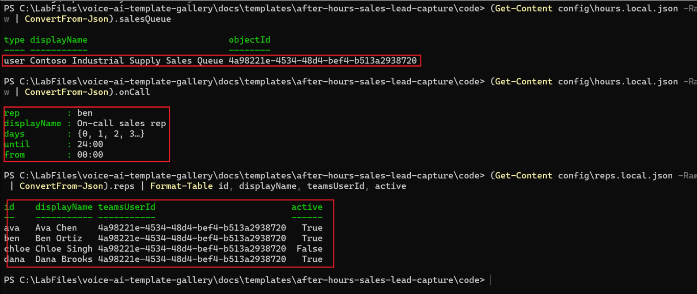

The sales queue, every rep and the on-call cover now point at your Teams user.

### Task 3: Allow your ACS resource to call Teams users

**Overview:**

Allow your ACS resource to call Teams users in the tenant, and confirm the settings.

1. Execute the below commands in the PowerShell window.

   ```powershell
   Set-CsTeamsAcsFederationConfiguration -Identity Global -EnableAcsUsers $true -AllowedAcsResources @{Add=$IMMUTABLE}
   Set-CsExternalAccessPolicy -Identity Global -EnableAcsFederationAccess $true
   Get-CsTeamsAcsFederationConfiguration | Format-List Identity, EnableAcsUsers, AllowedAcsResources
   Get-CsExternalAccessPolicy -Identity Global | Format-List Identity, EnableAcsFederationAccess
   ```

2. Ensure that **EnableAcsUsers** is **True**, your **$IMMUTABLE** value is listed under **AllowedAcsResources**, and **EnableAcsFederationAccess** is True. Teams can take up to an hour to apply these.

   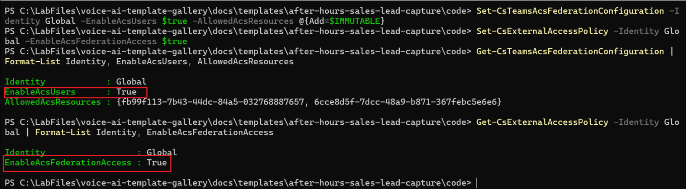

Your ACS resource is on the tenant’s allow-list and ACS calls to Teams users are enabled.

Transfers are ready: the Teams user can take calls, the sales queue, reps and on-call cover point at them, and your ACS resource is allowed to call Teams users.

## Exercise 7: Go live: tunnel, .env, server and Event Grid

**Overview:**

In this exercise, you take the agent live. You expose your local server to Azure through a dev tunnel, create the .env configuration from the values fetched from Azure, start the server in live mode, check its health, and subscribe it to incoming-call events.

You use three PowerShell 7 windows, all in the code folder, and load the variables in each one with the below commands.

```powershell
cd "C:\LabFiles\voice-ai-template-gallery\docs\templates\after-hours-sales-lead-capture\code"
pwsh
. .\lab-vars.ps1
```

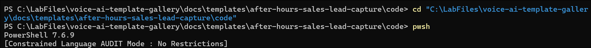

| **Window** | **Runs** | **Keep open?** |
|---|---|---|
| 1 | Dev tunnel | Yes, for the whole session |
| 2 | Server (npm start) | Yes, for the whole session |
| 3 | az commands, checks, Teams PowerShell | As needed |

### Task 1: Start a persistent tunnel (window 1)

**Overview:**

Start a named dev tunnel so Azure can reach the server running on your machine at a stable public address.

1. Use the window you have been using so far as window 1, and execute the below code to start a tunnel on port 8093.

   ```powershell
   devtunnel user login
   devtunnel create $TUNNEL --allow-anonymous      # first time only
   devtunnel port create $TUNNEL -p 8093           # first time only
   devtunnel host $TUNNEL
   ```

2. When prompted, select **Work or school account** and sign in with your tenant credentials, then select **No, this app only**.

3. Copy the **Connect via browser** address it prints (it looks like https://<id>-8093.<region>.devtunnels.ms).

   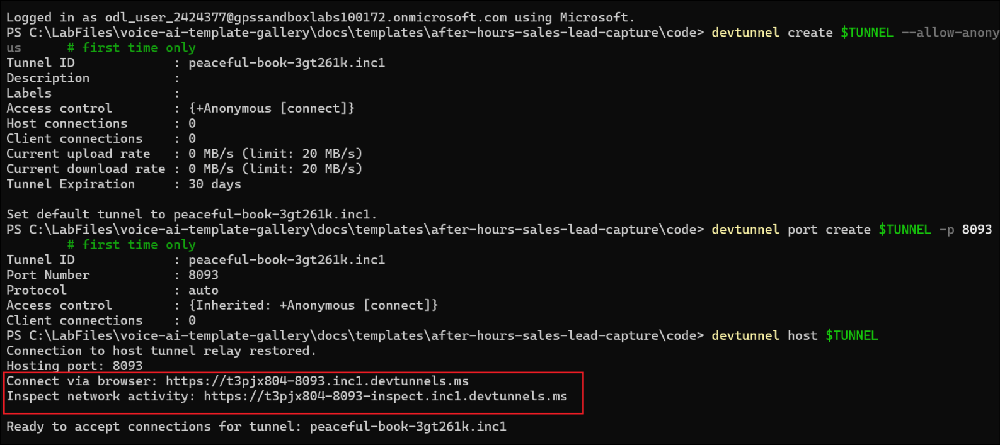

4. Add one line to the bottom of lab-vars.ps1 in VS Code, replacing the address with yours, and save the file:

   ```powershell
   $PUBLIC = "<paste the Connect via browser address, no trailing slash>"
   ```

   **Note:** A named tunnel keeps the same address every time you restart it, so .env and Event Grid never need updating. Window 1 is busy running the tunnel; windows 2 and 3 pick up $PUBLIC when they load lab-vars.ps1.

   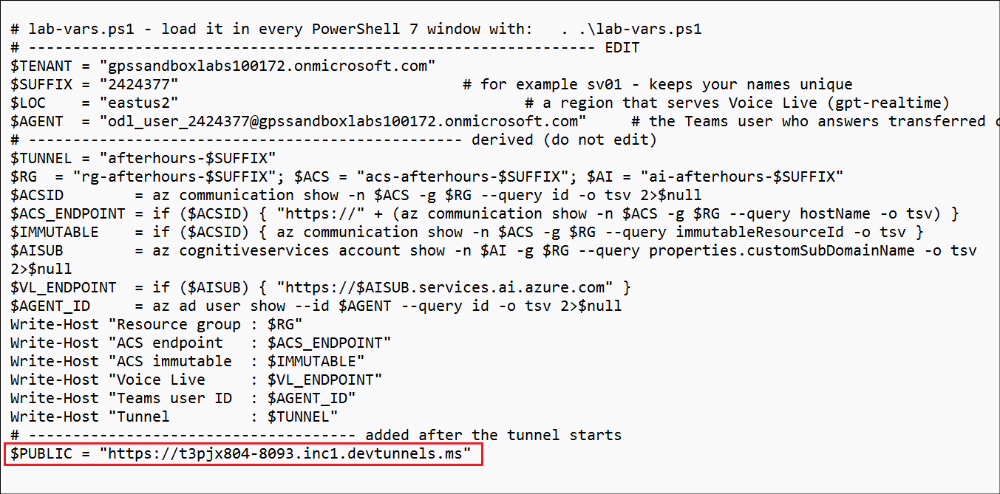

The tunnel is running, and its public address is saved in lab-vars.ps1.

### Task 2: Create .env from the fetched values (window 2)

Generate the .env file from the values fetched from Azure.

1. Open a new PowerShell window (window 2), navigate to the code folder and execute **pwsh**.

   ```powershell
   cd "C:\LabFiles\voice-ai-template-gallery\docs\templates\after-hours-sales-lead-capture\code"
   ```

2. Copy the below script block and paste it in the PowerShell.

   ```powershell
   . .\lab-vars.ps1
   Copy-Item .env.example .env -Force
   $set = [ordered]@{
     PUBLIC_BASE_URL     = $PUBLIC
     ACS_ENDPOINT        = $ACS_ENDPOINT
     VOICE_LIVE_ENDPOINT = $VL_ENDPOINT
     HOURS_PATH          = "./config/hours.local.json"
     REPS_PATH           = "./config/reps.local.json"
   }
   $lines = Get-Content .env
   foreach ($k in $set.Keys) {
     $found = $false
     $lines = $lines | ForEach-Object { if ($_ -match "^\s*#?\s*$k=") { $found = $true; "$k=$($set[$k])" } else { $_ } }
     if (-not $found) { $lines += "$k=$($set[$k])" }
   }
   $lines | Set-Content .env -Encoding utf8
   Select-String "^(PUBLIC_BASE_URL|ACS_ENDPOINT|VOICE_LIVE_ENDPOINT|VOICE_LIVE_API_KEY|HOURS_PATH|REPS_PATH)=" .env
   ```

   Expected: five lines with your values and **VOICE_LIVE_API_KEY**= **empty** (keyless sign-in). HOURS_PATH and REPS_PATH must point at the .local.json files — the original files hold placeholder Teams IDs and every transfer would fail.

   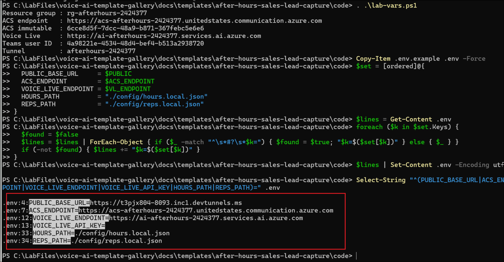

**.env** contains your tunnel address, the ACS and Voice Live endpoints and the local hours and reps files.

### Task 3: Start the server (window 2)

Start the server in live mode.

1. Execute the below commands in window 2.

   ```powershell
   az account show --query user.name -o tsv    # must be the account that received the roles in Exercise 4, Task 4
   npm start
   ```

2. The log must not say SIMULATION MODE, and must end with lines like these. The server reads .env and the config files only at start-up: restart it (Ctrl+C, npm start) after any change.

   **Expected output**

   ```text
     on-call cover      : Ben Ortiz until 12 AM
     ...
     voice model        : gpt-realtime (WebSocket 2026-04-10)
     public base URL    : https://<id>-8093.<region>.devtunnels.ms
     sales queue        : Contoso Industrial Supply Sales Queue
   ```

   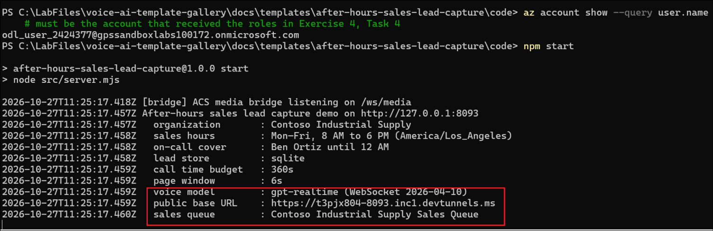

The server is running in live mode with your tunnel as its public address.

### Task 4: Check health through the tunnel (window 3)

Check the server’s health through the public tunnel address.

1. Open a new PowerShell window (window 3), navigate to the code folder, execute **pwsh**, and then the below commands.

   ```powershell
   cd "C:\LabFiles\voice-ai-template-gallery\docs\templates\after-hours-sales-lead-capture\code"
   . .\lab-vars.ps1
   $h = Invoke-RestMethod "$PUBLIC/health"
   $h | Select mode, callReady
   $h.voiceLive; $h.telephony; $h.teamsPhone; $h.hours; $h.onCall
   ```

2. Ensure that mode is live; **voiceLive**, **telephony** and **teamsPhone** are ready (True); hours.open is False during the Indian working day (after hours in Pacific time); and **onCall.covered** is **True**.

   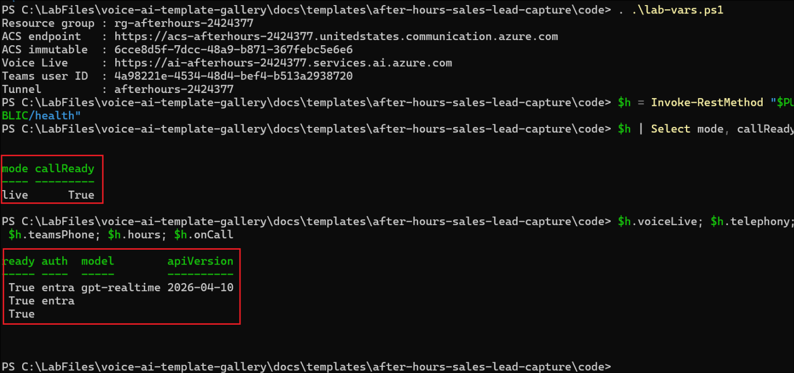

The health check reports live mode, ready for Voice Live, telephony and Teams, with on-call cover active.

### Task 5: Create the Event Grid subscription (window 3)

**Subscribe** the server to **incoming-call events** from your ACS resource.

1. The server and tunnel must be running: Event Grid sends a validation handshake that your server answers. Copy and paste the below code block in window 3.

   ```powershell
   az eventgrid event-subscription create -n incoming-call `
     --source-resource-id $ACSID `
     --endpoint "$PUBLIC/api/events" `
     --included-event-types Microsoft.Communication.IncomingCall
   ```

2. It can take up to 2 minutes with no output. Success: JSON ending in "provisioningState": "Succeeded".

   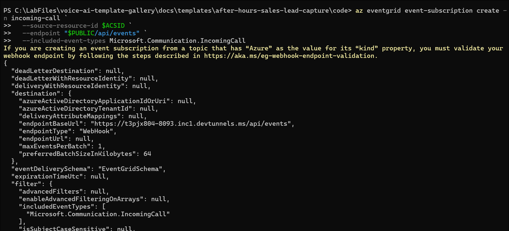

   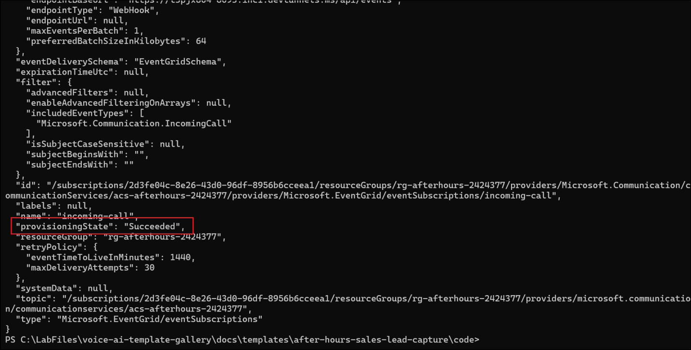

3. Window 2 logs **[eventgrid] subscription validation handshake**.

   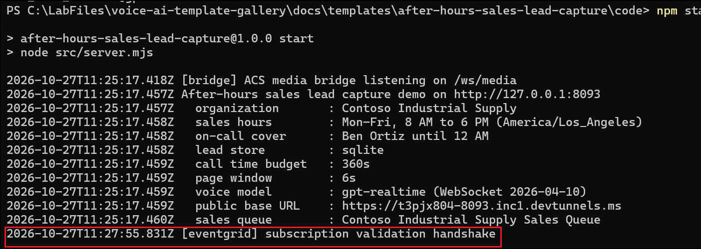

   **Note:** Health shows live and ready, and the subscription is Succeeded. You are ready to call.

The Event Grid subscription succeeded, so calls to your number now reach the agent.

The agent is live: the server runs with your Azure settings, reports ready, and receives incoming calls through Event Grid.

## Exercise 8: Test with real phone calls

In this exercise, you call the agent from a phone as a buyer, let it capture your lead, and trigger a page so the call is transferred to you in Teams, while watching the server log and the console.

### Task 1: Before you dial

**Overview:**

Get everything ready before you place the test call.

1. Window 1 (tunnel) and window 2 (server) are running.

2. The console http://127.0.0.1:8093 is open, so you can watch the transcript, the lead and its score, the decisions and the VoIP headers live.

3. You, as the Teams user, will answer the transferred calls. Open a browser and sign in to Teams (https://teams.microsoft.com) as $AGENT.

4. Use a headset or earphones, in a quiet room. A speakerphone causes echo the AI may pick up.

5. You have a way to call the US. A mobile with international calling enabled is required.

The tunnel, server, console and Teams are ready for a live call.

### Task 2: Capture a lead

**Overview:**

Call the agent after hours, give it a sales inquiry, confirm your number and check the saved lead.

1. From your mobile, dial the **ACS number** (+1…) you noted in Exercise 5. The first call of a session may take up to ~20 seconds to answer.

2. The agent says it is Contoso Industrial Supply’s automated assistant, that the sales team is not available, and asks what you are looking for.

3. Wait for the greeting to finish, then say clearly: “This is Dana Morgan from Northwind Traders. We need about 12,000 hex bolts by the end of the month.”

4. Answer its questions (for example “I’m the purchasing manager”). It reads your caller ID back as the callback number; say “Yes, that’s the best number.”

5. Expected: the agent says someone will call you within an hour of opening and says goodbye. Nobody is paged — the lead is hot, but nothing is urgent.

6. Window 2 should show a sequence like this (example; your call IDs and number differ):

   ```text
   [call] incoming 7c1e… from +••••••••••63 → capture (Sales is closed until 8 AM tomorrow, so the assistant takes the details)
   [acs] answered 7c1e… with media -> 1f00…
   [bridge] media socket connected for call 7c1e…
   [acs] CallConnected 7c1e…
   [voice-live] connected (gpt-realtime)
   [voice-live] tool lookup_catalog {"query":"hex bolts"}
   [voice-live] tool save_lead {"fields":{"name":"Dana Morgan","company":"Northwind Traders",…,"phoneConfirmed":true}}
   ```

   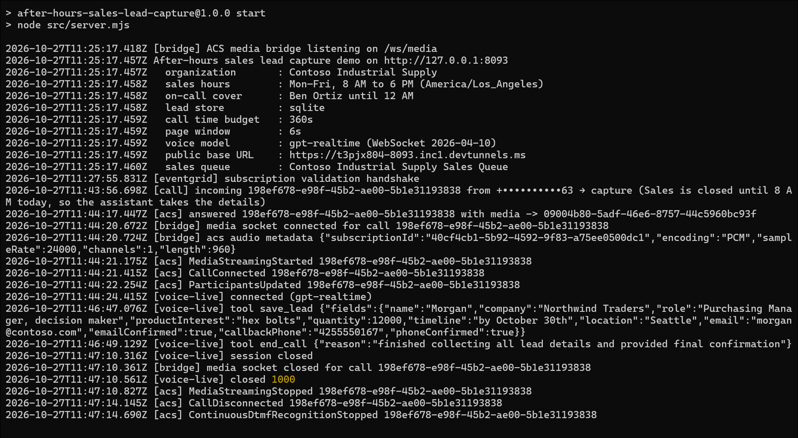

7. In the console, check the lead: its score and points with a reason for each, the owner, the callback deadline and the follow-up message. You can also list the saved leads from window 3:

   ```powershell
   Invoke-RestMethod "$PUBLIC/api/leads" | Select-Object -Last 1 | Format-List name, company, score, points, normalizedPhone, slaDueAt, @{n="owner";e={$_.owner.displayName}}
   ```

   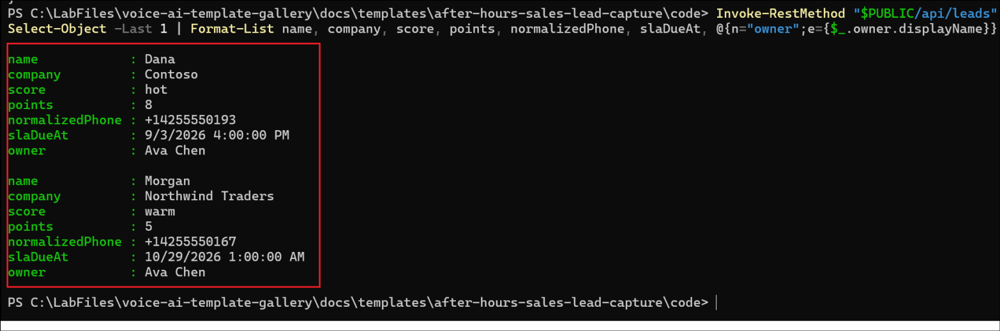

The live call captured a scored lead with a confirmed number, an owner and a deadline.

### Task 3: Page the on-call rep in Teams

**Overview:**

Call again with an **urgent request** and let the server page you in Teams.

1. Dial the **ACS number** again. After the greeting, say: “This is Sam Rivera, operations director at Tailwind Traders. Our packaging line is down and we need 2,000 cartons by tomorrow morning. Can I talk to someone tonight?”

2. Confirm the callback number when it is read back.

3. **Expected:** the agent says it is paging the on-call sales rep and asks you to stay on the line. About 6 seconds later Teams rings in your browser. Answer it.

4. Window 2 shows the page and the transfer:

   ```text
   [voice-live] tool save_lead {…"phoneConfirmed":true…}
   [acs] transfer requested 9a42… -> Ben Ortiz
   [acs] CallTransferAccepted 9a42…
   ```

   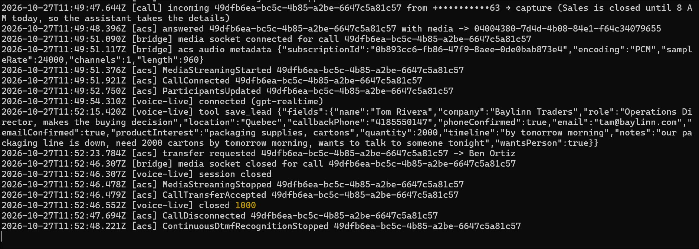

5. In the console’s Teams panel, read the VoIP headers sent with the transfer.

   **Note:** Because you called from the same number as in Task 2, the server merges this call into your earlier lead instead of creating a second one (the console shows it as merged, and the lead’s notes gain this call). That is the repeat-caller rule from Exercise 2, Task 4. The page still happens, because the paging decision is made for this call.

   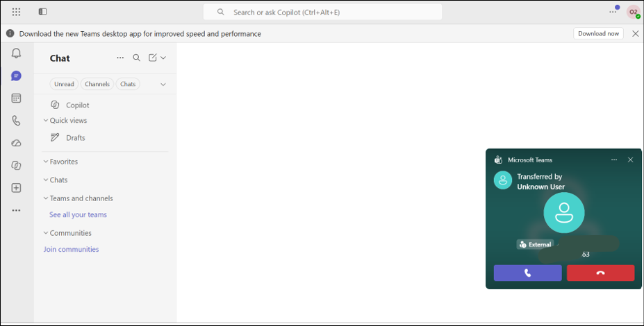

   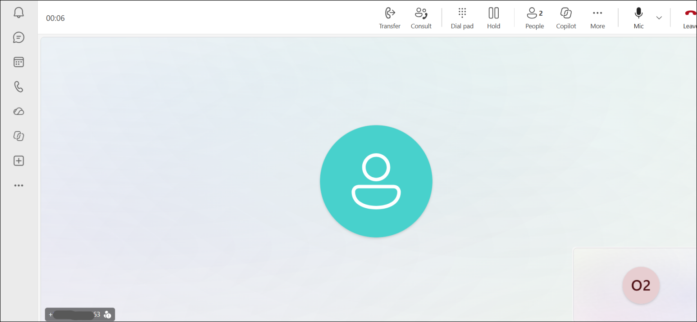

An urgent hot lead paged the on-call rep, and the call reached you in Teams with the lead details.

### Task 4: More live tests

**Overview:**

Try other flows and compare them with the expected behaviour.

1. The AI words things in its own way, but the decisions — hours, score, read-back, owner, deadline and page — are the server’s and must match.

   | **#** | **Flow** | **Say or do** | **Pass if** |
   |---|---|---|---|
   | 1 | Correction | At the read-back: “No, please use 425-555-0147.” | The new number is read back too; only the confirmed number is saved |
   | 2 | Price | “How much do hex bolts cost?” | No price; the question is noted for the rep |
   | 3 | Not a sales call | “I’m calling about an order that hasn’t arrived.” | Gives the support line and hours; no lead (tool classify_non_sales) |
   | 4 | Keypad | Press 0 | Takes a few details first, then the paging policy decides |
   | 5 | Silence | Say nothing | Two prompts, then a goodbye; a partial lead from your caller ID |
   | 6 | Barge-in | Talk over the agent mid-sentence | The agent stops speaking immediately |

2. Optional — the sales-hours path. Stop the server (Ctrl+C in window 2), run the below commands in window 2 to open sales all day in the local copy, and start the server again.

   ```powershell
   $h = Get-Content config\hours.local.json -Raw | ConvertFrom-Json
   $h.weeklyHours = 0..6 | ForEach-Object { [pscustomobject]@{ day = $_; open = "00:00"; close = "24:00" } }
   $h | ConvertTo-Json -Depth 10 | Set-Content config\hours.local.json -Encoding utf8
   npm start
   ```

   Call the number: the assistant does not speak. The call is answered without media and goes straight to the “sales queue” — Teams rings with the topic “Sales inquiry”, and window 2 shows → transfer (Sales is open, so the caller goes straight to the sales queue). Afterwards, stop the server, run the commands of Exercise 6, Task 2 again to restore the normal hours, and start the server again.

3. Press **Ctrl+C** in windows 1 and 2 to stop the tunnel and the server.

The live calls matched the expected behaviour: the server decided the hours, score, read-back, owner, deadline and page, and the transfer reached you in Teams.

You have completed real phone calls with the agent: it disclosed that it is automated, captured and scored leads with confirmed numbers, kept non-sales calls out of the pipeline, and paged the on-call rep in Teams with the lead attached.

## Exercise 9: Delete the resources

In this exercise, you remove everything you created so it no longer incurs cost: the phone number, the Teams allow-list entry, the Azure resources and the dev tunnel.

Run in order, in one PowerShell 7 window with lab-vars.ps1 loaded. Steps 1–2 must run before the resource group is deleted, because they need the ACS IDs.

1. Release the phone number: Azure portal → ACS resource → **Phone numbers** → select the number → **Release**. Numbers bill monthly until released.

   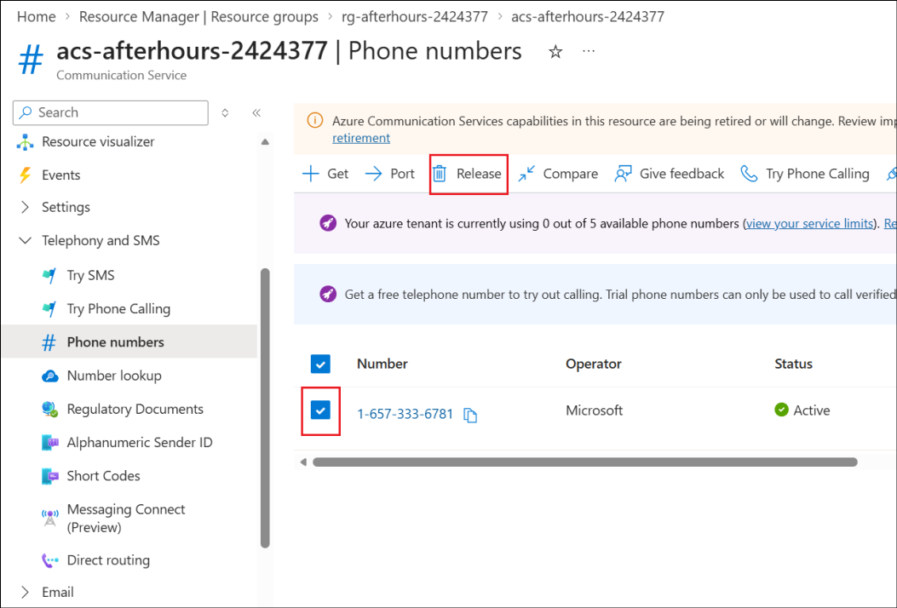

   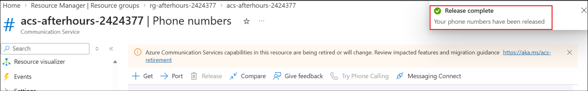

2. Remove **ACS** from the **Teams allow-list**.

   ```powershell
   Connect-MicrosoftTeams
   Set-CsTeamsAcsFederationConfiguration -Identity Global -AllowedAcsResources @{Remove=$IMMUTABLE}
   ```

   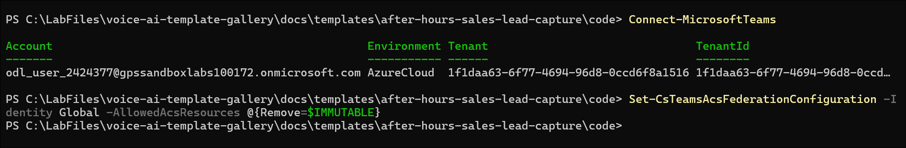

3. Delete the Azure resources (ACS, AI Services and the Event Grid subscription).

   ```powershell
   az group delete -n $RG --yes
   ```

   

4. Delete the tunnel.

   ```powershell
   devtunnel delete $TUNNEL
   ```

   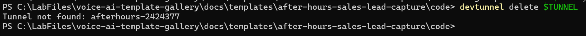

**Exercise conclusion:**

All lab resources are removed. The phone number is released, your ACS resource is no longer allowed in Teams, and the resource group and dev tunnel are deleted.

## Summary

In this lab, you explored and ran an after-hours sales assistant end to end:

- You explored the project and read the code behind each decision: the sales-hours check, lead scoring, the callback read-back rule, owner rotation and deadlines, repeat-caller merging, the paging policy, the AI’s four tools and the Teams handoff with the transfer fix.

- You ran the complete agent in simulation mode and saw every rule fire, each with its reason.

- You created Azure Communication Services and Azure AI Services with keyless access, bought a phone number, and prepared Teams so the agent can transfer callers.

- You took the agent live with a dev tunnel and an Event Grid subscription, captured leads and paged the on-call rep with real phone calls, and removed the resources at the end.

The key design idea throughout is that the AI holds the conversation while the server owns every business decision: whether to answer, how a lead scores, whether a number can be saved, who follows up and by when, and whether someone is worth interrupting tonight. Each decision is made by readable code driven by configuration, and each one comes with a reason a person can check.
