# Lab 3 - Implement outbound appointment reminder calls with Azure Communication Services call automation and Voice Live API

**Objective:**

In this lab, you will run and explore a working AI phone agent that calls patients two days before their appointment. It checks who it is talking to before it says anything about the visit, lets the patient confirm, cancel or ask for a new time, updates the clinic’s schedule while the patient is on the line, and transfers requests for a new time to a person at the scheduling desk in Microsoft Teams. By the end of the lab, you will be able to:

- Explain how the project is organised and which file owns which decision.

- Read the most important parts of the code: who may be called and when, identity first, schedule changes that need a clear yes, the handoff to the scheduling desk, voicemail and wrong-party handling, the AI’s tools and how the reminder call is placed.

- Run and test the complete agent locally in simulation mode.

- Create and configure Azure Communication Services and the Azure AI Voice Live API with keyless access.

- Place real reminder calls to your own phone through a dev tunnel, and transfer a request for a new time to Teams with the context attached.

- Clean up the resources afterwards.

**Description:**

Contoso Health, a fictional group of clinics, loses appointment slots every day to patients who forget or cannot come. In this lab you work with its automated reminder caller. Two days before an appointment it calls the patient from a clinic phone number, says it is an automated assistant, asks for the patient by first name and then for a date of birth. Only when the date of birth matches does it read out the appointment. The patient can then confirm, cancel (the slot is released for someone else) or ask for a new time, which goes to a person at the scheduling desk in Teams — the agent never books a time itself. Voicemail and family members hear a callback request only, never the details of the visit.

The agent runs on a Node.js server on your machine. Azure Communication Services (ACS) places the call from a phone number and controls it, the Azure AI Voice Live API (gpt-realtime) listens and speaks, and the server owns every decision: who may be called and when, what may be said before the right person is on the line, every change to the schedule, and the handoff. The AI is the voice; its tools pass along what the patient said, and none of them can dial, transfer or book anything.

The complete code is already in the lab files. This is based on the templates available here - [Voice AI Agent Template Gallery](https://anujb-msft.github.io/voice-ai-template-gallery/). You explore the key parts, run the agent in simulation mode without Azure, then create the Azure resources, buy a phone number, prepare Teams for transfers, set up a test patient with your own phone number and place real reminder calls.

## Exercise 1: Explore the project

In this exercise, you open the project, install its packages, run the automated tests, and look at the configuration files and the fictional schedule the agent works from.

1. Open a **PowerShell** window and execute the below commands to navigate to the project, install the packages and open VS Code.

   ```powershell
   cd "C:\LabFiles\voice-ai-template-gallery\docs\templates\appointment-reminder-agent\code"
   pwsh
   ```

   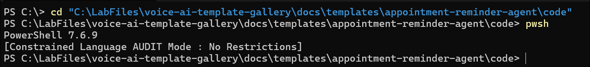

   ```powershell
   npm install --ignore-script
   code .
   ```

   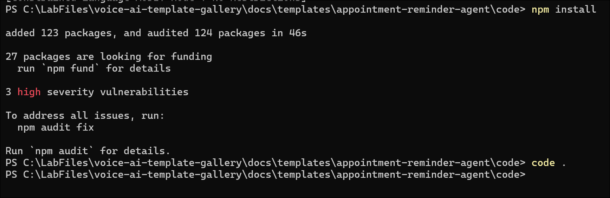

2. Execute the automated tests. They need no Azure and no network.

   ```powershell
   npm test
   ```

   **Expected output**

   ```text
   # tests 52
   # suites 0
   # pass 52
   # fail 0
   ```

   **Note:** You may see “ExperimentalWarning: SQLite is an experimental feature”. It is harmless: some tests use the SQLite built into Node.js.

   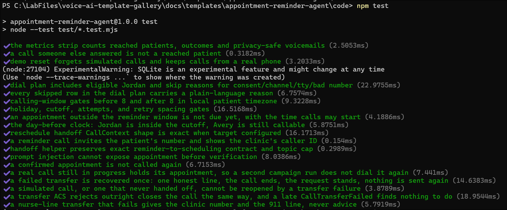

   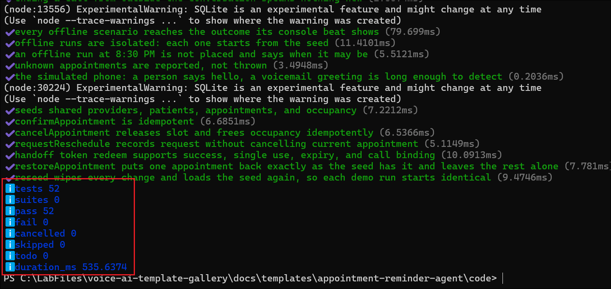

3. Look at the project layout in VS Code. Each file owns one job:

   | **File** | **What it does** |
   |---|---|
   | src/flow.mjs | The call state machine: the dial gates, the identity check, every schedule decision and the handoff. Imports nothing from Azure, Express or SQLite, so it runs the same in tests, in simulation and on real calls. |
   | src/schedule-store.mjs | The clinic’s schedule in SQLite: appointments, confirmations, cancellations and released slots, reschedule requests, call attempts, opt-outs and single-use handoff tokens. |
   | src/handoff.mjs | The reschedule context and the VoIP headers that carry it to Teams. |
   | src/agent.mjs | The 11 tools the AI may call and its standing instructions. |
   | src/audit.mjs, src/db.mjs | The audit trail of every call and decision (in memory, or SQLite) and the numbers on the console. |
   | src/offline.mjs | The simulated phone used by the console, and a terminal run (npm run offline). |
   | src/voice/acs.mjs | ACS Call Automation: place the reminder call, answer a callback, transfer to Teams, keypad, hang up. |
   | src/voice/voice-live.mjs | The Voice Live (gpt-realtime) session over WebSocket. |
   | src/voice/call-bridge.mjs | Joins one phone call’s audio to one Voice Live session and passes the AI’s tool calls to the flow. |
   | src/server.mjs | The campaign run, Event Grid intake for callbacks, ACS callbacks, the simulation and console APIs and /health. |
   | public/ | The browser console you use in simulation and to watch live calls. |

4. Open the files in **config/** and **fixtures/**. Changing who is called, when and what is said is a configuration change, not a code change:

   | **File** | **Holds** |
   |---|---|
   | config/campaign.json | The reminder window (about 48 hours before the appointment), calling hours (8 AM–8 PM in the patient’s time zone), 3 attempts at least 4 hours apart, no calls in the last 24 hours, voicemail on the last attempt only |
   | config/clinics.json | Each clinic’s time zone, callback number, front desk and nurse line, holidays and late-cancellation wording |
   | config/scripts.json | Every line the server owns, in English and Spanish — the opening, the date-of-birth request, the voicemail message, the failures |
   | config/routing.json | The scheduling desk, the front desk and the nurse line |
   | config/prep.json, config/detection.json | Preparation reminders (such as fasting); voicemail, emergency and clinical-question phrases |
   | fixtures/appointments-seed.json | Fictional patients (with date of birth, phone, consent, language, proxies), providers and appointments, loaded into an empty schedule |

The project is open, its packages are installed and all 52 tests pass. You know which file owns which job and where the policy and the fictional schedule live.

## Exercise 2: Understand the key code

In this exercise, you read the most important parts of the code. Each task shows a short excerpt and explains it. You do not need to change anything: open the file in VS Code (Ctrl+P, then type the file name) and find the code with Ctrl+F to see it in context.

### Task 1: Who may be called, and when

See the gates every reminder call must pass before anything is dialed.

1. Open **config/campaign.json**.

   **config/campaign.json**

   ```json
   {
     "leadTimeHours": 48,
     "leadWindowHours": 8,
     "callingWindow": { "start": "08:00", "end": "20:00" },
     "maxAttempts": 3,
     "minSpacingHours": 4,
     "cutoffHoursBeforeAppointment": 24,
     "voicemailOnLastAttempt": true,
     "maxConcurrent": 2,
     "nightlyRunLocalTime": "18:00"
   }
   ```

2. Open **src/flow.mjs** and find **evaluateDialEligibility**.

   **src/flow.mjs — evaluateDialEligibility()**

   ```javascript
     evaluateDialEligibility(appointment, { now = this.now(), dryRun = true } = {}) {
       const campaign = fixtures.campaign;
       const patient = appointment?.patient ?? {};
       const clinic = fixtures.clinics.locations[appointment?.location] ?? {};
       const timeZone = patientTimeZone(appointment);
       const phone = (patient.phones ?? [])[0] ?? {};
       const attempts = this.schedule.attemptsFor(appointment.appointmentId);
       const result = (reason, extra = {}) => ({ ok: reason === "ok", reason, timeZone, attempt: attempts.length + 1, nextAllowedAt: null, ...extra });
   
       if (!patient.consent?.voice) return result("no_consent");
       if ((patient.preferredChannel ?? "voice") !== "voice") return result("channel");
       if (this.schedule.isSuppressed(appointment.patientId)) return result("suppressed");
       if (patient.flags?.tty || /hearing/i.test(String(patient.flags?.note ?? ""))) return result("tty");
       if (!phone.number || phone.status === "bad") return result("bad_number");
       const allowlist = this.options.allowedTestNumbers ?? [];
       if (!dryRun && allowlist.length && !allowlist.includes(phone.number)) return result("not_allowlisted");
       if (appointment.status === "confirmed") return result("already_confirmed");
       if (appointment.status !== "booked") return result("appointment_closed");
       if (this.schedule.hasOpenRescheduleRequest?.(appointment.appointmentId)) return result("reschedule_pending");
       // A real call's attempt is recorded when it ends, so until then the call itself holds the appointment.
       if (this.#liveCallInProgress(appointment.appointmentId)) return result("in_progress");
   
       const start = new Date(appointment.start).getTime();
       const cutoffAt = new Date(start - campaign.cutoffHoursBeforeAppointment * 3_600_000);
       const dueFrom = new Date(start - (campaign.leadTimeHours + campaign.leadWindowHours / 2) * 3_600_000);
       const last = attempts.at(-1);
       const spacedUntil = last ? new Date(new Date(last.created_at).getTime() + campaign.minSpacingHours * 3_600_000) : null;
       const holidays = clinic.holidays ?? [];
       const nextAllowed = () => {
         const from = new Date(Math.max(now.getTime(), dueFrom.getTime(), spacedUntil?.getTime() ?? 0));
         return nextAllowedCallTime(from, { timeZone, window: campaign.callingWindow, holidays, notAfter: cutoffAt })?.toISOString() ?? null;
       };
       const local = localParts(now, timeZone);
   
       if (holidays.includes(local.ymd)) return result("holiday", { nextAllowedAt: nextAllowed() });
       if (local.minutes < minutesOf(campaign.callingWindow.start) || local.minutes >= minutesOf(campaign.callingWindow.end)) {
         return result("calling_window", { nextAllowedAt: nextAllowed() });
       }
       if (now >= cutoffAt) return result("cutoff");
       if (now < dueFrom) return result("not_due", { nextAllowedAt: nextAllowed() });
       if (attempts.length >= campaign.maxAttempts) return result("attempts");
       if (spacedUntil && now < spacedUntil) {
         const next = nextAllowed();
         return result("spacing", { nextAllowedAt: next, nextAttemptAt: next });
       }
       return result("ok");
     }
   ```

**What to notice:**

- The gates run in a fixed order: consent, preferred channel, opt-out, TTY, a valid number, the test allowlist (real calls only), the appointment’s status, an open reschedule request, a call already in progress, holidays, calling hours, the 24-hour cutoff, the reminder window, attempts and spacing.

- Calling hours are checked in the **patient’s** time zone (patientTimeZone), not the server’s.

- A refused call returns a reason and, for a time rule, the next allowed time (nextAllowed), which the console and the dial plan show in plain English.

3. Open **src/server.mjs** and find **/api/campaign/run**, the endpoint that starts the reminder calls.

   **src/server.mjs — POST /api/campaign/run**

   ```javascript
     "/api/campaign/run",
     asyncRoute(async (_req, res) => {
       const dialing = config.campaign.enabled && !config.campaign.dryRun && !isSimulated();
       const dialPlan = flow.buildDialPlan({ dryRun: !dialing });
       const launched = [];
       if (dialing) {
         for (const row of dialPlan.filter((r) => r.state === "scheduled")) {
           // Checked again right before each dial, with no await in between: a run that
           // overlapped this one may have taken the last slot or already be calling this patient.
           if (callsInFlight >= config.campaign.maxConcurrent) break;
           const appointment = schedule.getAppointment(row.appointmentId);
           if (!appointment || !flow.evaluateDialEligibility(appointment, { dryRun: false }).ok) continue;
           const call = flow.create({ appointmentId: row.appointmentId });
           callsInFlight += 1;
           try {
             const { callConnectionId } = await createOutboundCall({ to: call.appointment.patient.phones?.[0]?.number, callId: call.id });
             call.callConnectionId = callConnectionId;
             launched.push(call.id);
           } catch (e) {
             log("[campaign] dial failed", call.id, e.message);
             callsInFlight = Math.max(0, callsInFlight - 1);
             flow.endCall(call.id, "create_call_failed");
           }
         }
       }
       res.json({ dryRun: !dialing, dialPlan, launched });
   ```

**What to notice:**

- Real dialing needs CAMPAIGN_ENABLED=true, CAMPAIGN_DRY_RUN=false and live mode. Otherwise the run only returns the dial plan and calls nobody.

- The gates are checked again right before each dial, and no more than CAMPAIGN_MAX_CONCURRENT calls run at once.

Who may be called, and when, is decided by the server from campaign.json and the patient record, before anything is dialed.

### Task 2: Identity first, then the minimum necessary

See how the server keeps every appointment detail back until a date of birth matches.

1. In **src/flow.mjs**, find **#guard** at the end of the class. Every appointment tool goes through it.

   **src/flow.mjs — #guard()**

   ```javascript
     #guard(callId, { verified = false } = {}) {
       const call = this.#require(callId);
       if (isTerminal(call.state)) return { call, refusal: { ok: false, reason: "call_ended", state: call.state } };
       if (verified && !call.verified) {
         this.#event(call, "policy", "blocked_until_verified", "Blocked: identity not verified yet");
         return { call, refusal: { ok: false, reason: "not_verified" } };
       }
       return { call, refusal: null };
     }
   ```

2. Find **checkDob**.

   **src/flow.mjs — checkDob()**

   ```javascript
     checkDob(callId, { spokenOrDigits = "", dob = null } = {}) {
       const { call, refusal } = this.#guard(callId);
       if (refusal) return refusal;
       if (call.state !== STATES.VERIFYING) return { ok: false, reason: "confirm_identity_first" };
       call.dobTurns += 1;
       const heard = normalizeDob(spokenOrDigits || dob || "");
       if (heard && heard === call.appointment.patient?.dob) {
         call.verified = true;
         this.audit.updateCall(call.id, { verified: true, proxyName: call.proxyName });
         const who = call.proxyName ? `${firstWord(call.proxyName)} verified as an authorized proxy` : "identity verified";
         this.#event(call, "policy", "identity_verified", `Date of birth matched: ${who}`);
         this.#setState(call, STATES.PRESENTING);
         return { ...this.presentAppointment(call.id), ok: true, status: "verified" };
       }
       if (!heard) {
         if (call.dobTurns >= 3) return this.#unverified(call);
         return this.#say(call, this.#script(call, "dobExplain"), { ok: false, status: "retry", reason: "no_date_heard" });
       }
       call.dobAttempts += 1;
       this.#event(call, "policy", "dob_mismatch", `Date of birth did not match (try ${call.dobAttempts} of 2)`);
       if (call.dobAttempts >= 2 || call.dobTurns >= 3) return this.#unverified(call);
       return this.#say(call, this.#script(call, "dobRetry"), { ok: false, status: "retry" });
     }
   ```

**What to notice:**

- The AI passes along what the patient said (spoken or keyed as MMDDYYYY); the server compares it with the record. The AI never sees the date on file.

- Only a match sets verified and unlocks presentAppointment(), which reads out the department, provider, time and place. Before that, #guard refuses any appointment tool with not_verified.

- Two mismatches end the call with the clinic’s number and nothing about the appointment (#unverified). An authorized proxy, such as a spouse, still has to give the patient’s date of birth.

Identity is checked by the server, and nothing about the visit is said until it matches.

### Task 3: Schedule changes need a clear yes

See how a confirmation and a cancellation are written to the schedule only after an explicit yes.

1. In **src/flow.mjs**, find **confirmAppointment** and **cancelAppointment**.

   **src/flow.mjs — confirmAppointment()**

   ```javascript
     confirmAppointment(callId, { confirmation = "", idempotencyKey = null } = {}) {
       const { call, refusal } = this.#guard(callId, { verified: true });
       if (refusal) return refusal;
       if (!isAffirmative(confirmation)) return this.#say(call, this.#script(call, "needYesConfirm"), { ok: false, reason: "needs_explicit_yes" });
       this.schedule.confirmAppointment(call.appointmentId, idempotencyKey ?? `${call.appointmentId}:call:${call.id}:confirm`);
       call.appointment = this.schedule.getAppointment(call.appointmentId) ?? call.appointment;
       this.#event(call, "schedule", "appointment_confirmed", `${call.appointmentId} marked confirmed in the schedule`);
       this.#publish(call, "schedule", { appointmentId: call.appointmentId, status: call.appointment.status });
       const spoken = this.#script(call, "confirmed", { prep: prepText(call.appointment.prepCode, call.language) });
       return this.#finish(call, STATES.CONFIRMED, "confirmed", { spoken });
     }
   ```

   **src/flow.mjs — cancelAppointment()**

   ```javascript
     cancelAppointment(callId, { proposalId = null, confirmation = "" } = {}) {
       const { call, refusal } = this.#guard(callId, { verified: true });
       if (refusal) return refusal;
       const proposal = call.cancelProposal;
       if (!proposal || (proposalId && proposalId !== proposal.proposalId)) return { ok: false, reason: "missing_proposal" };
       if (!isAffirmative(confirmation)) return this.#say(call, this.#script(call, "needYesCancel"), { ok: false, reason: "needs_explicit_yes" });
       const result = this.schedule.cancelAppointment(call.appointmentId, proposal.reasonCode, `${call.appointmentId}:call:${call.id}:cancel:${proposal.proposalId}`);
       call.appointment = this.schedule.getAppointment(call.appointmentId) ?? call.appointment;
       const slot = result.releasedSlot ?? null;
       const when = formatShort(slot?.start ?? call.appointment.start, timeZoneOf(call.appointment));
       this.#event(call, "schedule", "slot_released", `${when} with ${call.appointment.provider?.name ?? "the provider"} is free again`, { releasedSlot: slot });
       this.#publish(call, "schedule", { appointmentId: call.appointmentId, status: call.appointment.status, releasedSlot: slot });
       return this.#finish(call, STATES.CANCELLED, "cancelled", { spoken: this.#script(call, "cancelled") });
     }
   ```

**What to notice:**

- Both go through #guard with verified: true, so they are refused before the identity check.

- isAffirmative() requires an explicit yes in the patient’s own words; anything else gets a question, not a change.

- A cancellation must first be read back by proposeCancel(), which creates a proposal (with a late-cancellation notice inside 24 hours). cancelAppointment() accepts only that proposal, then releases the slot so the schedule shows it free again.

- Writes are idempotent (idempotency keys), so a repeated tool call cannot cancel or confirm twice.

The schedule changes during the call, but only after verification and a clear yes.

### Task 4: The agent never books — the handoff to the scheduling desk

See how a request for a new time becomes a transfer to a person in Teams, with the context attached.

1. In **src/flow.mjs**, find **requestReschedule**.

   **src/flow.mjs — requestReschedule()**

   ```javascript
     requestReschedule(callId, { correlationId = null } = {}) {
       const { call, refusal } = this.#guard(callId, { verified: true });
       if (refusal) return refusal;
       const appointment = call.appointment;
       const request = this.schedule.requestReschedule(call.appointmentId, `${call.appointmentId}:call:${call.id}:reschedule`);
       const target = this.options.schedulingAgentTarget || "";
       if (!target && !call.simulated) {
         this.#event(call, "handoff", "reschedule_callback", "No scheduling desk configured: request logged for a callback; nothing booked");
         const finished = this.#finish(call, STATES.ENDED, "reschedule_callback", { spoken: this.#script(call, "rescheduleCallback") });
         return { ...finished, ok: true, request, transfer: null, callContext: null };
       }
       const issued = this.schedule.issueHandoffToken({ appointmentId: call.appointmentId, patientId: call.patientId, correlationId: correlationId ?? call.sessionId });
       const callContext = reminderToSchedulingContext({ appointmentId: call.appointmentId, patientRef: issued.token, verified: true, sessionId: call.sessionId });
       const routing = fixtures.routing.schedulingAgent ?? {};
       const timeZone = timeZoneOf(appointment);
       const callTopic = clipTopic(`Reschedule – ${appointment.department} ${call.appointmentId}`);
       const callerSaid = [...call.transcript].reverse().find((t) => t.role === "caller")?.text ?? "";
       const handoff = {
         destination: "schedulingAgent",
         queue: routing.queue ?? "Scheduling desk",
         displayName: routing.displayName ?? "Appointment scheduling agent",
         target: target || null,
         simulated: call.simulated,
         sessionId: call.sessionId,
         callTopic,
         callContext,
         voipHeaders: buildCustomCallingContext({ sessionId: call.sessionId, callTopic, callContext }),
         summary: `${maskName(appointment.patient)} (verified${call.proxyName ? ` via ${firstWord(call.proxyName)}, authorized proxy` : ""}) wants a new time for ${appointment.department} ${appointment.visitType} on ${formatShort(appointment.start, timeZone)}. The current slot stays booked until a new one is chosen.`,
         callerSaid: callerSaid.slice(0, 120),
         patientRefExpiresAt: issued.expiresAt,
         appointment: {
           appointmentId: call.appointmentId,
           department: appointment.department,
           visitType: appointment.visitType,
           provider: appointment.provider?.name ?? null,
           localTime: formatShort(appointment.start, timeZone),
         },
       };
       call.handoff = handoff;
       this.#event(call, "handoff", "reschedule_handoff", `Handing off to the ${handoff.queue.toLowerCase()} with context; the agent books nothing itself`, { callTopic });
       this.#publish(call, "handoff", handoff);
       const finished = this.#finish(call, STATES.TRANSFERRING, "reschedule_handoff", { spoken: this.#script(call, "rescheduleTransfer") });
       this.#startTransfer(call, handoff);
       return { ...finished, ok: true, request, transfer: handoff, callContext };
     }
   ```

**What to notice:**

- The request is logged in the schedule; the current slot stays booked until a person chooses a new one.

- With no scheduling desk configured, a real call ends with a callback request. With SCHEDULING_AGENT_TARGET set (a Teams user’s object ID), the call is transferred.

- The context carries the intent, the appointment id, verified: true and a **patientRef** — a single-use token that expires after five minutes, not a patient id. No date of birth or phone number travels to Teams.

- The topic reads “Reschedule – Primary Care A-20419”. Note the en dash (–): this matters for the transfer fix in Task 7.

2. Open **src/handoff.mjs**, which turns this context into VoIP headers.

   **src/handoff.mjs**

   ```javascript
   import { config } from "./config.mjs";
   
   const LIMIT = 48;
   export function clipTopic(text) { const s = String(text ?? "").replace(/\s+/g, " ").trim(); return s.length <= LIMIT ? s : `${s.slice(0, LIMIT - 1).trimEnd()}…`; }
   export function teamsIdentifier(target) {
     if (!target?.objectId && !target?.teamsAppId && !target?.microsoftTeamsUserId) throw new Error("handoff target missing Teams id");
     if (target.microsoftTeamsUserId || target.type === "user") return { microsoftTeamsUserId: target.microsoftTeamsUserId ?? target.objectId };
     return { teamsAppId: target.teamsAppId ?? target.objectId, cloud: config.acs.teamsCloud };
   }
   export function buildCustomCallingContext({ sessionId, callTopic, callContext }) {
     const context = typeof callContext === "string" ? callContext : JSON.stringify(callContext ?? {});
     return [
       ["CallDetails.SessionId", sessionId],
       ["CallDetails.CallTopic", clipTopic(callTopic)],
       ["CallDetails.CallContext", context],
     ].filter(([, v]) => v != null && v !== "").map(([key, value]) => ({ kind: "voip", key, value: String(value).slice(0, 1024) }));
   }
   export function resourceAccountFrom(to) {
     const match = /^28:(?:orgid:)?([0-9a-f-]{36})$/i.exec(to?.rawId ?? "");
     return match ? match[1] : null;
   }
   export function reminderToSchedulingContext({ appointmentId, patientRef, verified = true, sessionId }) {
     return { intent: "reschedule", appointmentId, patientRef, verified, sessionId };
   }
   ```

A request for a new time always goes to a person, with a verified, minimal context the scheduler can act on.

### Task 5: Voicemail, family members, emergencies and opt-outs

See what a voicemail or someone else may hear, and the safety checks on every patient turn.

1. In **src/flow.mjs**, find **handleVoicemail** and **screen**.

   **src/flow.mjs — handleVoicemail()**

   ```javascript
     handleVoicemail(callId, detected = { reason: "detected" }) {
       const call = this.#require(callId);
       if (isTerminal(call.state)) return { ok: false, reason: "call_ended", state: call.state };
       this.#setState(call, STATES.VOICEMAIL);
       const reason = String(detected.reason ?? "detected");
       const how = reason.startsWith("phrase:") ? `greeting said “${reason.slice(7)}”` : reason.replace(/_/g, " ");
       this.#event(call, "policy", "voicemail_detected", `Voicemail detected (${how})`);
       const last = call.attempt >= fixtures.campaign.maxAttempts && fixtures.campaign.voicemailOnLastAttempt !== false;
       if (!last) return this.#retry(call, "voicemail_hangup");
       this.#event(call, "policy", "minimum_necessary", "Anyone could hear a voicemail: callback request only, no appointment details");
       return this.#finish(call, STATES.ENDED, "voicemail_left", { spoken: this.#script(call, "voicemail") });
     }
   ```

   **src/flow.mjs — screen()**

   ```text
     screen(callId, text) {
       if (emergencyMatch(text)) return this.emergency(callId);
       if (match.optOut(text)) return this.optOut(callId);
       return null;
     }
   ```

**What to notice:**

- Before the last attempt, voicemail gets no message at all and a retry is scheduled. On the last attempt it gets a callback request only: the clinic name, the patient’s first name, that it is a reminder, and a callback number — no department, provider, date or time.

- When someone other than the patient answers, #wrongParty gives the same callback request and ends the call.

- screen() runs on every patient turn: an emergency gets the advice to hang up and call emergency services, and “please stop calling me” saves an opt-out before the call ends, so the patient is not called again.

What a voicemail, a family member, an emergency or an opt-out triggers is fixed server wording, not something the AI improvises.

### Task 6: What the AI is allowed to do

See the AI’s tools and how each one is handed to the server.

1. Open **src/agent.mjs**. The AI has 11 tools: confirm_identity, check_dob, get_appointment_summary, confirm_appointment, propose_cancel, cancel_appointment, request_reschedule, opt_out, nurse_line, repeat_last and end_call. None of them takes a phone number, a Teams ID, a time or a slot.

2. Open **src/voice/call-bridge.mjs** and find where each tool is mapped.

   **src/voice/call-bridge.mjs — tool mapping**

   ```powershell
         case "confirm_identity": return this.flow.confirmIdentity(this.callId, args);
         case "check_dob": return this.flow.checkDob(this.callId, args);
         case "get_appointment_summary": return this.flow.presentAppointment(this.callId);
         case "confirm_appointment": return this.flow.confirmAppointment(this.callId, args);
         case "propose_cancel": return this.flow.proposeCancel(this.callId, args);
         case "cancel_appointment": return this.flow.cancelAppointment(this.callId, args);
         case "request_reschedule": return this.flow.requestReschedule(this.callId, args);
         case "opt_out": return this.flow.optOut(this.callId);
         case "nurse_line": return this.flow.nurseLine(this.callId, { connect: args.connect === true });
         case "repeat_last": return this.flow.repeatLast(this.callId);
   ```

**What to notice:**

- Each tool maps to one flow method; the bridge makes no decisions of its own.

- Because no tool accepts a number or an ID, the AI cannot dial anyone, transfer anywhere or book anything — even if a caller tries to talk it into it.

- A clinical question goes to nurse_line: the agent gives no medical advice and offers the nurse line instead.

The AI is the voice; every action it can take is a narrow tool that the server checks.

### Task 7: Placing the call, and the Teams transfer fix

See how ACS places the reminder call, and the fix that makes transfers to Teams work.

1. Open **src/voice/acs.mjs** and find **reminderCallInvite** and **createOutboundCall**.

   **src/voice/acs.mjs — placing the reminder call**

   ```javascript
   export function reminderCallInvite(to, callerId = config.acs.callerId) {
     return { targetParticipant: { phoneNumber: to }, sourceCallIdNumber: { phoneNumber: callerId } };
   }
   
   export async function createOutboundCall({ to, callId, operationContext = `reminder:${callId}` }) {
     const result = await (await acsClient()).createCall(reminderCallInvite(to), `${config.publicBaseUrl}/api/calls/callback?call=${encodeURIComponent(callId)}`, { operationContext, mediaStreamingOptions: mediaOptions(callId) });
     return { callConnectionId: result.callConnectionProperties?.callConnectionId ?? null };
   }
   ```

**What to notice:**

- createCall dials the patient’s number from ACS_CALLER_ID (your ACS phone number) and opens bidirectional media streaming, so the audio flows to Voice Live as PCM 24 kHz mono.

- The call id travels in the callback URL and the media URL, so call events and audio land on the right call.

2. In the same file, find **transferCall**.

   **src/voice/acs.mjs — asciiSafe() and transferCall()**

   ```javascript
   /** Lab fix (ACS phone number): transfers reject dotted VoIP header keys and non-ASCII values. */
   const asciiSafe = (headers) =>
     headers.map((h) => ({
       ...h,
       key: String(h.key).replace(/[^A-Za-z0-9]/g, ""),
       value: String(h.value)
         .replace(/[\u2013\u2014]/g, "-")
         .replace(/[\u201C\u201D]/g, '"')
         .replace(/[\u2018\u2019]/g, "'")
         .replace(/\u2026/g, "...")
         .replace(/[^\x20-\x7E]/g, ""),
     }));
   
   const log = (...a) => console.log(new Date().toISOString(), "[acs]", ...a);
   
   export async function transferCall({ callConnectionId, target, context, callId }) {
     if (!callConnectionId) throw new Error("no call connection to transfer");
     const participant = /^\+/.test(target) ? { phoneNumber: target } : { microsoftTeamsUserId: target };
     try {
       await (await acsClient()).getCallConnection(callConnectionId).transferCallToParticipant(participant, {
         operationContext: `transfer:${callId}`,
         customCallingContext: asciiSafe(buildCustomCallingContext(context)),
       });
     } catch (e) {
       log("TRANSFER ERROR", "status:", e.statusCode, "| code:", e.code, "| message:", e.message);
       log("TRANSFER ERROR body:", e.response?.bodyAsText ?? "(none)");
       throw e;
     }
     log("transfer requested", callId, "->", target);
   }
   ```

ACS places the reminder call from your number, and transfers carry the context to Teams with headers ACS accepts.

You have read the code behind every important decision: the dial gates, identity first, schedule changes with a clear yes, the handoff to the scheduling desk, voicemail and safety handling, the AI’s tools, and how the call is placed and transferred.

## Exercise 3: Test the agent in simulation

In this exercise, you run the complete agent in the browser console before connecting any Azure services. A typed call drives the same state machine a real call does — the same dial gates, identity check, schedule writes and handoff. Only the AI and the audio are replaced by a scripted stand-in. The demo clock starts two days before the seeded appointments (19 May 2026, 10 AM Pacific).

1. Start the server.

   ```powershell
   npm start
   ```

   **Expected output**

   ```text
   Appointment reminder demo on http://127.0.0.1:8099
     schedule           : better-sqlite3
     audit              : sqlite
     reminder policy    : 48 h ahead, stop 24 h before, 3 attempts, calls 08:00–20:00 patient time
     scheduling desk    : not set (real reschedule requests become callbacks)
     SIMULATION MODE    — set ACS_ENDPOINT, ACS_CALLER_ID, PUBLIC_BASE_URL, VOICE_LIVE_ENDPOINT to place real calls
     demo clock         : 2026-05-19T17:00:00… (two-days-before)
   ```

   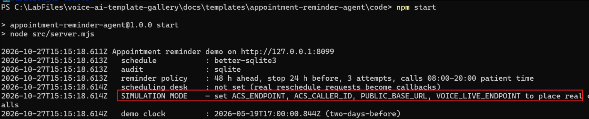

2. Open **http://127.0.0.1:8099** in the browser and click **Reset demo**.

   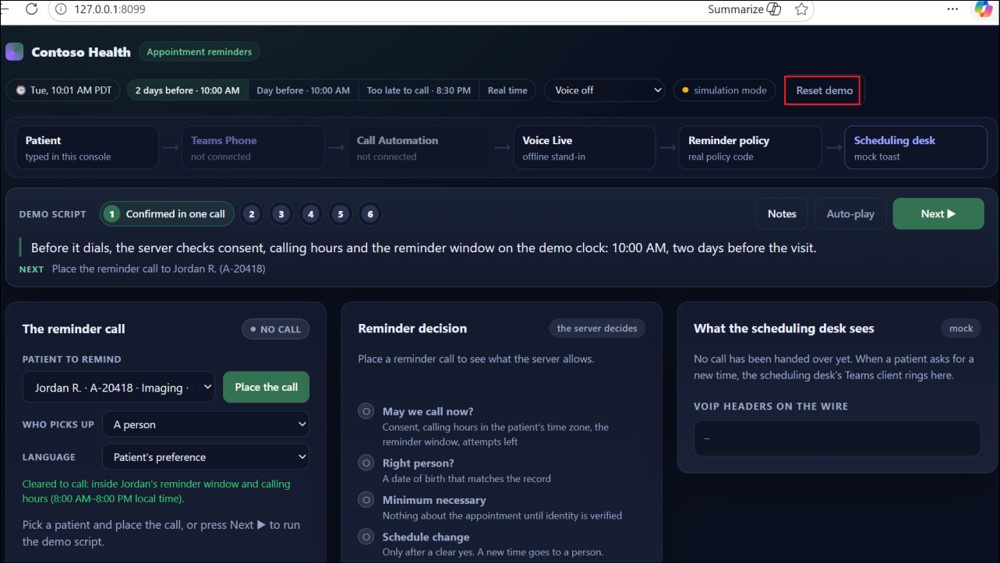

3. Play the scripted demo: press **Next ▶** (or the → key) to run each of the six beats. Compare with the expected result:

   | **#** | **Beat** | **Expected result** |
   |---|---|---|
   | 1 | Confirmed in one call (Jordan R., A-20418) | No details until the date of birth (March 12th, 1984) matches; then the imaging appointment with Dr. Lee is read out; “Yes, I’ll be there” marks A-20418 **confirmed** in the schedule, with the fasting reminder. |
   | 2 | Cancel frees the slot (Avery S., A-20419) | After verification, “I need to cancel” is read back first; “Yes, please cancel it” cancels A-20419 and the 10:15 slot with Dr. Patel shows **free** again. |
   | 3 | New time → a person (Riley D., A-20423) | “Can I come next week instead?” hands the call to the scheduling desk. The Teams panel shows the toast and the VoIP headers: topic “Reschedule – Primary Care A-20423” and a context with verified: true and a patientRef. |
   | 4 | Someone else answers (Camila L.) | “No, this is her sister”: a callback request only — no department, provider or time. The rule shown is minimum necessary. |
   | 5 | Voicemail: callback only (attempt 3 of 3) | The greeting says “leave a message”, so it is treated as voicemail: a callback request only. |
   | 6 | Too late to call (Noah M., 8:30 PM) | Refused before dialing: outside calling hours, with Noah’s local time and the next allowed time. The numbers strip shows the totals. |

   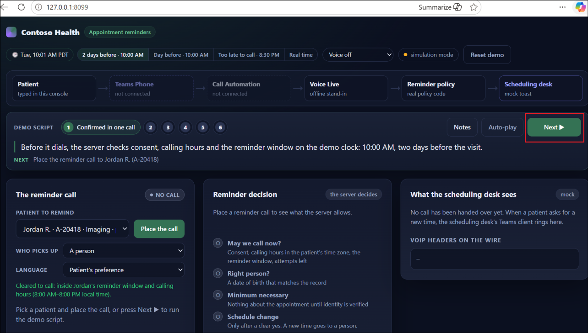

   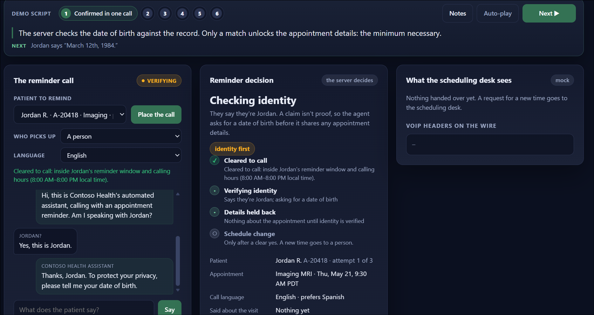

4. Now drive calls yourself. Click **Reset demo** before each row (a confirmed appointment is not called again). Pick the **Patient to remind**, set **Who picks up** to **A person** and **Language** to **English**, press **Place the call**, type each line and click **Say** (or use the keypad):

   | **Patient** | **Type or press** | **Expected result** |
   |---|---|---|
   | Jordan R. | This is Alex, Jordan’s husband. → March 12th, 1984. → Yes, we’ll be there. | An authorized proxy still gives Jordan’s date of birth first; then confirmed |
   | Jordan R. | Yes, this is Jordan. → keypad 0 3 1 2 1 9 8 4 → keypad 1 | Date of birth keyed in, then confirmed from the keypad |
   | Jordan R. | Yes, this is Jordan. → January 1st, 1990. → January 1st, 1990. | Not verified: the clinic’s number, and nothing about the appointment |
   | Jordan R. | Yes, this is Jordan. → March 12th, 1984. → I have a fever, should I still come? → Yes. | No medical advice; the nurse line is offered, and “Yes.” connects it |
   | Avery S. | Please stop calling me. | Opted out before the call ends; the next Place the call for Avery is not placed |

   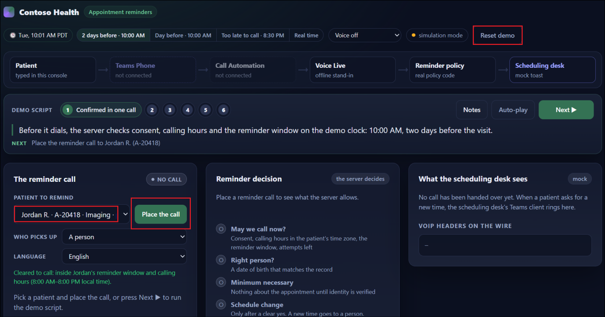

   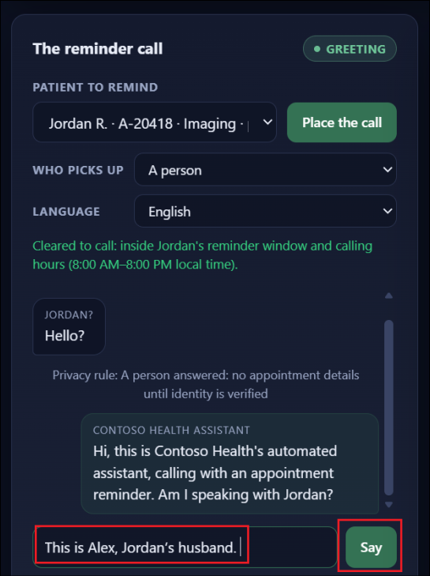

   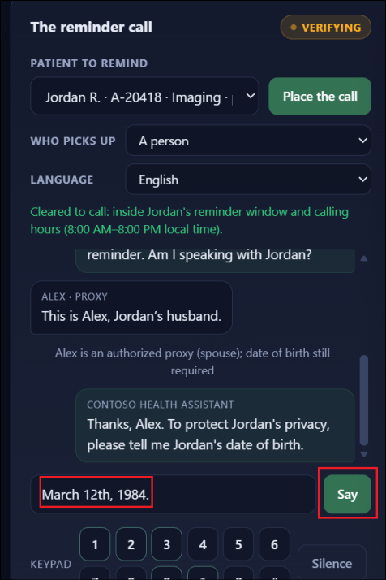

   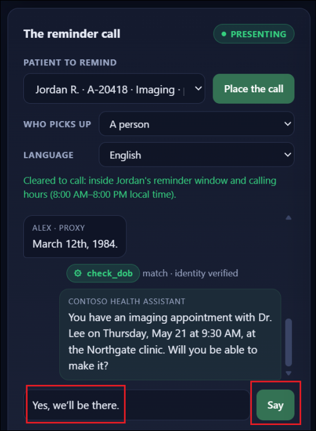

The screenshots are added for the conversation as per the first row of the table only. You can continue testing with the other column values as well.

5. For each call, read the **decision** panel and the **decision trail** (which rule fired), the **schedule** panel, and the **Teams** panel with the **VoIP headers**. Name the file and function from Exercise 2 that made each decision.

6. Press **Ctrl+C** in the PowerShell window to stop the server.

You have seen every rule fire in simulation — the dial gates, identity first, proxies, confirmation, cancellation, the handoff, wrong party, voicemail, clinical questions and opt-out — and traced each one to the code.

## Exercise 4: Create the Azure resources

In this exercise, you create the Azure resources the live agent needs — an Azure Communication Services resource and an Azure AI Services resource for Voice Live — and give your sign-in the roles for keyless access. A small variables file keeps every name, number, endpoint and ID consistent across PowerShell windows.

### Task 1: Create the lab variables file

Create **lab-vars.ps1**, a small file that holds your names and phone numbers and fetches every endpoint and ID from Azure, and load it into your PowerShell session.

1. In VS Code, create a new file named **lab-vars.ps1** in the **code** folder (next to package.json) and paste the below content.

   ```powershell
   # lab-vars.ps1 - load it in every PowerShell 7 window with:   . .\lab-vars.ps1
   # ---------------------------------------------------------------- EDIT
   $TENANT  = "<yourtenant>.onmicrosoft.com"
   $SUFFIX  = "<initials><nn>"                               # for example sv01 - keeps your names unique
   $LOC     = "eastus2"                                      # a region that serves Voice Live (gpt-realtime)
   $AGENT   = "<teams-user>@<yourtenant>.onmicrosoft.com"    # the Teams user who acts as the scheduling desk
   $MYPHONE = "+<country code><your mobile number>"          # the phone the reminder calls, e.g. +919876543210
   # ------------------------------------------------- derived (do not edit)
   $TUNNEL = "reminder-$SUFFIX"
   $RG  = "rg-reminder-$SUFFIX"; $ACS = "acs-reminder-$SUFFIX"; $AI = "ai-reminder-$SUFFIX"
   $ACSID        = az communication show -n $ACS -g $RG --query id -o tsv 2>$null
   $ACS_ENDPOINT = if ($ACSID) { "https://" + (az communication show -n $ACS -g $RG --query hostName -o tsv) }
   $IMMUTABLE    = if ($ACSID) { az communication show -n $ACS -g $RG --query immutableResourceId -o tsv }
   $AISUB        = az cognitiveservices account show -n $AI -g $RG --query properties.customSubDomainName -o tsv 2>$null
   $VL_ENDPOINT  = if ($AISUB) { "https://$AISUB.services.ai.azure.com" }
   $AGENT_ID     = az ad user show --id $AGENT --query id -o tsv 2>$null
   Write-Host "Resource group : $RG"
   Write-Host "ACS endpoint   : $ACS_ENDPOINT"
   Write-Host "ACS immutable  : $IMMUTABLE"
   Write-Host "Voice Live     : $VL_ENDPOINT"
   Write-Host "Teams user ID  : $AGENT_ID"
   Write-Host "Your phone     : $MYPHONE"
   Write-Host "Tunnel         : $TUNNEL"
   # ------------------------------- added later: $ACS_NUMBER (Exercise 5) and $PUBLIC (Exercise 8)
   ```

   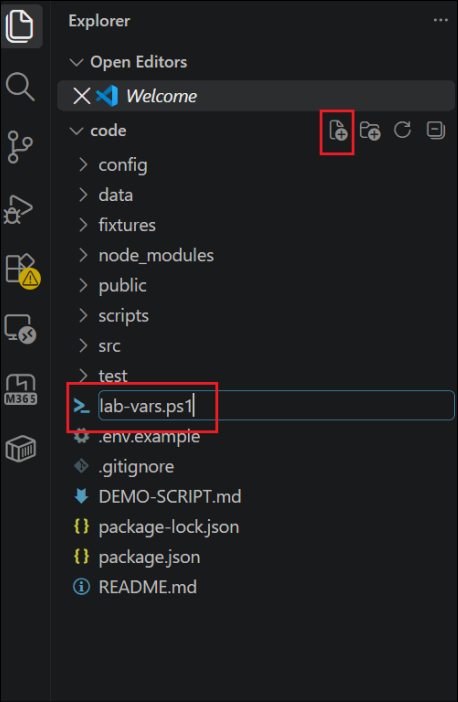

2. Replace the five values in the **EDIT** section with your own. **$MYPHONE** is your mobile number in international format: a plus sign, the country code and the number, with no spaces (for example +91900000000). Keep the quotes and remove the < > brackets.

   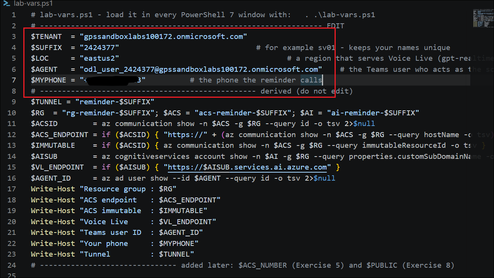

3. Save the file (Ctrl+S).

4. In the PowerShell 7 window, execute the below command to load the variables.

   ```powershell
   az login --tenant $TENANT --use-device-code
   . .\lab-vars.ps1
   ```

   Resource group must show rg-reminder-<your suffix>, not the text <suffix>. If it still shows <suffix>, the EDIT section was not saved.

   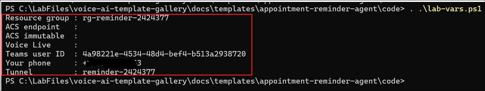

   **Note:** Blank endpoint and ID values after the first load are normal — the resources do not exist yet. Reload the file after each step that creates something.

**lab-vars.ps1** holds your names and phone number and loads into the session.

### Task 2: Sign in and check permissions

**Sign in** to **Azure**, check your **permissions** and **register** the **services** the lab uses.

1. **Copy** the below code and **paste** it in the **PowerShell** to **sign in** and check the available **permissions**.

   ```powershell
   . .\lab-vars.ps1
   az login --tenant $TENANT --use-device-code
   az account show --query "{user:user.name, tenant:tenantId, subscription:name}" -o table
   $ME = az ad signed-in-user show --query id -o tsv
   az role assignment list --assignee $ME --all --query "[].{role:roleDefinitionName, scope:scope}" -o table
   az provider register -n Microsoft.Communication
   az provider register -n Microsoft.CognitiveServices
   az provider register -n Microsoft.EventGrid
   az extension add --name communication --upgrade
   ```

2. Select **Paste anyway** when you get a warning about multiple lines of code.

3. Follow the **prompts** to **sign in**.

   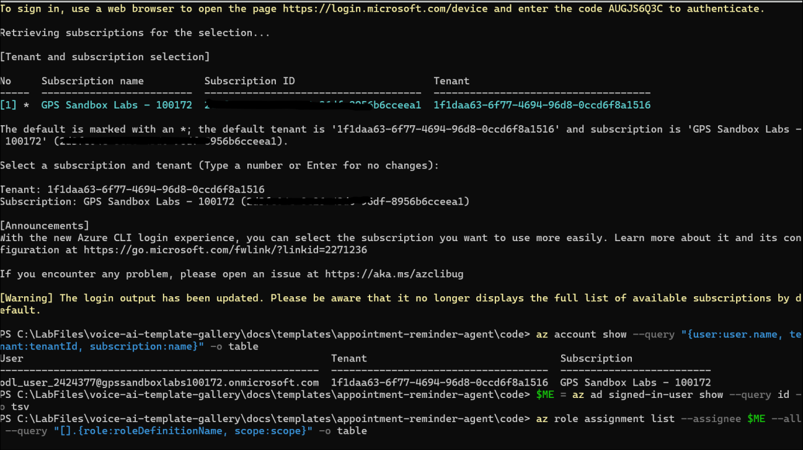

   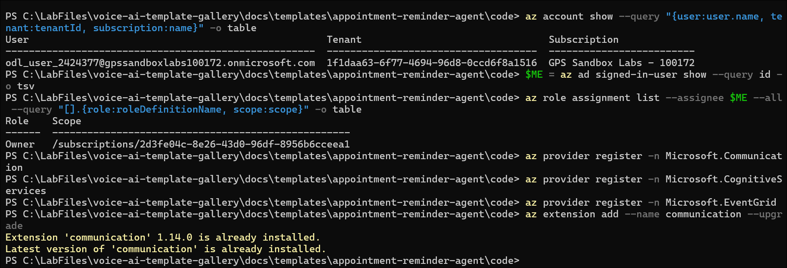

You are signed in to the lab tenant with the required permissions, and the resource providers are registered.

### Task 3: Create the resources

Create the resource group, the Azure Communication Services resource and the Azure AI Services resource.

1. Copy and paste the below block of code in the PowerShell to **create** the **resources** in **Azure**.

   ```powershell
   az group create -n $RG -l $LOC
   az communication create -n $ACS -g $RG --location global --data-location UnitedStates
   az cognitiveservices account create -n $AI -g $RG -l $LOC --kind AIServices --sku S0 --custom-domain $AI --yes
   ```

   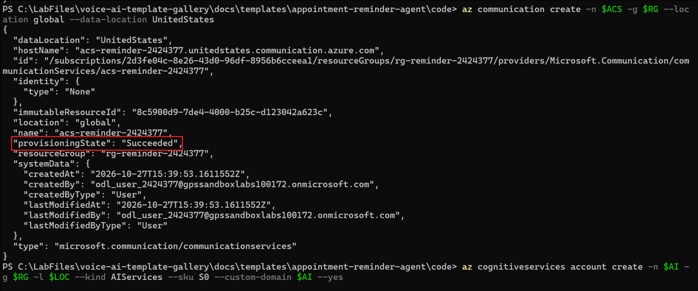

   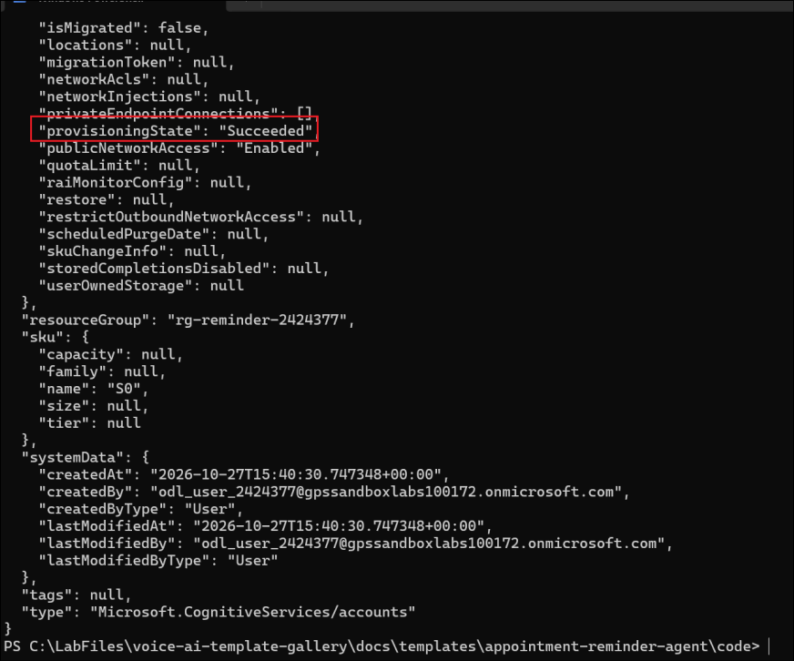

The **resource group**, **ACS** resource and **AI Services** resource are created.

### Task 4: Assign roles to your sign-in

Give your sign-in the roles it needs to use **ACS** and **Voice Live** without keys, and confirm the **endpoints**.

1. Copy and paste the below block of code in the PowerShell.

   ```powershell
   . .\lab-vars.ps1                 # reload: now fetches the new IDs
   $ME   = az ad signed-in-user show --query id -o tsv
   $AIID = az cognitiveservices account show -n $AI -g $RG --query id -o tsv
   az role assignment create --assignee $ME --role "Communication and Email Service Owner" --scope $ACSID
   az role assignment create --assignee $ME --role "Cognitive Services User" --scope $AIID
   az role assignment create --assignee $ME --role "Foundry User" --scope $AIID
   ```

2. `. .\lab-vars.ps1` now **prints** an **ACS endpoint** ending in .communication.azure.com and a **Voice Live endpoint** ending in .services.ai.azure.com (never /models).

3. Role assignments can take a few minutes to apply.

   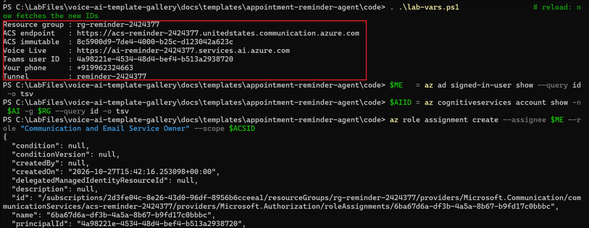

   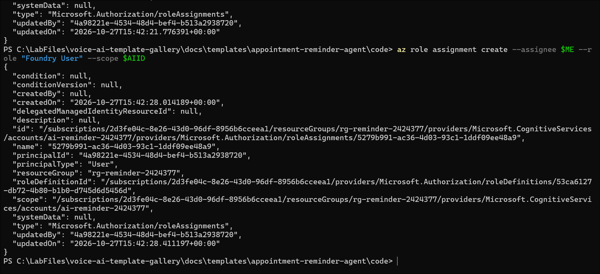

The roles are assigned and lab-vars.ps1 now returns both endpoints.

Your Azure resources exist, the roles are assigned, and lab-vars.ps1 fetches the ACS and Voice Live endpoints automatically.

## Exercise 5: Get a US phone number in ACS

In this exercise, you buy a US local phone number in your Azure Communication Services resource. This is the clinic number the reminder calls come from, so it must be able to **make** calls.

1. Open the Azure portal at https://portal.azure.com and sign in with your lab tenant.

2. Open the resource group **rg-reminder-<suffix>** and select your Communication Service from there.

   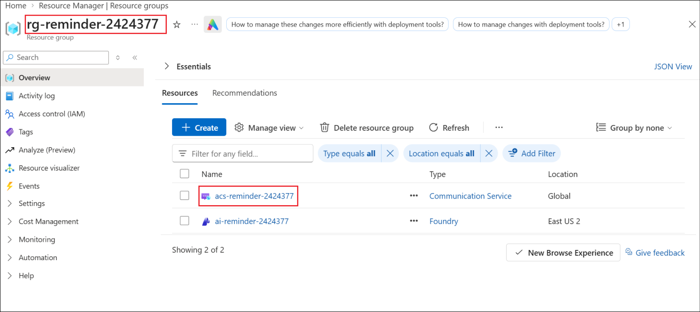

3. Select **Phone numbers** under **Telephony and SMS** and then select **+ Get**.

   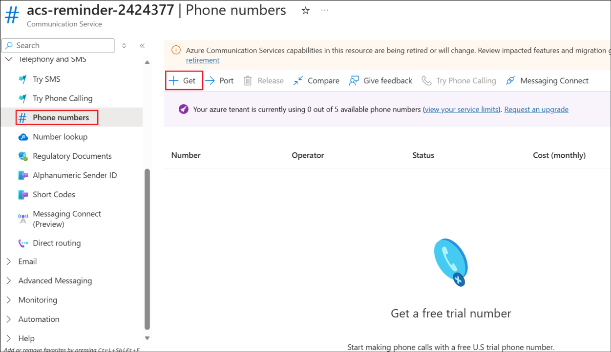

4. Select the below values.

- Country/region: United States.

- Number type: Local (geographic).

- Calling: **Make and receive calls** (the reminder agent places outbound calls). SMS: None.

  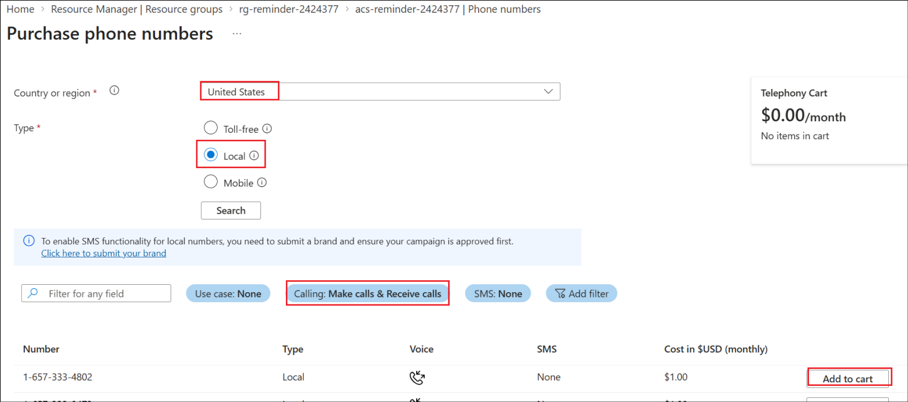

5. Add a number to the cart and then select **Next**.

   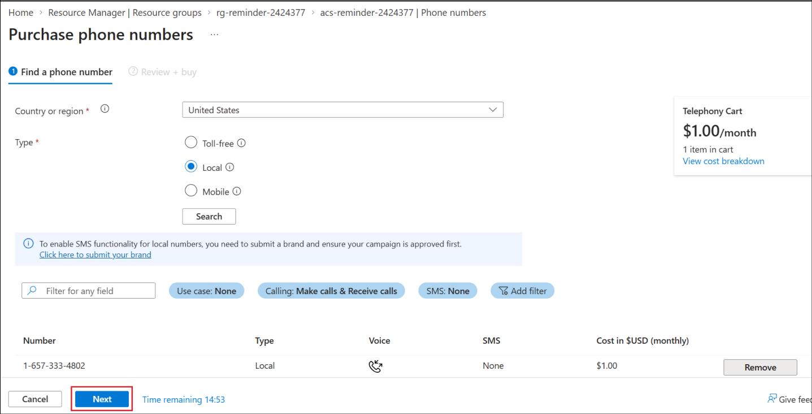

6. Complete the purchase: select **Buy now**.

   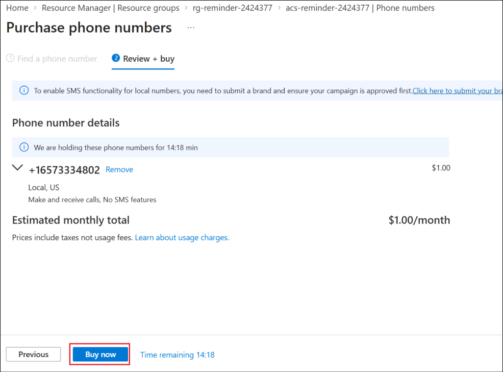

   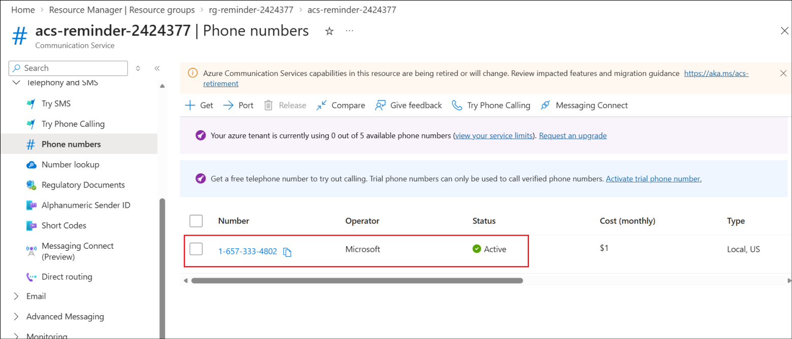

7. Add the number to the bottom of lab-vars.ps1 in international format, with no spaces, save the file and reload it:

   ```powershell
   $ACS_NUMBER = "+1XXXXXXXXXX"
   ```

   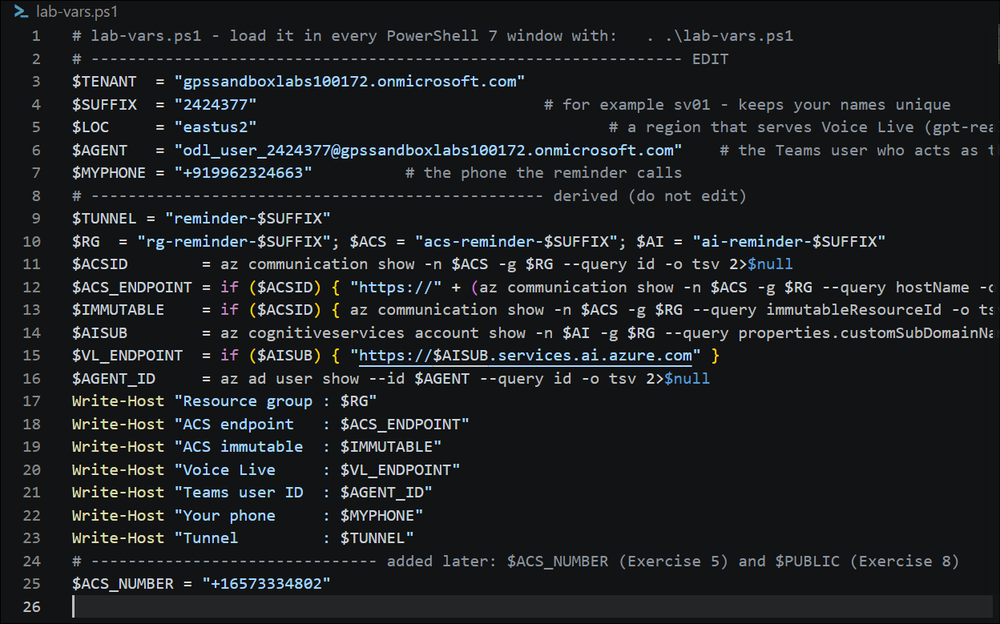

**Exercise conclusion:**

You have a phone number that can place calls, saved in lab-vars.ps1 as $ACS_NUMBER.

## Exercise 6: Set up transfers to Teams

In this exercise, you prepare Microsoft Teams so the agent can hand a request for a new time to a person: you enable your Teams user, who acts as the scheduling desk, for calling, and allow your ACS resource to call Teams users.

Reminders, confirmations and cancellations work without this exercise. It is needed for a request for a new time to reach a person in Teams; without it, the request becomes a callback request.

### Task 1: Sign in to Teams and enable the Teams user

Sign in to Teams PowerShell and enable the Teams user who acts as the scheduling desk for Teams calling.

1. Copy and paste the below code in the PowerShell window to **sign in** to **Teams** and enable the Teams user for **Teams calling**.

   ```powershell
   . .\lab-vars.ps1
   $env:PSModulePath = "$HOME\PSModules;" + $env:PSModulePath
   Import-Module MicrosoftTeams
   Connect-MicrosoftTeams -UseDeviceAuthentication     # sign in as the tenant's Teams admin
   Get-CsOnlineUser -Identity $AGENT | Format-List DisplayName, FeatureTypes, EnterpriseVoiceEnabled, TeamsUpgradeEffectiveMode
   Set-CsPhoneNumberAssignment -Identity $AGENT -EnterpriseVoiceEnabled $true
   $AGENT_ID                                            # the object ID used as the scheduling desk
   ```

2. Ensure that **FeatureTypes** includes **PhoneSystem**, the mode is **TeamsOnly**, and **EnterpriseVoiceEnabled** becomes **True** (this can take a few minutes).

   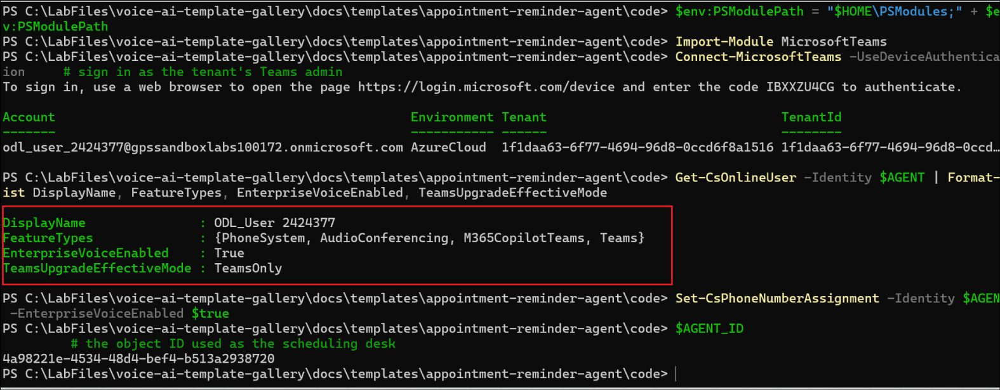

The Teams user has Teams Phone, is in Teams-only mode, and has Enterprise Voice enabled.

### Task 2: Allow your ACS resource to call Teams users

Allow your **ACS resource** to **call Teams users** in the tenant, and confirm the settings.

1. Execute the below commands in the PowerShell window.

   ```powershell
   Set-CsTeamsAcsFederationConfiguration -Identity Global -EnableAcsUsers $true -AllowedAcsResources @{Add=$IMMUTABLE}
   Set-CsExternalAccessPolicy -Identity Global -EnableAcsFederationAccess $true
   Get-CsTeamsAcsFederationConfiguration | Format-List Identity, EnableAcsUsers, AllowedAcsResources
   Get-CsExternalAccessPolicy -Identity Global | Format-List Identity, EnableAcsFederationAccess
   ```

2. Ensure that **EnableAcsUsers** is **True**, your $IMMUTABLE value is listed under **AllowedAcsResources**, and **EnableAcsFederationAccess** is **True**. Teams can take up to an hour to apply these.

   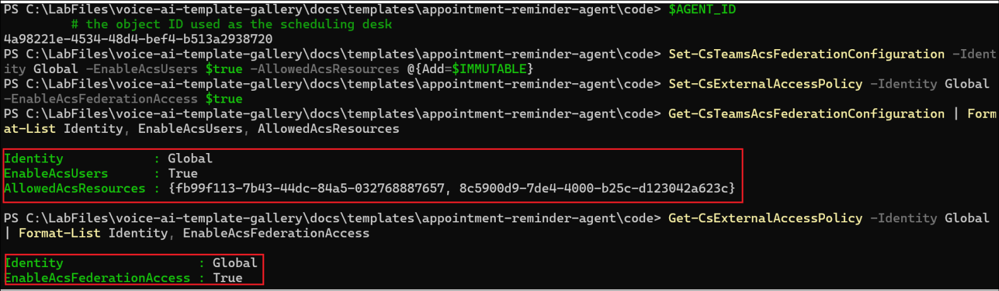

Your **ACS** resource is on the tenant’s **allow-list** and ACS **calls to Teams users** are **enabled**.

Transfers are ready: the Teams user can take calls as the scheduling desk, and your ACS resource is allowed to call Teams users.

## Exercise 7: Create a test patient with your phone number

In this exercise, you create a local copy of the schedule in which one patient has your phone number and an appointment about two days from now, so a real reminder campaign calls you.

A live server decides on the real clock, and the seeded appointments. The test patient is Avery S. (date of birth **June 9th, 1979**), appointment **A-20419**, Primary Care with Dr. Patel.

1. Execute the below commands in the PowerShell window, in the code folder.

   ```powershell
   . .\lab-vars.ps1
   $s = Get-Content fixtures\appointments-seed.json -Raw | ConvertFrom-Json
   $p = $s.patients | Where-Object patientId -eq "P-1001"
   $p.phones[0].number = $MYPHONE
   $p.timeZone = "Asia/Kolkata"
   $a = $s.appointments | Where-Object appointmentId -eq "A-20419"
   $start = (Get-Date -Minute 0 -Second 0).AddHours(50)
   $a.start = $start.ToString("yyyy-MM-ddTHH:mm:sszzz")
   $a.end   = $start.AddMinutes(15).ToString("yyyy-MM-ddTHH:mm:sszzz")
   $s | ConvertTo-Json -Depth 20 | Set-Content fixtures\appointments-live.json -Encoding utf8
   $a | Format-List appointmentId, department, start
   ```

   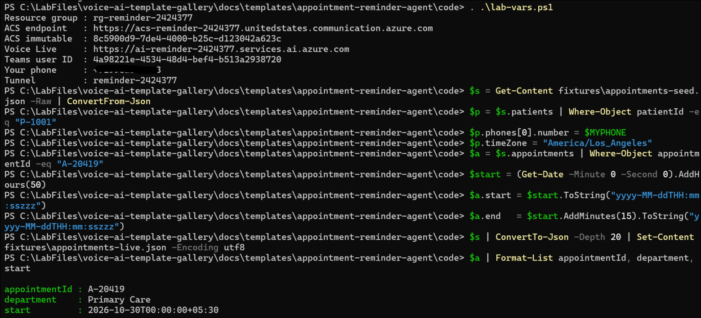

**What to notice:**

- Avery’s phone becomes your $MYPHONE, and Avery’s time zone becomes India Standard Time, so the 8 AM–8 PM calling hours are your local hours. Use your own time zone if you are not in India (for example "Europe/London").

- A-20419 is moved to about 50 hours from now. A reminder is due between 52 and 24 hours before the appointment, and the campaign looks for appointments 44–52 hours away, so you have about 6 hours to place the call. If more time passes, run this step again.

- The agent reads the time in the clinic’s time zone (Seattle, Pacific time), so it sounds different from your local time. That is expected.

**fixtures\appointments-live.json** holds a test patient who can be reminded now, on your phone.

## Exercise 8: Go live: tunnel, .env and server

In this exercise, you take the agent live. You expose your local server to Azure through a dev tunnel, create the .env configuration, start the server in live mode, and check its health and the dial plan.

You use three PowerShell 7 windows, all in the code folder, and load the variables in each one using these commands.

```powershell
cd "C:\LabFiles\voice-ai-template-gallery\docs\templates\appointment-reminder-agent\code"
pwsh

. .\lab-vars.ps1
```

| **Window** | **Runs** | **Keep open?** |
|---|---|---|
| 1 | Dev tunnel | Yes, for the whole session |
| 2 | Server (npm start) | Yes, for the whole session |
| 3 | Campaign runs, checks, az commands | As needed |

### Task 1: Start a persistent tunnel (window 1)

Start a named dev tunnel so Azure can reach the server running on your machine at a stable public address.

1. Use the window you have been using so far as window 1, and execute the below code to start a tunnel on port 8099.

   ```powershell
   devtunnel user login
   devtunnel create $TUNNEL --allow-anonymous      # first time only
   devtunnel port create $TUNNEL -p 8099           # first time only
   devtunnel host $TUNNEL
   ```

2. When prompted, select **Work or school account** and sign in with your tenant credentials, then select **No, this app only**.

3. Copy the **Connect via browser** address it prints (it looks like https://<id>-8099.<region>.devtunnels.ms).

   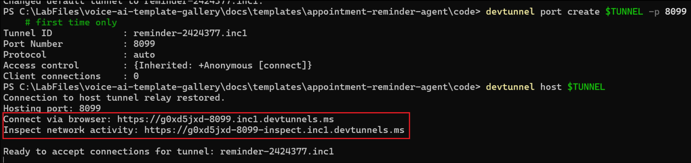

4. Add one line to the bottom of lab-vars.ps1 in VS Code, replacing the address with yours, and save the file:

   ```powershell
   $PUBLIC = "<paste the Connect via browser address, no trailing slash>"
   ```

   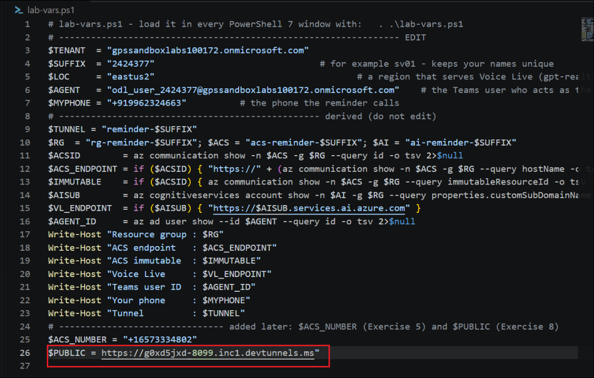

The tunnel is running, and its public address is saved in lab-vars.ps1.

### Task 2: Create .env (window 2)

Generate the .env file with your Azure values, the scheduling desk, the campaign switches and the test schedule.

1. Open a new PowerShell window (window 2), navigate to the code folder and execute **pwsh**.

   ```powershell
   cd "C:\LabFiles\voice-ai-template-gallery\docs\templates\appointment-reminder-agent\code"
   ```

   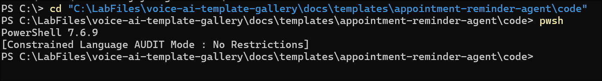

2. Copy the below script block and paste it in the PowerShell.

   ```powershell
   . .\lab-vars.ps1
   Copy-Item .env.example .env -Force
   $set = [ordered]@{
     PUBLIC_BASE_URL         = $PUBLIC
     ACS_ENDPOINT            = $ACS_ENDPOINT
     ACS_CALLER_ID           = $ACS_NUMBER
     VOICE_LIVE_ENDPOINT     = $VL_ENDPOINT
     SCHEDULING_AGENT_TARGET = $AGENT_ID
     CAMPAIGN_ENABLED        = "true"
     CAMPAIGN_DRY_RUN        = "false"
     ALLOWED_TEST_NUMBERS    = $MYPHONE
     SCHEDULE_SEED_PATH      = "./fixtures/appointments-live.json"
     SCHEDULE_DB_PATH        = "./data/schedule-live.db"
     DEMO_NOW                = ""
   }
   $lines = Get-Content .env
   foreach ($k in $set.Keys) {
     $found = $false
     $lines = $lines | ForEach-Object { if ($_ -match "^\s*#?\s*$k=") { $found = $true; "$k=$($set[$k])" } else { $_ } }
     if (-not $found) { $lines += "$k=$($set[$k])" }
   }
   $lines | Set-Content .env -Encoding utf8
   Select-String "^(PUBLIC_BASE_URL|ACS_ENDPOINT|ACS_CALLER_ID|VOICE_LIVE_ENDPOINT|VOICE_LIVE_API_KEY|SCHEDULING_AGENT_TARGET|CAMPAIGN_ENABLED|CAMPAIGN_DRY_RUN|ALLOWED_TEST_NUMBERS|SCHEDULE_SEED_PATH|SCHEDULE_DB_PATH)=" .env
   ```

**What to notice:**

- **ACS_CALLER_ID** is the number the calls come from; **SCHEDULING_AGENT_TARGET** is your Teams user’s object ID (the scheduling desk).

- **CAMPAIGN_ENABLED=true** and **CAMPAIGN_DRY_RUN=false** allow real dialing, and **ALLOWED_TEST_NUMBERS** makes sure only your phone can be dialed.

- The live schedule uses your test seed and its own database file, so the simulation schedule (data\schedule.db) is untouched. VOICE_LIVE_API_KEY stays empty (keyless sign-in).

  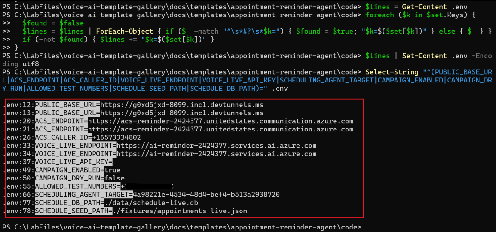

.env holds your Azure values, the scheduling desk, the campaign switches and the test schedule.

### Task 3: Start the server (window 2)

Start the server in live mode.

1. Execute the below commands in window 2.

   ```powershell
   az account show --query user.name -o tsv    # must be the account that received the roles in Exercise 4, Task 4
   npm start
   ```

2. The log must not say SIMULATION MODE, and must show the scheduling desk configured and the campaign dialing. The server reads .env and the files only at start-up: restart it (Ctrl+C, npm start) after any change.

   **Expected output**

   ```text
     scheduling desk    : configured
     voice model        : gpt-realtime (WebSocket 2026-04-10)
     public base URL    : https://<id>-8099.<region>.devtunnels.ms
     campaign           : enabled, dialing
   ```

   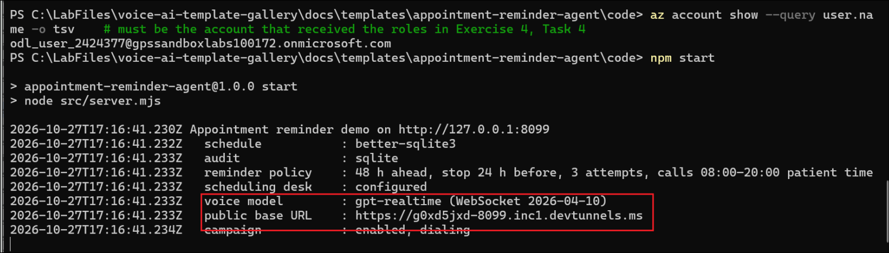

The server is running in live mode with your tunnel as its public address.

### Task 4: Check health and the dial plan (window 3)

Check the server’s health through the tunnel, and see who the campaign would call before calling anyone.

1. Open a new PowerShell window (window 3), navigate to the code folder, execute **pwsh**, and then the below commands.

   ```powershell
   cd "C:\LabFiles\voice-ai-template-gallery\docs\templates\appointment-reminder-agent\code"
   . .\lab-vars.ps1
   $h = Invoke-RestMethod "$PUBLIC/health"
   $h | Select mode, callReady, campaignEnabled, campaignDryRun, schedulingAgentTarget, scheduleDbPath
   $h.voiceLive; $h.acs
   (Invoke-RestMethod "$PUBLIC/api/campaign/dry-run").dialPlan | Format-List appointmentId, patientName, localTime, state, why
   ```

2. Ensure that **mode** is **live**, **callReady** is **True**, **campaignEnabled** is **True**, **campaignDryRun** is **False**, **schedulingAgentTarget** shows your **$AGENT_ID**, and **acs.ready** and **acs.callerIdConfigured** are **True**.

3. The **dial plan** must list **A-20419**, Avery S., with state **scheduled** and “Cleared to call: inside Avery’s reminder window and calling hours”. If it says skipped, the why line gives the reason (for example outside calling hours, or not due — then run Exercise 7 again and restart the server after deleting data\schedule-live.db).

   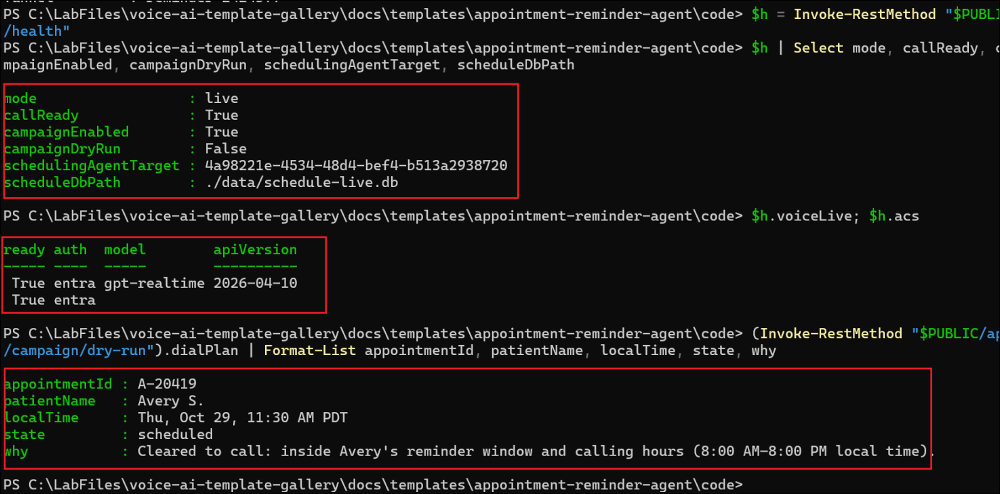

   **Note:** Health shows live and ready, and the dial plan shows A-20419 scheduled. You are ready to place the reminder call.

The server is live, and the dial plan shows your test patient cleared to call.

The agent is live: the server runs with your Azure settings, the scheduling desk is configured, and the dial plan shows your test patient cleared to call.

## Exercise 9: Test with real reminder calls

In this exercise, you run the reminder campaign so the agent calls your phone, verify yourself as the patient, confirm, cancel and ask for a new time — which transfers you to yourself in Teams — while watching the server log and the console.

### Task 1: Before the call

Get everything ready before you start the campaign.

1. Window 1 (tunnel) and window 2 (server) are running.

2. The console http://127.0.0.1:8099 is open, so you can watch the transcript, the decisions and the schedule live.

3. You, as the Teams user, are the scheduling desk. Open a browser and sign in to Teams (https://teams.microsoft.com) as $AGENT.

4. Use a headset or earphones, in a quiet room. A speakerphone causes echo the AI may pick up.

5. You are **Avery**; your date of birth is **June 9th, 1979** (keypad: 06091979).

The tunnel, server, console and Teams are ready, and you know the test patient’s details.

### Task 2: Confirm the appointment

Start the campaign, answer the reminder call and confirm.

1. In window 3, start the campaign:

   ```powershell
   $run = Invoke-RestMethod -Method Post "$PUBLIC/api/campaign/run"
   $run.dryRun; $run.launched
   ```

2. Expected: **dryRun** is **False** and launched shows one call id. Your phone rings from your ACS number within a few seconds.

   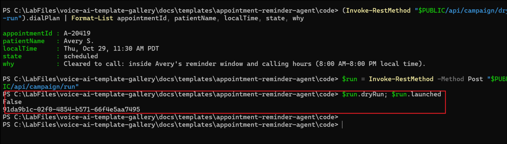

3. Answer and say “**Hello**?”. The agent says it is **Contoso Health’s automated assistant calling with an appointment reminder**, and asks **whether it is speaking with Avery**.

4. Say: “**Yes, this is Avery**.” It asks for your **date of birth** — still nothing about the appointment.

5. Say: “**June 9th, 1979**.” Only now does it read out the Primary Care appointment with Dr. Patel and ask whether you can make it.

6. Say: “**Yes, I’ll be there**.” It confirms and reminds you to bring your medication list, then ends the call.

7. In the console, the decision trail shows identity verified before details were shared, and **A-20419 confirmed in the schedule**. **Window 2 shows the call events**, for example:

   ```text
   [acs] CallConnected 3b7f…
   [acs] ParticipantsUpdated 3b7f…
   [acs] CallDisconnected 3b7f…
   ```

   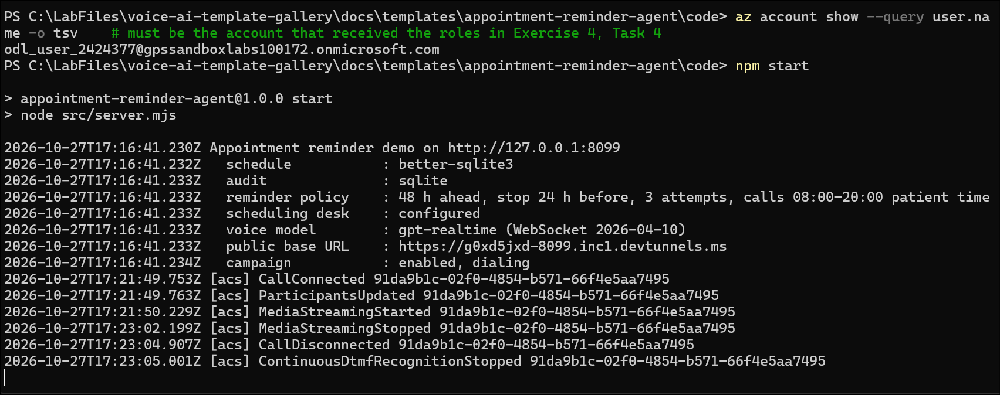

A real reminder call verified you, then confirmed the appointment in the schedule.

### Task 3: Reset the test appointment

Put the test appointment back to booked so it can be called again.

A confirmed appointment is never called again, and attempts must be four hours apart. To test again, reset the live schedule: it reloads from your test seed.

1. In window 2, press Ctrl+C to stop the server, then execute:

   ```powershell
   Remove-Item data\schedule-live.db* -Force
   npm start
   ```

2. Repeat this reset before each of the next tests.

   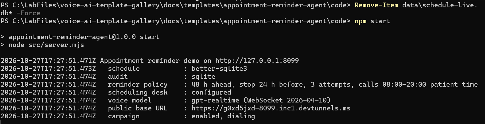

The test appointment is booked again and can be called.

### Task 4: Ask for a new time — transfer to Teams

Ask for a new time and let the agent transfer you to the scheduling desk in Teams.

1. Reset the test appointment (Task 3), then start the campaign again from window 3 (Task 2, first step).

   ```powershell
   $run = Invoke-RestMethod -Method Post "$PUBLIC/api/campaign/run"
   $run.dryRun; $run.launched
   ```

2. Answer, say “**Yes, this is Avery**” and give the **date of birth**.

3. When the appointment is read out, say: “**Can I come next week instead?**”

4. Expected: the agent says it is connecting you to the **scheduling desk**. About 3 seconds later **Teams rings** in your browser. Answer it — you are now the scheduler talking to the patient.

   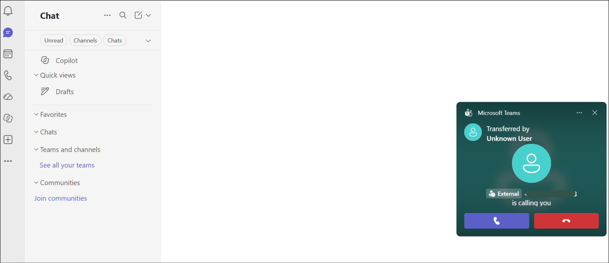

5. Window 2 shows the transfer:

   ```text
   [acs] transfer requested 3b7f… -> <your $AGENT_ID>
   [acs] CallTransferAccepted 3b7f…
   [call] transfer accepted 3b7f…
   ```

   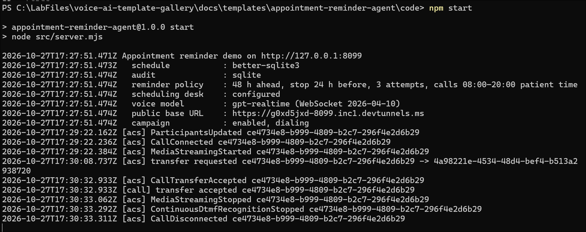

6. In the console’s Teams panel, read the handoff: the topic “Reschedule – Primary Care A-20419” and the context with verified: true and a patientRef. The headers sent to ACS have no dots in their names (CallDetailsCallTopic) and the en dash became a plain hyphen — this is the transfer fix at work.

A request for a new time reached a person in Teams with the context attached, and the agent booked nothing itself.

### Task 5: More live tests

**Overview:**

Try other flows and compare them with the expected behaviour. Reset the test appointment (Task 3) before each one.

1. The AI words things in its own way, but the dial gates, the identity check, the schedule writes and the handoff are the server’s and must match.

   | **#** | **Flow** | **Say or do** | **Pass if** |
   |---|---|---|---|
   | 1 | Cancel | After verification: “I need to cancel.” → “Yes.” | The cancellation is read back first; then A-20419 is cancelled and the slot shows free in the console |
   | 2 | Wrong date of birth | “Yes, this is Avery.” → a wrong date twice | Nothing about the appointment; the clinic’s number; the call ends |
   | 3 | Someone else | “No, this is her sister.” | A callback request only: no department, provider or time |
   | 4 | Keypad | Key 06091979, then press 1 | Verified, then confirmed |
   | 5 | Opt-out | “Please stop calling me.” | The opt-out is saved; the next campaign run skips Avery (suppressed) |
   | 6 | Clinical question | After verification: “I have a fever, should I still come?” | No medical advice; the nurse line is offered (decline it — the lab nurse line is a fictional number) |
   | 7 | Barge-in | Talk over the agent mid-sentence | The agent stops speaking immediately |
   | 8 | Callback (needs Exercise 8, Task 5) | Call your ACS number from your mobile | The agent answers about A-20419 and starts at the same identity check |

2. Press Ctrl+C in windows 1 and 2 to stop the tunnel and the server.

**Conclusion:**

The live calls matched the expected behaviour: identity first, schedule changes only after a clear yes, minimum necessary for anyone else, and a request for a new time transferred to Teams.

**Exercise conclusion:**

You have completed real reminder calls with the agent: it placed the call within the rules, verified the patient, confirmed and cancelled in the schedule, and handed a request for a new time to the scheduling desk in Teams.

## Exercise 10: Delete the resources

In this exercise, you remove everything you created so it no longer incurs cost: the phone number, the Teams allow-list entry, the Azure resources and the dev tunnel.

Run in order, in one PowerShell 7 window with lab-vars.ps1 loaded. Steps 1–2 must run before the resource group is deleted, because they need the ACS IDs.

1. Release the phone number: Azure portal → ACS resource → **Phone numbers** → select the number → **Release**. Numbers bill monthly until released.

2. Remove ACS from the Teams allow-list.

   ```powershell
   Connect-MicrosoftTeams
   Set-CsTeamsAcsFederationConfiguration -Identity Global -AllowedAcsResources @{Remove=$IMMUTABLE}
   ```

3. Delete the Azure resources (ACS, AI Services and the Event Grid subscription, if you created it).

   ```powershell
   az group delete -n $RG --yes
   ```

   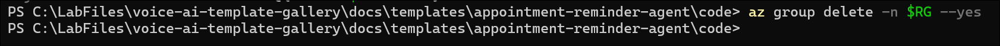

4. Delete the tunnel.

   ```powershell
   devtunnel delete $TUNNEL
   ```

   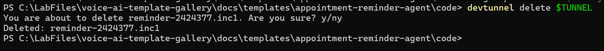

All lab resources are removed. The phone number is released, your ACS resource is no longer allowed in Teams, and the resource group and dev tunnel are deleted.

## Summary

In this lab, you explored and ran an outbound appointment reminder agent end to end:

- You explored the project and read the code behind each decision: the dial gates, identity first, schedule changes that need a clear yes, the handoff to the scheduling desk with a single-use patient reference, voicemail and wrong-party handling, the AI’s tools, and how the call is placed and transferred with the fix.

- You ran the complete agent in simulation mode and saw every rule fire, each with its reason.

- You created Azure Communication Services and Azure AI Services with keyless access, bought a phone number that places calls, and prepared Teams so a request for a new time reaches a person.

- You created a test patient with your own phone number, placed real reminder calls through a dev tunnel, and removed the resources at the end.

The key design idea throughout is that the AI is the voice while the server owns every decision: who may be called and when, what may be said before the right person is on the line, every change to the schedule, and the handoff. The AI’s tools pass along what the patient said; none of them can dial, transfer or book, so even a confused or misled conversation cannot reach beyond what the clinic’s rules allow.
