# Lab 4 - Develop intent-based call routing agent with Voice Live API and Microsoft Teams through Azure Communication Services

**Objective:**

In this lab, you will build a working AI phone receptionist that answers the main line, asks callers in their own words why they are calling, and transfers them to the right team in Microsoft Teams together with a topic and a one-sentence summary. By the end of the lab, you will be able to:

- Build the agent’s routing logic module by module and verify each module as you go.

- Explain how the server, not the AI, decides which destinations exist, whether the AI is confident enough, whether a team is open, and when a call goes to a person.

- Run and test the complete agent locally in simulation mode.

- Create and configure Azure Communication Services and the Azure AI Voice Live API with keyless access.

- Connect a phone number, take the agent live through a dev tunnel and Event Grid, and transfer calls to Teams with handoff context.

- Test the agent with real phone calls and clean up the resources afterwards.

**Description:**

Contoso, a fictional company, wants to replace its “press 1 for sales” phone menu. In this lab you build its automated switchboard: a caller says why they are calling, the agent works out which team they need — Sales, Support, Billing or Reception — confirms it with the caller and transfers the call to Teams. The person who answers sees what the call is about, so the caller never has to explain twice.

The agent runs on a Node.js server on your machine. Azure Communication Services (ACS) provides the phone number and call control, the Azure AI Voice Live API (gpt-realtime) listens and speaks, and the server owns every routing rule. The AI may only propose a destination from a fixed list and report how sure it is; the server decides whether that clears the confidence gate, whether the team is open, how many clarifying questions are allowed, and when to hand the caller to a person. The AI never sees a Teams ID or a phone number.

This is based on the templates available here - [Voice AI Agent Template Gallery](https://anujb-msft.github.io/voice-ai-template-gallery/).You build the agent first and test it locally in simulation mode, without Azure. You then create the Azure resources, buy a phone number, prepare Teams for transfers, take the agent live and test it with real calls.

## Exercise 1: Set up the starter project

In this exercise, you open the starter project, look at the routing policy and caller directory the agent works from, and confirm the starting point: the configuration, tests and browser console are in place, but the application code in src has not been written yet.

1. Open PowerShell window and execute the below command to navigate to the working directory and open the VS Code.

   ```powershell
   cd "C:\LabFiles\voice-ai-callrouting\docs\templates\intent-based-call-routing\code"
   npm install --ignore-script
   code .
   ```

   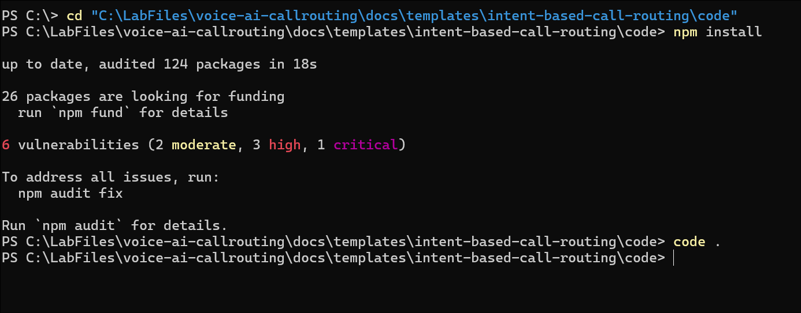

2. Look at the configuration first. Open the two files in **config/**. Everything the agent knows about where calls can go comes from them:

   | **File** | **Holds** | **Example** |
   |---|---|---|
   | routes.json | The four destinations: id, keypad digit, label, the description the AI reads, the Teams target, opening hours and what happens after hours. `fallbackRouteId` is where every “give up” path leads. | billing — keypad 3, Mon–Fri 09:00–17:00 Pacific; after hours it takes a message |
   | callers.json | A small directory of known callers, used only to greet them by name and enrich the handoff. A match is never treated as proof of identity. | +14255550101 — Dana Whitfield, Northwind Traders |

   **Note:** The targets in routes.json still hold placeholder IDs (all zeros). That is fine for simulation. In Exercise 7 you create a local copy that points every route at your own Teams user.

3. Confirm the starting point. Execute the command **npm test** in the PowerShell.

   Every test file fails with “The requested module '../src/…' does not provide an export named …”. That is expected — the files in src are still empty. By the end of Exercise 2, Task 7, all 74 tests will pass.

The starter project is open in VS Code, its dependencies are installed, and you know where the routing policy comes from. The failing tests confirm that src is empty and ready for you to build.

## Exercise 2: Build the routing logic

In this exercise, you build the routing logic of the agent, module by module: its settings, the routing policy, the audit, the Teams handoff, the call state machine, the AI contract and the simulated caller. After each module you run a quick checkpoint to confirm it works.

### Task 1: Settings and modes

Build config.mjs, which reads every setting from .env (with safe defaults) and decides whether the server runs in simulation or live mode.

1. Open the **config.mjs** from “C:\LabFiles\voice-ai-callrouting\docs\templates\intent-based-call-routing\code\src” in VS Code.

2. In this file, we will add code to **read** every **setting** from **.env**, with safe defaults, and decide whether the server can take real calls.

3. The file starts by loading dotenv/config, which copies .env into process.env. It is wrapped in try so the tests run even without the package.

4. **config** collects every setting in one object: host and port (8091), the public address, ACS (endpoint preferred, connection string as a fallback), Voice Live (endpoint, model, voice; an empty key means keyless sign-in) and the locale.

5. **config.routing** holds the routing policy knobs: the confidence gate (0.75), the time budget from answer to confirmed route (90 seconds), the clarifying questions allowed (2), the mind-change window before a transfer (1.2 seconds), and the paths to routes.json and callers.json.

6. **Transcripts** are not written to disk unless **PERSIST_TRANSCRIPTS** is turned on; route decisions are always recorded. DEMO_NOW pins the clock, in simulation only.

7. **assertCallConfig()** lists what is missing for real calls: ACS_ENDPOINT (or a connection string), PUBLIC_BASE_URL and VOICE_LIVE_ENDPOINT. isSimulated() is simply “is anything missing?” — this one function switches the whole app between simulation and live mode.

8. **readiness()** builds the per-subsystem status that the server reports later at /health, including which routes still have placeholder Teams IDs (unprovisionedRoutes).

9. Paste the whole code block below into **config.mjs**.

   **src/config.mjs**

   ```javascript
   // dotenv is optional so the state machine and its tests run from a bare clone
   // with no `npm install`. The server pulls it in for real deployments.
   try {
     await import("dotenv/config");
   } catch {
     /* running without dependencies installed */
   }
   
   export const config = {
     host: process.env.HOST ?? "127.0.0.1",
     /** The console and the call webhooks are served on this port. */
     port: Number(process.env.PORT ?? 8091),
   
     /**
      * Public HTTPS base URL for this server. ACS must be able to reach it for the
      * Event Grid incoming-call webhook and for call callbacks, and it is also used
      * to derive the media-streaming wss:// URL.
      * With devtunnel: `devtunnel host -p 8091 --allow-anonymous`.
      */
     publicBaseUrl: (process.env.PUBLIC_BASE_URL ?? "").replace(/\/$/, ""),
   
     acs: {
       connectionString: process.env.ACS_CONNECTION_STRING ?? "",
       /**
        * Preferred over the connection string. e.g.
        * https://<resource>.unitedstates.communication.azure.com
        * When set, the Call Automation client authenticates with
        * DefaultAzureCredential and no ACS key is stored anywhere.
        */
       endpoint: (process.env.ACS_ENDPOINT ?? "").replace(/\/$/, ""),
       /** "public", "dod" or "gcch" — only change this for a sovereign Teams tenant. */
       teamsCloud: process.env.TEAMS_CLOUD ?? "public",
     },
   
     voiceLive: {
       /** e.g. https://<resource>.services.ai.azure.com */
       endpoint: (process.env.VOICE_LIVE_ENDPOINT ?? "").replace(/\/$/, ""),
       /**
        * Optional. When empty the server falls back to DefaultAzureCredential,
        * which is what Microsoft recommends. Keyless auth needs the Cognitive Services User
        * and Foundry User roles on the AI Services resource.
        */
       apiKey: process.env.VOICE_LIVE_API_KEY ?? "",
       model: process.env.VOICE_LIVE_MODEL ?? "gpt-realtime",
       /** WebSocket transport api-version. */
       apiVersion: process.env.VOICE_LIVE_API_VERSION ?? "2026-04-10",
       voice: process.env.VOICE_LIVE_VOICE ?? "en-US-Ava:DragonHDLatestNeural",
     },
   
     /** Locale and voice live together — change both here to move off the English demo. */
     locale: process.env.LOCALE ?? "en-US",
   
     routing: {
       /**
        * Below this, the agent must ask a clarifying question instead of proposing
        * a destination. Flat across routes on purpose: a per-route threshold is a
        * tuning exercise that hides the mechanism this agent is meant to show.
        */
       confidenceThreshold: Number(process.env.CONFIDENCE_THRESHOLD ?? 0.75),
       /** Answer-to-confirmed-route budget. Expiry routes to reception. */
       timeBudgetMs: Number(process.env.ROUTE_TIME_BUDGET_MS ?? 90_000),
       /** Clarifying questions allowed before falling back to reception. */
       maxClarifications: Number(process.env.MAX_CLARIFICATIONS ?? 2),
       /**
        * Gap between "Connecting you now" and the actual ACS transfer. This is the
        * window in which a caller can still change their mind; once the transfer
        * dispatches, the route is frozen.
        */
       transferDelayMs: Number(process.env.TRANSFER_DELAY_MS ?? 1_200),
       routesPath: process.env.ROUTES_PATH ?? "./config/routes.json",
       callersPath: process.env.CALLERS_PATH ?? "./config/callers.json",
     },
   
     /**
      * Transcripts stay in memory unless this is explicitly enabled, so utterance
      * text does not reach disk by accident. Summaries and route decisions are
      * always persisted — those are the audit trail.
      */
     persistTranscripts: /^(1|true|yes)$/i.test(process.env.PERSIST_TRANSCRIPTS ?? ""),
   
     dbPath: process.env.DB_PATH ?? "./data/routing.db",
   
     /**
      * Pins the clock the routing policy sees, as an ISO 8601 timestamp, so a
      * demo run shows the same open and closed routes every time. Honored
      * only in simulation mode — a live call always uses the real time.
      */
     demoNow: process.env.DEMO_NOW ?? "",
   };
   
   /**
    * Config needed to answer a real inbound call. Empty array means we are live.
    * Takes the config explicitly so it is a pure function — a readiness check that
    * silently reads ambient process state is a check you cannot test.
    */
   export function assertCallConfig(cfg = config) {
     const missing = [];
     if (!cfg.acs.endpoint && !cfg.acs.connectionString) missing.push("ACS_ENDPOINT");
     if (!cfg.publicBaseUrl) missing.push("PUBLIC_BASE_URL");
     if (!cfg.voiceLive.endpoint) missing.push("VOICE_LIVE_ENDPOINT");
     return missing;
   }
   
   /**
    * Readiness broken out per subsystem, because "not ready" is rarely uniform.
    * Voice Live can be configured while ACS is not, and both can be configured
    * while the Teams routing targets are still placeholder GUIDs.
    */
   export function readiness(routes, cfg = config) {
     const placeholder = /^0{8}-0{4}-0{4}-0{4}-0{11}\d$/;
     const unprovisioned = (routes?.menu?.() ?? [])
       .map((r) => routes.get(r.id))
       .filter((r) => !r?.target?.objectId || placeholder.test(r.target.objectId))
       .map((r) => r.id);
   
     return {
       voiceLive: {
         ready: Boolean(cfg.voiceLive.endpoint),
         auth: cfg.voiceLive.apiKey ? "api-key" : "entra",
         model: cfg.voiceLive.model,
         apiVersion: cfg.voiceLive.apiVersion,
       },
       telephony: {
         ready: Boolean(cfg.acs.endpoint || cfg.acs.connectionString) && Boolean(cfg.publicBaseUrl),
         auth: cfg.acs.endpoint ? "entra" : cfg.acs.connectionString ? "connection-string" : "none",
         missing: assertCallConfig(cfg).filter((k) => k !== "VOICE_LIVE_ENDPOINT"),
       },
       teams: {
         // Placeholder object ids answer the question "why did my transfer fail?"
         // before anyone has to read a log.
         ready: unprovisioned.length === 0,
         unprovisionedRoutes: unprovisioned,
         cloud: cfg.acs.teamsCloud,
       },
     };
   }
   
   /** True when the agent is running without any Azure configuration. */
   export const isSimulated = () => assertCallConfig().length > 0;
   ```

10. **Save** the file (Ctrl+S).

11. **Execute** the below **command** in the PowerShell to check the syntax. No output means **OK**.

   ```powershell
   node --check src\config.mjs
   ```

   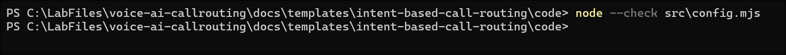

12. Execute the below command to have a quick run of the module you just built, so you can confirm it works before moving on, and catch any mistake in the step where it happened.

   ```powershell
   node lab-checks\01-config.mjs
   ```

   **Expected output**

   ```text
   Port             : 8091
   Voice model      : gpt-realtime
   Routes file      : ./config/routes.json
   Callers file     : ./config/callers.json
   Confidence gate  : 0.75
   Route time budget: 90 s | clarifications allowed: 2
   Missing for live : ACS_ENDPOINT, PUBLIC_BASE_URL, VOICE_LIVE_ENDPOINT
   Simulation mode  : true
   ```

   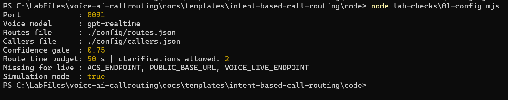

**config.mjs** reads every setting with safe defaults and reports simulation mode, because nothing for Azure is set yet.

### Task 2: The routing policy

**Overview:**

Build **routes.mjs**: the allowlist of destinations, their opening hours, the after-hours rules and the caller directory.

1. Open the **routes.mjs** from “C:\LabFiles\voice-ai-callrouting\docs\templates\intent-based-call-routing\code\src” in VS Code.

2. In this file, we will add code to load **routes.json** into an allowlist, decide whether a route is open right now, and look up known callers.

3. **RoutePolicy** is the allowlist. Its constructor refuses a broken file: every route needs a unique id and a target object ID, and the fallback route must exist. It also maps keypad digits to route ids.

4. **isOpen()** checks a route’s hours in that route’s own time zone (localParts uses Intl.DateTimeFormat), so “09:00–17:00 Pacific” means the same thing wherever the server runs.

5. **resolve()** turns a confirmed route into what should happen now: transfer if open; if closed, either take a message or divert to another route. A diversion is followed only once, so two misconfigured routes cannot loop.

6. **menu()** and **menuText()** are what the AI is given: ids, labels, descriptions and keypad digits — never the Teams targets. describeHours() puts the hours into words for the console.

7. **CallerDirectory** looks a caller up by phone number and always marks the result verified: false, because caller ID is not authentication. maskPhone() keeps only the last two digits for logs and screens.

8. Paste the whole code block below into **routes.mjs**.

   **src/routes.mjs**

   ```javascript
   import { readFileSync } from "node:fs";
   import { fileURLToPath } from "node:url";
   import { isAbsolute, join } from "node:path";
   import { config } from "./config.mjs";
   
   const PKG_ROOT = fileURLToPath(new URL("..", import.meta.url));
   const resolvePath = (p) => (isAbsolute(p) ? p : join(PKG_ROOT, p));
   
   const DAY_INDEX = { Sun: 0, Mon: 1, Tue: 2, Wed: 3, Thu: 4, Fri: 5, Sat: 6 };
   const DAY_NAMES = ["Sun", "Mon", "Tue", "Wed", "Thu", "Fri", "Sat"];
   
   function toMinutes(hhmm) {
     const [h, m] = String(hhmm).split(":").map(Number);
     return h * 60 + (m ?? 0);
   }
   
   /** Weekday and minute-of-day for `date` as observed in `timeZone`. */
   function localParts(date, timeZone) {
     const parts = Object.fromEntries(
       new Intl.DateTimeFormat("en-US", {
         timeZone,
         weekday: "short",
         hour: "2-digit",
         minute: "2-digit",
         hourCycle: "h23",
       })
         .formatToParts(date)
         .map((p) => [p.type, p.value]),
     );
     return {
       day: DAY_INDEX[parts.weekday],
       minutes: Number(parts.hour) * 60 + Number(parts.minute),
     };
   }
   
   /**
    * The routing policy.
    *
    * This is the allowlist. The model proposes a route *id* and nothing else — it
    * never sees or supplies a Teams object id, a phone number, or a URL, so a
    * confused or adversarial caller cannot talk the agent into dialling somewhere
    * it was not configured to reach.
    */
   export class RoutePolicy {
     constructor(doc) {
       const routes = doc?.routes ?? [];
       if (!routes.length) throw new Error("routes.json contains no routes");
   
       this.organization = doc.organization ?? "the organisation";
       this.fallbackRouteId = doc.fallbackRouteId ?? "reception";
       this.byId = new Map();
       this.byDtmf = new Map();
   
       for (const route of routes) {
         if (!route.id) throw new Error("every route needs an id");
         if (this.byId.has(route.id)) throw new Error(`duplicate route id: ${route.id}`);
         if (!route.target?.objectId) throw new Error(`route ${route.id} has no target objectId`);
         this.byId.set(route.id, route);
         if (route.dtmf) this.byDtmf.set(String(route.dtmf), route.id);
       }
   
       if (!this.byId.has(this.fallbackRouteId)) {
         throw new Error(`fallbackRouteId ${this.fallbackRouteId} is not a defined route`);
       }
       if (!this.isOpen(this.fallbackRouteId, new Date())) {
         // Not fatal, but it means a late caller can be left with nowhere to go.
         console.warn(`[routes] fallback route ${this.fallbackRouteId} is currently closed`);
       }
     }
   
     static load(path = config.routing.routesPath) {
       return new RoutePolicy(JSON.parse(readFileSync(resolvePath(path), "utf8")));
     }
   
     get ids() {
       return [...this.byId.keys()];
     }
   
     get(routeId) {
       return this.byId.get(routeId) ?? null;
     }
   
     has(routeId) {
       return this.byId.has(routeId);
     }
   
     routeForDigit(digit) {
       return this.byDtmf.get(String(digit)) ?? null;
     }
   
     isOpen(routeId, now = new Date()) {
       const route = this.get(routeId);
       if (!route) return false;
       const hours = route.hours ?? {};
       if (hours.alwaysOpen) return true;
       const { day, minutes } = localParts(now, hours.timeZone ?? "UTC");
       if (!(hours.days ?? []).includes(day)) return false;
       return minutes >= toMinutes(hours.open ?? "00:00") && minutes < toMinutes(hours.close ?? "24:00");
     }
   
     /**
      * Turn a confirmed route id into what should actually happen now.
      *
      * Returns either a transfer target or an instruction to take a message. The
      * `route` hop is followed at most once so a misconfigured pair of routes
      * cannot loop.
      */
     resolve(routeId, now = new Date()) {
       const route = this.get(routeId);
       if (!route) return { ok: false, reason: "unknown_route" };
   
       if (this.isOpen(routeId, now)) {
         return { ok: true, action: "transfer", routeId, target: route.target, afterHours: false };
       }
   
       const after = route.afterHours ?? { behavior: "route", routeId: this.fallbackRouteId };
   
       if (after.behavior === "message") {
         return { ok: true, action: "message", routeId, afterHours: true };
       }
   
       const altId = after.routeId ?? this.fallbackRouteId;
       const alt = this.get(altId);
       if (!alt) return { ok: false, reason: "unknown_after_hours_route" };
   
       return {
         ok: true,
         action: "transfer",
         routeId: altId,
         target: alt.target,
         afterHours: true,
         divertedFrom: routeId,
       };
     }
   
     /** The menu the model is given. Descriptions only — never targets. */
     menu() {
       return [...this.byId.values()].map((r) => ({
         id: r.id,
         label: r.label ?? r.id,
         description: r.description ?? "",
         dtmf: r.dtmf ?? null,
       }));
     }
   
     /** The time zone business hours are written in, for anything that displays them. */
     get timeZone() {
       for (const route of this.byId.values()) if (route.hours?.timeZone) return route.hours.timeZone;
       return "UTC";
     }
   
     /**
      * Opening hours and the after-hours rule in words, for people rather than the
      * policy: `{ hours: "Mon–Fri 09:00–17:00", whenClosed: "takes a message" }`.
      */
     describeHours(routeId) {
       const route = this.get(routeId);
       if (!route) return null;
       const hours = route.hours ?? {};
       if (hours.alwaysOpen) return { hours: "Always open", whenClosed: null };
   
       // Monday-first, so a working week reads Mon–Fri rather than wrapping.
       const days = [...new Set(hours.days ?? [])].map((d) => (d + 6) % 7).sort((a, b) => a - b);
       const name = (i) => DAY_NAMES[(i + 1) % 7];
       const contiguous = days.every((d, i) => i === 0 || d === days[i - 1] + 1);
       const allDay = (hours.open ?? "00:00") === "00:00" && (hours.close ?? "24:00") === "24:00";
   
       let text;
       if (!days.length) text = "Closed";
       else if (days.length === 7 && allDay) text = "24/7";
       else {
         const dayText =
           days.length === 7
             ? "Every day"
             : days.length === 1
               ? name(days[0])
               : contiguous
                 ? `${name(days[0])}–${name(days.at(-1))}`
                 : days.map(name).join(", ");
         text = allDay ? `${dayText}, all day` : `${dayText} ${hours.open ?? "00:00"}–${hours.close ?? "24:00"}`;
       }
   
       const after = route.afterHours ?? { behavior: "route", routeId: this.fallbackRouteId };
       const whenClosed =
         after.behavior === "message"
           ? "takes a message"
           : `goes to ${this.get(after.routeId ?? this.fallbackRouteId)?.label ?? after.routeId ?? this.fallbackRouteId}`;
       return { hours: text, whenClosed: text === "24/7" ? null : whenClosed };
     }
   
     menuText() {
       return this.menu()
         .map((r) => `- ${r.id} (${r.label}): ${r.description}${r.dtmf ? ` Keypad ${r.dtmf}.` : ""}`)
         .join("\n");
     }
   }
   
   /**
    * Seeded caller directory.
    *
    * A caller-ID match is a convenience, never proof. Everything this returns is
    * marked unverified and is passed to Teams that way.
    */
   export class CallerDirectory {
     constructor(doc) {
       this.byPhone = new Map();
       for (const caller of doc?.callers ?? []) {
         if (caller.phone) this.byPhone.set(normalisePhone(caller.phone), caller);
       }
     }
   
     static load(path = config.routing.callersPath) {
       return new CallerDirectory(JSON.parse(readFileSync(resolvePath(path), "utf8")));
     }
   
     lookup(phone) {
       if (!phone) return null;
       const hit = this.byPhone.get(normalisePhone(phone));
       return hit ? { ...hit, verified: false } : null;
     }
   }
   
   export function normalisePhone(phone) {
     return String(phone).replace(/[^\d+]/g, "");
   }
   
   /** Never log or display a caller's full number — the last two digits are enough to tell demo callers apart. */
   export function maskPhone(phone) {
     if (!phone) return "anonymous";
     const digits = String(phone).replace(/\D/g, "");
     if (digits.length <= 2) return "•".repeat(digits.length) || "anonymous";
     const plus = String(phone).trim().startsWith("+") ? "+" : "";
     return `${plus}${"•".repeat(digits.length - 2)}${digits.slice(-2)}`;
   }
   ```

9. **Save** the file (Ctrl+S).

10. **Execute** the below command in the PowerShell to check the syntax. No output means OK.

   ```powershell
   node --check src\routes.mjs
   ```

   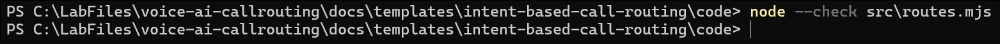

11. Execute the below command to have a quick run of the module you just built, so you can confirm it works before moving on, and catch any mistake in the step where it happened.

   ```powershell
   node lab-checks\02-routes.mjs
   ```

   **Expected output**

   ```text
   Organisation : Contoso | fallback: reception
   Route ids    : sales, support, billing, reception
   Keypad 3     : billing
   Billing open at 10:30 : true
   Billing open at 19:30 : false
   Billing after hours   : message
   Sales after hours     : transfer to reception (diverted from sales)
   Hours (billing)       : { hours: 'Mon–Fri 09:00–17:00', whenClosed: 'takes a message' }
   Caller +14255550101   : {
     phone: '+14255550101',
     displayName: 'Dana Whitfield',
     company: 'Northwind Traders',
     accountId: 'NW-4471',
     relationship: 'Existing customer',
     verified: false
   }
   Masked number         : +•••••••••01
   ```

   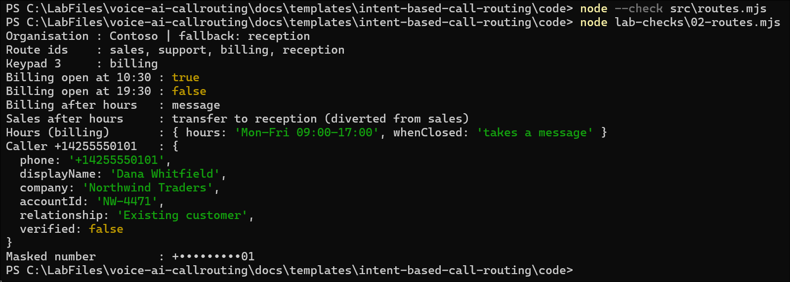

**routes.mjs** loads the four routes, judges opening hours in the route’s time zone, applies the after-hours rules and recognises known callers without trusting them.

### Task 3: The in-memory audit

Build **audit.mjs**, the simple audit store the call flow writes to, and the statistics the console shows.

1. Open the **audit.mjs** from “C:\LabFiles\voice-ai-callrouting\docs\templates\intent-based-call-routing\code\src” in VS Code.

2. In this file, we will add code to record every call, every decision and (optionally) the transcript, in memory.

3. MemoryAudit is the audit interface the call flow talks to: startCall, updateCall, recordEvent, recordTranscript, eventsFor, reset and stats. Because the flow only knows this interface, it runs and is tested with no database.

4. Events (decisions) and transcripts (what was said) are stored separately on purpose: events are always kept, transcripts can be switched off.

5. reset() forgets simulated calls only, so the console’s Reset demo never deletes a real call.

6. stats() returns the numbers on the console’s metrics strip: calls, transfers, clarifying questions, fallbacks, messages taken, requests for a person and the median seconds to route (medianSeconds).

7. Paste the whole code block below into **audit.mjs**.

   **src/audit.mjs**

   ```javascript
   /**
    * Audit sink.
    *
    * The state machine only ever talks to this interface, which is what lets the
    * whole routing flow run — and be tested — with no database and no cloud
    * credentials. `src/db.mjs` provides the SQLite implementation the server uses.
    *
    * Utterance text is passed separately from events on purpose: transcripts are
    * suppressed by default, events never are.
    */
   export class MemoryAudit {
     name = "memory";
   
     constructor() {
       this.calls = new Map();
       this.events = [];
       this.transcripts = [];
     }
   
     startCall(call) {
       this.calls.set(call.id, { ...call });
     }
   
     updateCall(id, patch) {
       const existing = this.calls.get(id);
       if (existing) this.calls.set(id, { ...existing, ...patch });
     }
   
     recordEvent(callId, source, kind, detail = null) {
       this.events.push({
         callId,
         source,
         kind,
         detail: detail == null ? null : String(detail),
         at: new Date().toISOString(),
       });
     }
   
     recordTranscript(callId, role, text) {
       this.transcripts.push({ callId, role, text, at: new Date().toISOString() });
     }
   
     eventsFor(callId) {
       return this.events.filter((e) => e.callId === callId);
     }
   
     /**
      * Forget simulated calls and everything recorded about them — the demo
      * console's reset between run-throughs. Calls from a real phone stay.
      */
     reset() {
       const gone = new Set([...this.calls.values()].filter((c) => c.simulated).map((c) => c.id));
       for (const id of gone) this.calls.delete(id);
       this.events = this.events.filter((e) => !gone.has(e.callId));
       this.transcripts = this.transcripts.filter((t) => !gone.has(t.callId));
     }
   
     stats() {
       const calls = [...this.calls.values()];
       const tally = (key) =>
         calls.reduce((acc, c) => {
           const k = c[key] ?? "none";
           acc[k] = (acc[k] ?? 0) + 1;
           return acc;
         }, {});
   
       const count = (kind) => this.events.filter((e) => e.kind === kind).length;
   
       return {
         calls: calls.length,
         byOutcome: tally("outcome"),
         byRoute: tally("confirmedRouteId"),
         clarifications: count("clarification"),
         fallbacks: count("fallback"),
         transfers: count("transfer_succeeded") + count("transfer_simulated"),
         failedTransfers: count("transfer_failed"),
         messagesTaken: count("message_taken"),
         humanRequests: count("human_requested"),
         medianSecondsToRoute: medianSeconds(
           calls.filter((c) => String(c.outcome ?? "").startsWith("transferred:")).map((c) => c.durationMs),
         ),
       };
     }
   }
   
   /** Median of a list of durations in milliseconds, in seconds to one decimal place. */
   export function medianSeconds(durationsMs) {
     const sorted = durationsMs.filter(Number.isFinite).sort((a, b) => a - b);
     if (!sorted.length) return null;
     const mid = Math.floor(sorted.length / 2);
     const ms = sorted.length % 2 ? sorted[mid] : (sorted[mid - 1] + sorted[mid]) / 2;
     return Math.round(ms / 100) / 10;
   }
   ```

8. Save the file (Ctrl+S).

9. Execute the below command in the PowerShell to check the syntax. No output means OK.

   ```powershell
   node --check src\audit.mjs
   ```

   

10. Execute the below command to have a quick run of the module you just built, so you can confirm it works before moving on, and catch any mistake in the step where it happened.

   ```powershell
   node lab-checks\03-audit.mjs
   ```

   **Expected output**

   ```text
   Events for call-1: clarification, transfer_simulated
   Stats: {
     calls: 1,
     byOutcome: { 'transferred:billing': 1 },
     byRoute: { billing: 1 },
     clarifications: 1,
     fallbacks: 0,
     transfers: 1,
     failedTransfers: 0,
     messagesTaken: 0,
     humanRequests: 0,
     medianSecondsToRoute: 21
   }
   ```

   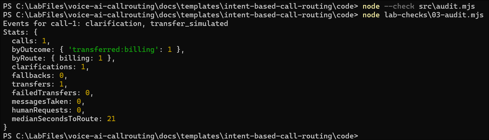

audit.mjs records calls and decisions in memory and summarises them for the console.

### Task 4: The Teams handoff contract

Build **handoff.mjs**, which decides how a Teams destination is addressed and turns the routing decision into the VoIP headers Teams receives.

1. Open the **handoff.mjs** from “C:\LabFiles\voice-ai-callrouting\docs\templates\intent-based-call-routing\code\src” in VS Code.

2. In this file, we will add code to address the Teams destination correctly and package the handoff context as VoIP headers.

3. **teamsIdentifier()** addresses a Teams user as { microsoftTeamsUserId } and a call queue or auto attendant (a resource account) as { teamsAppId }. Both take a Microsoft Entra object ID, which is why routes.json holds object IDs, never phone numbers.

4. **resourceAccountFrom()** reads which Teams resource account a call was dialled through. A call straight to an ACS phone number has none — the server log shows these calls as acs-direct.

5. **buildCustomCallingContext()** turns the handoff into VoIP headers: session id, topic, one-sentence context, sentiment (only if the caller said they were unhappy), route id, an after-hours flag and the caller record. Empty fields are left out and values are capped at 1024 characters.

6. The caller record is sent as one JSON value so the verified: false flag can never be separated from the name.

7. Paste the whole code block below into **handoff.mjs**.

   **src/handoff.mjs**

   ```javascript
   import { config } from "./config.mjs";
   
   /**
    * How a routing decision becomes something Teams can act on.
    *
    * Kept free of any Azure import so it can be tested — and read — without
    * installing the SDK. `src/voice/acs.mjs` is the only thing that calls it.
    */
   
   /** VoIP header value ceiling in Call Automation. */
   const VOIP_VALUE_LIMIT = 1024;
   
   /**
    * Teams Call Queues and Auto Attendants are resource accounts, so they are
    * addressed as Teams *apps*; a named specialist is addressed as a Teams user.
    * Both take a Microsoft Entra object ID, which is why routes.json holds object
    * IDs and never phone numbers.
    */
   export function teamsIdentifier(target) {
     if (!target?.objectId) throw new Error("route target has no objectId");
     if (target.type === "user") return { microsoftTeamsUserId: target.objectId };
     return { teamsAppId: target.objectId, cloud: config.acs.teamsCloud };
   }
   
   /**
    * Teams Phone extensibility delivers the dialled resource account in `to.rawId`
    * as `28:orgid:<object id>`, with `to.kind` documented as "unknown" rather than
    * "microsoftTeamsApp" — so match on the raw ID and do not trust `kind`.
    * A call straight to an ACS number has no resource account, which is the
    * difference between a TPE call and a plain Call Automation one.
    */
   export function resourceAccountFrom(to) {
     const match = /^28:(?:orgid:)?([0-9a-f-]{36})$/i.exec(to?.rawId ?? "");
     return match ? match[1] : null;
   }
   
   /**
    * Only VoIP headers are used here. SIP headers are a PSTN-side mechanism and do
    * not reach a Teams identifier, so putting the handoff context in them would
    * silently drop it — the caller would still be transferred, but the receiving
    * agent would answer blind, which is the entire failure this agent exists to
    * prevent.
    *
    * Keys mirror the Teams Phone extensibility custom-context schema. Empty fields
    * are omitted rather than sent as nulls, so the receiving agent never has to
    * distinguish "unknown" from "absent".
    */
   export function buildCustomCallingContext(context) {
     const headers = [
       ["CallDetails.SessionId", context.sessionId],
       ["CallDetails.CallTopic", context.callTopic],
       ["CallDetails.CallContext", context.callContext],
       ["CallDetails.CallSentiment", context.callSentiment],
       ["CallDetails.RouteId", context.routeId],
       ["CallDetails.AfterHours", context.afterHours ? "true" : null],
       // Serialised whole so the receiving agent gets the verified:false flag with
       // the name, rather than a name with no provenance attached to it.
       ["CallerDetails", context.callerDetails ? JSON.stringify(context.callerDetails) : null],
     ];
   
     return headers
       .filter(([, value]) => value != null && value !== "")
       .map(([key, value]) => ({ kind: "voip", key, value: String(value).slice(0, VOIP_VALUE_LIMIT) }));
   }
   ```

8. Save the file (Ctrl+S).

9. Execute the below command in the PowerShell to check the syntax. No output means OK.

   ```powershell
   node --check src\handoff.mjs
   ```

   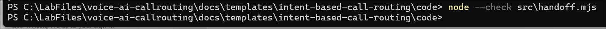

10. Execute the below command to have a quick run of the module you just built, so you can confirm it works before moving on, and catch any mistake in the step where it happened.

   ```powershell
   node lab-checks\04-handoff.mjs
   ```

   **Expected output**

   ```text
   User target  : { microsoftTeamsUserId: '11111111-2222-3333-4444-555555555555' }
   Queue target : { teamsAppId: '66666666-7777-8888-9999-000000000000', cloud: 'public' }
   Resource account in a Teams call: 66666666-7777-8888-9999-000000000000
   Resource account in an ACS call : null
   VoIP headers:
   [
     { kind: 'voip', key: 'CallDetails.SessionId', value: 'abc-123' },
     {
       kind: 'voip',
       key: 'CallDetails.CallTopic',
       value: 'Charged twice on my invoice'
     },
     {
       kind: 'voip',
       key: 'CallDetails.CallContext',
       value: 'Caller was charged twice on the March invoice.'
     },
     { kind: 'voip', key: 'CallDetails.RouteId', value: 'billing' },
     {
       kind: 'voip',
       key: 'CallerDetails',
       value: '{"name":"Dana Whitfield","company":"Northwind Traders","verified":false}'
     }
   ]
   ```

   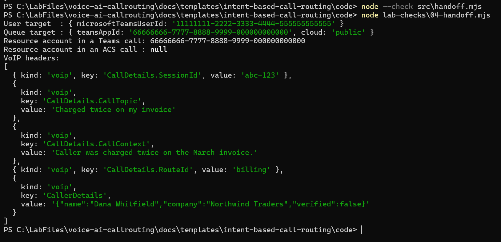

handoff.mjs addresses users and queues correctly and produces the VoIP headers that travel with the transfer.

### Task 5: The call state machine

**Overview:**

Build flow.mjs, the heart of the agent: the state machine that owns every routing decision on a call.

1. Open the **flow.mjs** from “C:\LabFiles\voice-ai-callrouting\docs\templates\intent-based-call-routing\code\src” in VS Code.

2. In this file, we will add code to run each call through its states and make every routing decision on the server: ringing → greeting → classifying → confirming → transferring → transferred, with fallback, messaging and ended as the other exits.

3. **RoutingFlow** receives everything from outside — the routes, the caller directory, the audit, the transfer function, the console hub and the clock. It imports nothing from Azure, Express or SQLite, which is why it can be tested with a typed transcript.

4. **create()** registers an incoming call (a simulated call is never really transferred). answered() starts the time budget and tells the agent to disclose that it is an automated assistant and ask one open question — no menu.

5. **proposeRoute()** is the confidence gate. An id that is not on the allowlist is rejected. A confidence below 0.75 becomes a clarifying question instead of a guess. A confident proposal moves to confirming. A new proposal while a transfer is still waiting cancels it — the caller changed their mind.

6. **confirmRoute()** is accepted only for the route currently on the table. requestHuman() goes straight to the fallback route with no confirmation, and dtmf() commits a keypad choice immediately.

7. **noInput()** and **outOfScope()** give the caller one more chance; #clarify() allows two clarifying questions (offering the keypad on the last) and then #fallback() sends the caller to a person. The time budget does the same if the call runs too long.

8. **#commit()** asks the routing policy what to do now: take a message (team closed) or transfer, possibly diverted. #scheduleDispatch() waits the mind-change window before dispatchTransfer() runs.

9. **dispatchTransfer()** retries a failed transfer once, then tries the fallback route once, then apologises honestly — the caller is never left in a loop. transferFailed() re-enters the same ladder when ACS reports the transfer failed later.

10. Every instruction to the agent also carries an example of what to say. The real AI words it its own way; the simulated agent speaks it as is. handoffContext() builds what Teams receives and snapshot() what the console shows.

11. Paste the whole code block below into **flow.mjs**.

   **src/flow.mjs**

   ```javascript
   import { randomUUID } from "node:crypto";
   import { config } from "./config.mjs";
   import { maskPhone } from "./routes.mjs";
   
   /**
    * The intent-routing state machine.
    *
    *   ringing → greeting → classifying → confirming → transferring → transferred
    *                            ↑____________|                     ↘ fallback
    *                                                               ↘ messaging → ended
    *
    * Everything security- or policy-sensitive lives here rather than in the model:
    * which routes exist, which Teams object each one maps to, whether a route is
    * open, how many clarifications are allowed, and when the call gives up and goes
    * to a human. The model's only power is to *propose* an allowlisted route id.
    *
    * This module deliberately has no Azure, Express, or SQLite imports. The audio
    * path, the transfer, and the audit sink are all injected, which is what lets
    * the entire flow run offline from a typed transcript and be tested with plain
    * `node --test`.
    */
   
   export const STATES = Object.freeze({
     RINGING: "ringing",
     GREETING: "greeting",
     CLASSIFYING: "classifying",
     CONFIRMING: "confirming",
     TRANSFERRING: "transferring",
     TRANSFERRED: "transferred",
     MESSAGING: "messaging",
     FALLBACK: "fallback",
     ENDED: "ended",
   });
   
   const TERMINAL = new Set([STATES.TRANSFERRED, STATES.ENDED]);
   const ALLOWED_SENTIMENT = new Set(["frustrated", "angry", "upset", "distressed"]);
   
   /** Teams CallTopic is capped at 48 characters. */
   const TOPIC_LIMIT = 48;
   const SUMMARY_LIMIT = 400;
   
   const clip = (value, limit) => {
     if (value == null) return null;
     const text = String(value).replace(/\s+/g, " ").trim();
     if (!text) return null;
     return text.length <= limit ? text : `${text.slice(0, limit - 1).trimEnd()}…`;
   };
   
   export class RoutingFlow {
     /**
      * @param {object} deps
      * @param {import("./routes.mjs").RoutePolicy} deps.routes
      * @param {import("./routes.mjs").CallerDirectory} [deps.callers]
      * @param {object} deps.audit
      * @param {(call: object, destination: object) => Promise<void>} [deps.transfer]
      * @param {{send: (id: string, target: string, payload: object) => any}} [deps.hub]
      * @param {() => number} [deps.now] injectable clock, so budget expiry is testable
      */
     constructor({ routes, callers = null, audit, transfer = null, hub = null, now = Date.now, options = {} }) {
       this.routes = routes;
       this.callers = callers;
       this.audit = audit;
       this.transfer = transfer;
       this.hub = hub;
       this.now = now;
       this.options = {
         confidenceThreshold: config.routing.confidenceThreshold,
         timeBudgetMs: config.routing.timeBudgetMs,
         maxClarifications: config.routing.maxClarifications,
         transferDelayMs: config.routing.transferDelayMs,
         maxDeflections: 1,
         ...options,
       };
       /** @type {Map<string, object>} */
       this.calls = new Map();
       /** @type {Map<string, object>} agent handles keyed by call id */
       this.agents = new Map();
     }
   
     // ------------------------------------------------------------------ lifecycle
   
     /**
      * An inbound call has arrived but has not been answered yet.
      *
      * `simulated` marks a call driven from the console or `curl` rather than a
      * phone. Its transfer is recorded but never dispatched to Teams, even when
      * the server is configured for live calls.
      */
     create({
       callId = randomUUID(),
       fromPhone = null,
       incomingCallContext = null,
       sessionId = null,
       resourceAccountId = null,
       simulated = false,
     } = {}) {
       const caller = this.callers?.lookup(fromPhone) ?? null;
   
       const call = {
         id: callId,
         fromPhone,
         maskedPhone: maskPhone(fromPhone),
         caller,
         sessionId,
         incomingCallContext,
         // Set when the call arrived for a Teams resource account under Teams Phone
         // extensibility; null when it came straight to an ACS number. One ACS
         // resource can back several resource accounts, so this is what says which
         // line was dialled.
         resourceAccountId,
         arrival: resourceAccountId ? "teams-phone-extensibility" : "acs-direct",
         simulated: Boolean(simulated) || !this.transfer,
         callConnectionId: null,
         state: STATES.RINGING,
         proposed: null,
         confirmedRouteId: null,
         destination: null,
         topic: null,
         summary: null,
         sentiment: null,
         clarifications: 0,
         deflections: 0,
         transferAttempts: 0,
         dispatched: false,
         pendingDispatch: null,
         outcome: null,
         startedAt: this.now(),
         answeredAt: null,
         endedAt: null,
         transcript: [],
       };
   
       this.calls.set(callId, call);
       this.audit.startCall({
         id: callId,
         maskedPhone: call.maskedPhone,
         callerName: caller?.displayName ?? null,
         callerVerified: false,
         state: call.state,
         startedAt: new Date(call.startedAt).toISOString(),
         simulated: call.simulated,
       });
       this.#event(call, "system", "call_created", caller ? `known caller ${caller.displayName}` : "unknown caller");
       return call;
     }
   
     get(callId) {
       return this.calls.get(callId) ?? null;
     }
   
     /**
      * Forget every call, cancelling any transfer still waiting out its
      * mind-change window. The demo console's reset between run-throughs.
      */
     reset() {
       for (const call of this.calls.values()) this.#cancelPendingDispatch(call);
       this.calls.clear();
       this.agents.clear();
     }
   
     /**
      * The injected clock jumped by `deltaMs` (a demo moving from business hours
      * to after hours, say). Calls still in progress shift with it, so their time
      * budgets keep measuring time that actually passed, not the jump.
      */
     rebaseClock(deltaMs) {
       if (!Number.isFinite(deltaMs) || deltaMs === 0) return;
       for (const call of this.calls.values()) {
         if (TERMINAL.has(call.state)) continue;
         call.startedAt += deltaMs;
         if (call.answeredAt != null) call.answeredAt += deltaMs;
       }
     }
   
     /** Register the live agent so the flow can re-instruct it on every transition. */
     registerAgent(callId, handle) {
       this.agents.set(callId, handle);
     }
   
     unregisterAgent(callId) {
       this.agents.delete(callId);
     }
   
     /** ACS hands back the connection id once the call is answered. */
     setCallConnection(callId, callConnectionId) {
       const call = this.get(callId);
       if (call) call.callConnectionId = callConnectionId;
     }
   
     /**
      * Log every tool the model reached for, accepted or not. A rejected proposal
      * is the most interesting line in the audit trail, so it is never dropped.
      */
     recordAgentAction(callId, { tool, ok = true, detail = null }) {
       const call = this.get(callId);
       if (!call) return;
       this.#event(call, "agent", ok ? "tool" : "tool_rejected", detail ? `${tool}: ${detail}` : tool);
     }
   
     /**
      * The call is up. Starts the time budget and returns the opening instruction,
      * which discloses that the caller is talking to an automated assistant.
      */
     answered(callId) {
       const call = this.#require(callId);
       call.answeredAt = this.now();
       this.#setState(call, STATES.GREETING);
   
       const greeting = call.caller
         ? `Greet them by first name — the caller ID matches ${call.caller.displayName} at ${call.caller.company}. Treat that as a convenience only; it is NOT proof of identity, so never share account details on the strength of it.`
         : "Greet them neutrally. You do not know who they are.";
   
       this.#instruct(
         call,
         `The call is connected. ${greeting}
   Open by saying you are ${this.routes.organization}'s automated assistant, then ask what they are calling about. One sentence, warm, no list of options.`,
         call.caller
           ? `Hi ${call.caller.displayName.split(" ")[0]}, you've reached ${this.routes.organization} — I'm the automated assistant. What can I help you with today?`
           : `Thanks for calling ${this.routes.organization} — I'm the automated assistant. What can I help you with today?`,
       );
   
       this.#setState(call, STATES.CLASSIFYING);
       return call;
     }
   
     // ----------------------------------------------------------------- classification
   
     /**
      * The model's proposal. Rejected outright if the route is not on the
      * allowlist; downgraded to a clarifying question if the model is not
      * confident enough.
      */
     proposeRoute(callId, { routeId, confidence = 1, callTopic = null, callSummary = null, sentiment = null } = {}) {
       const call = this.#require(callId);
       if (this.#budgetExpired(call)) return this.#expire(call);
       if (TERMINAL.has(call.state)) return { ok: false, reason: "call_finished" };
   
       if (!this.routes.has(routeId)) {
         this.#event(call, "agent", "route_rejected", routeId);
         return {
           ok: false,
           reason: "unknown_route",
           message: `There is no route called "${routeId}". Choose one of: ${this.routes.ids.join(", ")}.`,
         };
       }
   
       // A fresh proposal while a transfer is pending is the caller changing their
       // mind. That is allowed right up until the transfer dispatches.
       if (call.state === STATES.TRANSFERRING) {
         if (call.dispatched) return { ok: false, reason: "already_transferring" };
         this.#cancelPendingDispatch(call);
         this.#event(call, "caller", "route_changed", `${call.confirmedRouteId} → ${routeId}`);
         call.confirmedRouteId = null;
         call.destination = null;
       }
   
       const score = Number(confidence);
       const confident = Number.isFinite(score) ? score >= this.options.confidenceThreshold : false;
   
       call.topic = clip(callTopic, TOPIC_LIMIT) ?? call.topic;
       call.summary = clip(callSummary, SUMMARY_LIMIT) ?? call.summary;
       const cleanSentiment = ALLOWED_SENTIMENT.has(String(sentiment)) ? String(sentiment) : null;
       if (cleanSentiment) call.sentiment = cleanSentiment;
   
       if (!confident) {
         this.#event(call, "agent", "low_confidence", `${routeId} @ ${score}`);
         return this.#clarify(call, "low_confidence");
       }
   
       call.proposed = { routeId, confidence: score };
       this.#setState(call, STATES.CONFIRMING);
       this.#event(call, "agent", "route_proposed", `${routeId} @ ${score}`);
   
       const route = this.routes.get(routeId);
       const label = route.label ?? routeId;
       this.#instruct(
         call,
         `You are confident this is ${label}. Say so in one short sentence and ask the caller to confirm before you connect them. Wait for their answer, then call \`confirm_route\`.`,
         `It sounds like ${label} is the right team for that — shall I put you through?`,
       );
       return { ok: true, routeId, label, confirmRequired: true };
     }
   
     /** Caller said yes. Only ever accepted for the route currently on the table. */
     confirmRoute(callId, routeId) {
       const call = this.#require(callId);
       if (this.#budgetExpired(call)) return this.#expire(call);
       if (call.state !== STATES.CONFIRMING) return { ok: false, reason: "nothing_to_confirm" };
       if (!call.proposed || call.proposed.routeId !== routeId) {
         return { ok: false, reason: "route_not_proposed", message: "Propose that route first, then confirm it." };
       }
       return this.#commit(call, routeId, "confirmed");
     }
   
     /**
      * An explicit request for a person. Skips classification and confirmation —
      * asking someone to confirm that they want a human is the exact frustration
      * this agent exists to remove.
      */
     requestHuman(callId, reason = "caller_requested") {
       const call = this.#require(callId);
       if (TERMINAL.has(call.state)) return { ok: false, reason: "call_finished" };
       if (call.dispatched) return { ok: false, reason: "already_transferring" };
       this.#cancelPendingDispatch(call);
       this.#event(call, "caller", "human_requested", reason);
       call.topic = call.topic ?? "Asked for a person";
       return this.#commit(call, this.routes.fallbackRouteId, "human_requested");
     }
   
     /** Keypad shortcut. Always available, announced only when the caller struggles. */
     dtmf(callId, digit) {
       const call = this.#require(callId);
       if (TERMINAL.has(call.state)) return { ok: false, reason: "call_finished" };
       if (call.dispatched) return { ok: false, reason: "already_transferring" };
       const routeId = this.routes.routeForDigit(digit);
       if (!routeId) {
         this.#event(call, "caller", "dtmf_ignored", String(digit));
         return { ok: false, reason: "unmapped_digit" };
       }
       this.#event(call, "caller", "dtmf", `${digit} → ${routeId}`);
       call.topic = call.topic ?? `Chose ${this.routes.get(routeId)?.label ?? routeId} on the keypad`;
       // A keypress is unambiguous, so it commits without a spoken confirmation.
       return this.#commit(call, routeId, "dtmf");
     }
   
     /** Silence or an unusable answer. Two strikes, then a human. */
     noInput(callId) {
       const call = this.#require(callId);
       if (this.#budgetExpired(call)) return this.#expire(call);
       this.#event(call, "caller", "no_input", null);
       return this.#clarify(call, "no_input");
     }
   
     /**
      * A question no route covers. Exactly one polite deflection, then the caller
      * goes to a person — this is a router, not an FAQ bot.
      */
     outOfScope(callId, question = null) {
       const call = this.#require(callId);
       if (this.#budgetExpired(call)) return this.#expire(call);
       call.deflections += 1;
       this.#event(call, "caller", "out_of_scope", clip(question, 120));
   
       if (call.deflections > this.options.maxDeflections) {
         return this.#fallback(call, "repeated_out_of_scope");
       }
       this.#instruct(
         call,
         `The caller asked something no route covers. Say once, politely, that you only connect people to the right team and cannot answer that yourself, then ask again what they need help with. Do not attempt an answer.`,
         "I'm not able to answer that one myself — I'm here to get you to the right team. What do you need help with?",
       );
       return { ok: true, deflected: true, remaining: this.options.maxDeflections - call.deflections };
     }
   
     /** After-hours message capture, enabled only once the server has chosen it. */
     takeMessage(callId, { callTopic = null, callSummary = null } = {}) {
       const call = this.#require(callId);
       if (call.state !== STATES.MESSAGING) return { ok: false, reason: "not_taking_messages" };
       call.topic = clip(callTopic, TOPIC_LIMIT) ?? call.topic;
       call.summary = clip(callSummary, SUMMARY_LIMIT) ?? call.summary;
       this.#event(call, "agent", "message_taken", call.topic);
       // Never leave the caller in silence wondering whether it worked.
       const label = this.routes.get(call.confirmedRouteId)?.label ?? "the team";
       this.#instruct(
         call,
         `The message is recorded. Thank the caller in one sentence, say ${label} will see it when they are back, then call \`end_call\`. Do not promise a specific callback time.`,
         `Thanks — I've passed that on to ${label}, and they'll see it when they're back. Goodbye for now.`,
       );
       this.#finish(call, STATES.ENDED, "message_taken");
       return { ok: true, recorded: true };
     }
   
     endCall(callId, outcome = "caller_ended") {
       const call = this.get(callId);
       if (!call || TERMINAL.has(call.state)) return { ok: true };
       this.#cancelPendingDispatch(call);
       this.#finish(call, STATES.ENDED, outcome);
       return { ok: true };
     }
   
     pushTranscript(callId, role, text) {
       const call = this.get(callId);
       if (!call || !text) return;
       call.transcript.push({ role, text, at: this.now() });
       this.audit.recordTranscript?.(callId, role, text);
       this.#publish(call, "transcript", { role, text });
     }
   
     /**
      * Enforce the answer-to-confirmed-route budget. Safe to call on a timer and
      * from any interaction; it only fires once.
      */
     checkBudget(callId) {
       const call = this.get(callId);
       if (!call) return { ok: true };
       if (this.#budgetExpired(call)) return this.#expire(call);
       return { ok: true };
     }
   
     // ------------------------------------------------------------------- internals
   
     #require(callId) {
       const call = this.calls.get(callId);
       if (!call) throw new Error(`unknown call ${callId}`);
       return call;
     }
   
     #budgetExpired(call) {
       if (call.answeredAt == null) return false;
       if (call.confirmedRouteId || TERMINAL.has(call.state) || call.state === STATES.MESSAGING) return false;
       return this.now() - call.answeredAt >= this.options.timeBudgetMs;
     }
   
     #expire(call) {
       this.#event(call, "system", "budget_expired", `${this.options.timeBudgetMs}ms`);
       return this.#fallback(call, "time_budget_expired");
     }
   
     /** One more clarifying question, or give up and route to a person. */
     #clarify(call, reason) {
       call.clarifications += 1;
       this.#event(call, "agent", "clarification", `${reason} (${call.clarifications})`);
   
       if (call.clarifications > this.options.maxClarifications) {
         return this.#fallback(call, "unresolved_intent");
       }
   
       const offerKeypad = call.clarifications >= this.options.maxClarifications;
       const keypadMenu = this.routes
         .menu()
         .filter((r) => r.dtmf)
         .map((r) => `${r.dtmf} for ${r.label}`)
         .join(", ");
       this.#setState(call, STATES.CLASSIFYING);
       this.#instruct(
         call,
         `You still do not have a confident destination. Ask one short question to narrow it down.${
           offerKeypad ? ` This is the last attempt, so also offer the keypad: ${keypadMenu}.` : ""
         }`,
         offerKeypad
           ? `Sorry — I want to get this right. Could you tell me a bit more? Or use the keypad: ${keypadMenu}.`
           : "Sorry, I want to make sure I get you to the right place. Could you tell me a bit more about what you need?",
       );
   
       return {
         ok: true,
         clarify: true,
         reason,
         attempt: call.clarifications,
         remaining: this.options.maxClarifications - call.clarifications,
         offerKeypad,
       };
     }
   
     /** Unclear, out of time, or out of patience — send them to a person. */
     #fallback(call, reason) {
       this.#event(call, "system", "fallback", reason);
       call.topic = call.topic ?? "Unclear — needs triage";
       const result = this.#commit(call, this.routes.fallbackRouteId, `fallback:${reason}`);
       return { ...result, fallback: true, reason };
     }
   
     /**
      * Resolve a route id to what actually happens now, then either schedule the
      * transfer or switch to message-taking. The delay before dispatch is the
      * window in which the caller can still change their mind.
      */
     #commit(call, routeId, why) {
       const resolution = this.routes.resolve(routeId, new Date(this.now()));
       if (!resolution.ok) {
         this.#event(call, "system", "resolve_failed", resolution.reason);
         return { ok: false, reason: resolution.reason };
       }
   
       call.confirmedRouteId = routeId;
       call.proposed = null;
       this.#event(call, "system", "route_confirmed", `${routeId} (${why})`);
       this.audit.updateCall(call.id, {
         confirmedRouteId: routeId,
         topic: call.topic,
         summary: call.summary,
         sentiment: call.sentiment,
       });
   
       if (resolution.action === "message") {
         this.#setState(call, STATES.MESSAGING);
         this.#instruct(
           call,
           `${this.routes.get(routeId).label} is closed right now. Tell the caller that, offer to take a short message, and once they have given it call \`take_message\` with a topic and a one-sentence summary. Do not promise a specific callback time.`,
           `${this.routes.get(routeId).label} is closed at the moment. I can take a short message and make sure it reaches them — what would you like me to pass on?`,
         );
         return { ok: true, routeId, action: "message", afterHours: true };
       }
   
       call.destination = {
         routeId: resolution.routeId,
         target: resolution.target,
         afterHours: resolution.afterHours,
         divertedFrom: resolution.divertedFrom ?? null,
       };
       this.#setState(call, STATES.TRANSFERRING);
   
       const label = this.routes.get(resolution.routeId)?.label ?? resolution.routeId;
       this.#instruct(
         call,
         resolution.afterHours
           ? `${this.routes.get(routeId).label} is closed, so say briefly that you are connecting them to ${label} instead, then stop talking.`
           : `Say "Connecting you now" and briefly name ${label}. Then stop talking — do not ask anything else.`,
         resolution.afterHours
           ? `${this.routes.get(routeId).label} is closed right now, so I'll put you through to ${label} instead.`
           : `Connecting you now to ${label}.`,
       );
   
       this.#scheduleDispatch(call);
       return { ok: true, routeId: resolution.routeId, action: "transfer", afterHours: resolution.afterHours };
     }
   
     #scheduleDispatch(call) {
       // Idempotent: a second commit (a keypress inside the mind-change window, say)
       // must replace the pending transfer, not race it.
       this.#cancelPendingDispatch(call);
       const delay = this.options.transferDelayMs;
       if (delay <= 0) {
         // Tests and the offline console dispatch immediately.
         call.dispatchPromise = this.dispatchTransfer(call.id);
         return undefined;
       }
       call.pendingDispatch = setTimeout(() => {
         call.pendingDispatch = null;
         call.dispatchPromise = this.dispatchTransfer(call.id);
       }, delay);
       call.pendingDispatch.unref?.();
       return undefined;
     }
   
     /** Resolves once any in-flight transfer has settled. Used by tests and the console. */
     async settled(callId) {
       await this.get(callId)?.dispatchPromise;
       return this.snapshot(callId);
     }
   
     #cancelPendingDispatch(call) {
       if (call.pendingDispatch) {
         clearTimeout(call.pendingDispatch);
         call.pendingDispatch = null;
       }
     }
   
     /**
      * Hand the call to Teams. One retry, then the fallback queue, then an honest
      * explanation — the agent never silently abandons the caller.
      */
     async dispatchTransfer(callId) {
       const call = this.#require(callId);
       if (call.dispatched || !call.destination) return { ok: false, reason: "nothing_to_dispatch" };
   
       call.dispatched = true;
       call.transferAttempts += 1;
   
       const context = this.handoffContext(call);
       this.#event(call, "system", "transfer_started", call.destination.routeId);
   
       if (!this.transfer || call.simulated) {
         // Offline mode: everything above this line ran for real.
         this.#event(call, "system", "transfer_simulated", call.destination.routeId);
         this.#publish(call, "handoff", context);
         this.#finish(call, STATES.TRANSFERRED, `transferred:${call.destination.routeId}`, { simulated: true });
         return { ok: true, simulated: true, context };
       }
   
       try {
         await this.transfer(call, { ...call.destination, context });
         this.#event(call, "system", "transfer_succeeded", call.destination.routeId);
         this.#publish(call, "handoff", context);
         this.#finish(call, STATES.TRANSFERRED, `transferred:${call.destination.routeId}`);
         return { ok: true, context };
       } catch (error) {
         this.#event(call, "system", "transfer_failed", error.message);
         return this.#handleTransferFailure(call, error);
       }
     }
   
     /**
      * ACS accepted the transfer request, then reported CallTransferFailed: the
      * queue never picked up. The caller is still on the line with the agent, so
      * reopen the call and climb the same ladder a refused request does. The
      * attempt count bounds it, so a target that always fails can't loop.
      */
     async transferFailed(callId, message = "transfer failed") {
       const call = this.get(callId);
       if (!call || call.simulated || call.state !== STATES.TRANSFERRED || !call.destination) {
         return { ok: false, reason: "nothing_to_recover" };
       }
       call.outcome = null;
       call.endedAt = null;
       call.dispatched = false;
       this.audit.updateCall(call.id, { outcome: null, endedAt: null, durationMs: null });
       this.#setState(call, STATES.TRANSFERRING);
       this.#event(call, "system", "transfer_failed", message);
       return this.#handleTransferFailure(call, new Error(message));
     }
   
     async #handleTransferFailure(call, error) {
       const isFallback = call.destination.routeId === this.routes.fallbackRouteId;
   
       // One retry against the same destination.
       if (call.transferAttempts < 2) {
         this.#event(call, "system", "transfer_retry", call.destination.routeId);
         call.dispatched = false;
         return this.dispatchTransfer(call.id);
       }
   
       // Then the fallback queue, once — no retry ladder on the safety net.
       if (!isFallback) {
         this.#event(call, "system", "transfer_diverted", this.routes.fallbackRouteId);
         const fallbackRoute = this.routes.get(this.routes.fallbackRouteId);
         call.destination = { routeId: fallbackRoute.id, target: fallbackRoute.target, afterHours: false };
         call.dispatched = false;
         call.transferAttempts = 1;
         return this.dispatchTransfer(call.id);
       }
   
       this.#setState(call, STATES.FALLBACK);
       this.#instruct(
         call,
         "The transfer did not go through. Apologise once, tell the caller plainly that you cannot connect them right now, and suggest they call back shortly. Then call `end_call`.",
         "I'm sorry — I can't connect you right now. Please try us again shortly.",
       );
       return { ok: false, reason: "transfer_unavailable", error: error.message };
     }
   
     /**
      * What Teams receives. Only the fields the receiving agent can act on, and
      * caller details are explicitly flagged unverified because caller ID is not
      * authentication.
      */
     handoffContext(call) {
       const context = {
         sessionId: call.sessionId ?? call.id,
         callTopic: clip(call.topic, TOPIC_LIMIT) ?? "General enquiry",
         callContext: call.summary ?? null,
         routeId: call.destination?.routeId ?? call.confirmedRouteId,
         afterHours: Boolean(call.destination?.afterHours),
       };
       if (call.sentiment) context.callSentiment = call.sentiment;
       if (call.caller) {
         context.callerDetails = {
           name: call.caller.displayName,
           company: call.caller.company ?? null,
           accountId: call.caller.accountId ?? null,
           relationship: call.caller.relationship ?? null,
           verified: false,
         };
       }
       return context;
     }
   
     #finish(call, state, outcome, extra = {}) {
       this.#cancelPendingDispatch(call);
       call.outcome = outcome;
       call.endedAt = this.now();
       this.#setState(call, state);
       this.audit.updateCall(call.id, {
         outcome,
         endedAt: new Date(call.endedAt).toISOString(),
         durationMs: call.endedAt - call.startedAt,
         ...extra,
       });
     }
   
     #setState(call, state) {
       if (call.state === state) return;
       const from = call.state;
       call.state = state;
       this.audit.updateCall(call.id, { state });
       this.#event(call, "system", "state", `${from} → ${state}`);
       this.#publish(call, "state", this.snapshot(call.id));
     }
   
     #instruct(call, text, spoken = null) {
       this.agents.get(call.id)?.instruct?.(text, spoken);
     }
   
     #event(call, source, kind, detail) {
       this.audit.recordEvent(call.id, source, kind, detail);
       this.#publish(call, "event", { source, kind, detail, at: new Date(this.now()).toISOString() });
     }
   
     #publish(call, target, payload) {
       this.hub?.send?.(call.id, target, payload);
     }
   
     snapshot(callId) {
       const call = this.get(callId);
       if (!call) return null;
       return {
         id: call.id,
         state: call.state,
         simulated: call.simulated,
         maskedPhone: call.maskedPhone,
         caller: call.caller ? { name: call.caller.displayName, company: call.caller.company, verified: false } : null,
         proposed: call.proposed,
         confirmedRouteId: call.confirmedRouteId,
         destination: call.destination
           ? {
               routeId: call.destination.routeId,
               displayName: call.destination.target?.displayName ?? null,
               afterHours: call.destination.afterHours,
             }
           : null,
         topic: call.topic,
         summary: call.summary,
         sentiment: call.sentiment,
         clarifications: call.clarifications,
         deflections: call.deflections,
         outcome: call.outcome,
         elapsedMs: (call.endedAt ?? this.now()) - call.startedAt,
         budgetMs: this.options.timeBudgetMs,
         transcript: call.transcript,
         handoff: call.destination ? this.handoffContext(call) : null,
       };
     }
   }
   ```

12. Save the file (Ctrl+S).

13. Execute the below command in the PowerShell to check the syntax. No output means OK.

   ```powershell
   node --check src\flow.mjs
   ```

   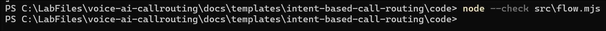

14. Execute the below command to have a quick run of the module you just built, so you can confirm it works before moving on, and catch any mistake in the step where it happened.

   ```powershell
   node lab-checks\05-flow.mjs
   ```

   **Expected output**

   ```text
   agent : Hi Dana, you've reached Contoso — I'm the automated assistant. What can I help you with today?
   model : propose billing, confidence 0.5
   agent : Sorry, I want to make sure I get you to the right place. Could you tell me a bit more about what you need?
   server: below the gate - clarify (low_confidence)
   model : propose payroll, confidence 0.9
   server: refused (unknown_route)
   model : propose billing, confidence 0.95
   agent : It sounds like Billing is the right team for that — shall I put you through?
   server: accepted - ask the caller to confirm
   caller: yes  -> confirm_route billing
   agent : Connecting you now to Billing.
   Final state: transferred | outcome: transferred:billing | clarifications: 1
   Teams receives: {
     callTopic: 'Charged twice',
     callContext: 'Charged twice on the March invoice.',
     routeId: 'billing',
     afterHours: false,
     callerDetails: {
       name: 'Dana Whitfield',
       company: 'Northwind Traders',
       accountId: 'NW-4471',
       relationship: 'Existing customer',
       verified: false
     }
   }
   ```

   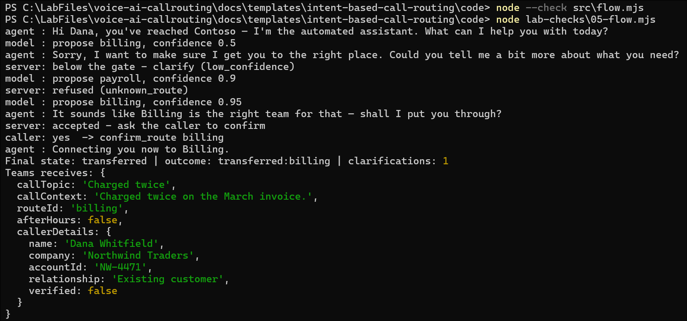

flow.mjs owns every routing decision: the allowlist, the confidence gate, confirmation, requests for a person, the keypad, clarifying questions, after-hours handling, the mind-change window and transfer recovery.

### Task 6: The AI contract

Build agent.mjs, which defines the only tools the AI may call and the standing instructions it follows.

1. Open the **agent.mjs** from “C:\LabFiles\voice-ai-callrouting\docs\templates\intent-based-call-routing\code\src” in VS Code.

2. In this file, we will add code to define the tools the AI may call and the instructions it is given.

3. **AGENT_TOOLS** lists six tools: propose_route, confirm_route, request_human, not_covered, take_message and end_call. Each one maps to a flow method you built in Task 5.

4. Note what is absent: no tool takes a phone number, a Teams object ID or a URL. The worst a confused or misled AI can do is propose the wrong internal team, which the caller still has to confirm.

5. sentiment is restricted by the tool schema to frustrated, angry, upset or distressed, and only when the caller said so — it is never inferred from tone of voice.

6. **buildInstructions()** writes the standing instructions: disclose the assistant once, speak the configured language, keep turns short, never read out ids, call request_human at once when someone asks for a person, and never ask for passwords or card numbers. The route menu is generated from routes.json, so adding a team is a configuration change, not a prompt rewrite.

7. Paste the whole code block below into **agent.mjs**.

   **src/agent.mjs**

   ```javascript
   /**
    * What the model is allowed to do, and what it is told.
    *
    * Deliberately free of transport imports so the tool surface and the standing
    * instructions can be inspected and tested without installing the WebSocket or
    * Azure SDKs. `src/voice/voice-live.mjs` is what puts these on the wire.
    */
   
   
   /**
    * The only levers the model has.
    *
    * Note what is absent: there is no tool that takes a phone number, a Teams
    * object id, or a URL. The model may propose an id from a fixed list and
    * nothing more, so the worst a confused — or deliberately misled — agent can do
    * is send someone to the wrong internal queue.
    */
   export const AGENT_TOOLS = [
     {
       type: "function",
       name: "propose_route",
       description:
         "Name the destination you believe the caller needs. Call this as soon as you have a view, even a tentative one — report your honest confidence and let the server decide whether it is high enough to act on.",
       parameters: {
         type: "object",
         properties: {
           routeId: { type: "string", description: "One of the route ids you were given. Never invent one." },
           confidence: {
             type: "number",
             description:
               "0 to 1. Your genuine certainty that this is the right team. Use a low number when the caller has been vague — a clarifying question is cheaper than a wrong transfer.",
           },
           callTopic: {
             type: "string",
             description: "Under 48 characters, in the caller's own terms. Shown to the Teams agent before they answer.",
           },
           callSummary: {
             type: "string",
             description: "One sentence explaining what the caller needs, so nobody has to ask them twice.",
           },
           sentiment: {
             type: "string",
             enum: ["frustrated", "angry", "upset", "distressed"],
             description:
               "Only when the caller has explicitly said they are unhappy. Omit it otherwise — do not infer mood from tone of voice.",
           },
         },
         required: ["routeId", "confidence", "callTopic"],
       },
     },
     {
       type: "function",
       name: "confirm_route",
       description:
         "The caller agreed with the destination you just offered. Call this only after they have actually said yes.",
       parameters: {
         type: "object",
         properties: { routeId: { type: "string", description: "The route id you proposed." } },
         required: ["routeId"],
       },
     },
     {
       type: "function",
       name: "request_human",
       description:
         "The caller asked for a person, or is too frustrated to continue. Call this immediately — do not ask them to confirm and do not try one more classifying question.",
       parameters: {
         type: "object",
         properties: { reason: { type: "string", description: "Short machine-readable reason." } },
         required: ["reason"],
       },
     },
     {
       type: "function",
       name: "not_covered",
       description:
         "The caller asked a question none of your routes cover, such as a factual question about products, policy, or hours. Call this instead of answering it yourself.",
       parameters: {
         type: "object",
         properties: { question: { type: "string", description: "What they asked, briefly." } },
         required: ["question"],
       },
     },
     {
       type: "function",
       name: "take_message",
       description:
         "Record the caller's message. Only available after you have been told the team is closed and you have offered to take one.",
       parameters: {
         type: "object",
         properties: {
           callTopic: { type: "string", description: "Under 48 characters." },
           callSummary: { type: "string", description: "One sentence, including anything they asked you to pass on." },
         },
         required: ["callTopic", "callSummary"],
       },
     },
     {
       type: "function",
       name: "end_call",
       description: "End the call once there is nothing further to do.",
       parameters: { type: "object", properties: {}, required: [] },
     },
   ];
   
   /**
    * The standing instructions. The route menu is injected from routes.json, so
    * adding a destination is a config change rather than a prompt rewrite.
    */
   export function localeLanguage(locale = "en-US") {
     const fallback = String(locale || "en-US");
     try {
       const parsed = new Intl.Locale(fallback);
       const label = new Intl.DisplayNames(["en"], { type: "language" }).of(parsed.baseName);
       return { locale: parsed.baseName, code: parsed.language, label: label ?? parsed.baseName };
     } catch {
       return { locale: fallback, code: fallback.split("-")[0], label: fallback };
     }
   }
   
   export function buildInstructions(routes, locale = "en-US") {
     const language = localeLanguage(locale);
     return `You are the automated switchboard for ${routes.organization}. You answer the main line, work out who the caller needs, and connect them. You are a receptionist, not a help desk.
   
   Disclose what you are in your first sentence — say you are ${routes.organization}'s automated assistant. Never pretend to be a person, but do not belabour it either; say it once and move on.
   
   Conversation language: Start every call in ${language.label} (${language.locale}), including the very first word of the greeting. Continue speaking only ${language.label} unless the caller explicitly asks you to switch languages. Do not infer the opening language from caller ID, tenant settings, background audio, the selected voice, or a multilingual model default.
   
   Style: warm, brisk, human. One or two short sentences per turn. This is a phone call, so never read out lists, markdown, or route ids. Ask an open question first ("What can I help you with?") rather than reciting a menu — the whole point of this system is that the caller does not have to listen to one.
   
   DESTINATIONS — you may only ever propose one of these ids:
   ${routes.menuText()}
   
   How to route:
   - Listen to what the caller actually wants, then call \`propose_route\` with your honest confidence. If you are unsure, say so in the number rather than guessing; the server will ask you to clarify instead of transferring.
   - When you have a destination, offer it in plain language using the team's name and wait for a yes: "Sounds like Billing can sort that — shall I put you through?" Then call \`confirm_route\`.
   - Never state a route id out loud. Say "Billing", not "billing route".
   - If the caller asks for a person, or is clearly fed up, call \`request_human\` straight away. Making a frustrated caller answer another question is the exact experience this system exists to remove.
   - If they ask something none of your destinations cover, call \`not_covered\`. Do not attempt an answer, do not speculate about products, pricing, policy or opening hours, and never invent anything.
   - If the caller changes their mind before the transfer completes, just call \`propose_route\` again with the new destination.
   - Keep it moving. If you have gone back and forth more than twice without getting anywhere, hand them to a person rather than persisting.
   
   Caller identity:
   - A name from caller ID is a convenience, never proof. Use it to greet them, never to release account information, and never read out an account number.
   - Never ask for a password, a PIN, a full card number, or a date of birth. You do not need any of it to transfer a call.
   
   You will be given a fresh instruction after each step. Always follow the most recent one.`;
   }
   ```

8. **Save** the file (Ctrl+S).

9. Execute the below command in the PowerShell to check the syntax. No output means OK.

   ```powershell
   node --check src\agent.mjs
   ```

   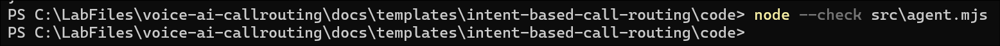

10. Execute the below command to have a quick run of the module you just built, so you can confirm it works before moving on, and catch any mistake in the step where it happened.

   ```powershell
   node lab-checks\06-agent.mjs
   ```

   **Expected output**

   ```text
   Tools the AI may call: propose_route, confirm_route, request_human, not_covered, take_message, end_call
   Any tool that takes a phone number, object id or URL? no
   Locale: { locale: 'en-US', code: 'en', label: 'American English' }
   
   Route menu the AI is given:
   - sales (Sales): Buying, renewing, upgrading, pricing, quotes, or talking to an account team. Keypad 1.
   - support (Support): Something already purchased is broken, erroring, offline, or needs technical help. Keypad 2.
   - billing (Billing): Invoices, charges, refunds, payment methods, or anything about money already owed or paid. Keypad 3.
   - reception (Reception): Anything else, an unclear reason, or an explicit request to speak to a person. Keypad 4.
   ```

   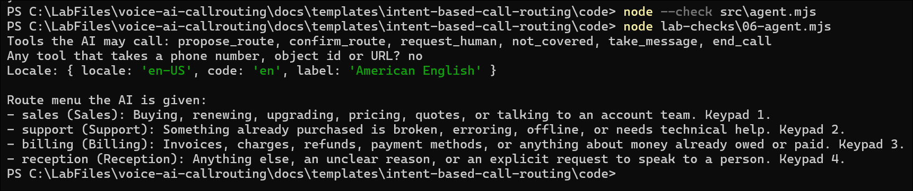

agent.mjs gives the AI six narrow tools and instructions generated from the routing policy.

### Task 7: The simulated caller brain

Build **offline.mjs**, a simple keyword classifier that stands in for the AI in simulation mode, then run the full test suite.

1. Open the **offline.mjs** from “C:\LabFiles\voice-ai-callrouting\docs\templates\intent-based-call-routing\code\src” in VS Code.

2. In this file, we will add code to drive the same state machine from typed text when no AI is connected.

3. **SIGNALS** lists keywords for each route. classifyOffline() scores them; when two routes score close to each other it reports a low confidence, so the flow asks a clarifying question instead of guessing.

4. **registerSimulatedAgent()** stands in for the AI: instead of steering a model, it speaks the example line the flow supplies with each instruction.

5. **handleUtterance()** feeds one typed line through the flow in the same order a call would: silence, a keypad digit, a request for a person, a message after hours, a “yes” to the offered team, and otherwise a new proposal.

6. **isAffirmative()** accepts “yes” but not “no, actually…”; summarise() builds the topic and inTheirWords() keeps the caller’s own words for the agent who answers.

7. Paste the whole code block below into **offline.mjs**.

   **src/offline.mjs**

   ```javascript
   /**
    * Offline intent classifier.
    *
    * This is NOT the intent engine. In a configured deployment, Voice Live decides
    * the route and calls `propose_route`. This keyword matcher exists so the agent
    * runs end to end with no Azure subscription: a typed transcript drives exactly
    * the same state machine, the same confidence gate, the same confirmation, the
    * same Teams handoff assembly. Only the classifier and the audio path are stubs.
    *
    * It is deliberately dumb and readable — if it were clever it would be mistaken
    * for the real thing.
    */
   
   import { STATES } from "./flow.mjs";
   
   const SIGNALS = {
     sales: [
       "buy", "purchase", "pricing", "price", "quote", "renew", "renewal", "upgrade",
       "subscription", "plan", "sales", "demo", "contract", "licence", "license", "order",
     ],
     support: [
       "broken", "error", "not working", "doesn't work", "does not work", "down", "outage",
       "fix", "install", "bug", "technical", "support", "crash", "slow", "offline", "reset",
       "login", "log in", "can't connect", "cannot connect",
     ],
     billing: [
       "invoice", "bill", "billing", "charge", "charged", "refund", "payment", "paid",
       "receipt", "overcharged", "credit card", "statement", "owe", "double charged",
     ],
     reception: [
       "person", "human", "someone", "somebody", "representative", "operator", "real agent",
       "speak to a", "talk to a",
     ],
   };
   
   /** Explicit asks for a human, which bypass classification entirely. */
   export function wantsHuman(text) {
     const t = normalise(text);
     return SIGNALS.reception.some((k) => t.includes(k));
   }
   
   /**
    * Stands in for the Voice Live agent. It implements the same handle the real
    * bridge registers — `{ instruct, nudge }` — but instead of steering a model it
    * speaks the example line the flow supplies alongside each instruction. The
    * flow cannot tell the difference, which is the point: state transitions,
    * confirmations and wording all happen on the same code path a real call takes.
    */
   export function registerSimulatedAgent(flow, callId) {
     flow.registerAgent(callId, {
       instruct: (_prompt, spoken) => {
         if (spoken) flow.pushTranscript(callId, "agent", spoken);
       },
       nudge: (_prompt, opts) => {
         if (opts?.spoken) flow.pushTranscript(callId, "agent", opts.spoken);
       },
     });
   }
   
   function normalise(text) {
     return ` ${String(text ?? "").toLowerCase().replace(/[^a-z0-9' ]+/g, " ").replace(/\s+/g, " ")} `;
   }
   
   /**
    * @returns {{routeId: string|null, confidence: number, matches: string[]}}
    */
   export function classifyOffline(text, allowedIds = null) {
     const t = normalise(text);
   
     const scores = Object.entries(SIGNALS)
       .filter(([id]) => !allowedIds || allowedIds.includes(id))
       .map(([id, keywords]) => {
         const matches = keywords.filter((k) => t.includes(` ${k}`) || t.includes(`${k} `));
         return { id, matches, hits: matches.length };
       })
       .filter((s) => s.hits > 0)
       .sort((a, b) => b.hits - a.hits);
   
     if (!scores.length) return { routeId: null, confidence: 0, matches: [] };
   
     const [best, runnerUp] = scores;
   
     // More than one category fired with comparable weight. Say so honestly and let
     // the flow ask a clarifying question rather than guessing between them.
     if (runnerUp) {
       const contest = runnerUp.hits / best.hits;
       if (contest === 1) return { routeId: best.id, confidence: 0.45, matches: best.matches };
       if (contest >= 0.5) return { routeId: best.id, confidence: 0.6, matches: best.matches };
       return { routeId: best.id, confidence: 0.8, matches: best.matches };
     }
   
     return { routeId: best.id, confidence: best.hits >= 2 ? 0.95 : 0.85, matches: best.matches };
   }
   
   /**
    * Feed one caller utterance through the flow exactly as the model would.
    * The presenter types; everything downstream is the real state machine.
    */
   export function handleUtterance(flow, callId, text) {
     const said = String(text ?? "").trim();
     if (!said) return flow.noInput(callId);
   
     flow.pushTranscript(callId, "caller", said);
     const call = flow.get(callId);
   
     if (/^[0-9]$/.test(said)) return flow.dtmf(callId, said);
     if (wantsHuman(said)) return flow.requestHuman(callId, "explicit_request");
   
     // After hours the caller is dictating a message, not stating an intent.
     if (call?.state === STATES.MESSAGING) {
       return flow.takeMessage(callId, { callTopic: summarise(said), callSummary: said });
     }
   
     // A yes accepts the destination just offered. Anything else falls through to
     // classification again, which is how a caller changes their mind.
     if (call?.state === STATES.CONFIRMING && call.proposed && isAffirmative(said)) {
       return flow.confirmRoute(callId, call.proposed.routeId);
     }
   
     const { routeId, confidence } = classifyOffline(said, flow.routes.ids);
     if (!routeId) return flow.noInput(callId);
   
     return flow.proposeRoute(callId, {
       routeId,
       confidence,
       callTopic: summarise(said),
       callSummary: inTheirWords(call, said),
     });
   }
   
   const AFFIRMATIVE = /\b(yes|yeah|yep|correct|right|that's it|thats it|sure|please|ok|okay)\b/i;
   const NEGATIVE = /\b(no|nope|not really|wrong|actually)\b/i;
   
   export function isAffirmative(text) {
     return AFFIRMATIVE.test(String(text)) && !NEGATIVE.test(String(text));
   }
   
   // Spoken openers that say nothing about the topic: "no wait, …", "um, actually …".
   // A bare "no" stays, so "no one can log in" keeps its meaning.
   const OPENERS = /^(?:(?:no,?\s+(?=wait|actually|sorry)|wait|actually|sorry|um+|uh+|er+|so|well|oh|hi|hey)\b[\s,.!-]*)+/i;
   // The flow's topic limit. Cutting here, at a word, keeps the Teams topic readable.
   const TOPIC_CHARS = 48;
   
   function summarise(text) {
     const said = String(text).trim();
     let topic = (said.replace(OPENERS, "") || said).replace(/[\s,.;:!?]+$/, "");
     if (topic.length > TOPIC_CHARS) {
       const cut = topic.slice(0, TOPIC_CHARS - 1);
       const space = cut.lastIndexOf(" ");
       topic = `${(space > 0 ? cut.slice(0, space) : cut).replace(/[\s,;:]+$/, "")}…`;
     }
     return topic.charAt(0).toUpperCase() + topic.slice(1);
   }
   
   // The caller's own words so far, minus the bare yeses and keypresses, so the
   // agent who picks up hears the whole story — a changed mind included.
   function inTheirWords(call, said) {
     const lines = (call?.transcript ?? [])
       .filter((line) => line.role === "caller")
       .map((line) => String(line.text).trim())
       .filter((text) => text && !/^[0-9]$/.test(text) && !(isAffirmative(text) && text.split(/\s+/).length <= 3));
     const story = (lines.length ? lines : [said]).slice(-3).map((text) => `“${text.replace(/[\s.]+$/, "")}”`);
     return `Caller said: ${story.join(", then ")}`;
   }
   ```

8. Save the file (Ctrl+S).

9. Execute the below command in the PowerShell to check the syntax. No output means OK.

   ```powershell
   node --check src\offline.mjs
   ```

   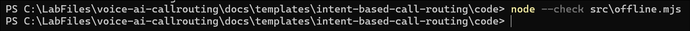

10. Execute the below command to have a quick run of the module you just built, so you can confirm it works before moving on, and catch any mistake in the step where it happened.

   ```powershell
   node lab-checks\07-offline.mjs
   ```

   **Expected output**

   ```text
   classify 'I was charged twice on my invoice': {
     routeId: 'billing',
     confidence: 0.95,
     matches: [ 'invoice', 'charge', 'charged' ]
   }
   
   agent : Hi Dana, you've reached Contoso — I'm the automated assistant. What can I help you with today?
   caller: I was charged for a renewal I did not order
   agent : Sorry, I want to make sure I get you to the right place. Could you tell me a bit more about what you need?
   caller: There's a charge on my invoice I need refunded
   agent : It sounds like Billing is the right team for that — shall I put you through?
   caller: Yes please
   agent : Connecting you now to Billing.
   
   Outcome: transferred:billing
   ```

   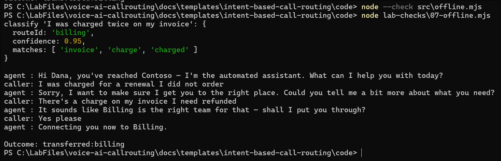

11. Execute the command **npm test** in the PowerShell. All the modules the tests need now exist.

   **Expected output**

   ```text
   # tests 74
   # suites 0
   # pass 74
   # fail 0
   # cancelled 0
   # skipped 0
   # todo 0
   ```

   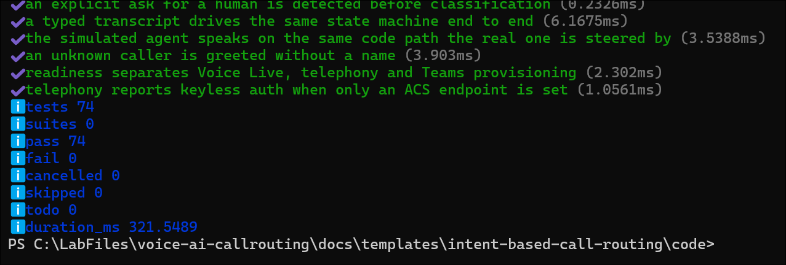

   If a test fails, its name tells you which rule is broken, for example “a proposal below the threshold clarifies instead of transferring”. Compare the matching module with the code block in this guide.

offline.mjs drives the real state machine from typed text, and all 74 automated tests pass.

The routing logic is complete: settings, routing policy, audit, Teams handoff, state machine, AI contract and simulated caller. All 74 automated tests pass.

## Exercise 3: Make the complete agent run

In this exercise, you add the parts that connect the routing logic to the outside world: live updates to the browser console, the SQLite audit trail, Azure Communication Services, the Voice Live session, the call bridge and the web server.

### Task 1: Live updates to the console

Build realtime.mjs, which pushes every call event to the browser console as it happens.

1. Open the **realtime.mjs** from “C:\LabFiles\voice-ai-callrouting\docs\templates\intent-based-call-routing\code\src” in VS Code.

2. In this file, we will add code to send every transcript line, state change and decision to the browser console in real time.

3. **LocalWebSocketHub** is a small WebSocket hub inside the server, addressed by call id, so no extra Azure service is needed for the console.

4. **attach()** is created with noServer: true; the web server you build in Task 6 routes each WebSocket upgrade to the right handler by path.

5. **send()** delivers a message to consoles watching that call and to consoles watching everything (“*”), and keeps the last 200 messages so a console opened mid-call is not blank.

6. Paste the whole code block below into **realtime.mjs**.

   **src/realtime.mjs**

   ```javascript
   import { WebSocketServer } from "ws";
   
   /**
    * Realtime fan-out to the presenter console.
    *
    * A plain WebSocket hub inside this process, addressed by call id, so the whole
    * agent runs with no Azure SignalR dependency and no second service to
    * provision. For a production console you would swap this for Azure SignalR
    * Service in serverless mode; the `send(userId, target, payload)` shape is the
    * same, which is the only thing the flow depends on.
    */
   export class LocalWebSocketHub {
     transport = "local-ws";
   
     /** @type {Map<string, Set<import("ws").WebSocket>>} */
     #clients = new Map();
     /** Every message, so a console opened mid-call is not blank. */
     #backlog = new Map();
   
     /**
      * Returns the server so the caller can route upgrades. Deliberately
      * `noServer`: attaching two WebSocketServers to one HTTP server does not work,
      * because each aborts the handshake for paths it does not own.
      */
     attach() {
       const wss = new WebSocketServer({ noServer: true });
   
       wss.on("connection", (socket, req) => {
         const userId = new URL(req.url, "http://localhost").searchParams.get("user") ?? "*";
         if (!this.#clients.has(userId)) this.#clients.set(userId, new Set());
         this.#clients.get(userId).add(socket);
   
         for (const msg of this.#backlog.get(userId) ?? []) socket.send(msg);
   
         socket.on("close", () => {
           const set = this.#clients.get(userId);
           set?.delete(socket);
           if (set && set.size === 0) this.#clients.delete(userId);
         });
         socket.on("error", () => socket.close());
       });
   
       return wss;
     }
   
     negotiate(userId) {
       return { url: `/ws/hub?user=${encodeURIComponent(userId)}`, transport: this.transport };
     }
   
     /**
      * Sent to the console watching this specific call and to any console watching
      * everything, which is what the demo surface subscribes to.
      */
     send(userId, target, payload) {
       const msg = JSON.stringify({ target, arguments: [{ callId: userId, ...payload }] });
   
       const backlog = this.#backlog.get(userId) ?? [];
       backlog.push(msg);
       if (backlog.length > 200) backlog.shift();
       this.#backlog.set(userId, backlog);
   
       for (const key of [userId, "*"]) {
         for (const socket of this.#clients.get(key) ?? []) {
           if (socket.readyState === socket.OPEN) socket.send(msg);
         }
       }
     }
   
     forget(userId) {
       this.#backlog.delete(userId);
     }
   }
   
   export function createHub() {
     return new LocalWebSocketHub();
   }
   ```

7. Save the file (Ctrl+S).

8. Execute the below command in the PowerShell to check the syntax. No output means OK.

   ```powershell
   node --check src\realtime.mjs
   ```

   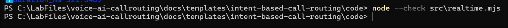

9. Execute the below command to have a quick run of the module you just built, so you can confirm it works before moving on, and catch any mistake in the step where it happened.

   ```powershell
   node lab-checks\08-realtime.mjs
   ```

   **Expected output**

   ```text
   Transport: local-ws
   Console connects to: /ws/hub?user=*
   Message queued for consoles that connect later: OK
   ```

   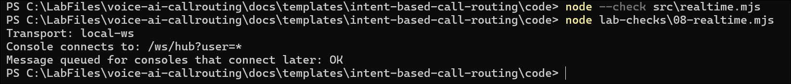

realtime.mjs streams call events to any open console.

### Task 2: The SQLite audit trail

Build **db.mjs**, a SQLite version of the audit store so decisions survive a server restart.

1. Open the **db.mjs** from “C:\LabFiles\voice-ai-callrouting\docs\templates\intent-based-call-routing\code\src” in VS Code.

2. In this file, we will add code to store calls, decisions and (optionally) transcripts in a SQLite database file.

3. **SqliteAudit** has exactly the same methods as MemoryAudit, so the flow cannot tell the difference.

4. The constructor creates the data folder and the three tables (calls, call_events, transcripts) if they do not exist. The database file is data\routing.db.

5. **updateCall()** only writes the columns present in the change; recordTranscript() does nothing unless PERSIST_TRANSCRIPTS is on.

6. **reset()** deletes simulated calls only, and stats() answers the console’s metrics strip with SQL.

7. Paste the whole code block below into **db.mjs**.

   **src/db.mjs**

   ```javascript
   import Database from "better-sqlite3";
   import { mkdirSync } from "node:fs";
   import { dirname } from "node:path";
   import { config } from "./config.mjs";
   import { medianSeconds } from "./audit.mjs";
   
   /**
    * SQLite implementation of the audit sink.
    *
    * Same interface as `MemoryAudit`, so the state machine cannot tell the
    * difference and the tests never touch a database. What gets stored is the
    * routing decision — masked number, chosen route, topic, summary, outcome,
    * and every state transition. Utterance text is written only when
    * PERSIST_TRANSCRIPTS is explicitly turned on.
    */
   export class SqliteAudit {
     name = "sqlite";
   
     constructor(path = config.dbPath) {
       mkdirSync(dirname(path), { recursive: true });
       this.db = new Database(path);
       this.db.pragma("journal_mode = WAL");
       this.db.exec(SCHEMA);
       this.persistTranscripts = config.persistTranscripts;
     }
   
     startCall(call) {
       this.db
         .prepare(
           `INSERT OR REPLACE INTO calls
              (id, masked_phone, caller_name, caller_verified, state, simulated, started_at)
            VALUES (@id, @maskedPhone, @callerName, @callerVerified, @state, @simulated, @startedAt)`,
         )
         .run({
           id: call.id,
           maskedPhone: call.maskedPhone ?? null,
           callerName: call.callerName ?? null,
           callerVerified: call.callerVerified ? 1 : 0,
           state: call.state,
           simulated: call.simulated ? 1 : 0,
           startedAt: call.startedAt,
         });
     }
   
     /** Only the columns present in the patch are touched. */
     updateCall(id, patch) {
       const columns = {
         state: "state",
         confirmedRouteId: "confirmed_route_id",
         outcome: "outcome",
         endedAt: "ended_at",
         durationMs: "duration_ms",
         topic: "topic",
         summary: "summary",
         sentiment: "sentiment",
         simulated: "simulated",
       };
   
       const sets = [];
       const values = {};
       for (const [key, column] of Object.entries(columns)) {
         if (patch[key] === undefined) continue;
         sets.push(`${column} = @${key}`);
         values[key] = typeof patch[key] === "boolean" ? Number(patch[key]) : patch[key];
       }
       if (!sets.length) return;
   
       this.db.prepare(`UPDATE calls SET ${sets.join(", ")} WHERE id = @id`).run({ ...values, id });
     }
   
     recordEvent(callId, source, kind, detail = null) {
       this.db
         .prepare(
           `INSERT INTO call_events (call_id, source, kind, detail, created_at)
            VALUES (?, ?, ?, ?, ?)`,
         )
         .run(callId, source, kind, detail == null ? null : String(detail), new Date().toISOString());
     }
   
     recordTranscript(callId, role, text) {
       if (!this.persistTranscripts) return;
       this.db
         .prepare(
           `INSERT INTO transcripts (call_id, role, text, created_at)
            VALUES (?, ?, ?, ?)`,
         )
         .run(callId, role, text, new Date().toISOString());
     }
   
     eventsFor(callId) {
       return this.db
         .prepare(`SELECT source, kind, detail, created_at AS at FROM call_events WHERE call_id = ? ORDER BY id`)
         .all(callId);
     }
   
     /**
      * Delete simulated calls and everything recorded about them — the demo
      * console's reset between run-throughs. Calls from a real phone stay.
      */
     reset() {
       const simulated = `SELECT id FROM calls WHERE simulated = 1`;
       this.db.transaction(() => {
         this.db.prepare(`DELETE FROM call_events WHERE call_id IN (${simulated})`).run();
         this.db.prepare(`DELETE FROM transcripts WHERE call_id IN (${simulated})`).run();
         this.db.prepare(`DELETE FROM calls WHERE simulated = 1`).run();
       })();
     }
   
     /** What the presenter console shows on the metrics strip. */
     stats() {
       const tally = (column) =>
         Object.fromEntries(
           this.db
             .prepare(`SELECT COALESCE(${column}, 'none') AS k, COUNT(*) AS n FROM calls GROUP BY k`)
             .all()
             .map((r) => [r.k, r.n]),
         );
   
       const eventCount = (kind) =>
         this.db.prepare(`SELECT COUNT(*) AS n FROM call_events WHERE kind = ?`).get(kind).n;
   
       return {
         calls: this.db.prepare(`SELECT COUNT(*) AS n FROM calls`).get().n,
         byOutcome: tally("outcome"),
         byRoute: tally("confirmed_route_id"),
         clarifications: eventCount("clarification"),
         fallbacks: eventCount("fallback"),
         transfers: eventCount("transfer_succeeded") + eventCount("transfer_simulated"),
         failedTransfers: eventCount("transfer_failed"),
         messagesTaken: eventCount("message_taken"),
         humanRequests: eventCount("human_requested"),
         medianSecondsToRoute: this.#medianSecondsToRoute(),
       };
     }
   
     /**
      * Answer to transfer, which is the number this agent is actually trying
      * to move. Computed over transferred calls only — a message or a hang-up is
      * not a route.
      */
     #medianSecondsToRoute() {
       const rows = this.db
         .prepare(`SELECT duration_ms FROM calls WHERE duration_ms IS NOT NULL AND outcome LIKE 'transferred:%'`)
         .all();
       return medianSeconds(rows.map((r) => r.duration_ms));
     }
   
     close() {
       this.db.close();
     }
   }
   
   const SCHEMA = `
   CREATE TABLE IF NOT EXISTS calls (
     id                TEXT PRIMARY KEY,
     masked_phone      TEXT,
     caller_name       TEXT,
     caller_verified   INTEGER NOT NULL DEFAULT 0,
     state             TEXT NOT NULL,
     confirmed_route_id TEXT,
     topic             TEXT,
     summary           TEXT,
     sentiment         TEXT,
     outcome           TEXT,
     simulated         INTEGER NOT NULL DEFAULT 0,
     started_at        TEXT NOT NULL,
     ended_at          TEXT,
     duration_ms       INTEGER
   );
   
   CREATE TABLE IF NOT EXISTS call_events (
     id         INTEGER PRIMARY KEY AUTOINCREMENT,
     call_id    TEXT NOT NULL REFERENCES calls(id),
     source     TEXT NOT NULL,
     kind       TEXT NOT NULL,
     detail     TEXT,
     created_at TEXT NOT NULL
   );
   
   CREATE TABLE IF NOT EXISTS transcripts (
     id         INTEGER PRIMARY KEY AUTOINCREMENT,
     call_id    TEXT NOT NULL REFERENCES calls(id),
     role       TEXT NOT NULL,
     text       TEXT NOT NULL,
     created_at TEXT NOT NULL
   );
   
   CREATE INDEX IF NOT EXISTS idx_events_call ON call_events(call_id);
   CREATE INDEX IF NOT EXISTS idx_transcripts_call ON transcripts(call_id);
   `;
   ```

8. Save the file (Ctrl+S).

9. Execute the below command in the PowerShell to check the syntax. No output means OK.

   ```powershell
   node --check src\db.mjs
   ```

   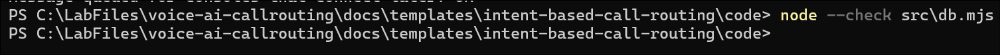

10. Execute the below command to have a quick run of the module you just built, so you can confirm it works before moving on, and catch any mistake in the step where it happened.

   ```powershell
   node lab-checks\09-db.mjs
   ```

   **Expected output**

   ```text
   Store: sqlite | calls: 1 | transfers: 1 | by route: {"billing":1} | median seconds to route: 18
   ```

   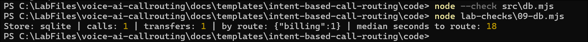

db.mjs keeps an audit trail in SQLite with the same interface as the in-memory audit.

### Task 3: Azure Communication Services

Build **acs.mjs**, which answers the phone call, transfers it to Teams with the handoff headers, listens for keypad presses and hangs up.

1. Open the **acs.mjs** from “C:\LabFiles\voice-ai-callrouting\docs\templates\intent-based-call-routing\code\src\voice” in VS Code.

2. In this file, we will add code to control the phone call through ACS Call Automation: answer, transfer to Teams, keypad and hang-up.

3. **acsClient()** creates the Call Automation client on first use. With ACS_ENDPOINT set it signs in keylessly with DefaultAzureCredential (your az login); the connection string is only a fallback.

4. **answerInboundCall()** answers the call and opens bidirectional media streaming in one step: audio flows over a WebSocket as PCM 24 kHz mono, exactly what Voice Live uses, so no conversion is needed. The call id travels in both the callback URL and the media URL.

5. **asciiSafe()** and **transferToTeams()** hand the caller to the Teams destination with the handoff headers attached (see the transfer fix below). This is a blind transfer: once the context is delivered, the agent leaves the call.

6. **startDtmfRecognition()** listens for keypad presses for the rest of the call; hangUp() ends the call.

7. Paste the whole code block below into **acs.mjs**.

   **src/voice/acs.mjs**

   ```javascript
   import { config } from "../config.mjs";
   import { teamsIdentifier, buildCustomCallingContext } from "../handoff.mjs";
   
   export { teamsIdentifier, buildCustomCallingContext, asciiSafe };
   
   const log = (...a) => console.log(new Date().toISOString(), "[acs]", ...a);
   
   /**
    * The Azure SDKs load on first use, not at startup. Simulation never touches
    * ACS, and @azure/identity alone can add many seconds to a cold start on a slow
    * filesystem — the difference between a demo that restarts at once and one
    * that keeps the room waiting.
    */
   let client;
   export function acsClient() {
     client ??= createClient().catch((e) => {
       client = null;
       throw e;
     });
     return client;
   }
   
   async function createClient() {
     if (!config.acs.endpoint && !config.acs.connectionString) {
       throw new Error("Set ACS_ENDPOINT (preferred) or ACS_CONNECTION_STRING");
     }
     const { CallAutomationClient } = await import("@azure/communication-call-automation");
     // Entra first. A connection string is still accepted, but it means an ACS
     // key has to live in a file somewhere, and there is no reason to require
     // that when the SDK takes a TokenCredential.
     if (config.acs.endpoint) {
       const { DefaultAzureCredential } = await import("@azure/identity");
       return new CallAutomationClient(config.acs.endpoint, new DefaultAzureCredential());
     }
     return new CallAutomationClient(config.acs.connectionString);
   }
   
   /**
    * Answer an inbound PSTN call and open the media stream in one operation.
    *
    * The call id travels in both the callback URL and the media transport URL, so
    * lifecycle events and the audio socket both land on the right state machine
    * without any extra correlation table.
    */
   export async function answerInboundCall({ incomingCallContext, callId }) {
     const base = config.publicBaseUrl;
     const wss = base.replace(/^https:/, "wss:");
     const q = encodeURIComponent(callId);
   
     const acs = await acsClient();
     const result = await acs.answerCall(incomingCallContext, `${base}/api/calls/callback?call=${q}`, {
       operationContext: `answer:${callId}`,
       mediaStreamingOptions: {
         transportType: "websocket",
         transportUrl: `${wss}/ws/media?call=${q}`,
         contentType: "audio",
         audioChannelType: "mixed",
         startMediaStreaming: true,
         enableBidirectional: true,
         // Matches the Voice Live PCM path exactly, so no resampling on this leg.
         audioFormat: "pcm24KMono",
       },
     });
   
     const callConnectionId = result.callConnectionProperties?.callConnectionId ?? null;
     log("answered", callId, "->", callConnectionId);
     return { callConnectionId };
   }
   
   /** Lab fix (ACS-number path): transfers reject dotted VoIP header keys and non-ASCII values. */
   const asciiSafe = (headers) =>
     headers.map((h) => ({
       ...h,
       key: String(h.key).replace(/[^A-Za-z0-9]/g, ""),
       value: String(h.value)
         .replace(/[\u2013\u2014]/g, "-")
         .replace(/[\u201C\u201D]/g, '"')
         .replace(/[\u2018\u2019]/g, "'")
         .replace(/\u2026/g, "...")
         .replace(/[^\x20-\x7E]/g, ""),
     }));
   
   /**
    * Hand the call to Teams and step out of the way.
    *
    * A blind transfer is deliberate for this agent: the voice agent's job ends
    * once the context has been delivered, and staying on the line would mean a
    * silent third party on every routed call.
    */
   export async function transferToTeams({ callConnectionId, target, context, callId }) {
     if (!callConnectionId) throw new Error("no call connection to transfer");
   
     const connection = (await acsClient()).getCallConnection(callConnectionId);
     try {
       await connection.transferCallToParticipant(teamsIdentifier(target), {
         operationContext: `transfer:${callId}`,
         customCallingContext: asciiSafe(buildCustomCallingContext(context)),
       });
     } catch (e) {
       log("TRANSFER ERROR", "status:", e.statusCode, "| code:", e.code, "| message:", e.message);
       log("TRANSFER ERROR body:", e.response?.bodyAsText ?? "(none)");
       throw e;
     }
   
     log("transfer requested", callId, "->", target.displayName ?? target.objectId);
   }
   
   /**
    * Subscribe to keypad presses for the rest of the call. The caller can press a
    * digit at any point; the flow only *mentions* the keypad when speech has
    * already failed twice.
    */
   export async function startDtmfRecognition({ callConnectionId, fromPhone }) {
     if (!callConnectionId || !fromPhone) return;
     try {
       await (await acsClient())
         .getCallConnection(callConnectionId)
         .getCallMedia()
         .startContinuousDtmfRecognition({ phoneNumber: fromPhone });
     } catch (e) {
       // Not fatal: speech still works, the caller just loses the keypad shortcut.
       log("could not start DTMF recognition:", e.message);
     }
   }
   
   export async function hangUp(callConnectionId) {
     if (!callConnectionId) return;
     try {
       await (await acsClient()).getCallConnection(callConnectionId).hangUp(true);
     } catch {
       /* call may already be gone */
     }
   }
   ```

8. Save the file (Ctrl+S).

9. Execute the below command in the PowerShell to check the syntax. No output means OK.

   ```powershell
   node --check src\voice\acs.mjs
   ```

   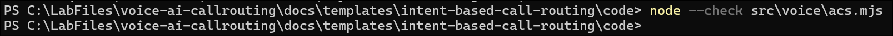

10. Execute the below command to have a quick run of the module you just built, so you can confirm it works before moving on, and catch any mistake in the step where it happened.

   ```powershell
   node lab-checks\10-acs.mjs
   ```

   **Expected output**

   ```text
   Exports: answerInboundCall, transferToTeams, startDtmfRecognition, hangUp
   Headers built         : CallDetails.SessionId=abc-123 | CallDetails.CallTopic=Renewal charge – “not ordered”… | CallDetails.RouteId=billing
   Headers sent to Teams : CallDetailsSessionId=abc-123 | CallDetailsCallTopic=Renewal charge - "not ordered"... | CallDetailsRouteId=billing
   Expected without .env: Set ACS_ENDPOINT (preferred) or ACS_CONNECTION_STRING
   ```

   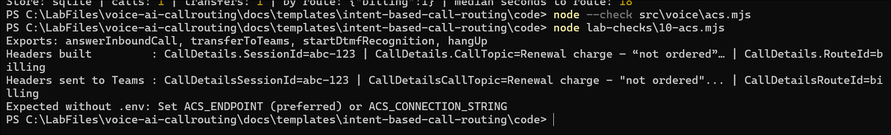

acs.mjs answers calls, transfers them to Teams with headers ACS accepts on an ACS phone number, and handles the keypad and hang-up.

### Task 4: The Voice Live session

Build **voice-live.mjs**, which opens a realtime session with the AI, streams audio both ways and passes the AI’s tool calls to the server.

1. Open the **voice-live.mjs** from “C:\LabFiles\voice-ai-callrouting\docs\templates\intent-based-call-routing\code\src\voice” in VS Code.

2. In this file, we will add code to open and run one Voice Live (gpt-realtime) session per call.

3. **authHeaders()** uses the API key if one is set; otherwise it gets an Entra token for https://ai.azure.com/.default with DefaultAzureCredential — keyless, as recommended.

4. **connect()** opens the WebSocket and sends session.update: the instructions, the six tools, the voice, PCM16 audio both ways, transcription of the caller, azure_semantic_vad turn detection, noise suppression and echo cancellation.

5. Voice Live allows only one response at a time, so #requestResponse() queues a second request instead of letting two collide.

6. **#handleEvent()** passes agent audio to the caller, reports when the caller starts speaking (for barge-in) and passes both transcripts on. #dispatchTool() runs each tool call on the server and returns the result to the AI.

7. **instruct()** replaces the step instruction every time the flow changes state; cancelResponse() stops the agent mid-sentence; writeCallerAudio() forwards the caller’s audio unchanged.

8. Paste the whole code block below into **voice-live.mjs**.

   **src/voice/voice-live.mjs**

   ```javascript
   import WebSocket from "ws";
   import { config } from "../config.mjs";
   import { AGENT_TOOLS, buildInstructions, localeLanguage } from "../agent.mjs";
   
   export { AGENT_TOOLS, buildInstructions, localeLanguage };
   
   const log = (...a) => console.log(new Date().toISOString(), "[voice-live]", ...a);
   
   const ENTRA_SCOPE = "https://ai.azure.com/.default";
   let credential;
   
   /**
    * Keyless auth is what Microsoft recommends, so it is the default here: set
    * VOICE_LIVE_API_KEY only if you cannot assign the Cognitive Services User and Foundry User roles.
    * @azure/identity is imported lazily so this module stays loadable without it.
    */
   async function authHeaders() {
     const { apiKey } = config.voiceLive;
     if (apiKey) return { "api-key": apiKey };
   
     if (!credential) {
       const { DefaultAzureCredential } = await import("@azure/identity");
       credential = new DefaultAzureCredential();
     }
     const token = await credential.getToken(ENTRA_SCOPE);
     if (!token?.token) throw new Error(`Could not acquire a token for ${ENTRA_SCOPE}`);
     return { Authorization: `Bearer ${token.token}` };
   }
   
   /**
    * One Voice Live session over the WebSocket transport.
    *
    * Audio is PCM16 mono 24 kHz in both directions, which is exactly what ACS
    * bidirectional media streaming emits and accepts (`audioFormat: "pcm24KMono"`),
    * so audio is forwarded verbatim — no transcoding, no resampling, no jitter buffer.
    */
   export class VoiceLiveSession {
     constructor({ instructions, onAgentAudio, onEvent, onToolCall }) {
       this.baseInstructions = instructions;
       this.onAgentAudio = onAgentAudio;
       this.onEvent = onEvent ?? (() => {});
       this.onToolCall = onToolCall ?? (async () => ({}));
       this.closed = false;
       this.pending = [];
       this.activeResponse = false;
       this.pendingResponse = false;
     }
   
     async connect() {
       const { endpoint, model, apiVersion, voice } = config.voiceLive;
       const language = localeLanguage(config.locale);
       const url =
         `${endpoint.replace(/^https:/, "wss:")}/voice-live/realtime` +
         `?api-version=${encodeURIComponent(apiVersion)}&model=${encodeURIComponent(model)}`;
   
       this.ws = new WebSocket(url, { headers: await authHeaders() });
   
       await new Promise((resolve, reject) => {
         const fail = setTimeout(() => reject(new Error("Voice Live connect timeout")), 20000);
   
         this.ws.on("open", () => {
           clearTimeout(fail);
           log(`connected (${model})`);
           this.#send({
             type: "session.update",
             session: {
               instructions: this.baseInstructions,
               modalities: ["text", "audio"],
               input_audio_format: "pcm16",
               output_audio_format: "pcm16",
               voice: { name: voice, type: "azure-standard" },
               tools: AGENT_TOOLS,
               tool_choice: "auto",
               // Voice Live expects an ISO-639-1 hint for multimodal-model
               // transcription ("en"), while the rest of the agent exposes the
               // more specific BCP-47 locale ("en-US").
               input_audio_transcription: { model: "gpt-4o-transcribe", language: language.code },
               turn_detection: {
                 type: "azure_semantic_vad",
                 threshold: 0.3,
                 prefix_padding_ms: 200,
                 silence_duration_ms: 400,
               },
               input_audio_noise_reduction: { type: "azure_deep_noise_suppression" },
               input_audio_echo_cancellation: { type: "server_echo_cancellation" },
             },
           });
           for (const frame of this.pending.splice(0)) this.#send(frame);
           resolve();
         });
   
         this.ws.on("error", (e) => {
           clearTimeout(fail);
           reject(e);
         });
       });
   
       this.ws.on("message", (raw) => this.#handleEvent(raw));
       this.ws.on("close", (code) => {
         log("closed", code);
         this.closed = true;
       });
     }
   
     #send(obj) {
       if (this.ws?.readyState === WebSocket.OPEN) this.ws.send(JSON.stringify(obj));
       else this.pending.push(obj);
     }
   
     /**
      * Voice Live allows exactly one in-flight response per conversation. A state
      * transition and a tool result can easily both want the agent to speak, so
      * requests are coalesced here instead of racing and erroring with
      * `conversation_already_has_active_response`.
      */
     #requestResponse() {
       if (this.activeResponse) this.pendingResponse = true;
       else {
         this.activeResponse = true;
         this.#send({ type: "response.create" });
       }
     }
   
     async #handleEvent(raw) {
       let msg;
       try {
         msg = JSON.parse(raw);
       } catch {
         return;
       }
   
       switch (msg.type) {
         case "response.created":
           this.activeResponse = true;
           break;
   
         case "response.done":
         case "response.cancelled":
           this.activeResponse = false;
           if (this.pendingResponse) {
             this.pendingResponse = false;
             this.#requestResponse();
           }
           break;
   
         case "response.audio.delta":
           this.onAgentAudio(msg.delta);
           break;
   
         case "input_audio_buffer.speech_started":
           this.onEvent({ kind: "user_speech_started" });
           break;
   
         case "conversation.item.input_audio_transcription.completed":
           this.onEvent({ kind: "user_transcript", text: msg.transcript });
           break;
   
         case "response.audio_transcript.done":
           this.onEvent({ kind: "agent_transcript", text: msg.transcript });
           break;
   
         case "response.function_call_arguments.done":
           await this.#dispatchTool(msg);
           break;
   
         case "error":
           log("ERROR", JSON.stringify(msg.error));
           this.onEvent({ kind: "error", error: msg.error });
           break;
       }
     }
   
     async #dispatchTool(msg) {
       let args = {};
       try {
         args = msg.arguments ? JSON.parse(msg.arguments) : {};
       } catch {
         /* tolerate malformed tool args */
       }
       log("tool", msg.name, JSON.stringify(args));
   
       let result;
       try {
         result = await this.onToolCall(msg.name, args);
       } catch (e) {
         result = { error: e.message };
       }
   
       this.#send({
         type: "conversation.item.create",
         item: { type: "function_call_output", call_id: msg.call_id, output: JSON.stringify(result ?? {}) },
       });
       this.#requestResponse();
     }
   
     /** Replace the standing instructions for the current step, then let the agent speak. */
     instruct(text) {
       this.#send({ type: "session.update", session: { instructions: `${this.baseInstructions}\n\n${text}` } });
       this.#requestResponse();
     }
   
     /** Inject an out-of-band fact mid-call without necessarily prompting speech. */
     nudge(text, { speak = true } = {}) {
       this.#send({
         type: "conversation.item.create",
         item: { type: "message", role: "system", content: [{ type: "input_text", text }] },
       });
       if (speak) this.#requestResponse();
     }
   
     /** Caller started talking — stop the agent immediately. */
     cancelResponse() {
       this.pendingResponse = false;
       if (!this.activeResponse) return;
       this.activeResponse = false;
       this.#send({ type: "response.cancel" });
     }
   
     /** Feed caller audio straight through: base64 PCM16 24 kHz mono from ACS. */
     writeCallerAudio(base64Pcm) {
       this.#send({ type: "input_audio_buffer.append", audio: base64Pcm });
     }
   
     close() {
       if (this.closed) return;
       this.closed = true;
       try {
         this.ws?.close();
       } catch {}
       log("session closed");
     }
   }
   ```

9. Save the file (Ctrl+S).

10. Execute the below command in the PowerShell to check the syntax. No output means OK.

   ```powershell
   node --check src\voice\voice-live.mjs
   ```

   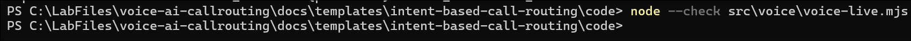

11. Execute the below command to have a quick run of the module you just built, so you can confirm it works before moving on, and catch any mistake in the step where it happened.

   ```powershell
   node lab-checks\11-voice-live.mjs
   ```

   **Expected output**

   ```text
   Session object created; connected yet? false
   Tools it will register with Voice Live: 6
   ```

   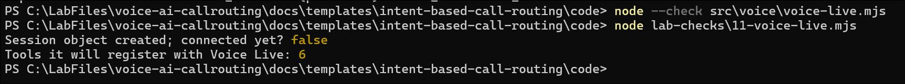

voice-live.mjs runs the realtime AI session, keyless, with the tools and turn-taking the call needs.

### Task 5: Joining a phone call to the AI

Build **call-bridge.mjs**, which connects the ACS audio stream of a call to its Voice Live session and turns the AI’s tool calls into flow decisions.

1. Open the **call-bridge.mjs** from “C:\LabFiles\voice-ai-callrouting\docs\templates\intent-based-call-routing\code\src\voice” in VS Code.

2. In this file, we will add code to bridge one phone call’s audio to one Voice Live session and wire both into the routing flow.

3. **CallBridge.start()** opens the Voice Live session with instructions built from the routes, registers itself with the flow and calls answered(), which makes the agent speak first.

4. Audio is forwarded verbatim in both directions. When the caller starts talking, the bridge sends StopAudio to ACS and cancels the AI’s response, so the agent stops immediately (barge-in).

5. **#invokeTool()** maps each tool to a flow method and nothing else: the bridge makes no routing decisions of its own. end_call is refused while a transfer is in progress, so the caller is never dropped on the way to a person.

6. **attachMediaBridge()** accepts the ACS media WebSocket only for a call id the flow knows, and cleans up when the socket closes.

7. Paste the whole code block below into **call-bridge.mjs**.

   **src/voice/call-bridge.mjs**

   ```javascript
   import { WebSocketServer } from "ws";
   import { VoiceLiveSession, buildInstructions } from "./voice-live.mjs";
   import { hangUp } from "./acs.mjs";
   import { config } from "../config.mjs";
   import { STATES } from "../flow.mjs";
   
   const log = (...a) => console.log(new Date().toISOString(), "[bridge]", ...a);
   
   /** Once a transfer has started, the call is on its way to a person and is not the agent's to end. */
   const HANDED_OFF = new Set([STATES.TRANSFERRING, STATES.TRANSFERRED]);
   
   /**
    * Bridges one ACS call to one Voice Live session and wires both into the routing
    * flow.
    *
    *   PSTN caller
    *      ⇅  ACS bidirectional media streaming (WebSocket, PCM16 24 kHz mono)
    *   this process
    *      ⇅  Voice Live (WebSocket, PCM16 24 kHz mono — forwarded verbatim)
    *   gpt-realtime
    *
    * The bridge translates tool calls into flow methods and nothing else. It makes
    * no routing decisions of its own, which is why the flow can be tested without
    * it.
    */
   class CallBridge {
     constructor({ callId, acsSocket, flow }) {
       this.callId = callId;
       this.acs = acsSocket;
       this.flow = flow;
     }
   
     async start() {
       this.voice = new VoiceLiveSession({
         instructions: buildInstructions(this.flow.routes, config.locale),
         onAgentAudio: (base64Pcm) => this.#toCaller(base64Pcm),
         onEvent: (e) => this.#onVoiceEvent(e),
         onToolCall: (name, args) => this.#onToolCall(name, args),
       });
   
       await this.voice.connect();
   
       this.flow.registerAgent(this.callId, {
         instruct: (text) => this.voice.instruct(text),
         nudge: (text, opts) => this.voice.nudge(text, opts),
       });
   
       // Moving into the greeting is what makes the agent speak first.
       this.flow.answered(this.callId);
     }
   
     /** Both legs are PCM16 24 kHz mono, so the base64 payload is forwarded verbatim. */
     #toCaller(base64Pcm) {
       if (this.acs.readyState !== this.acs.OPEN) return;
       this.acs.send(JSON.stringify({ kind: "AudioData", audioData: { data: base64Pcm } }));
     }
   
     #stopCallerPlayback() {
       if (this.acs.readyState === this.acs.OPEN) {
         this.acs.send(JSON.stringify({ kind: "StopAudio", stopAudio: {} }));
       }
     }
   
     #onVoiceEvent(e) {
       switch (e.kind) {
         case "user_speech_started":
           // Barge-in: flush whatever ACS still has buffered so the agent stops instantly.
           this.#stopCallerPlayback();
           this.voice.cancelResponse();
           break;
         case "user_transcript":
           this.flow.pushTranscript(this.callId, "caller", e.text);
           break;
         case "agent_transcript":
           this.flow.pushTranscript(this.callId, "agent", e.text);
           break;
         case "error":
           log("voice error", JSON.stringify(e.error));
           break;
       }
     }
   
     async #onToolCall(name, args) {
       const result = await this.#invokeTool(name, args);
       this.flow.recordAgentAction(this.callId, {
         tool: name,
         ok: !result?.error && result?.ok !== false,
         detail: result?.error ?? result?.reason ?? null,
       });
       return result;
     }
   
     async #invokeTool(name, args) {
       switch (name) {
         case "propose_route":
           return this.flow.proposeRoute(this.callId, args);
         case "confirm_route":
           return this.flow.confirmRoute(this.callId, args.routeId);
         case "request_human":
           return this.flow.requestHuman(this.callId, args.reason ?? "agent_requested");
         case "not_covered":
           return this.flow.outOfScope(this.callId, args.question);
         case "take_message":
           return this.flow.takeMessage(this.callId, args);
         case "end_call":
           // Hanging up now would drop the caller on the way to a person.
           if (HANDED_OFF.has(this.flow.get(this.callId)?.state)) return { ok: false, reason: "transfer_in_progress" };
           setTimeout(() => this.stop(), 4000); // let the closing line finish playing
           this.flow.endCall(this.callId, "agent_ended");
           return { ending: true };
         default:
           return { error: `Unknown tool ${name}` };
       }
     }
   
     handleAcsMessage(raw) {
       let msg;
       try {
         msg = JSON.parse(raw);
       } catch {
         return;
       }
   
       if (msg.kind === "AudioMetadata") {
         log("acs audio metadata", JSON.stringify(msg.audioMetadata));
         return;
       }
       if (msg.kind === "AudioData" && msg.audioData?.data && !msg.audioData.silent) {
         this.voice?.writeCallerAudio(msg.audioData.data);
       }
     }
   
     stop() {
       this.flow.unregisterAgent(this.callId);
       this.voice?.close();
       try {
         this.acs.close();
       } catch {}
       // A call handed to a person belongs to Teams now, so it is not ours to hang up.
       const call = this.flow.get(this.callId);
       if (call && !HANDED_OFF.has(call.state)) hangUp(call.callConnectionId);
     }
   }
   
   /** @type {Map<string, CallBridge>} */
   export const activeBridges = new Map();
   
   /**
    * Returns the server so the caller can route upgrades to it. Deliberately
    * `noServer`: two WebSocketServers sharing one HTTP server both receive every
    * upgrade event, and `ws` aborts the handshake — destroying the socket — for any
    * path a given server does not own. Whichever is registered first therefore
    * kills the other's connections. That is not a hypothetical: it silently broke
    * every media stream, because the presenter hub was attached first.
    */
   export function attachMediaBridge(flow, path = "/ws/media") {
     const wss = new WebSocketServer({ noServer: true });
   
     wss.on("connection", async (socket, req) => {
       const callId = new URL(req.url, "http://localhost").searchParams.get("call");
       if (!callId || !flow.get(callId)) {
         log("rejecting media socket with unknown call", callId);
         return socket.close();
       }
   
       log("media socket connected for call", callId);
       const bridge = new CallBridge({ callId, acsSocket: socket, flow });
       activeBridges.set(callId, bridge);
   
       socket.on("message", (raw) => bridge.handleAcsMessage(raw));
       socket.on("close", () => {
         log("media socket closed for call", callId);
         bridge.voice?.close();
         flow.unregisterAgent(callId);
         activeBridges.delete(callId);
       });
       socket.on("error", (e) => log("media socket error", e.message));
   
       try {
         await bridge.start();
       } catch (e) {
         log("failed to start Voice Live session:", e.message);
         socket.close();
       }
     });
   
     log(`ACS media bridge listening on ${path}`);
     return wss;
   }
   ```

8. Save the file (Ctrl+S).

9. Execute the below command in the PowerShell to check the syntax. No output means OK.

   ```powershell
   node --check src\voice\call-bridge.mjs
   ```

   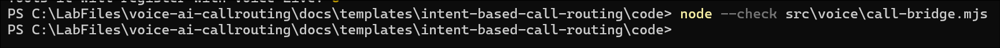

10. Execute the below command to have a quick run of the module you just built, so you can confirm it works before moving on, and catch any mistake in the step where it happened.

   ```powershell
   node lab-checks\12-call-bridge.mjs
   ```

   **Expected output**

   ```text
   <time> [bridge] ACS media bridge listening on /ws/media
   Media bridge ready; active calls: 0
   ```

   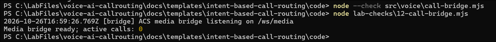

call-bridge.mjs joins each call’s audio to the AI and routes every tool call through the server’s flow.

### Task 6: The web server

Build server.mjs, which ties everything together: Event Grid intake, ACS callbacks, the simulation API, the console API, the health check and the WebSockets.

1. Open the **server.mjs** from “C:\LabFiles\voice-ai-callrouting\docs\templates\intent-based-call-routing\code\src” in VS Code.

2. In this file, we will add code to start the server and connect every module you have built.

3. At start-up the server loads the routes and callers, creates the console hub and the audit (SQLite, falling back to memory if SQLite cannot load) and creates the flow. The real transfer function is passed to the flow only in live mode.

4. The demo clock (Business hours / After hours / Real time) can be moved only in simulation mode; a live call always routes on the real time. flowHub adds the exact VoIP headers to every handoff shown in the console.

5. **/api/events** receives Event Grid: it answers the validation handshake, ignores duplicate deliveries, and for each IncomingCall creates a call in the flow and answers it.

6. **/api/calls/callback** receives ACS call events: CallConnected starts keypad recognition, keypad tones become flow.dtmf(), CallTransferFailed re-enters the flow’s recovery ladder, and CallDisconnected ends the call.

7. **/api/simulate/…** drives typed calls from the console; /api/demo/… moves the clock and resets the demo (refused with 403 while live); /api/routes, /api/calls and /api/stats feed the console; /health reports readiness per subsystem.

8. One upgrade listener routes /ws/hub to the console hub and /ws/media to the call bridge, then the server listens on port 8091 and logs whether it is in simulation or live mode.

9. Paste the whole code block below into **server.mjs**.

   **src/server.mjs**

   ```javascript
   import express from "express";
   import { createServer } from "node:http";
   import { randomUUID } from "node:crypto";
   import { fileURLToPath } from "node:url";
   import { dirname, join } from "node:path";
   
   import { config, assertCallConfig, isSimulated, readiness } from "./config.mjs";
   import { RoutePolicy, CallerDirectory, normalisePhone } from "./routes.mjs";
   import { MemoryAudit } from "./audit.mjs";
   import { RoutingFlow } from "./flow.mjs";
   import { createHub } from "./realtime.mjs";
   import { handleUtterance, registerSimulatedAgent } from "./offline.mjs";
   import { attachMediaBridge, activeBridges } from "./voice/call-bridge.mjs";
   import { answerInboundCall, transferToTeams, startDtmfRecognition, hangUp } from "./voice/acs.mjs";
   import { resourceAccountFrom, buildCustomCallingContext } from "./handoff.mjs";
   
   const __dirname = dirname(fileURLToPath(import.meta.url));
   const log = (...a) => console.log(new Date().toISOString(), ...a);
   
   const routes = RoutePolicy.load();
   const callers = CallerDirectory.load();
   const hub = createHub();
   
   /**
    * SQLite is loaded only when it is actually going to be used. better-sqlite3 is
    * a native module, so keeping it off the offline path means the demo still
    * starts if the build step failed on an unusual platform.
    */
   async function createAudit() {
     try {
       const { SqliteAudit } = await import("./db.mjs");
       return new SqliteAudit();
     } catch (e) {
       log(`[audit] falling back to in-memory audit: ${e.message}`);
       return new MemoryAudit();
     }
   }
   
   const audit = await createAudit();
   
   // ------------------------------------------------------------------ demo clock
   
   /**
    * The clock the routing policy sees. Real time unless a demo moves it: in
    * simulation mode DEMO_NOW, or the console, can pin it inside or outside
    * business hours, so one running server shows both paths on stage. A server
    * answering real calls always routes on the real time.
    */
   const CLOCK_PRESETS = [
     // A Wednesday, so every weekday route is in play.
     { id: "business-hours", label: "Business hours", at: "2026-09-30T10:30:00-07:00" },
     { id: "after-hours", label: "After hours", at: "2026-09-30T19:30:00-07:00" },
     { id: "real", label: "Real time", at: null },
   ];
   
   function startingClock() {
     if (!config.demoNow) return { at: null, preset: "real" };
     if (!isSimulated()) {
       log("[clock] DEMO_NOW is ignored while answering real calls");
       return { at: null, preset: "real" };
     }
     const at = Date.parse(config.demoNow);
     if (!Number.isFinite(at)) {
       log(`[clock] DEMO_NOW is not an ISO 8601 timestamp (${config.demoNow}); using the real time`);
       return { at: null, preset: "real" };
     }
     return { at, preset: CLOCK_PRESETS.find((p) => p.at && Date.parse(p.at) === at)?.id ?? "custom" };
   }
   
   const STARTING_CLOCK = startingClock();
   let clockOffsetMs = STARTING_CLOCK.at == null ? 0 : STARTING_CLOCK.at - Date.now();
   let clockPreset = STARTING_CLOCK.preset;
   const now = () => Date.now() + clockOffsetMs;
   
   /** The real transfer. Absent in simulation, which is what makes the flow stub it out. */
   const transfer = isSimulated()
     ? null
     : async (call, destination) =>
         transferToTeams({
           callConnectionId: call.callConnectionId,
           target: destination.target,
           context: destination.context,
           callId: call.id,
         });
   
   /**
    * The console shows the VoIP headers a transfer actually sends, built by the
    * same function the transfer uses, rather than its own copy of the list.
    */
   const flowHub = {
     send: (callId, target, payload) =>
       hub.send(callId, target, target === "handoff" ? { ...payload, voipHeaders: buildCustomCallingContext(payload) } : payload),
   };
   
   const flow = new RoutingFlow({ routes, callers, audit, transfer, hub: flowHub, now });
   
   /**
    * Move the demo clock. Calls in progress shift by the same jump, so switching
    * to after hours mid-call does not blow that call's time budget — and the
    * policy core never has to know a demo clock exists.
    */
   function setClock(at, preset) {
     const offsetMs = at == null ? 0 : at - Date.now();
     flow.rebaseClock(offsetMs - clockOffsetMs);
     clockOffsetMs = offsetMs;
     clockPreset = preset;
   }
   
   const app = express();
   app.use(express.json({ limit: "256kb" }));
   app.use(express.static(join(__dirname, "..", "public")));
   
   const asyncRoute = (fn) => (req, res) =>
     Promise.resolve(fn(req, res)).catch((e) => {
       log("route error", e);
       if (!res.headersSent) res.status(500).json({ error: e.message });
     });
   
   // ------------------------------------------------------------- Event Grid intake
   
   /** Event Grid delivers the same event more than once by design. */
   const seenEvents = new Set();
   
   /**
    * Inbound calls arrive here as an Event Grid `IncomingCall` event, which is the
    * only way to be told about a call to your ACS number. The first request Event
    * Grid ever sends is a validation handshake, so that is answered before
    * anything else.
    */
   app.post(
     "/api/events",
     asyncRoute(async (req, res) => {
       const events = Array.isArray(req.body) ? req.body : [req.body];
   
       for (const event of events) {
         if (event.eventType === "Microsoft.EventGrid.SubscriptionValidationEvent") {
           log("[eventgrid] subscription validation handshake");
           return res.json({ validationResponse: event.data.validationCode });
         }
       }
   
       res.sendStatus(200);
   
       for (const event of events) {
         if (event.eventType !== "Microsoft.Communication.IncomingCall") continue;
         if (seenEvents.has(event.id)) {
           log("[eventgrid] ignoring duplicate delivery", event.id);
           continue;
         }
         seenEvents.add(event.id);
         await onIncomingCall(event.data).catch((e) => log("[eventgrid] answer failed", e));
       }
     }),
   );
   
   async function onIncomingCall(data) {
     const fromPhone = data?.from?.rawId?.replace(/^4:/, "") ?? data?.from?.phoneNumber?.value ?? null;
     const resourceAccountId = resourceAccountFrom(data?.to);
   
     const call = flow.create({
       callId: randomUUID(),
       fromPhone: fromPhone ? normalisePhone(fromPhone) : null,
       incomingCallContext: data.incomingCallContext,
       resourceAccountId,
       // Preserve an Auto Attendant's session id when this line sits behind one, so
       // the whole journey correlates in Teams rather than restarting here.
       sessionId: data.customContext?.voipHeaders?.["CallDetails.SessionId"] ?? data.correlationId ?? null,
     });
   
     log("[call] incoming", call.id, "from", call.maskedPhone, "via", call.arrival);
     if (call.arrival === "acs-direct") {
       log("[call] note: no Teams resource account on this call — Teams Phone extensibility context is absent");
     }
   
     const { callConnectionId } = await answerInboundCall({
       incomingCallContext: data.incomingCallContext,
       callId: call.id,
     });
     flow.setCallConnection(call.id, callConnectionId);
   }
   
   // --------------------------------------------------------------- ACS callbacks
   
   app.post(
     "/api/calls/callback",
     asyncRoute(async (req, res) => {
       res.sendStatus(200);
       const callId = req.query.call;
   
       for (const event of req.body ?? []) {
         const type = event.type?.split(".").pop();
         log("[acs]", type, callId);
   
         switch (type) {
           case "CallConnected":
             flow.setCallConnection(callId, event.data?.callConnectionId);
             await startDtmfRecognition({
               callConnectionId: event.data?.callConnectionId,
               fromPhone: flow.get(callId)?.fromPhone,
             });
             break;
   
           case "ContinuousDtmfRecognitionToneReceived": {
             // ACS reports the tone by name; the keypad map is keyed by digit.
             const digit = TONE_DIGITS[event.data?.tone] ?? event.data?.tone;
             if (digit != null) flow.dtmf(callId, String(digit));
             break;
           }
   
           case "MediaStreamingFailed": {
             // Without the reason this reads as "it broke", which is how a socket
             // that never connected can look like a Voice Live problem.
             const info = event.data?.resultInformation ?? {};
             log("[call] media streaming failed", `code=${info.code} sub=${info.subCode}`, info.message ?? "");
             break;
           }
   
           case "CallTransferAccepted":
             log("[call] transfer accepted", callId);
             break;
   
           case "CallTransferFailed": {
             // ACS accepted the transfer, then the queue never picked up. The flow
             // owns the retry ladder and its attempt count, so re-enter it rather
             // than retrying here, which would loop on a target that always fails.
             const message = event.data?.resultInformation?.message ?? "transfer failed";
             log("[call] transfer failed", message);
             await flow.transferFailed(callId, message).catch((e) => log("[call] recovery failed", e.message));
             break;
           }
   
           case "CallDisconnected":
             flow.endCall(callId, "caller_hung_up");
             activeBridges.get(callId)?.stop();
             break;
         }
       }
     }),
   );
   
   const TONE_DIGITS = {
     zero: "0",
     one: "1",
     two: "2",
     three: "3",
     four: "4",
     five: "5",
     six: "6",
     seven: "7",
     eight: "8",
     nine: "9",
   };
   
   // ------------------------------------------------------------------ simulation
   
   /**
    * The offline demo. A typed transcript drives the same state machine, the same
    * confidence gate, the same business hours and the same handoff assembly as a
    * real call — only the classifier and the audio path are stubbed. A simulated
    * call is never transferred for real, even on a server that answers real calls.
    */
   app.post(
     "/api/simulate",
     asyncRoute(async (req, res) => {
       const fromPhone = req.body?.fromPhone ? normalisePhone(req.body.fromPhone) : null;
       const call = flow.create({ fromPhone, simulated: true });
       registerSimulatedAgent(flow, call.id);
       flow.answered(call.id);
       res.json({ ok: true, callId: call.id, snapshot: flow.snapshot(call.id) });
     }),
   );
   
   app.post(
     "/api/simulate/:id/say",
     asyncRoute(async (req, res) => {
       if (!flow.get(req.params.id)) return res.status(404).json({ error: "unknown call" });
       const result = handleUtterance(flow, req.params.id, req.body?.text ?? "");
       await flow.settled(req.params.id);
       res.json({ ok: true, result, snapshot: flow.snapshot(req.params.id) });
     }),
   );
   
   app.post(
     "/api/simulate/:id/dtmf",
     asyncRoute(async (req, res) => {
       if (!flow.get(req.params.id)) return res.status(404).json({ error: "unknown call" });
       const result = flow.dtmf(req.params.id, String(req.body?.digit ?? ""));
       await flow.settled(req.params.id);
       res.json({ ok: true, result, snapshot: flow.snapshot(req.params.id) });
     }),
   );
   
   app.post(
     "/api/simulate/:id/silence",
     asyncRoute(async (req, res) => {
       if (!flow.get(req.params.id)) return res.status(404).json({ error: "unknown call" });
       const result = flow.noInput(req.params.id);
       await flow.settled(req.params.id);
       res.json({ ok: true, result, snapshot: flow.snapshot(req.params.id) });
     }),
   );
   
   app.post(
     "/api/simulate/:id/hangup",
     asyncRoute(async (req, res) => {
       flow.endCall(req.params.id, "caller_hung_up");
       await hangUp(flow.get(req.params.id)?.callConnectionId);
       res.json({ ok: true, snapshot: flow.snapshot(req.params.id) });
     }),
   );
   
   // ----------------------------------------------------------------- demo controls
   
   /** Demo controls refuse to touch a server that is answering real calls. */
   function simulationOnly(res) {
     if (isSimulated()) return true;
     res.status(403).json({ error: "Demo controls are off while this server answers real calls." });
     return false;
   }
   
   const clockView = () => ({
     now: new Date(now()).toISOString(),
     timeZone: routes.timeZone,
     preset: clockPreset,
     presets: CLOCK_PRESETS.map(({ id, label }) => ({ id, label })),
     adjustable: isSimulated(),
   });
   
   app.get("/api/demo/clock", (_req, res) => res.json(clockView()));
   
   app.post("/api/demo/clock", (req, res) => {
     if (!simulationOnly(res)) return;
     const { preset, at } = req.body ?? {};
     if (preset != null) {
       const match = CLOCK_PRESETS.find((p) => p.id === preset);
       if (!match) return res.status(400).json({ error: `Unknown clock preset "${preset}".` });
       setClock(match.at == null ? null : Date.parse(match.at), match.id);
     } else if (at != null) {
       const parsed = Date.parse(at);
       if (!Number.isFinite(parsed)) return res.status(400).json({ error: `"${at}" is not an ISO 8601 timestamp.` });
       setClock(parsed, "custom");
     } else {
       return res.status(400).json({ error: "Send { preset } or { at }." });
     }
     log(`[clock] demo clock → ${clockPreset} (${new Date(now()).toISOString()})`);
     res.json(clockView());
   });
   
   /**
    * A clean stage between run-throughs: no calls in memory, no simulated calls
    * in the audit (calls from a real phone are kept), and the starting clock.
    */
   app.post("/api/demo/reset", (_req, res) => {
     if (!simulationOnly(res)) return;
     for (const id of flow.calls.keys()) hub.forget(id);
     flow.reset();
     audit.reset();
     setClock(STARTING_CLOCK.at, STARTING_CLOCK.preset);
     log("[demo] reset");
     res.json({ ok: true, clock: clockView(), stats: audit.stats() });
   });
   
   // ------------------------------------------------------------------ console API
   
   app.get("/api/routes", (_req, res) => {
     const at = new Date(now());
     res.json({
       organization: routes.organization,
       fallbackRouteId: routes.fallbackRouteId,
       timeZone: routes.timeZone,
       // Targets are deliberately withheld: the console has no business knowing
       // Teams object ids, and neither does anything else outside routes.json.
       // Open or closed is judged on the demo clock — the time the policy routes on.
       routes: routes.menu().map((r) => ({ ...r, open: routes.isOpen(r.id, at), ...routes.describeHours(r.id) })),
     });
   });
   
   app.get("/api/calls/:id", (req, res) => {
     const snap = flow.snapshot(req.params.id);
     return snap ? res.json(snap) : res.status(404).json({ error: "unknown call" });
   });
   
   app.get("/api/calls/:id/events", (req, res) => res.json(audit.eventsFor(req.params.id)));
   
   app.get("/api/stats", (_req, res) => res.json(audit.stats()));
   
   app.post("/api/negotiate", (req, res) => res.json(hub.negotiate(req.body?.callId ?? "*")));
   
   app.get("/health", (_req, res) => {
     const missing = assertCallConfig();
     const ready = readiness(routes);
     res.json({
       ok: true,
       mode: missing.length === 0 ? "live" : "simulation",
       callReady: missing.length === 0,
       missingConfig: missing,
       ...ready,
       audit: { store: audit.name, persistTranscripts: config.persistTranscripts },
       realtime: hub.transport,
       routing: {
         routes: routes.ids,
         confidenceThreshold: config.routing.confidenceThreshold,
         timeBudgetMs: config.routing.timeBudgetMs,
         maxClarifications: config.routing.maxClarifications,
         transferDelayMs: flow.options.transferDelayMs,
       },
       clock: { preset: clockPreset, now: new Date(now()).toISOString() },
     });
   });
   
   // ----------------------------------------------------------------------- start
   
   const server = createServer(app);
   
   // One upgrade listener, routed by pathname. See attachMediaBridge for why this
   // cannot be left to `new WebSocketServer({ server, path })`.
   const wsRoutes = new Map([
     ["/ws/hub", hub.attach()],
     ["/ws/media", attachMediaBridge(flow)],
   ]);
   
   server.on("upgrade", (req, socket, head) => {
     const { pathname } = new URL(req.url, "http://localhost");
     const wss = wsRoutes.get(pathname);
     if (!wss) {
       log("[ws] no handler for", pathname);
       return socket.destroy();
     }
     wss.handleUpgrade(req, socket, head, (ws) => wss.emit("connection", ws, req));
   });
   
   server.listen(config.port, config.host, () => {
     log(`Intent-based call routing demo on http://${config.host}:${config.port}`);
     log(`  organization       : ${routes.organization}`);
     log(`  routes             : ${routes.ids.join(", ")} (fallback: ${routes.fallbackRouteId})`);
     log(`  audit              : ${audit.name}${config.persistTranscripts ? " (transcripts persisted)" : ""}`);
     log(`  confidence gate    : ${config.routing.confidenceThreshold}`);
     log(`  route time budget  : ${config.routing.timeBudgetMs / 1000}s`);
   
     const missing = assertCallConfig();
     if (missing.length) {
       log(`  SIMULATION MODE    — set ${missing.join(", ")} to answer real calls`);
       if (clockPreset !== "real") log(`  demo clock         : ${new Date(now()).toISOString()} (${clockPreset})`);
     } else {
       log(`  voice model        : ${config.voiceLive.model} (WebSocket ${config.voiceLive.apiVersion})`);
       log(`  public base URL    : ${config.publicBaseUrl}`);
     }
   });
   ```

10. Save the file (Ctrl+S).

11. Execute the below command in the PowerShell to check the syntax. No output means OK.

   ```powershell
   node --check src\server.mjs
   ```

   

12. Start the server by executing the below command.

   ```powershell
   npm start
   ```

   **Expected output**

   ```text
   [bridge] ACS media bridge listening on /ws/media
   Intent-based call routing demo on http://127.0.0.1:8091
     organization       : Contoso
     routes             : sales, support, billing, reception (fallback: reception)
     audit              : sqlite
     confidence gate    : 0.75
     route time budget  : 90s
     SIMULATION MODE    — set ACS_ENDPOINT, PUBLIC_BASE_URL, VOICE_LIVE_ENDPOINT to answer real calls
   ```

   Each line starts with a timestamp. audit : sqlite confirms that db.mjs loaded; if it says memory, check db.mjs.

   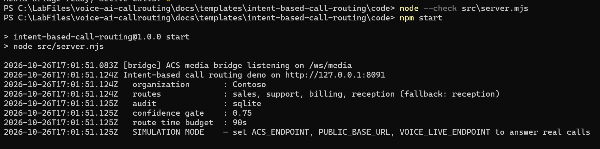

13. Leave the server running and open **http://127.0.0.1:8091** in the browser. The Contoso Switchboard console opens in simulation mode.

   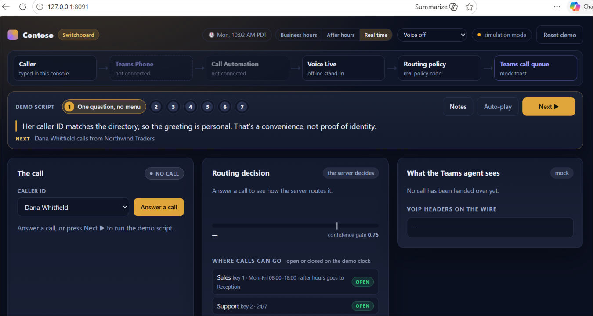

server.mjs runs the complete agent. It starts in simulation mode and serves the console on port 8091.

The complete agent runs: console updates, SQLite audit, ACS call control with the transfer fix, the Voice Live session, the call bridge and the web server. It runs in simulation mode until Azure is configured.

## Exercise 4: Test your build in simulation

In this exercise, you test the complete agent in the browser console before connecting any Azure services, using the same scenarios a real caller would exercise.

A typed line drives the same state machine a real call does: the same allowlist, the same confidence gate, the same opening hours and the same handoff headers. Only the AI and the audio are replaced by the offline classifier.

1. With npm start running, open http://127.0.0.1:8091.

2. Click **Reset demo**.

   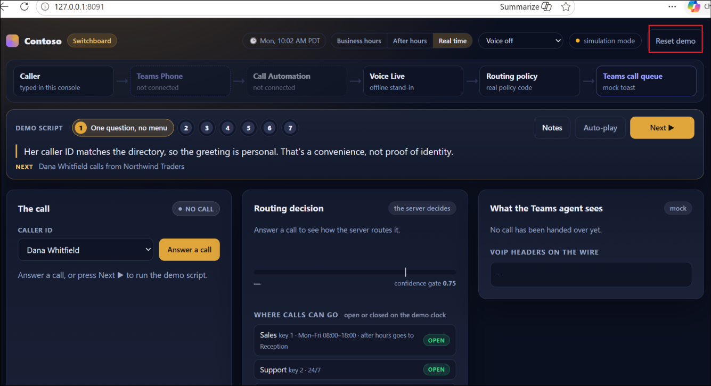

3. Set the clock in the header (**Business hours** or **After hours**), pick the **Caller ID**, click **Answer a call**, then type each line in the box and click **Say** (or use the keypad and **Silence** buttons). Compare with the expected result.

   | **#** | **Clock / caller** | **Type or do** | **Expected result** |
   |---|---|---|---|
   | 1 | Business hours<br>Dana Whitfield | I was charged twice on my invoice → yes | Greets Dana by name; confidence 0.95 clears the gate; “It sounds like Billing is the right team for that — shall I put you through?”; then “Connecting you now to Billing.” |
   | 2 | Business hours<br>Unknown number | I was charged for a renewal I did not order → It’s about a refund on my invoice → yes | First line is below the gate (two teams match), so a clarifying question; the second line offers Billing; transfer to Billing |
   | 3 | Business hours<br>any | can I just talk to a person | Straight to Reception — no confirmation question |
   | 4 | Business hours<br>any | Keypad 3 (or type 3) | Straight to Billing, no confirmation; topic “Chose Billing on the keypad” |
   | 5 | Business hours<br>any | Silence three times | A clarifying question, then a second one offering the keypad (1 Sales, 2 Support, 3 Billing, 4 Reception), then Reception with topic “Unclear — needs triage” |
   | 6 | After hours<br>Unknown number | I have a question about my invoice → yes → Please ask them to call me about invoice 4471 | Billing is closed, so the agent offers to take a message, records it and says goodbye; no transfer |
   | 7 | After hours<br>Marcus Bell | I need a quote to upgrade my subscription → yes | “Sales is closed right now, so I’ll put you through to Reception instead.”; the AfterHours header is true |

   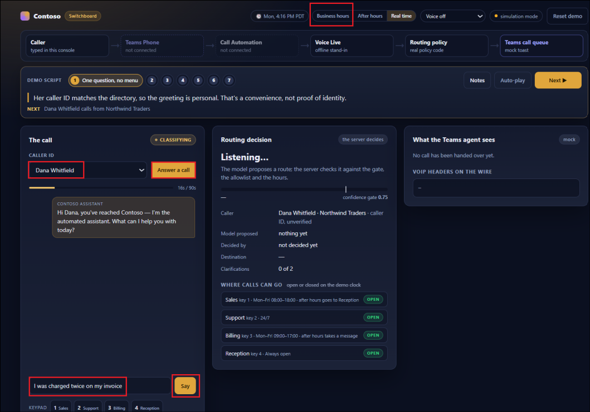

   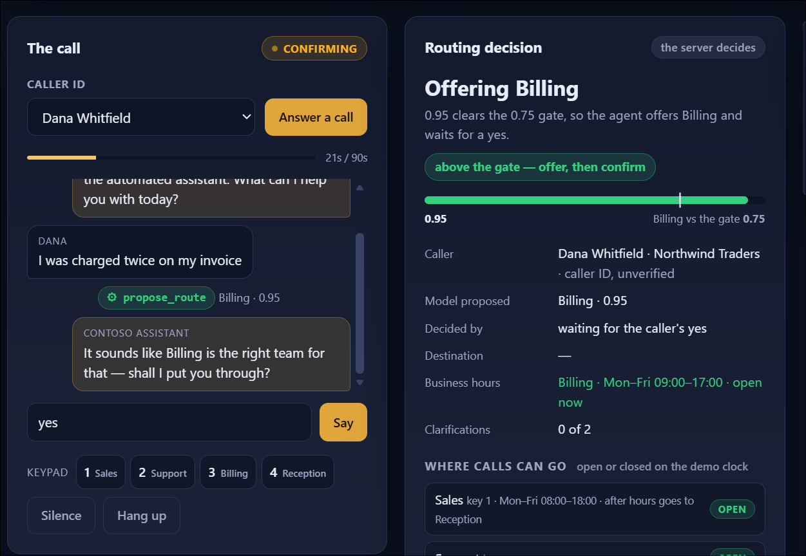

   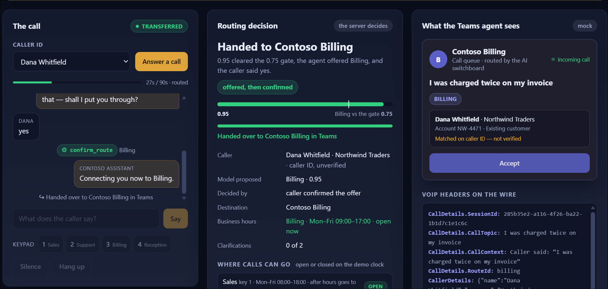

4. For each run, read the **Routing decision** panel (the confidence against the gate), the **Decision trail** (which rule fired), and **What the Teams agent sees** with the **VoIP headers on the wire**. Name the file and function in your build that produced each decision.

5. Optional — the mind-change window. The window between “Connecting you now” and the transfer is 1.2 seconds, too short to type in. Stop the server (Ctrl+C) and start it with a 6-second window:

   ```powershell
   $env:TRANSFER_DELAY_MS = "6000"
   npm start
   ```

   Click **Business hours**, answer a call, type **I was charged twice on my invoice**, then **yes**, and within six seconds type **no wait, actually my portal is broken**, then **yes**. Expected: the Billing transfer is cancelled, Support is offered and the call goes to Support. The Decision trail shows route_changed billing → support, and the CallContext header keeps both things the caller said.

   Restore the normal window afterwards:

   ```powershell
   Remove-Item Env:TRANSFER_DELAY_MS
   ```

6. You can also press **Next ▶** in the Demo script bar to play the seven scripted scenarios one by one.

7. Press **Ctrl+C** in the PowerShell window to stop the server.

You have seen every routing rule fire in simulation — the confidence gate, confirmation, a request for a person, the keypad, clarifying questions, after-hours messages and diversions, and a change of mind — and traced each decision back to the code you built.

## Exercise 5: Create the Azure resources

In this exercise, you create the Azure resources the live agent needs — an Azure Communication Services resource and an Azure AI Services resource for Voice Live — and give your sign-in the roles for keyless access. A small variables file keeps every name, endpoint and ID consistent across PowerShell windows.

### Task 1: Choose your names once — the lab variables file

Prepare **lab-vars.ps1**, a small file that holds your names and fetches every endpoint and ID from Azure, and load it into your PowerShell session.

The file holds your names and fetches every derived value (endpoints, IDs) from Azure. You load it with one line in every new PowerShell window, so values are never lost or mistyped.

1. Open **lab-vars.ps1** from the **code** folder in VS Code.

2. Edit only the four lines in the EDIT section: your tenant, a short suffix (for example your initials and a number), the region, and the sign-in name of the Teams user who will answer the routed calls.

   ```powershell
   $TENANT = "<yourtenant>.onmicrosoft.com"
   $SUFFIX = "<initials><nn>"
   $LOC    = "eastus2"
   $AGENT  = "<teams-user>@<yourtenant>.onmicrosoft.com"
   ```

3. **Save** it.

   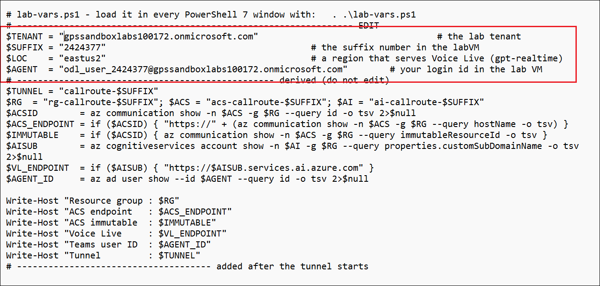

4. Execute **pwsh** from the PowerShell window to switch to PowerShell 7.

   

5. Execute the below command to keep its variables in your PowerShell window.

   ```powershell
   az login --tenant $TENANT --use-device-code
   . .\lab-vars.ps1
   ```

   **Note:** Blank values after the first load are normal — the resources do not exist yet. Reload the file after each step that creates something.

   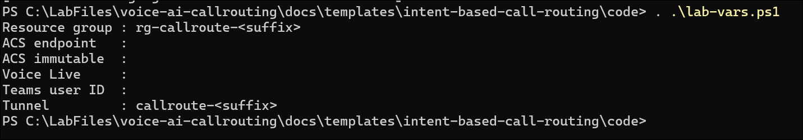

lab-vars.ps1 is set up with your names and loads into the session.

### Task 2: Sign in and check permissions

Sign in to Azure, check your permissions and register the services the lab uses.

1. Copy the below code and paste it in the PowerShell to sign in and check the available permissions.

   ```powershell
   . .\lab-vars.ps1
   az login --tenant $TENANT --use-device-code
   az account show --query "{user:user.name, tenant:tenantId, subscription:name}" -o table
   $ME = az ad signed-in-user show --query id -o tsv
   az role assignment list --assignee $ME --all --query "[].{role:roleDefinitionName, scope:scope}" -o table
   az provider register -n Microsoft.Communication
   az provider register -n Microsoft.CognitiveServices
   az provider register -n Microsoft.EventGrid
   az extension add --name communication --upgrade
   ```

2. Select **Paste anyway** when you get a warning about multiple lines of code.

3. Follow the **prompts** to **sign in**.

   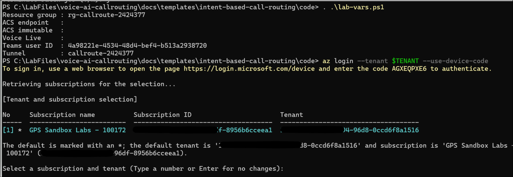

   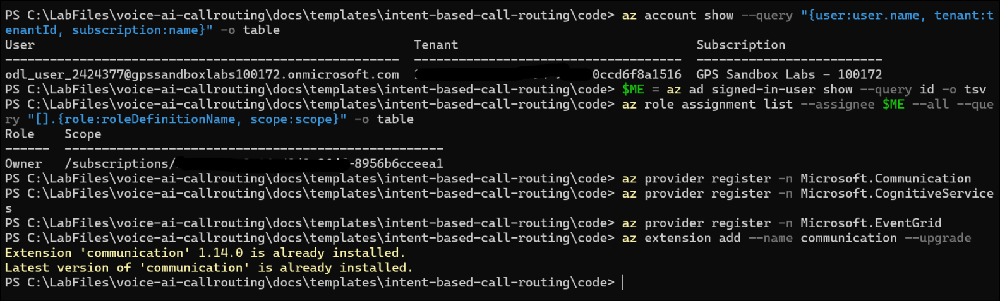

You are signed in to the lab tenant with the required permissions, and the resource providers are registered.

### Task 3: Create the resources

Create the resource group, the Azure Communication Services resource and the Azure AI Services resource.

1. Copy and paste the below block of code in the PowerShell to create the resources in Azure.

   ```powershell
   az group create -n $RG -l $LOC
   az communication create -n $ACS -g $RG --location global --data-location UnitedStates
   az cognitiveservices account create -n $AI -g $RG -l $LOC --kind AIServices --sku S0 --custom-domain $AI --yes
   ```

   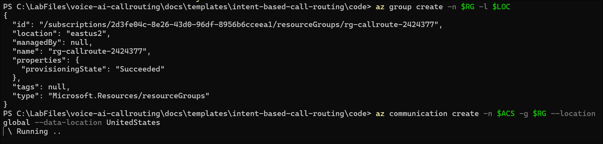

   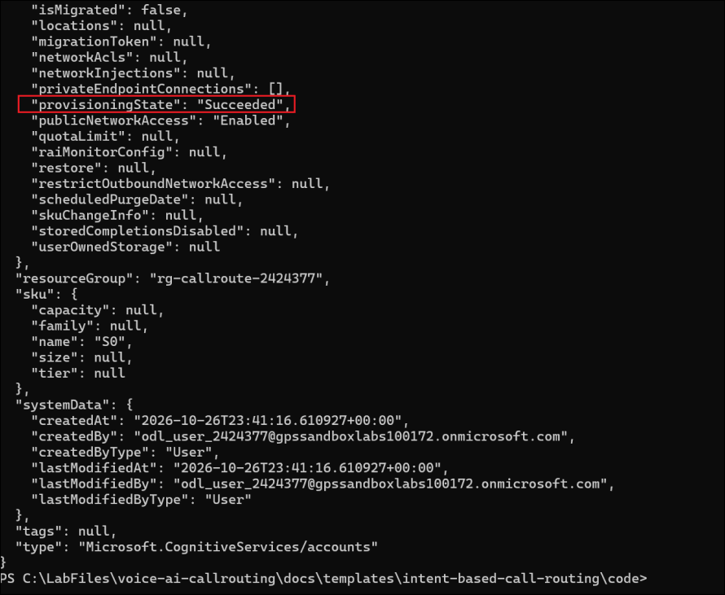

The resource group, ACS resource and AI Services resource are created.

### Task 4: Assign roles to your sign-in

Give your sign-in the roles it needs to use ACS and Voice Live without keys, and confirm the endpoints.

1. Copy and paste the below block of code in the PowerShell in order to assign the proper permissions to the user and the resources.

   ```powershell
   . .\lab-vars.ps1                 # reload: now fetches the new IDs
   $ME   = az ad signed-in-user show --query id -o tsv
   $AIID = az cognitiveservices account show -n $AI -g $RG --query id -o tsv
   az role assignment create --assignee $ME --role "Communication and Email Service Owner" --scope $ACSID
   az role assignment create --assignee $ME --role "Cognitive Services User" --scope $AIID
   az role assignment create --assignee $ME --role "Foundry User" --scope $AIID
   ```

2. **. .\lab-vars.ps1,** now prints an ACS endpoint ending in .communication.azure.com and a Voice Live endpoint ending in .services.ai.azure.com (never /models).

   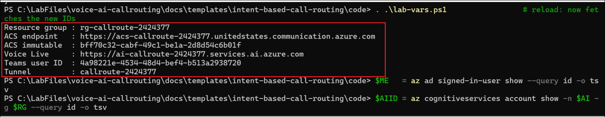

3. Role assignments can take a few minutes to apply.

   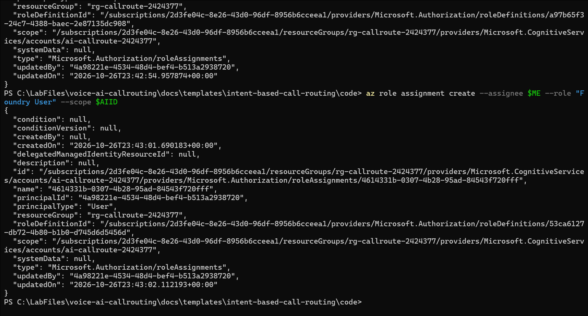

The roles are assigned and lab-vars.ps1 now returns both endpoints.

**Exercise conclusion:**

Your Azure resources exist, the roles are assigned, and lab-vars.ps1 fetches the ACS and Voice Live endpoints automatically.

## Exercise 6: Get a US phone number in ACS

In this exercise, you buy a US local phone number in your Azure Communication Services resource. This is the main line callers dial to reach the agent.

**Note:** Callers reach the agent on a phone number purchased directly in Azure Communication Services. In the server log these calls are shown as acs-direct. Transfers to Teams work on this kind of number because acs.mjs cleans the handoff headers before each transfer (Exercise 3, Task 3).

1. Open the Azure portal at https://portal.azure.com and sign in with your lab tenant.

2. Open the resource group **rg-callroute-<suffix>** and select your **Communication Service** from there.

   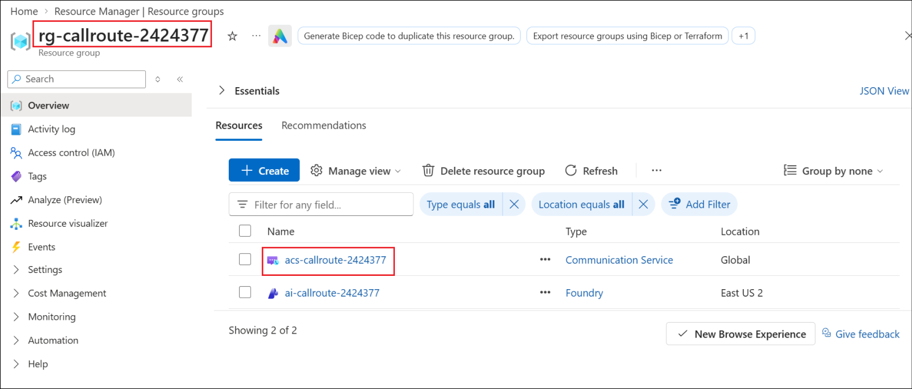

3. Select **Phone numbers** under **Telephony and SMS** and then select **+ Get**.

   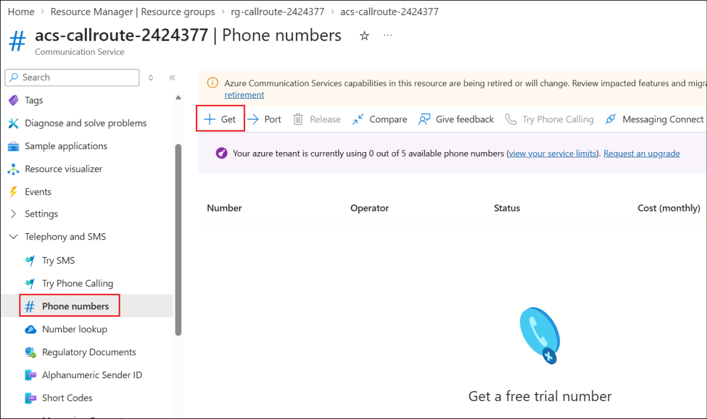

4. Select the below values.

- Country/region: **United States**.

- Number type: **Local** (geographic).

- Calling: **Receive calls** selected. SMS: **None**.

5. Add a number to the cart and then select **Next**.

   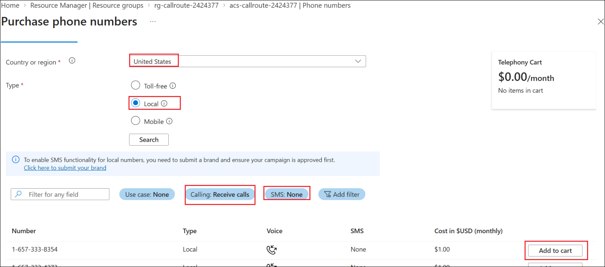

6. Complete the purchase: select **Buy now**. Make a note of this number in +1 format (for example, +1 XXX XXX XXXX). You will dial it later.

   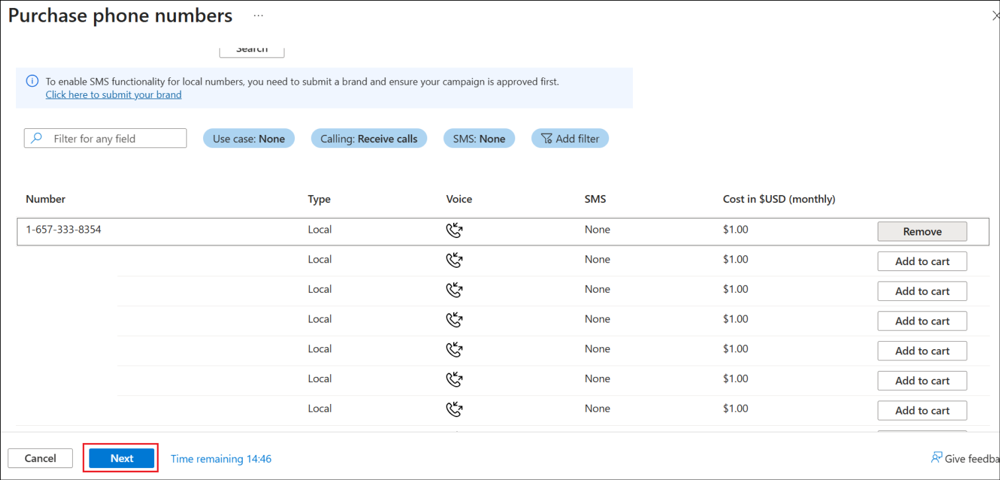

   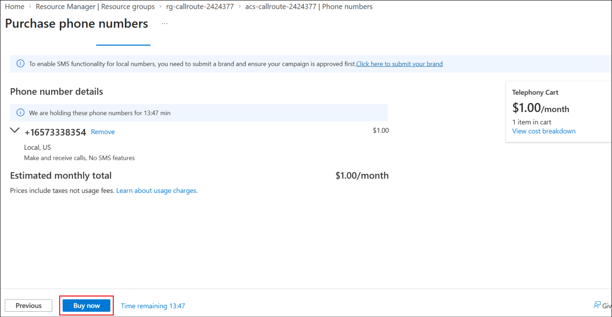

   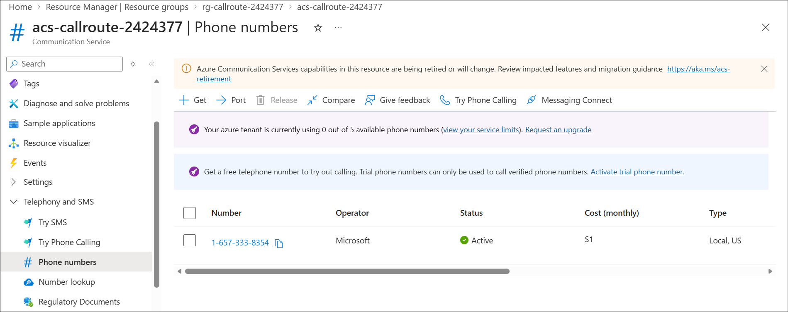

You have a phone number that can receive calls. It reaches the agent once the server is live and the Event Grid subscription is in place (Exercise 8).

## Exercise 7: Set up transfers to Teams

In this exercise, you prepare Microsoft Teams so the agent can hand callers to a person: you enable your Teams user for calling, point every route at that user, and allow your ACS resource to call Teams users.

The conversation and the routing decisions work without this exercise. It is needed for the confirmed transfers, “I want to talk to a person” and the keypad to reach a real person in Teams.

**Note:** In production each route points at its own Teams call queue or auto attendant. In this lab all four routes point at one Teams user — you — so you can answer every transfer yourself. The route the caller chose is still visible in the console, the server log and the RouteId header.

### Task 1: Sign in to Teams and enable the Teams user

**Sign in** to **Teams PowerShell** and enable the Teams user who answers routed calls for Teams calling.

1. Copy and paste the below code in the PowerShell window.

   ```powershell
   . .\lab-vars.ps1
   $env:PSModulePath = "$HOME\PSModules;" + $env:PSModulePath
   Import-Module MicrosoftTeams
   Connect-MicrosoftTeams -UseDeviceAuthentication     # sign in as the tenant's Teams admin
   Get-CsTenant | Select DisplayName
   Get-CsOnlineUser -Identity $AGENT | Format-List DisplayName, FeatureTypes, EnterpriseVoiceEnabled, TeamsUpgradeEffectiveMode
   Set-CsPhoneNumberAssignment -Identity $AGENT -EnterpriseVoiceEnabled $true
   $AGENT_ID                                            # the object ID used next
   ```

   Follow the **prompts** to **sign in**.

2. Ensure that **FeatureTypes** includes **PhoneSystem**, the mode is **TeamsOnly**, and **EnterpriseVoiceEnabled** becomes **True** (this can take a few minutes).

   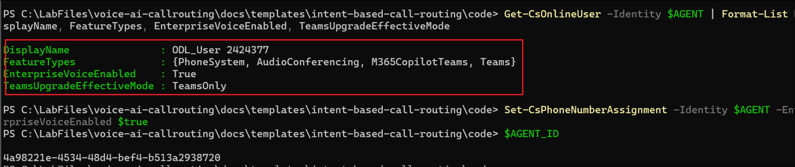

The Teams user has Teams Phone, is in Teams-only mode, and has Enterprise Voice enabled.

### Task 2: Point every route at the Teams user

Create a local routes file that points every route at your Teams user, and optionally open every route all day for testing.

1. This creates config\routes.local.json with your Teams user as the target of every route; in the next exercise ROUTES_PATH in .env points at it. Copy the below command and execute it from the PowerShell window.

   ```powershell
   $j = Get-Content config\routes.json -Raw | ConvertFrom-Json
   foreach ($r in $j.routes) {
     $r.target.type     = "user"
     $r.target.objectId = $AGENT_ID
   }
   $j | ConvertTo-Json -Depth 10 | Set-Content config\routes.local.json -Encoding utf8
   ```

   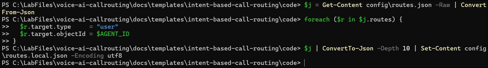

2. Test outside US Pacific business hours. Sales is open 8 AM–6 PM and Billing 9 AM–5 PM US Pacific, Mon–Fri (about 8:30 PM–6:30 AM IST). To test transfers to every team at any time, open every route all day in the local copy. Copy and paste the below code to do so.

   **Note:** This will not be the case in the production environment. We are doing it here for testing purposes. Skip this step if you want to test the after-hours behaviour live.

   ```powershell
   $j = Get-Content config\routes.local.json -Raw | ConvertFrom-Json
   foreach ($r in $j.routes) { $r.hours = [pscustomobject]@{ alwaysOpen = $true } }
   $j | ConvertTo-Json -Depth 10 | Set-Content config\routes.local.json -Encoding utf8
   ```

   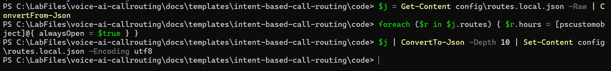

3. Check the result:

   ```powershell
   (Get-Content config\routes.local.json -Raw | ConvertFrom-Json).routes | Format-Table id, @{n="type";e={$_.target.type}}, @{n="objectId";e={$_.target.objectId}}, hours
   ```

   **Expected output**

   ```text
   id        type objectId                             hours
   --        ---- --------                             -----
   sales     user <your $AGENT_ID>                     @{alwaysOpen=True}
   support   user <your $AGENT_ID>                     @{alwaysOpen=True}
   billing   user <your $AGENT_ID>                     @{alwaysOpen=True}
   reception user <your $AGENT_ID>                     @{alwaysOpen=True}
   ```

   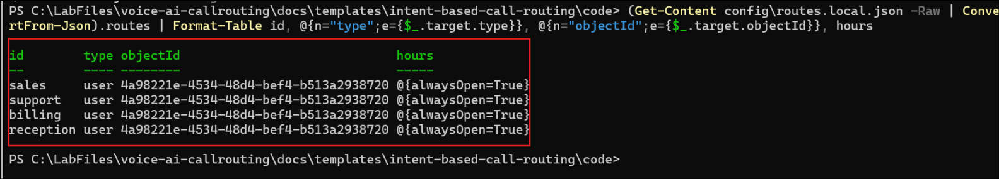

   Every route must show type user and your $AGENT_ID. If objectId is empty, reload lab-vars.ps1, check $AGENT and run the step again.

routes.local.json sends every route to your Teams user.

### Task 3: Allow your ACS resource to call Teams users

Allow your ACS resource to call Teams users in the tenant, and confirm the settings.

1. Execute the below commands in the PowerShell window in order to allow your ACS resource to call Teams users.

   ```powershell
   Set-CsTeamsAcsFederationConfiguration -Identity Global -EnableAcsUsers $true -AllowedAcsResources @{Add=$IMMUTABLE}
   Set-CsExternalAccessPolicy -Identity Global -EnableAcsFederationAccess $true
   Get-CsTeamsAcsFederationConfiguration | Format-List Identity, EnableAcsUsers, AllowedAcsResources
   Get-CsExternalAccessPolicy -Identity Global | Format-List Identity, EnableAcsFederationAccess
   ```

2. Ensure that **EnableAcsUsers** is **True**, your $IMMUTABLE value is listed under AllowedAcsResources, and EnableAcsFederationAccess is True. Teams can take up to an hour to apply these.

   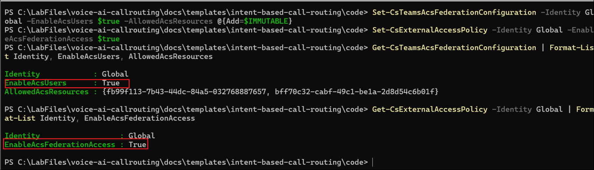

Your ACS resource is on the tenant’s allow-list and ACS calls to Teams users are enabled.

Transfers are ready: the Teams user can take calls, every route points at them, and your ACS resource is allowed to call Teams users.

## Exercise 8: Go live: tunnel, .env, server and Event Grid

In this exercise, you take the agent live. You expose your local server to Azure through a dev tunnel, create the .env configuration from the values fetched from Azure, start the server in live mode, check its health, and subscribe it to incoming-call events.

You use three PowerShell 7 windows, all in the code folder, and load the variables in each one:

| **Window** | **Runs** | **Keep open?** |
|---|---|---|
| 1 | Dev tunnel | Yes, for the whole session |
| 2 | Server (npm start) | Yes, for the whole session |
| 3 | az commands, checks, Teams PowerShell | As needed |

```powershell
cd "C:\LabFiles\voice-ai-callrouting\docs\templates\intent-based-call-routing\code"
. .\lab-vars.ps1
```

### Task 1: Start a persistent tunnel (window 1)

Start a named dev tunnel so Azure can reach the server running on your machine at a stable public address.

1. A named tunnel keeps the same address every time you restart it, so .env and Event Grid never need updating.

2. Use the same window you have been using so far as window 1.

3. Execute the below code to start a tunnel.

   ```powershell
   devtunnel user login
   devtunnel create $TUNNEL --allow-anonymous      # first time only
   devtunnel port create $TUNNEL -p 8091           # first time only
   devtunnel host $TUNNEL
   ```

4. As it prompts for a login, select **Work or school account** and sign in using your tenant credentials.

   

5. Select **No, this app only** in the Sign in to all apps prompt window.

   

6. The dev tunnel starts and is ready to accept connections.

7. Copy the **Connect via browser** address it prints (it looks like https://<id>-8091.<region>.devtunnels.ms).

8. Also make a note of the **Inspect network activity** address. It shows every request reaching the tunnel.

   

9. Then add one line to the bottom of **lab-vars.ps1**, replacing the address with the one obtained above, so every window knows it:

   ```powershell
   $PUBLIC = "<paste the Connect via browser address, no trailing slash>"
   ```

   

The tunnel is running, and its public address is saved in lab-vars.ps1.

### Task 2: Create .env from the fetched values (window 2)

Generate the .env file from the values fetched from Azure, and confirm what the server will load before starting it.

1. Open a new PowerShell window. This will be window 2, where the server will run.

2. Execute the below command to navigate to the code folder.

   ```powershell
   cd "C:\LabFiles\voice-ai-callrouting\docs\templates\intent-based-call-routing\code"
   ```

3. Execute the **pwsh** command.

4. Copy the below script block and paste it in the PowerShell.

   ```powershell
   . .\lab-vars.ps1
   Copy-Item .env.example .env -Force
   $set = [ordered]@{
     PUBLIC_BASE_URL     = $PUBLIC
     ACS_ENDPOINT        = $ACS_ENDPOINT
     VOICE_LIVE_ENDPOINT = $VL_ENDPOINT
     ROUTES_PATH         = "./config/routes.local.json"
   }
   $lines = Get-Content .env
   foreach ($k in $set.Keys) {
     $found = $false
     $lines = $lines | ForEach-Object { if ($_ -match "^\s*#?\s*$k=") { $found = $true; "$k=$($set[$k])" } else { $_ } }
     if (-not $found) { $lines += "$k=$($set[$k])" }
   }
   $lines | Set-Content .env -Encoding utf8
   Select-String "^(PUBLIC_BASE_URL|ACS_ENDPOINT|VOICE_LIVE_ENDPOINT|VOICE_LIVE_API_KEY|ROUTES_PATH)=" .env
   ```

   Expected: four lines with your values and VOICE_LIVE_API_KEY= empty (keyless sign-in). ROUTES_PATH must point to routes.local.json — pointing at the original file leaves placeholder Teams IDs and every transfer fails.

   

5. Confirm what the server will load, before starting it, by running the below command.

   ```powershell
   node lab-checks\13-live-config.mjs
   ```

   **Expected output**

   ```text
   Mode              : LIVE
   PUBLIC_BASE_URL   : https://<id>-8091.<region>.devtunnels.ms
   ACS_ENDPOINT      : https://<acs>.<geo>.communication.azure.com | auth: entra
   VOICE_LIVE        : https://<ai>.services.ai.azure.com | auth: entra
   Routes file       : ./config/routes.local.json
   Teams targets set : yes, all routes
     sales     : user <your $AGENT_ID> | Always open
     support   : user <your $AGENT_ID> | Always open
     billing   : user <your $AGENT_ID> | Always open
     reception : user <your $AGENT_ID> | Always open
   ```

   

   If you kept the original hours in Exercise 7, Task 2, the last four lines show each route’s hours instead of Always open.

.env contains your tunnel address, ACS and Voice Live endpoints and the local routes file, and the check reports live mode with all Teams targets set.

### Task 3: Start the server (window 2)

Start the server in live mode.

1. Execute the below commands in window 2 to start the server.

   ```powershell
   az account show --query user.name -o tsv    # must be the account that received the roles in Exercise 5, Task 4
   npm start
   ```

2. The log must not say SIMULATION MODE, and must end with these two lines. The server reads .env and the config files only at start-up: restart it (Ctrl+C, npm start) after any change.

   **Expected output**

   ```text
     voice model        : gpt-realtime (WebSocket 2026-04-10)
     public base URL    : https://<id>-8091.<region>.devtunnels.ms
   ```

   

The server is running in live mode with your tunnel as its public address.

### Task 4: Check health through the tunnel (window 3)

Check the server’s health through the public tunnel address.

1. Open a new PowerShell window. This will be window 3, where you will create the Event Grid subscription.

2. Execute the below command to navigate to the code folder, then execute **pwsh**.

   ```powershell
   cd "C:\LabFiles\voice-ai-callrouting\docs\templates\intent-based-call-routing\code"
   ```

3. Execute the below commands in window 3 to perform a health check.

   ```powershell
   . .\lab-vars.ps1
   $h = Invoke-RestMethod "$PUBLIC/health"
   $h | Select mode, callReady
   $h.voiceLive; $h.telephony; $h.teams
   ```

4. Ensure that mode is live, **voiceLive.ready** and **telephony.ready** are True, and teams.ready is True with no unprovisionedRoutes (False means ROUTES_PATH or routes.local.json is wrong).

   

The health check reports live mode and ready for Voice Live, telephony and Teams.

### Task 5: Create the Event Grid subscription (window 3)

Subscribe the server to incoming-call events from your ACS resource.

1. The server and tunnel must be running: Event Grid sends a validation handshake that your server answers.

2. Copy and paste the below code block in window 3.

   ```powershell
   az eventgrid event-subscription create -n incoming-call `
     --source-resource-id $ACSID `
     --endpoint "$PUBLIC/api/events" `
     --included-event-types Microsoft.Communication.IncomingCall
   ```

3. It can take up to 2 minutes with no output.

4. Success: JSON ending in "provisioningState": "Succeeded".

   

5. Window 2 logs **[eventgrid] subscription validation handshake**.

   **Note:** Health shows live and ready on all three, and the subscription is Succeeded. You are ready to call.

   

The Event Grid subscription succeeded, so calls to your number now reach the agent.

The agent is live: the server runs with your Azure settings, reports ready for Voice Live, telephony and Teams, and receives incoming calls through Event Grid.

## Exercise 9: Test with real phone calls

In this exercise, you call the agent from a phone, tell it why you are calling, and let it transfer you to yourself in Teams, while watching the server log and the console.

### Task 1: Before you dial

Get everything ready before you place the test call.

1. **Window 1 (tunnel)** and **window 2 (server)** are running.

2. The console http://127.0.0.1:8091 is open, so you can watch the transcript, the routing decision and the VoIP headers live.

3. You, as the Teams user, will answer the routed calls. Open a **browser** and **sign in** to **Teams** (https://teams.microsoft.com) as $AGENT.

4. Use a headset or earphones, in a quiet room. A speakerphone causes echo the AI may pick up.

5. You have a way to call the US. A mobile with international calling enabled is required.

The tunnel, server, console and Teams are ready for a live call.

### Task 2: What a successful call looks like

Call the agent, say why you are calling, confirm the team, and compare what happens with the expected behaviour and the server log.

1. From your **mobile**, dial the ACS number (+1…) you noted in Exercise 6.

2. It rings; the first call of a session may take up to ~20 **seconds** to answer.

3. The **agent says** it is Contoso’s automated assistant and asks one open question, for example:

   “Thanks for calling Contoso — I’m the automated assistant. What can I help you with today?”

4. Wait for the **greeting** to **finish**, then say clearly: “**I was charged twice on my invoice.**”

5. The **agent** offers **Billing** and asks you to confirm. **Say “Yes.”**

6. The agent says it is connecting you to Billing, and the call is transferred: Teams rings in your browser. Answer it.

7. In a **live scenario** an actual **Billing agent answers**. In the lab you can hang up here.

8. Window 2 should show a sequence like this (example; your call IDs and number differ):

   ```text
   [call] incoming 5f2c… from +••••••••••63 via acs-direct
   [call] note: no Teams resource account on this call — Teams Phone extensibility context is absent
   [acs] answered 5f2c… -> 2a00…
   [bridge] media socket connected for call 5f2c…
   [acs] CallConnected 5f2c…
   [voice-live] connected (gpt-realtime)
   [voice-live] tool propose_route {"routeId":"billing","confidence":0.9,"callTopic":"Charged twice on invoice",…}
   [voice-live] tool confirm_route {"routeId":"billing"}
   [acs] transfer requested 5f2c… -> Contoso Billing
   [acs] CallTransferAccepted 5f2c…
   [call] transfer accepted 5f2c…
   ```

9. The **console** shows the same call: the **transcript**, the confidence against the gate, the decision trail and the VoIP headers sent with the transfer (with the dots removed, for example CallDetailsCallTopic).

   

   

10. The below screenshots shows the transfer to the Teams.

   

   

11. The AI words things in its own way, but the destinations, confirmations, hand-offs and after-hours decisions come from the server and must match. Use the below table for more test calls.

   | **#** | **Flow** | **Say or do** | **Pass if** | **Log shows** |
   |---|---|---|---|---|
   | 1 | Confident route | “I was charged twice on my invoice.” → “Yes.” | Offers Billing, waits for yes, transfers | tool propose_route, tool confirm_route, transfer requested |
   | 2 | Unclear reason | “I have a question about a charge on my renewal.” | Asks a clarifying question instead of guessing (if the AI reports low confidence) | tool propose_route with confidence below 0.75 |
   | 3 | A person | “Can I just talk to a person?” | Transfers to Reception at once, with no confirmation question | tool request_human |
   | 4 | Keypad | Press 2 after the greeting | Transfers to Support with no confirmation | ContinuousDtmfRecognitionToneReceived |
   | 5 | Out of scope | “What are your opening hours?” | Says once that it only connects people, and asks again; a second such question goes to Reception | tool not_covered |
   | 6 | After hours | A Billing request outside Mon–Fri 9 AM–5 PM Pacific | Offers to take a message instead of transferring | tool take_message |
   | 7 | Barge-in | Talk over the agent mid-sentence | The agent stops speaking immediately | — |

12. Press **Ctrl+C** in windows 1 and 2 to stop the tunnel and the server.

The live call matched the expected behaviour: the server chose and confirmed the destination, and the transfer reached you in Teams with the handoff headers.

You have completed real phone calls with the agent: it answered with a disclosure, worked out why you were calling, confirmed the team, honoured requests for a person and the keypad, and transferred the call to Teams with context.

## Exercise 10: Delete the resources

In this exercise, you remove everything you created so it no longer incurs cost: the phone number, the Teams allow-list entry, the Azure resources and the dev tunnel.

Run in order, in one PowerShell 7 window with lab-vars.ps1 loaded. Steps 1–2 must run before the resource group is deleted, because they need the ACS IDs.

1. Release the phone number: Azure portal → ACS resource → **Phone numbers** → select the number → **Release**. Numbers bill monthly until released.

   

2. Remove ACS from the Teams allow-list. Execute the below commands in the PowerShell window.

   ```powershell
   Connect-MicrosoftTeams
   Set-CsTeamsAcsFederationConfiguration -Identity Global -AllowedAcsResources @{Remove=$IMMUTABLE}
   ```

   

3. Delete the Azure resources by executing the below command (it removes ACS, AI Services and the Event Grid subscription).

   ```powershell
   az group delete -n $RG --yes
   ```

   

4. Delete the tunnel.

   ```powershell
   devtunnel delete $TUNNEL
   ```

   

All lab resources are removed. The phone number is released, your ACS resource is no longer allowed in Teams, and the resource group and dev tunnel are deleted.

## Lab summary

In this lab, you built and ran an AI voice receptionist end to end:

- You built the routing logic — settings, routing policy, audit, Teams handoff, call state machine, AI contract and simulated caller — and verified each module with a checkpoint and the 74 automated tests.

- You added the console updates, SQLite audit, ACS call control with the transfer fix, Voice Live session, call bridge and web server, and ran the complete agent in simulation mode.

- You created Azure Communication Services and Azure AI Services with keyless access, bought a phone number, and prepared Teams so the agent can transfer callers to a person.

- You took the agent live with a dev tunnel and an Event Grid subscription, tested it with real phone calls, and removed the resources at the end.

The key design idea throughout is that the AI handles the conversation while the server owns every decision: the AI may only propose a destination from a fixed list and say how sure it is, and the server decides whether that is good enough, whether the team is open, when to ask again and when to hand the caller to a person. The same pattern — a realtime voice model behind narrow, server-owned tools — applies to other phone agents such as order status, appointment booking or help-desk triage.
