# Lab 7 - Monitor and evaluate the field technician assistant in Microsoft Foundry

# Lab overview

## Scenario

In a Day 2 lab, you built a field assistant voice agent, that guides **Zava**'s maintenance technicians at **Dayton, Ohio Plant 2** through repairs. It reads live machine data, looks up procedures in the equipment manuals, enforces lockout/tagout and logs work orders.

The pilot on Plant 2 has finished, and Zava's operations leadership wants to roll Torque(the voice agent) out to every technician. Before they approve, they want evidence. Is Torque fast enough to feel natural in a conversation? Does it call the right tools at the right time? Are the values it reads out, such as torque specifications and tolerances, grounded in the manuals? And does it actually help technicians finish the job?

In this lab, you play the AI engineer who answers those questions. You review the stored pilot conversations, trace what happened inside each voice turn, check the monitoring dashboard for latency and usage, and run an evaluation that scores Torque's conversations with an AI judge.

## Objective

By the end of this lab, you'll be able to:

1. Review a stored voice conversation: its transcript, its tool calls and the full-call recording.

2. Trace a voice conversation in Microsoft Foundry and identify the turn detection, speech-to-text, model, text-to-speech and tool steps in each turn.

3. Monitor a voice agent's usage and latency, including the average time to first audio.

4. Prepare a Foundry project for trace-based evaluation by deploying a judge model and granting the required access.

5. Run a full-conversation evaluation and interpret the scores for tool use, task completion, groundedness, coherence and output quality.

## Pre-requisites

Lab 5 should have completed.

## Exercise 1 — Check the environment

In this exercise, you prepare the lab VM for this lab. You open the same **Field-Technician** lab folder that you used in the previous lab, make sure Python 3.12 and the lab packages are available, check the lab settings, and set the variables that the Azure commands use. Some of these steps are already done; running them again is safe.

1. Open **Visual Studio Code**. Select **Open Folder**. Open the **Field-Technician** folder from **C:\LabFiles**.

2. Open a terminal: **Terminal** -\> **New Terminal.**

3. Run the following commands in the VS Code terminal to download and install **Python 3.12**. The last command confirms the installation and should print **Python 3.12.10**. If Python 3.12 is already installed, you can skip this step.

    ```powershell
    $ProgressPreference = 'SilentlyContinue'
    $installer = "$env:TEMP\python-3.12.10-amd64.exe"
    Invoke-WebRequest -Uri "https://www.python.org/ftp/python/3.12.10/python-3.12.10-amd64.exe" -OutFile $installer
    Start-Process -Wait -FilePath $installer -ArgumentList "/quiet InstallAllUsers=0 PrependPath=0 Include_launcher=1"
    py -3.12 --version
    ```

    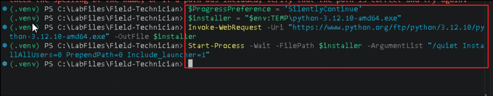

4. Run the following commands to create and activate the virtual environment, install the lab packages, and create the settings file (**.env**) if it doesn't exist yet. After activation, the prompt starts with **(.venv)**.

    ```powershell
    cd C:\LabFiles\Field-Technician
    py -3.12 -m venv .venv
    .\.venv\Scripts\Activate.ps1
    python --version
    python -m pip install --upgrade pip
    pip install -r requirements.txt
    if (-not (Test-Path .env)) { Copy-Item .env.example .env }
    ```

    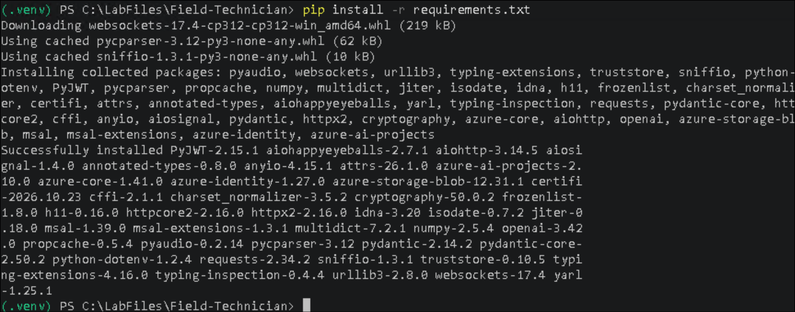

5. Open the **.env** file in the lab folder and check two values. **FOUNDRY_PROJECT_ENDPOINT** must be the endpoint of your **torque-lab** project (you can copy it from the project's **Home** page in the Foundry portal). **FOUNDRY_VOICE_AGENT_NAME** must match the agent you created in the previous lab (by default, **torque-field-assistant**). Save the file.

6. Sign in to Azure with the lab credentials, and then run the local readiness check:

    ```powershell
    az login
    cd src
    python check_prereqs.py --local
    ```

Check that Python, the Azure CLI, the sign-in and all the packages show **OK**. This lab doesn't use the microphone, so you can ignore any microphone or speaker failures.

7. Run the following commands to set the variables for the resource group, Foundry resource and project that you created in the previous lab. Replace **\<labnumber\>** with your lab instance number.

    ```powershell
    $RG       = "rg-voice-lab-<labnumber>"
    $LOCATION = "eastus2"
    $RESOURCE = "zava-voice-<labnumber>"     # Foundry resource (globally unique)
    $PROJECT  = "torque-lab"
    ```

> **Important:** Run all the commands in this lab in the same terminal window. If you open a new terminal, activate the virtual environment and set these variables again.

Your lab VM is ready, and the terminal knows which Azure resources to work with.

## Exercise 2 — Review and monitor the agent

In this exercise, you look at Torque's pilot conversations from three angles. First you read a stored conversation as the technician experienced it. Then you trace a conversation to see what happened inside each voice turn. Finally, you use the monitoring dashboard to see how Torque performs across all conversations.

### Task 1: Review a stored conversation

Torque's agent definition sets **store=True**, so Foundry keeps the transcript and the audio of every conversation for 60 days. In this task, you read one back from code.

1. Run the following command to read back the most recent stored conversation:

    ```powershell
    python read_conversation.py
    ```

**Expected result**

The ordered transcript, with the technician's and Torque's turns and the tool calls in between, and a **conversation_xxxxxxxx.wav** full-call recording saved in the lab folder.

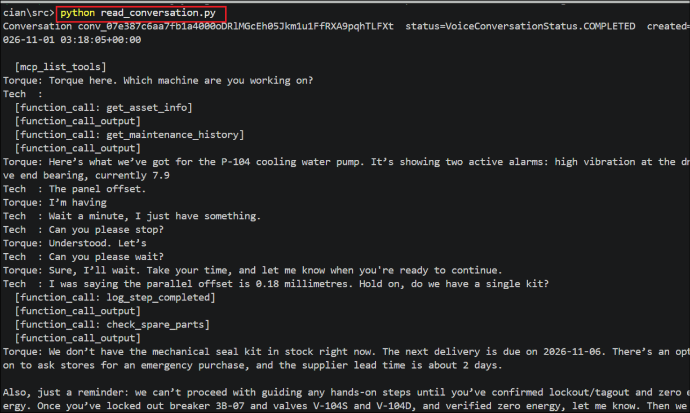

> **Note: No conversation ID?** The script reads the ID of the last conversation from the **.lab_state.json** file that the previous lab created. If the file isn't in the lab folder, copy a **Conversation ID** (it starts with **conv_**) from the agent's **Traces** tab in the Foundry portal, and run **python read_conversation.py \<conversation-id\>**.

The transcript shows what was said and which tools Torque called. Next, you look at how long each step took.

### Task 2: Trace a voice conversation

Every voice conversation produces one trace in Application Insights. A trace breaks each turn into its steps: detecting when the technician stopped speaking, converting speech to text, running the model, calling tools, and converting the reply to speech. In this task, you open a trace and find those steps.

1. In the Foundry portal, open **Agents**, select **torque-field-assistant**, and select the **Traces** tab. Each row is one voice conversation. New traces can take a few minutes to appear.

    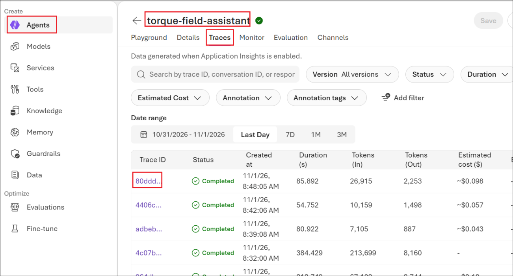

2. Select the **Trace ID** of one of the longer conversations, such as your full P-104 repair from the previous lab. In the **Trajectories** view, expand a turn and find the turn detection, **speech-to-text**, model (**chat gpt-realtime**) and **text-to-speech** steps, the **file_search** call, and the function calls that were handed to the plant-floor app.

    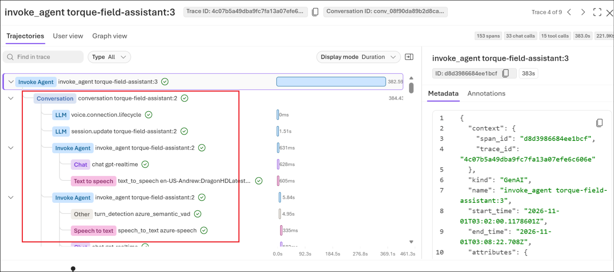

The waterfall shows where the time goes in each turn. Long speech-to-text or model steps are the first places to look when a conversation feels slow.

### Task 3: Monitor the agent

Traces show one conversation in detail. The monitoring dashboard summarizes all conversations, so you can spot trends in cost, usage and latency. In this task, you review the dashboard.

1. Select the **Monitor** tab and set the date range to cover your conversations (for example, **7D**). Review the **estimated cost**, **total token usage**, **total sessions** and **turns**, and **Avg. time to first audio**, which is the time between the technician finishing speaking and the start of Torque's reply.

    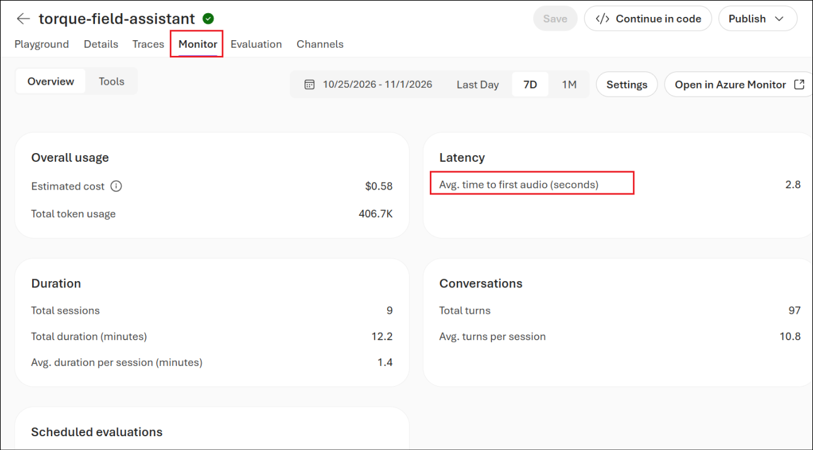

2. Scroll down to the charts. **Tokens per minute** shows usage over time, and **Overall latency** compares the time to first text (TTFT) with the time to first audio (TTFA).

    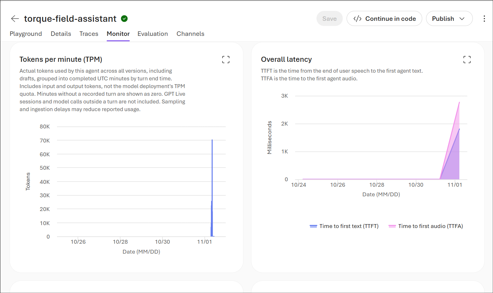

Average time to first audio is the key latency measure for voice: the lower it is, the more natural the conversation feels. Compare it across agent versions to catch changes that make Torque slower.

In this exercise, you reviewed a stored conversation, traced what happened inside a voice turn, and checked Torque's usage and latency on the monitoring dashboard.

## Exercise 3 — Evaluate the agent

Monitoring tells you how fast and how busy Torque is, but not whether its answers are good. In this exercise, you run an evaluation, an AI judge model reads Torque's conversations and scores them for tool use, task completion, groundedness, coherence and output quality.

### Task 1: Prepare the project for evaluation

The evaluation needs two things that the previous lab didn't set up: a chat model to act as the judge, and permission for the project to read the traces in Application Insights. In this task, you set up both.

1. Run the following command to deploy a **judge model**. The evaluators need a standard chat model to do the grading; the voice agent's **gpt-realtime** is a managed model and can't be used for this.

    ```powershell
    az cognitiveservices account deployment create `
      --name $RESOURCE --resource-group $RG `
      --deployment-name gpt-4.1-mini --model-name gpt-4.1-mini --model-version "2025-04-14" `
      --model-format OpenAI --sku-name GlobalStandard --sku-capacity 10
    ```

    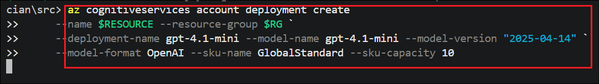

When the deployment succeeds, the command returns its details as JSON, including **"name": "GlobalStandard"** under **sku**.

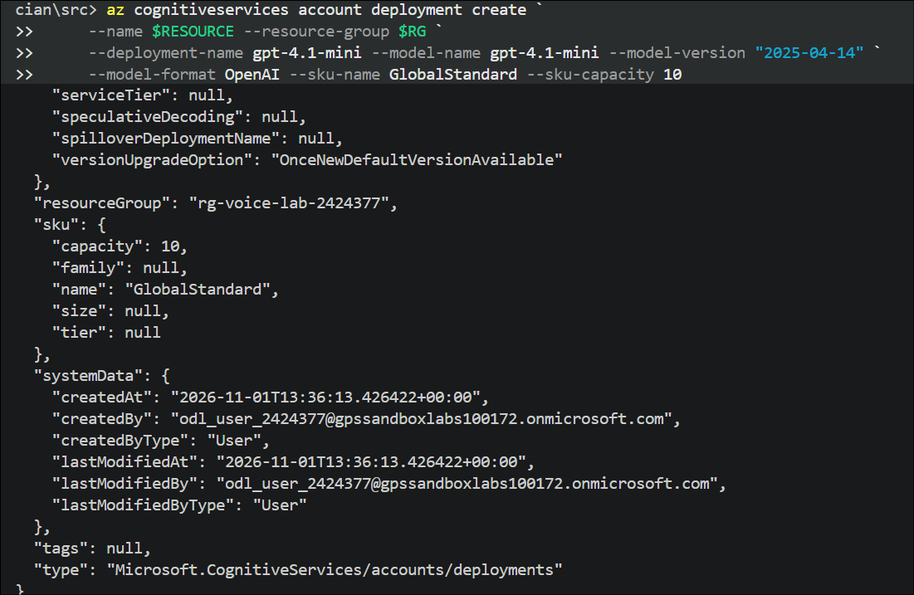

2. Run the following commands to let the project read the traces. The evaluation runs as the project's managed identity, which needs the **Reader** role on the connected Application Insights resource. The commands find the Application Insights resource and the project's identity, show both values so you can check them, and then assign the role.

    ```powershell
    # 0. Make sure the variables from Exercise 1 exist in this terminal
    "$RG | $RESOURCE | $PROJECT"
    
    # 1. Find the Application Insights resource and its ID
    az resource list -g $RG --resource-type "microsoft.insights/components" --query "[].{name:name, id:id}" -o table
    $APPI_ID = az resource list -g $RG --resource-type "microsoft.insights/components" --query "[0].id" -o tsv
    
    # 2. The project's managed identity
    $PROJECT_MI = az cognitiveservices account project show --name $RESOURCE --resource-group $RG --project-name $PROJECT --query identity.principalId -o tsv
    
    # 3. Check both have values before assigning
    "APPI_ID    = $APPI_ID"
    "PROJECT_MI = $PROJECT_MI"
    
    # 4. Grant Reader
    az role assignment create --role "Reader" --assignee-object-id $PROJECT_MI --assignee-principal-type ServicePrincipal --scope $APPI_ID
    ```

The last command returns the new role assignment as JSON, with **principalType** set to **ServicePrincipal**.

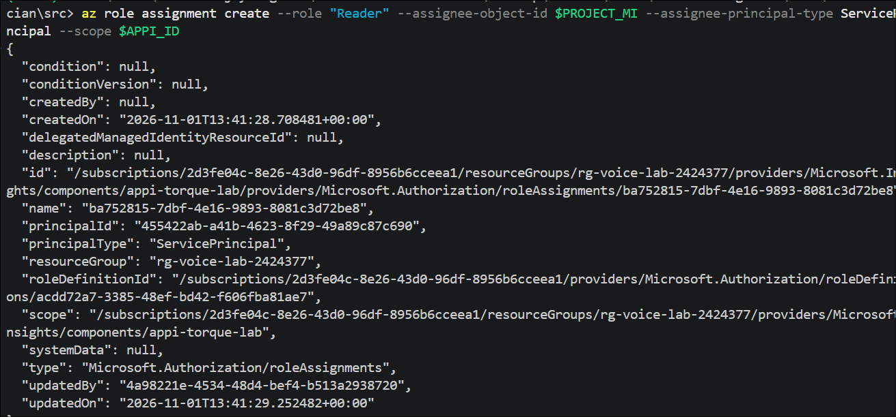

The judge model is deployed, and the project can read Torque's traces.

### Task 2: Create and run the evaluation

In this task, you create a **trace-based evaluation** of Torque's stored conversations. The evaluators read the transcripts and judge what was said and done. They don't judge pronunciation, background noise or interruption timing.

1. In the Foundry portal, open **torque-field-assistant**, select the **Evaluation** tab, and then select **Create**.

    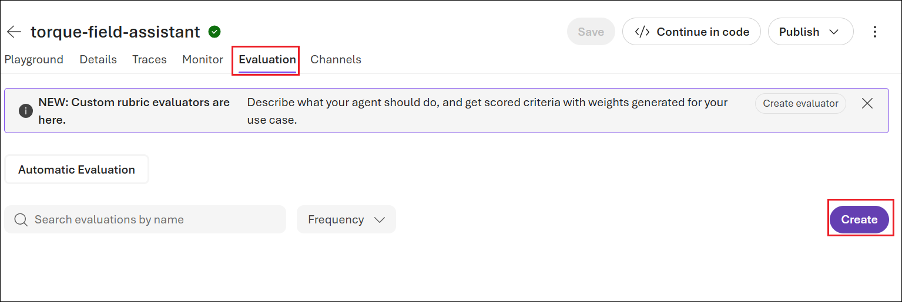

2. Under **Target**, select **Agent**. Make sure **torque-field-assistant** is selected with its latest version, and then select **Next**.

    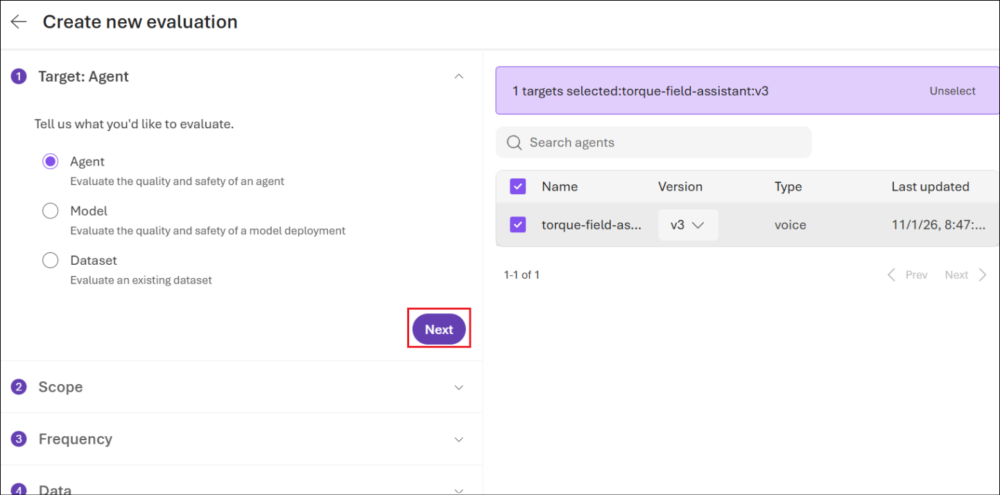

3. Under **Scope**, select **Full conversations** to evaluate complete multi-turn conversations, and then select **Next**.

    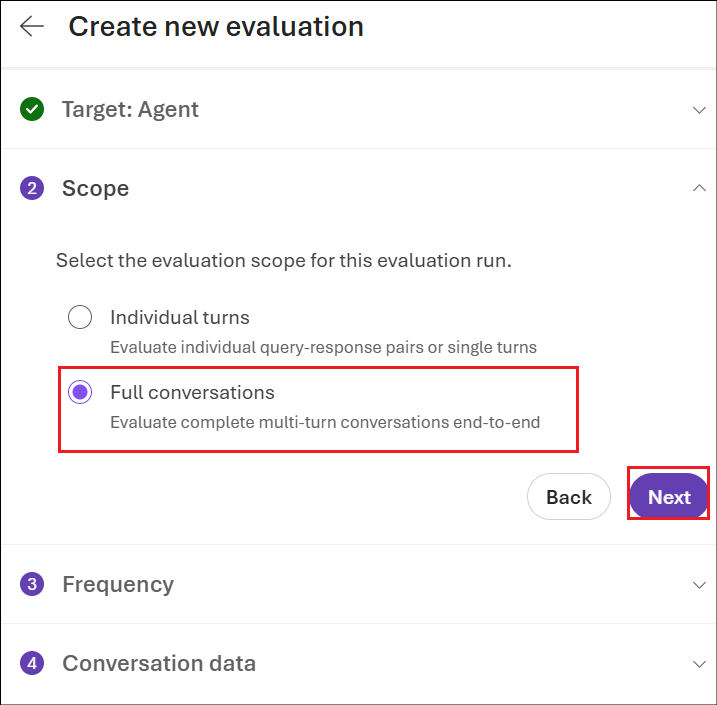

4. Under **Frequency**, select **One time**, and then select **Next**.

    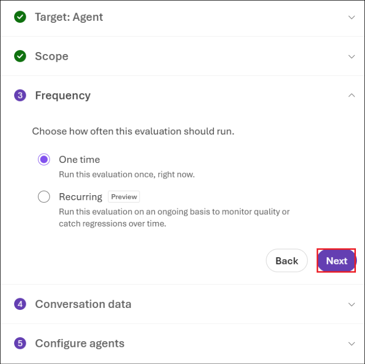

5. Under **Conversation data**, select **Existing conversations**. Set the **Time range** so that it includes your conversations from the previous lab (for example, **Last Day**), check the list of conversations on the right, and then select **Next**.

    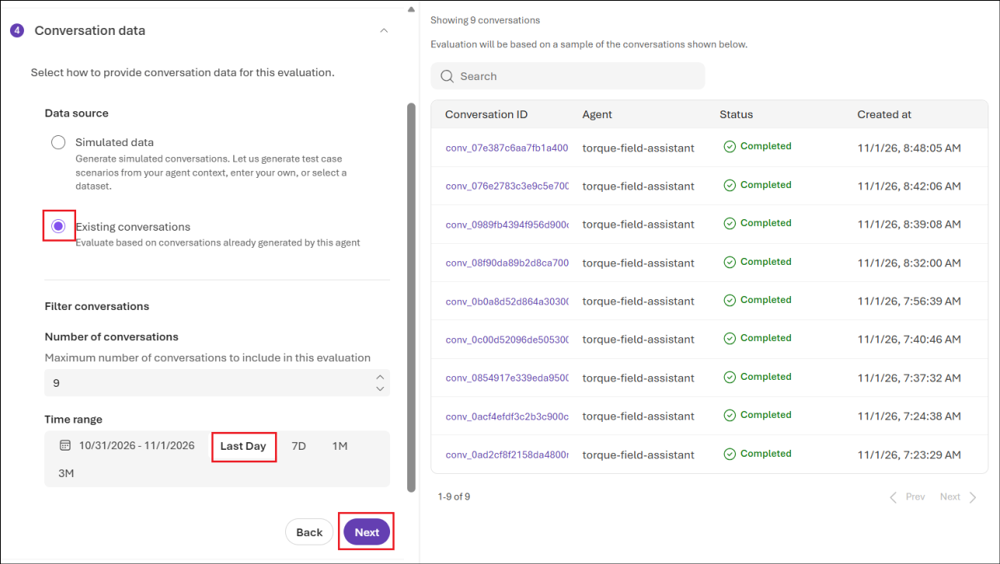

6. Under **Field mapping**, select your **gpt-4.1-mini** deployment as the **Judge model**. Keep the auto-detected mappings for **Messages** and **Tool definitions**, and then select **Next**.

    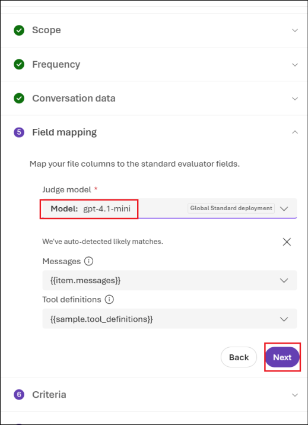

7. Under **Criteria**, select **Tool use quality**, **Output quality**, **Task completion**, **Groundedness** and **Coherence**, and then select **Next**.

    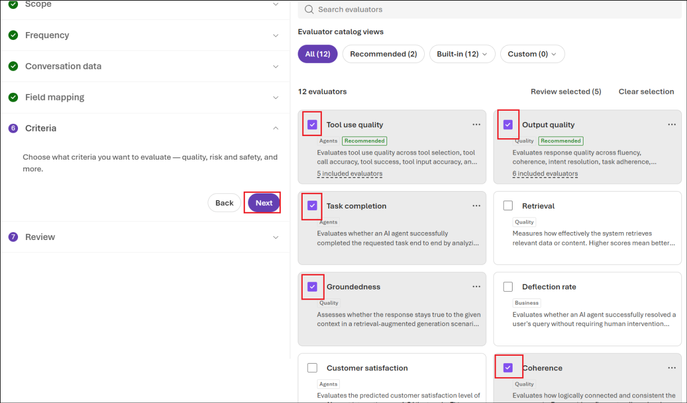

8. Under **Review**, keep the generated evaluation name or enter your own, and then select **Submit**.

    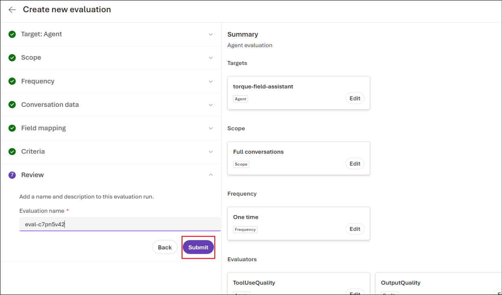

9. The evaluation run appears with the status **In progress**. Wait for it to finish; this can take 10 to 15 minutes.

    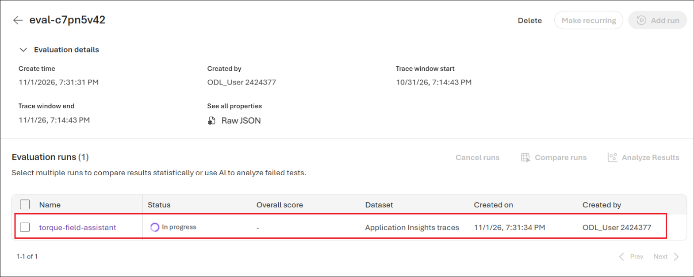

The evaluation is running against your stored conversations.

### Task 3: Review the evaluation results

In this task, you read the scores and the judge's reasons, and decide what they tell you about Torque.

1. When the run finishes, the **Evaluation runs** list shows the overall score and a score for each evaluator. Select the run name to open its details.

    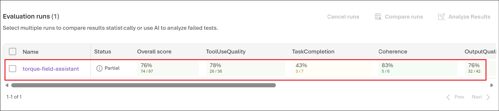

2. Review the **Overall metric results** and then the **Detailed metrics result** for each conversation, including the judge's reason for each score. Low scores often have a simple explanation: for example, if many of the evaluated conversations were short test sessions that never finished a repair, **Task completion** is low even though Torque behaved correctly. Use the reasons to separate real problems from incomplete test data.

    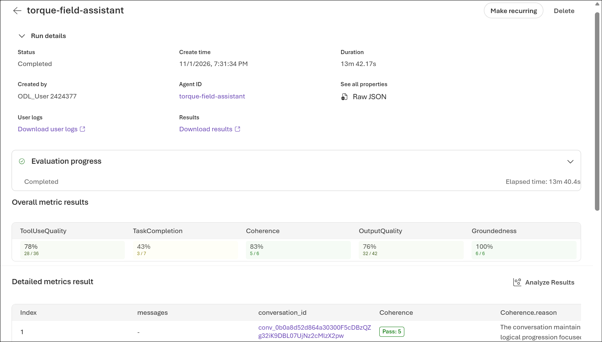

You now have a quality baseline for Torque. Rerun the same evaluation after any change to the agent, such as new instructions or a different voice setting, to check that quality hasn't dropped.

In this exercise, you prepared the project for evaluation, ran a full-conversation evaluation with an AI judge, and learned how to read the scores and reasons. Together with the monitoring data, these results give Zava the evidence it needs to decide whether Torque is ready for a wider rollout.

## Summary

In this lab, you checked whether **Torque**, Zava's hands-free voice assistant, is ready to move beyond its pilot. You:

- Read back a stored voice conversation, including its transcript, tool calls and full-call recording.

- Traced a voice conversation in Microsoft Foundry and saw how each turn breaks down into turn detection, speech-to-text, model, tool and text-to-speech steps.

- Used the monitoring dashboard to review cost, usage and latency, including the average time to first audio.

- Deployed a judge model and gave the project access to the traces in Application Insights.

- Ran a full-conversation evaluation and interpreted the scores for tool use quality, task completion, groundedness, coherence and output quality.

Stored conversations, traces, monitoring and evaluations answer different questions: what was said, why a turn was slow, how the agent performs overall, and how good its answers are. Used together, and rerun after every change, they give you the evidence to release a voice agent with confidence.
